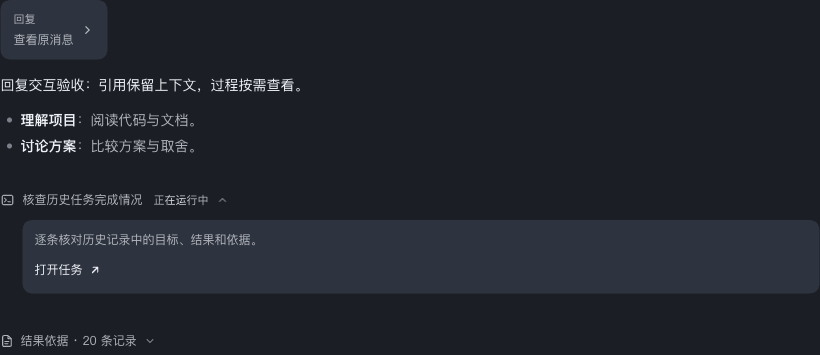
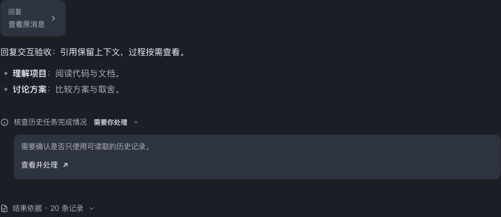
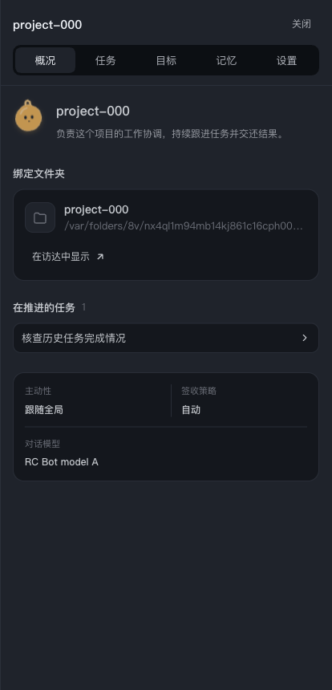
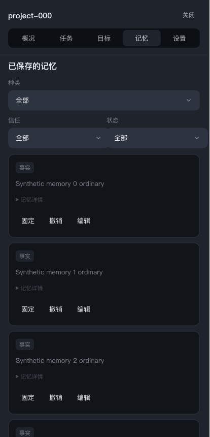
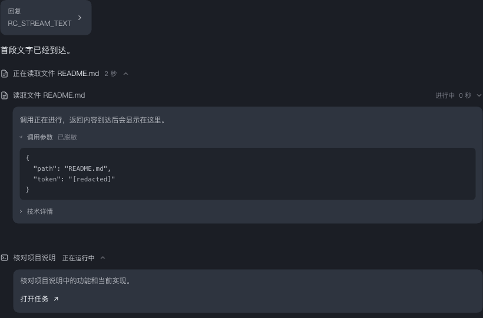
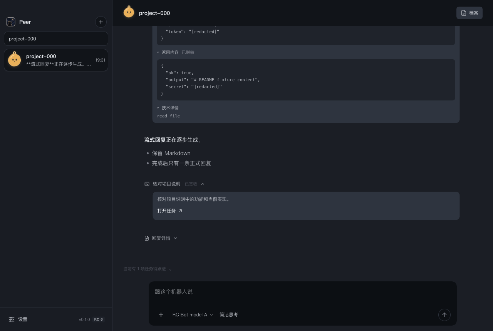
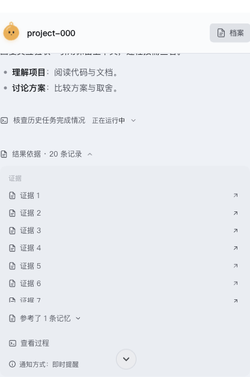

# Bot 消息与档案的信息归属

创建时间：2026-10-05
最后更新：2026-10-05
状态：负责人实测反馈后的 C 级展示修正。
依据：产品对齐的「人听结论，细节按需披露」；沿用 Peer Frost 的灰色填充与既有控件。

## 当前截图的三个问题

1. 回复底部证据、过程、任务入口和通知策略平铺，用户无法判断优先级。
2. 过程 inspect 位于全部页签上方，切到记忆也仍显示创建会话/发送回复记录。
3. 概况被过程 inspect 占据，Bot 的身份和职责退到执行日志之后。

## 实施

- 回复先呈现正文。随后是实际委派任务的紧凑状态行：任务名称、正在运行/需要确认等事实状态，可展开进度，并打开任务详情。
- 最新本机 session 快照优先于回复生成时的历史快照。只按明确来源或输入锚点关联；缺失记录说明状态暂不可用，不凭正文推测正在运行。
- 结果依据收成一个按需展开入口，内含证据与记忆；不再列出一排编号证据按钮。通知策略进入详情，不占主阅读流。
- 执行过程、证据查看有自己的标题与返回入口；概况、任务、目标、记忆、设置各自只承载所属内容。
- 概况先说明 Bot 名称、职责与绑定项目，再列实际模型/工作方式和少量正在进行的任务。不存在的自定义职责不生成假简介；使用已保存 responsibility 记忆，或明确产品默认职责。
- 记忆页先呈现记忆内容。记忆开关与来源等管理信息按需展开；保留既有治理操作，不改变存储或权限。

## 边界与验证

仅 renderer 的读取、订阅和展示投影，不新增 IPC、执行、权限、Evidence 或存储契约。验证多证据聚合、真实 session 状态切换、打开过程后返回概况/记忆、窄窗口、键盘与原有流式展开交接。

## 阅读层级

| 用户要知道的事 | 默认呈现 | 按需展开 |
| --- | --- | --- |
| 回复说了什么 | 正文与跟随消息的提问 | 原消息定位 |
| 委派工作怎么样了 | 具体任务名、最新状态 | 当前进展、打开任务 |
| 现在需要我做什么 | “需要你处理”或“待你确认” | 查看并处理 |
| 结论有什么依据 | 一个结果依据入口与记录数 | 证据列表、相关记忆、过程 |
| 这个 Bot 是谁 | 名称、职责、关联项目、实际配置 | 全部任务与设置 |
| Bot 记住了什么 | 记忆正文与必要提醒 | 来源、信任、管理开关 |

输入栏上方另有紧凑的待跟进汇总，优先列出需要用户处理的任务。摘要计数来自全部当前记录，紧凑展示最多 100 项；更多任务仍在任务页。原消息尚未载入时显示“查看原消息”，可继续定位，不直接展示内部消息 ID。

## 本机验收

验收脚本覆盖正式 Electron main / preload / renderer 和既有 IPC。认知事件和会话状态使用隔离数据夹具；展示检查不代表真实云模型时延、真实文件执行或任务结果验收。

源码追加提交：`bcd154232e86e0576a7b20aab099f7cb6a3a9c20`，阅读位置修复：`621cab19e2af67ad5386f8cfdd6b388a43d491c2`。最终窗口测试在修复提交前完成，捕获基线为 `bcd15423`；26 个追加源文件 blob 已逐项核对，与最终提交一致。源码 PR 为 [#122](https://github.com/ly-ccx/Peer-Agent/pull/122)。第一批 CI 只属于第一批提交，追加 CI 单独记录。

- desktop build、workspace typecheck、architecture:check：通过。
- desktop：5,349 项，5,344 通过、5 项既有 skip；focused 9 项通过；i18n 命名空间检查通过。
- Electron：11 项流式/工具/停止/失败/交接检查；6 项任务状态/信息归属检查；键盘、深浅主题 760px、附件/粘贴、650ms 档位保存与失败回退通过。
- 延迟原生 scroll 事件，让增量先抵达布局的确定性回归通过：上翻后的 scrollTop 为 5311.5，增量后仍为 5311.5；没有放宽原有 2px 断言。窗口 Hook 独占锚点恢复。
- 子任务的展开进展在流式预览接替为正式回复、进入下一回合后保留；状态仍使用最新本机记录。无页面异常或主进程授权错误。
- 截图与源文件 SHA-256、状态切换/回归结果见 [机器报告](../../playbook/v0.1.0/evidence/bot-work-surfaces-qa-20261005.json)。

### 子任务正在运行与需要用户处理

### Bot 概况与记忆

### 流式交接与窄窗口

## 交付状态

本机验收通过。首次追加 CI [37302055812](https://github.com/ly-ccx/Peer-Agent/actions/runs/37302055812) 的 Linux 通过，Mac 暴露阅读位置竞态；已补确定性回归并修复，新 CI [37303838740](https://github.com/ly-ccx/Peer-Agent/actions/runs/37303838740) 待完成。仍交付原开发线 PR，本次未发布新版本或替换已安装应用。
