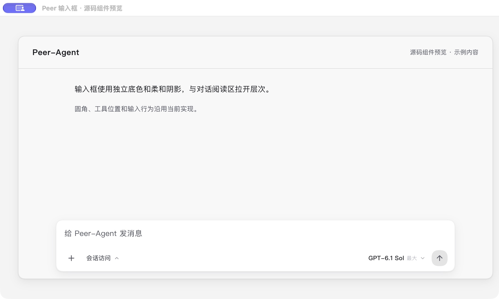

# 主 Bot 输入框悬浮卡片预览

创建时间：2026-11-02
最后更新：2026-11-02

用户目标：输入框更像轻微悬浮的独立卡片，沿用 Peer Frost 的底色、圆角和工具布局。

## 来源与自审

- 通过原生 Electron 窗口捕获，显示原工作区真实 `BotComposer`、`BotModelControls`、共享 Dropdown、Frost token 和生产 CSS；外围布局、文案、模型及访问选项为隔离预览样例。没有发送消息、调用模型或变更真实权限。
- 原工作区以 `b6e8fe88` 为已提交起点且包含其他未提交任务；完整主进程预览因缺失运行时构建文件而未启动成功。本次改用真实组件单独打包，截图不代表那些未提交任务或最终发布组合已通过验证。
- PR 将相同三处 CSS 修改单独迁移到 RC33 开发线 `429fa64d`。没有重新捕获该分支的完整产品截图。
- 实现者逐图自审：白色输入表面与灰色阅读面可区分，输入框四周的柔和阴影完整可见，文字、添加附件、示例访问/模型入口及禁用发送按钮未被裁切。静态图中圆角、输入区与工具区对齐正常。

## 状态、控制与恢复

本图只覆盖浅色默认/禁用发送的静态表达；焦点、拖入、生成、停止、附件、失败和恢复未在本图验证。代码沿用原状态、受控输入、IME、kernel/store、焦点和阅读位置责任，不新增权限或执行事实。

按仓库 Validation Scope，未运行单元/集成、生产 build/type/架构/IPC 或完整产品回归。深色与注册主题、窄窗、键盘/IME、减少动效/强制颜色、辅助技术、真实模型和安装版覆盖留待发布。自审不是独立验收，截图也不是发布候选通过凭证。
