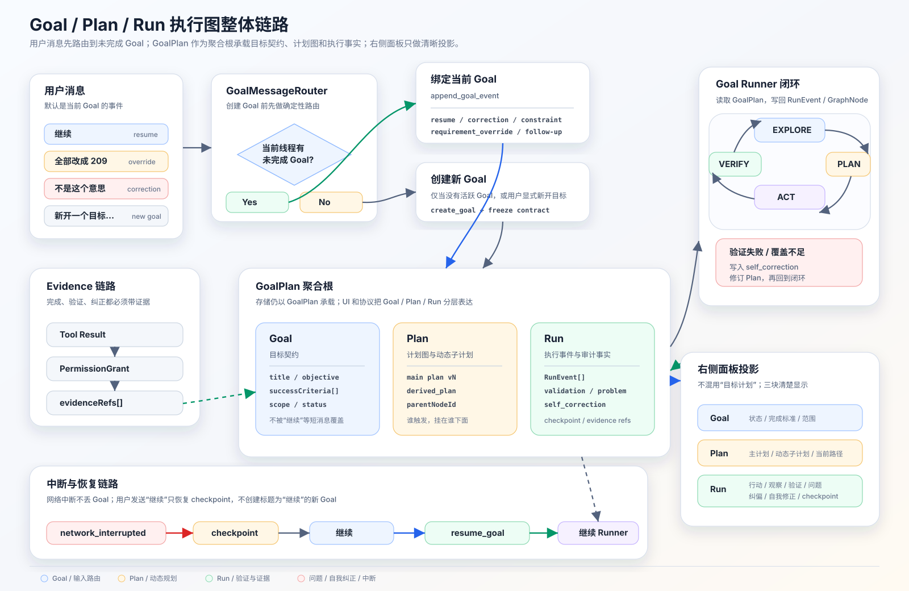

# Goal / Plan / Run 执行图技术设计

> 创建时间：2026-07-06
> 最后更新：2026-08-15
> 状态：设计草案（目标线投影、分组展示与追问派生路由已落地，见 §13）
> 关联代码：`peer_agent`
> 关联文档：
> - `design/product/goal-mode-ultrathink-workflow.md`
> - `design/product/goal-runner-explorer-task-list.md`
> - `knowledge/specifications/15-goal-plan-lifecycle-governance.md`
> - `knowledge/decisions/21-pending-task-resume.md`
> - `knowledge/decisions/22-stream-reattach-on-reload.md`
> - `knowledge/decisions/41-rename-goal-mode-to-plan-mode.md`

---



---

## 一、背景

当前 Goal / Plan 面板仍把「目标」「计划」「执行过程」混在一起表达。用户在网络中断后发送「继续」，右侧会出现一个标题为「继续」的新目标/计划卡片；用户发送纠偏消息时，也容易被系统解释成新的目标，而不是对当前未完成目标的修正。

这暴露出三个问题：

1. **消息路由错误**：有未完成 Goal 时，用户新消息应默认绑定到当前 Goal，作为继续、纠偏、约束、确认或暂停事件，而不是默认创建新目标。
2. **概念表达混乱**：右侧把 Goal 与 Plan 放在同一张卡片里，用户分不清「要达成什么」和「准备怎么做」。
3. **执行过程不可观测**：用户看不到经历了哪些步骤、发生了多少验证、哪些问题触发了自我纠正、网络中断后从哪里恢复。

本文设计目标是把 Goal 运行实例表达成一张可恢复、可纠偏、可审计的执行图。UI 可以像思维导图一样阅读，但底层必须是 typed graph / event log，而不是无类型的自由文本脑图。

---

## 二、设计原则

### 2.1 Goal 是持久任务对象，Message 是事件

在当前线程存在未完成 Goal 时，用户消息的默认语义不是「创建新目标」，而是「作用于当前 Goal 的控制事件」。

常见事件映射：

| 用户消息 | 事件类型 | 处理 |
| --- | --- | --- |
| `继续` / `继续执行` | `resume` | 从最近 checkpoint 恢复当前 Goal |
| `不是这个意思` / `你走偏了` | `user_correction` | 追加纠偏节点，触发计划修订 |
| `全部改成 209` | `requirement_override` | 追加需求覆盖节点，影响后续 Plan |
| `先别动代码` | `constraint` | 追加约束节点，Runner 进入受限执行 |
| `暂停` | `pause` | 暂停当前 Goal |
| `新开一个目标...` | `new_goal_explicit` | 创建新 Goal |

只有用户明确表达「新开目标 / 另起任务 / 切换目标」时，才允许创建新的 Goal。

### 2.2 Goal / Plan / Run 必须分层

右侧面板的信息架构拆成三层：

```text
Goal   = 要达成什么，完成标准是什么
Plan   = 准备怎么做，可动态修订，可挂子计划
Run    = 实际发生了什么，包括验证、问题、纠偏、自我修正、恢复点
```

产品上不再使用「目标计划」作为单一概念。目标是目标，计划是计划，执行记录是执行记录。

### 2.3 展示自我纠正，不展示原始思维链

允许展示结构化自检事件：

- 原先假设是什么；
- 发现了什么不一致；
- 使用了什么证据；
- 修正了哪一步；
- 影响了哪些节点；
- 是否重新验证通过。

禁止把模型的原始长篇思考过程直接暴露为执行流。执行图记录的是可审计事实，不是脑内独白。

### 2.4 兼容现有 `GoalPlan + runner` 聚合根

既有总体设计已决定不新增独立 `GoalSession` / `GoalRun` 表，当前 conversation 下仍活跃的最新 `GoalPlan` 即 active goal。

本文不推翻该决策。技术落点是：继续以 `GoalPlan` 作为聚合根，在其中新增或伴随持久化 `goalContract`、`planGraph`、`runTrace` 等结构。UI 上拆成 Goal / Plan / Run，存储上仍可由同一 `GoalPlan` 承载。

---

## 三、核心数据模型

### 3.1 逻辑对象

```ts
export interface GoalContract {
  readonly title: string;
  readonly objective: string;
  readonly successCriteria: SuccessCriterion[];
  readonly inScope: string[];
  readonly outOfScope: string[];
  readonly createdAt: string;
  readonly frozenAt?: string;
}
```

`GoalContract` 用于表达 Goal，不参与执行步骤计数。后续用户纠偏可以追加事件并触发 contract amendment，但不能把短消息直接覆盖成 `title`。

```ts
export interface GoalPlanGraph {
  readonly activePlanId: string;
  readonly plans: GoalPlanRevision[];
  readonly nodes: GoalGraphNode[];
}
```

`GoalPlanGraph` 表达主计划、动态子计划与步骤树。

```ts
export interface GoalRunTrace {
  readonly activeNodeId?: string;
  readonly lastCheckpointNodeId?: string;
  readonly events: GoalRunEvent[];
}
```

`GoalRunTrace` 是追加式事件日志，表达实际执行过程。

### 3.2 Plan 修订

```ts
export interface GoalPlanRevision {
  readonly id: string;
  readonly goalPlanId: string;
  readonly parentNodeId?: string;
  readonly sourceEventId?: string;
  readonly title: string;
  readonly version: number;
  readonly status: 'active' | 'superseded' | 'completed' | 'cancelled';
  readonly createdBy: 'agent' | 'user' | 'system';
  readonly createdAt: string;
}
```

动态规划出来的 plan 不创建新 Goal，而是作为 `GoalPlanRevision` 挂在触发它的节点下面。

示例：

```text
Goal: 网关开关与 AK 退场
└─ Step 2 修改 AK 选择逻辑
   ├─ 发现：存在 agent binding 分支
   └─ 动态子计划：处理 agent binding 分支
      ├─ 2.1 判断是否属于 pooling
      ├─ 2.2 确认是否覆盖
      ├─ 2.3 修改返回逻辑
      └─ 2.4 验证调用链
```

### 3.3 执行图节点

```ts
export type GoalGraphNodeType =
  | 'requirement'
  | 'plan_step'
  | 'derived_plan'
  | 'action'
  | 'observation'
  | 'validation'
  | 'problem'
  | 'decision'
  | 'user_correction'
  | 'self_correction'
  | 'checkpoint';

export interface GoalGraphNode {
  readonly id: string;
  readonly goalPlanId: string;
  readonly planId?: string;
  readonly parentNodeId?: string;
  readonly type: GoalGraphNodeType;
  readonly title: string;
  readonly summary?: string;
  readonly status: 'pending' | 'running' | 'passed' | 'failed' | 'completed' | 'superseded';
  readonly evidenceRefs: string[];
  readonly createdAt: string;
  readonly updatedAt: string;
}
```

`GoalGraphNode` 用于右侧树状 / 脑图式展示。它可以由 `GoalRunEvent` 派生，也可以在计划生成时直接写入。

### 3.4 执行事件

```ts
export type GoalRunEventType =
  | 'message_routed'
  | 'goal_created'
  | 'plan_created'
  | 'plan_revised'
  | 'step_started'
  | 'step_completed'
  | 'action_started'
  | 'action_completed'
  | 'observation_recorded'
  | 'validation_started'
  | 'validation_passed'
  | 'validation_failed'
  | 'problem_found'
  | 'user_correction'
  | 'self_correction'
  | 'checkpoint_created'
  | 'network_interrupted'
  | 'goal_resumed'
  | 'goal_paused'
  | 'goal_completed';

export interface GoalRunEvent {
  readonly id: string;
  readonly goalPlanId: string;
  readonly nodeId?: string;
  readonly parentNodeId?: string;
  readonly type: GoalRunEventType;
  readonly summary: string;
  readonly payload?: Record<string, unknown>;
  readonly evidenceRefs: string[];
  readonly createdAt: string;
}
```

事件日志是事实源，执行图是面向 UI 的投影。第一版可以直接持久化节点和事件；后续如体积增长，可把事件移到 sidecar 文件，但仍由 `GoalPlan` 索引。

### 3.5 自我纠正事件

```ts
export interface SelfCorrectionPayload {
  readonly trigger:
    | 'validation_failed'
    | 'missing_coverage'
    | 'inconsistency_found'
    | 'better_plan_found';
  readonly previousAssumption?: string;
  readonly issue: string;
  readonly correction: string;
  readonly affectedNodeIds: string[];
}
```

示例展示：

```text
自检发现：原计划只覆盖主路径
修正动作：补充调用侧检查
影响步骤：Step 2, Step 3
证据：getApiKey 调用链
```

---

## 四、消息路由

### 4.1 路由入口

新增 `GoalMessageRouter`，在创建 Goal / Plan 前先解析用户消息与当前线程状态。

```ts
export function routeGoalMessage(input: {
  threadId: string;
  conversationId: string;
  messageText: string;
  activeGoalPlan?: GoalPlan;
}): GoalMessageRoute {
  const active = input.activeGoalPlan;

  if (!active) {
    return { type: 'create_goal', objective: input.messageText };
  }

  const intent = classifyGoalMessage(input.messageText, active);

  if (intent.type === 'new_goal_explicit') {
    return { type: 'create_goal', objective: input.messageText };
  }

  return {
    type: 'append_goal_event',
    goalPlanId: active.id,
    eventType: intent.eventType,
    messageText: input.messageText,
  };
}
```

### 4.2 意图优先级

```text
1. 显式新目标
2. 暂停 / 终止
3. 恢复 / 继续
4. 用户纠偏
5. 约束补充
6. 需求覆盖
7. 普通 follow-up
```

在存在未完成 Goal 时，默认落到 `append_goal_event`，而不是 `create_goal`。

### 4.3 多活跃 Goal

理想状态下同一 conversation 只有一个活跃 Goal。若历史数据或异常状态导致多个未完成 Goal：

1. 优先选择 `runner.status in running/interrupted/blocked/paused` 且最近更新的 Goal；
2. 若无法确定，UI 弹出选择，不静默创建新 Goal；
3. 所有选择结果写入 `message_routed` 事件。

---

## 五、右侧面板信息架构

### 5.1 顶层分区

```text
[Goal]
标题：网关开关与 AK 退场
状态：Interrupted
完成标准：pooling 下线 / AK 209 / 保留特例

[Plan]
主计划 v3  5/7
  ✓ 定位 AK 选择逻辑
  ✓ 修改主路径
  → 处理 agent binding 分支
      动态子计划：确认是否保留绑定逻辑 1/4

[Run]
18:31 用户纠偏：全部改成 209
18:32 自检：发现 agent binding 分支未覆盖
18:33 checkpoint：等待确认
18:35 用户：继续
```

### 5.2 Goal 区

Goal 区只展示目标契约：

- title；
- objective；
- successCriteria；
- status；
- scope；
- 当前恢复点。

禁止把最新用户短消息覆盖为 Goal title。

### 5.3 Plan 区

Plan 区展示当前主计划和动态子计划：

- active plan version；
- plan steps；
- derived plan；
- superseded plan 可折叠查看；
- 当前执行路径。

当前路径示例：

```text
Goal > Step 2 修改 AK 选择逻辑 > 动态计划：处理 agent binding 分支 > 2.2 确认是否保留
```

### 5.4 Run 区

Run 区展示执行事实：

- action；
- observation；
- validation；
- problem；
- user correction；
- self correction；
- checkpoint；
- network interruption / resume。

Run 默认按时间线显示，支持切到树状图。树状图由 `parentNodeId` 表达因果关系，时间线由 `createdAt` 排序。

---

## 六、中断与恢复

### 6.1 网络中断

网络中断或 stream reattach 失败时，写入事件：

```ts
appendRunEvent({
  type: 'network_interrupted',
  nodeId: runTrace.activeNodeId,
  summary: '网络中断，等待恢复',
});

appendRunEvent({
  type: 'checkpoint_created',
  nodeId: runTrace.activeNodeId,
  summary: '恢复点：正在验证 agent binding 分支',
});
```

同时更新：

```ts
runTrace.lastCheckpointNodeId = runTrace.activeNodeId;
runner.status = 'paused' | 'blocked';
```

### 6.2 用户发送「继续」

用户发送「继续」时：

1. `GoalMessageRouter` 命中 `resume`；
2. 不创建新 Goal；
3. 追加 `goal_resumed` 事件；
4. Runner 从 `lastCheckpointNodeId` 恢复；
5. UI 明确提示恢复来源。

示例 UI：

```text
继续未完成目标：网关开关与 AK 退场
从 Step 5 恢复：补齐 AK 退场逻辑
上次中断前的问题：agent binding 分支未确认
```

---

## 七、动态 Plan 挂接规则

当模型在某个节点动态规划出一个 plan 时：

1. `parentNodeId` 指向触发该计划的节点；
2. `sourceEventId` 指向触发计划的 observation / problem / validation_failed 事件；
3. 新计划作为 `derived_plan` 节点显示在父节点下；
4. 子步骤作为该 derived plan 的 children；
5. 验证和自我纠正回写到该 derived plan 或其具体步骤。

```ts
createPlanRevision({
  goalPlanId,
  parentNodeId: currentNode.id,
  sourceEventId: problemEvent.id,
  title: '处理 agent binding 分支',
  createdBy: 'agent',
});
```

原则：谁触发了计划，计划就挂在谁下面；谁拥有这个计划，验证和修正也回写到谁下面。

---

## 八、代码落点

> 本知识库不落代码。以下为 `peer_agent` 仓建议落点。

| 文件 | 改动 |
| --- | --- |
| `packages/protocol/src/goal.ts` | 新增 `GoalContract`、`GoalPlanGraph`、`GoalGraphNode`、`GoalRunTrace`、`GoalRunEvent` 类型 |
| `apps/desktop/electron/main/goal-plan-store.mjs` | 归一化旧数据；新增 append run event / upsert graph node / create plan revision |
| `apps/desktop/electron/main/goal-message-router.mjs` | 新增消息路由与 intent classifier |
| `apps/desktop/electron/main/goal-runner.mjs` | 每个执行阶段写入 `GoalRunEvent`；checkpoint/resume 绑定 `lastCheckpointNodeId` |
| `apps/desktop/electron/main/prompt/sources/goal-runner-source.mjs` | 注入当前 Goal / Plan / Run 摘要，要求模型回写结构化事件 |
| `apps/desktop/electron/main/runtime-gateway/local-goal-provider.mjs` | 扩展 goal 工具：读取执行图、追加事件、创建 derived plan |
| `apps/desktop/electron/main/tools/goal-tool-definitions.mjs` | 暴露新工具 manifest |
| `apps/desktop/renderer/src/.../GoalPlanPanel.tsx` | 拆成 GoalSection / PlanSection / RunTraceSection |
| `apps/desktop/renderer/src/.../GoalExecutionGraph.tsx` | 新增执行图/时间线渲染组件 |

---

## 九、实施切片

### Slice 1：协议与 Store

- 新增协议类型；
- 旧 `GoalPlan` 归一化；
- 新增 `appendRunEvent`；
- 新增 `createPlanRevision`；
- 新增 `lastCheckpointNodeId`；
- 单测覆盖旧数据兼容、事件追加、动态子计划挂接。

### Slice 2：消息路由

- 新增 `GoalMessageRouter`；
- 有未完成 Goal 时，短消息默认绑定当前 Goal；
- `继续` 命中 resume；
- `不是这个意思` 命中 user correction；
- 显式新目标才创建新 Goal；
- 单测覆盖网络中断后继续不新建 Goal。

### Slice 3：右侧 UI 分区

- 面板文案从「目标计划」拆为 Goal / Plan / Run；
- Goal 标题锁定；
- Plan 显示主计划与动态子计划；
- Run 显示事件时间线；
- 旧数据无 run trace 时显示 legacy plan 摘要。

### Slice 4：Runner 事件写入

- step start / complete 写入事件；
- validation pass / fail 写入事件与 evidence；
- problem / self correction 写入事件；
- checkpoint 写入事件；
- resume 从 checkpoint 恢复。

### Slice 5：执行图增强

- 增加树状执行图；
- 支持当前路径；
- 支持 affected nodes 跳转；
- 支持 validation / evidence 展开。

---

## 十、验证策略

### 10.1 单元测试

- `goal-message-router.test.mjs`
  - 未完成 Goal + `继续` => `append_goal_event(resume)`；
  - 未完成 Goal + `全部改成 209` => `requirement_override`；
  - 未完成 Goal + `新开一个目标` => `create_goal`；
  - 多活跃 Goal => 返回需要 disambiguation。

- `goal-plan-store.test.mjs`
  - 旧 plan 缺少 `runTrace` 可读取；
  - `appendRunEvent` 追加事件不破坏 progress；
  - `createPlanRevision(parentNodeId)` 正确挂接动态子计划；
  - checkpoint 写入与恢复点读取。

- `goal-runner.test.mjs`
  - validation failed 触发 self correction event；
  - network interruption 生成 checkpoint；
  - resume 不创建新 plan；
  - derived plan 的验证结果回写到 parent path。

### 10.2 UI 测试

- 右侧面板同时显示 Goal / Plan / Run 三块；
- Goal 标题不会被「继续」覆盖；
- 动态子计划出现在触发节点下；
- self correction 只显示结构化摘要，不显示原始思维链；
- legacy plan 能降级展示。

### 10.3 端到端验收场景

1. 用户创建 Goal：「网关开关与 AK 退场」；
2. Runner 执行到 Step 2，发现 agent binding 分支；
3. Runner 动态创建「处理 agent binding 分支」子计划；
4. 网络中断，写入 checkpoint；
5. 用户发送「继续」；
6. 系统恢复原 Goal，不创建标题为「继续」的新 Goal；
7. 用户发送「全部改成 209」；
8. 系统写入 user correction / requirement override，并修订当前 Plan；
9. 验证失败触发 self correction；
10. 右侧 Run Trace 可看到问题、修正、验证和恢复点。

---

## 十一、风险与取舍

### 11.1 事件体积增长

长任务会产生大量事件。第一版可限制 UI 默认只展开最近 N 条，Store 保留完整事件。后续若体积明显影响性能，再将 `runTrace.events` 外置为 sidecar 文件，由 `GoalPlan` 保存索引。

### 11.2 计划与执行图重复

Plan step 与 Run action 会有重叠。规则是：

- Plan 表示预计路径；
- Run 表示实际事实；
- 同一个节点可以同时有 `plan_step` 与后续 `action/validation` 子节点；
- progress 以 Plan leaf 为主，审计以 Run event 为主。

### 11.3 自我纠正展示边界

展示结构化 correction，不展示原始推理链。所有 self correction 必须有 trigger、issue、correction、affected nodes，尽量带 evidence refs。

### 11.4 兼容既有 `GoalPlan.tasks`

第一版不删除 `tasks`。可以把 `tasks` 视为 Plan leaf 的兼容投影：

- 旧 UI/工具继续读 `tasks`；
- 新 UI 优先读 `planGraph.nodes`；
- Store 写入时同步维护 leaf task progress；
- 稳定后再评估是否收敛模型。

---

## 十二、成功标准

- 未完成 Goal 下，用户发送「继续」不会创建新 Goal；
- 用户纠偏消息默认绑定当前 Goal，并在 Run Trace 中可见；
- 右侧能清楚区分 Goal / Plan / Run；
- 动态 plan 挂在触发节点下，而不是变成顶层新目标；
- validation failure 和 self correction 可审计；
- 网络中断后可看到 checkpoint，并从 checkpoint 恢复；
- 旧 `GoalPlan` 数据可正常读取和降级展示。

---

## 十三、落地记录：目标线（Goal Thread）投影与分组展示（2026-08-14）

### 13.1 已落地范围（P1 + P2）

针对「验收后追问产生的新 plan 平铺、关系不可见」的问题（交互原型见
`design/product/goal-thread-acceptance-demo.html`），本次在 `peer_agent` 落地了投影与展示两层：

| 层 | 文件 | 改动 |
| --- | --- | --- |
| 协议 | `packages/protocol/src/task-overview.ts` | `GoalPlanProjectionSnapshot` / `TaskOverviewItem` 新增可选关系字段：`rootPlanId` / `parentPlanId` / `relationType`('derived') / `depth` / `round` / `rootPlanTitle`；`projectGoalPlan` 条件透传（缺事实不携带键） |
| 聚合 | `apps/desktop/electron/main/task-overview-aggregator.mjs` | 新增 `buildGoalThreadRelationIndex`：优先读 store 水合的关系字段，`sourceTaskId` 链兜底；解析线根、轮次（同根按 createdAt 排序）、根标题；孤立计划不参与线。`toGoalPlanSnapshot` 接收索引并透传 |
| UI | `apps/desktop/renderer/src/app/pages/TaskOverviewPage.tsx` | 结果待验收区 `groupResultCardsByGoalThread`：同 `rootPlanId` ≥2 张归组为一条线（线头标题 + N 轮 + 竖向轮次列表），卡片标题挂 `R2` 轮次徽标与「↳ 追问派生」文字徽标；单张线归属卡与旧数据仍平铺（向后兼容）。卡内压缩树按父子分组，但线性追问不按 `depth` 写 inline 缩进 |
| 样式 | `apps/desktop/renderer/src/styles/task-overview.css` | `.goal-thread-group` / `.goal-thread-badge` / `.thread-tree-row.is-child`，全部走 `--za-*` token；子行共用一条左边距/脊线，不按层级叠台阶 |

关键设计决策：

- **根自身也投影 `rootPlanId`（等于自身 planId）**：根待验收时必须与派生轮同组渲染；
  但只有「有父或有子」的计划才携带线字段，独立目标不会被判成「自成一线」。
- **轮次（round）是派生量**：同根下按 createdAt 升序的序号，不在 store 持久化，
  避免与 store 状态机耦合；根永远是 R1。
- **`rootPlanTitle` 跟随投影**：根卡片被验收移出列表后，分组头仍能显示根目标标题。

验证：protocol 48/48 测试 + build 绿；聚合器 55/55（含 2 条目标线专项测试：
显式 parentPlanId、sourceTaskId 兜底链、旧数据缺键降级）；桌面端 tsc 对本次改动 0 错误；
验收过渡 UI 测试 12/12。

### 13.2 P0 追问派生路由（2026-08-14 已落地）

验收后追问不再默认新建顶层 plan。模型侧、执行器、上下文三处一起接上：

| 层 | 文件 | 改动 |
| --- | --- | --- |
| 工具 schema / prompt | `apps/desktop/electron/main/tools/goal-tool-definitions.mjs` | `goal_create_plan` 新增可选 `parentPlanId` + `sourceTaskId`（必须成对）。prompt 规定：同主题追问带父计划；明确新需求才省略。`sourceTaskId` 必须是父 plan 上真实存在的 taskId，不能拿 planId 顶替（store 校验） |
| 执行器 | `apps/desktop/electron/main/runtime-gateway/local-goal-provider.mjs` | 把两参数透传进 `createPlan` / `upsertGoalContract` draft；store 写入 `rootPlanId` / `relationType=derived` / `depth`。模型漏填时，`resolveDerivedPlanRelation` 按同会话最近完成计划自动补挂：显式传参优先；标题/目标像「新需求 / unrelated new request」时不挂 |
| 上下文兜底 | `packages/system-context/src/sources/goal-plan-source.mjs` | 活动计划被过滤后，注入同会话最近一条 completed plan 的 `planId` / `title` / `completedAt` / `sourceTaskId`，模型可据此填参。无活动计划时仍渲染该摘要 |

验证：goal-plan-source + local-goal-provider 26/26（含漏填自动挂、显式传参优先、明确新需求不挂）；聚合器 56/56。
旧数据缺关系字段时首页仍平铺，无迁移成本。
明确的新需求仍可不带两参数，新建顶层目标线。执行器不会在这种文案上强行补挂。

### 13.3 顺带修复的接口漂移

`TaskOverviewItem` 此前漏声明 `qualityReviewStatus` / `qualityChecks`（实现与测试已在用），
随本次接口改动一并补齐。另注意 HEAD 上存在两处与本设计无关的既有类型漂移
（`goal.test.ts` 的 `successCriteria` 可选性、`GoalPlanPanel.tsx` 的 `quality_review` phase），
未越界修复，留待对应负责人处理。
