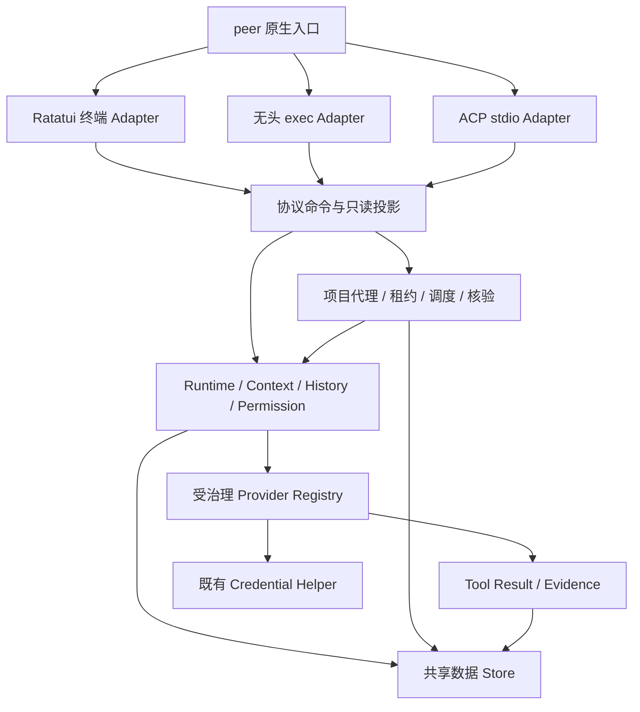

# Peer 原生 Rust CLI / Ratatui 全面迁移方案

创建时间：2026-11-14
最后更新：2026-11-14
状态：Accepted / 实施中（2026-11-14 用户接受方案及三份 ADR，先完成 P0/P1、自测后持续推进；未安装或发布）
级别：A
产品依据：[Peer 产品理念与价值对齐](peer-product-alignment.md)
决策入口：[ADR 129](../../knowledge/decisions/129-native-rust-cli-and-ratatui.md)、[ADR 130](../../knowledge/decisions/130-bounded-cli-memory-and-transcript.md)、[ADR 131](../../knowledge/decisions/131-native-cli-contract-storage-and-recovery.md)

## 1. 推荐结论与交付终态

把 CLI 的完整执行栈迁到 Rust，Ratatui 负责终端表达；以有界资源、契约一致性和旧任务恢复共同作为切换标准。终态不保留 Bun / React / OpenTUI，也不以长期 JavaScript Runtime sidecar 承载真正执行。

本次“全面”覆盖 `peer` 的交互、无头、ACP、模型请求、工具链、项目代理和本地状态；Desktop UI / Gateway / 公开 TypeScript SDK 继续作为现有产品面维护。npm 安装器可以保持薄 JavaScript 包装，直接下载的 CLI 无需 Node / Bun / Desktop。用户自行配置的 Node / Python MCP 或 Hook 是外部能力，不算内置执行栈，但其进程树资源必须呈现和治理。

迁移不改变产品北极星：用户把目标交给本机代理，代理持续推进、验证结果，只在关键节点要求人决定。不能交付一个“低内存聊天 demo”替代现有任务委托系统。

## 2. ADR pass 与证据身份

### 2.1 本次核对的源身份

| 对象 | 身份与限制 |
|---|---|
| Peer-Agent 源码 | `f00c955359a24b3e28afcbc947d862fd074376f7`，分支 `PeerAgent/tui-bot-composer`；审计开始时工作树干净 |
| Peer-Knowledge | `106985b923e7e153cb356e481c67ef31e84ca14c`；已有 `104-bot-capability-visibility.md`、`playbook/product-regression.md` 未提交修改，本次未改这些文件 |
| 用户截图 | `peer` 8.27 GB、`bun` 1.00 GB 的观察；没有安装包 hash、会话身份、过程曲线和父子进程证据 |
| 现有性能材料 | `apps/tui/perf/tui-performance-report.md`、架构 `tui-rendering-performance-optimization.md`；局部时间基准不能替代本次内存复现 |

本轮没有读取个人会话或凭据，没有对用户运行中的进程采样 / 重启，没有复现 8.27 GB。后续基线必须记录实际二进制身份，不能假定截图来自当前 checkout。

### 2.2 已读 ADR 及相关条款

当前 checkout 原无 `knowledge/decisions/00-adr-map.md`，已按主题检索并补建[专题索引](../../knowledge/decisions/00-adr-map.md)。以下为本次阅读的决策入口 / 相关章节，不代表逐条重新验收其历次 release 记录：

| 文件 | 对迁移的约束 |
|---|---|
| [0001-cross-platform-credential-vault.md](../../knowledge/decisions/0001-cross-platform-credential-vault.md) | Helper / Vault、凭证失败关闭 |
| [15-plugin-skill-mcp-system.md](../../knowledge/decisions/15-plugin-skill-mcp-system.md)、[16-skill-call-lifecycle.md](../../knowledge/decisions/16-skill-call-lifecycle.md) | 扩展能力主链；15 是设计草案，不能把草案整体当 Accepted |
| [35-mode-scoped-tool-projection.md](../../knowledge/decisions/35-mode-scoped-tool-projection.md)、[37-provider-channel-and-wire-protocol-separation.md](../../knowledge/decisions/37-provider-channel-and-wire-protocol-separation.md) | 模式在 Projection 强制；Provider channel 与 wire 分离 |
| [48-cli-first-class-release.md](../../knowledge/decisions/48-cli-first-class-release.md)、[54-open-runtime-public-packages-and-release-policy.md](../../knowledge/decisions/54-open-runtime-public-packages-and-release-policy.md) | 同仓、一等 CLI、独立安装、公开 SDK 与统一版本 |
| [49-cancel-path-hard-sandbox.md](../../knowledge/decisions/49-cancel-path-hard-sandbox.md)、[92-scoped-permission-inheritance.md](../../knowledge/decisions/92-scoped-permission-inheritance.md)、[101-bot-owned-access-policy.md](../../knowledge/decisions/101-bot-owned-access-policy.md) | 不恢复路径硬沙箱；具体操作许可、主体继承、动态降权与 CAS |
| [55-shared-system-context-assembler.md](../../knowledge/decisions/55-shared-system-context-assembler.md)、[57-canonical-conversation-history-projector.md](../../knowledge/decisions/57-canonical-conversation-history-projector.md) | 统一 Context Source 与 canonical history；跨语言后直接共享 TS 实现要求需显式修订 |
| [65-cli-headless-exec.md](../../knowledge/decisions/65-cli-headless-exec.md)、[76-peer-acp-agent.md](../../knowledge/decisions/76-peer-acp-agent.md) | TTY / 非 TTY、stdout / stderr、权限、会话隔离、ACP 能力声明 |
| [74-deployment-surfaces-and-local-storage.md](../../knowledge/decisions/74-deployment-surfaces-and-local-storage.md)、[86-batched-persisted-conversation-reads.md](../../knowledge/decisions/86-batched-persisted-conversation-reads.md) | 同一数据根、混合存储；展示批读不是执行授权 |
| [80-project-agent-delegation-model.md](../../knowledge/decisions/80-project-agent-delegation-model.md)、[81-project-agent-memory-system.md](../../knowledge/decisions/81-project-agent-memory-system.md)、[82-project-objectives-and-watches.md](../../knowledge/decisions/82-project-objectives-and-watches.md) | Bot 委托、事实记忆、持续目标 / Watch |
| [83-model-routing-by-role.md](../../knowledge/decisions/83-model-routing-by-role.md)、[84-bot-list-shell.md](../../knowledge/decisions/84-bot-list-shell.md)、[85-project-agent-hosts-inputs-and-surfaces.md](../../knowledge/decisions/85-project-agent-hosts-inputs-and-surfaces.md) | 用户模型选择、双壳、租约、持久输入与 stale approval |
| [88-project-agent-execution-continuity.md](../../knowledge/decisions/88-project-agent-execution-continuity.md)、[98-large-history-execution-responsiveness.md](../../knowledge/decisions/98-large-history-execution-responsiveness.md) | 恢复与交付、当前事实、按需读取、有界缓存及规模验证 |
| [100-actionable-attention-and-question-lifecycle.md](../../knowledge/decisions/100-actionable-attention-and-question-lifecycle.md)、[103-verification-settlement-and-progress.md](../../knowledge/decisions/103-verification-settlement-and-progress.md) | 问题与决策生命周期、真实核验进度、结算与 repair ownership |
| [104-bot-capability-visibility.md](../../knowledge/decisions/104-bot-capability-visibility.md)、[115-input-prediction-and-draft-boundary.md](../../knowledge/decisions/115-input-prediction-and-draft-boundary.md) | 本 checkout 为 Proposed；迁移不暗中采纳或实施 |

同时阅读治理 00 / 01 / 19 / 20 / 22、产品北极星、0.1.0 release plan 与执行手册 / 卡片入口、现有 TUI 与 Hook 标准、motion 规范。旧总览对 TUI Provider / Desktop 直接导入的部分描述已过时，以本次代码扫描为事实，不复制历史结论。

用户给定 AGENTS 引用的 `peer-product-experience-standard.md`、`peer-human-agent-interaction-contract.md`、`transition-system.md`、`model-picker.md` 及 `playbook/product-experience-development.md` 在当前知识 checkout 未找到。方案按用户给定的六不变量规划，不伪造缺失文档内容；进入产品 UI 实施前应取回相应正式版本并完成规范 / 矩阵核对，不以旧 motion 文档替代最新标准。

### 2.3 边界判定

本次拟移动的是 CLI 技术实现、跨语言协议与共享内核的实现方式，以及历史读取 / 资源准入 Interface，因此属于 A 级。能力主链、权限政策、Evidence 真源、System Context 分层、用户数据归属不改变。ADR 129 §3 列明拟局部取代的旧条款；129–131 目前均为 Proposed，不能据此声称旧边界已经生效变更。

## 3. 当前系统真正需要搬迁什么

### 3.1 规模与事实

按该 commit 下 `.ts` / `.tsx` / `.mjs` 文件静态统计、排除 `.test.*`：

| 范围 | 非测试文件 / 行数 | 解读 |
|---|---:|---|
| `apps/tui/src` | 121 / 25,278；另有 101 个测试文件 | 已有完整 CLI，不是少量组件替换 |
| `packages/runtime-node/src` | 370 / 65,942 | 多宿主能力与项目代理；只迁 CLI 可达功能，不能全包机械翻译 |
| `protocol` / `runtime-core` / `runtime-sdk` | 61 / 11,493；29 / 7,147；10 / 1,612 | 契约与核心算法需跨语言等价 |
| `system-context` / `conversation-store` | 45 / 4,454；17 / 4,006 | 内容准入、持久化与恢复不能遗漏 |

这些不是 Rust 工作量的直接换算。P0 应生成 CLI 实际可达模块 / 依赖 / 持久化清单；当前 TUI 源文件字符串扫描没有发现直接 `desktop/…` import，`desktop-provider-adapters.ts` 的当前实现复用的是 runtime-node，不能沿用旧总览“仍大量直接导入 Desktop Main”的说法。

### 3.2 真实入口与数据流

```text
index.tsx
  ├─ acp → acp/stdio → 会话 adapter → 原 CLI Runtime
  ├─ exec → cli-exec / cli-exec-bot / cli-exec-goal → Runtime / 项目输入
  ├─ version/help/models/doctor/update/sessions/export/result/completions
  └─ interactive-entry.tsx
       ├─ --classic → tui-runtime → chat-controller → Runtime Pipeline
       └─ 默认 Bot → tui-project-host + tui-project-client
                    → InputQueue / Lease / Scheduler / Supervisor
                    → tui-turn-executor → Runtime Pipeline

模型：model-config / model-selection → provider-wire-matrix
      → Provider encoder / transport / SSE → 结构化模型输出
工具：Manifest → Runtime Projection → Tool Call → PermissionGrant
      → Provider → ToolResult + Evidence
上下文：Context Sources + canonical history + compaction → 下一模型请求
存储：Conversation / sidecar / revisions + plans / inputs / approvals
      + bot-access.sqlite / memory / artifacts
展示：结构化只读投影 → classic / Bot 终端界面
```

关键事实所有者：Runtime 管回合和取消；Host / policy authority 管当前授权；Provider 管工具实际结果；Store 管已持久事实；Supervisor / lease 管项目执行所有权；UI 只管草稿、焦点、阅读与命令意图。安全审查沿这些 seam，不以“分了几个 crate”证明边界成立。

### 3.3 本次内存问题的已知与未知

| 观察 | 能得出的结论 | 不能得出的结论 |
|---|---|---|
| 用户截图 8.27 GB | 需要解决严重的空间增长 | 无法判定是 OpenTUI / Bun / 历史 / 工具 / MCP 的哪一层 |
| latest 路径取消 fallback 常规预算，使用大应急窗口 | 已存在随会话规模扩大渲染集合的风险 | 应急窗口仍不是总进程内存上限；不能据静态代码认定全部泄漏 |
| `chat-controller.ts` 同时持有 `snapshot.messages`、`conversationModelMessages` | 展示和模型历史的驻留、复制及闭包引用需要分层测量 | 尚未证明二者解释了用户现场 |
| 现有 text cache 限条目及 key 字符量 | 某些局部缓存已有上限 | 没有证明 value / AST / native allocation / 所有会话合计有界 |
| Bot client 每次读取 50 条交互，但还查询 cards / sessions / approvals | Bot 与 classic 有不同增长路径，必须分别覆盖 | 不能用 classic 的静态发现替代 Bot 故障复现 |

P0 对旧版和候选建立同源录制 / 回放。诊断是迁移验收的基线，不把“证明 OpenTUI 是唯一根因”设成用户已决定迁移的前置条件。

## 4. 目标架构与技术选型



拟 crate 划分见 ADR 129 §4。重点是深 Interface：UI 不需要知道 JSONL、Provider 或密钥；模型不需要知道终端；Provider 不能绕过执行时准入；Store 不替代授权。运行时与视图在同一进程内按 Module 隔离，不宣传为 OS 权限隔离。

| 需求 | 建议 | 约束 / P1 核对 |
|---|---|---|
| TUI | Ratatui + Crossterm | 核对时官方已有 Ratatui 0.30.2；将通过 spike 的具体版本与 feature 锁入 Cargo.lock；不追随浮动 latest |
| 并发 | Tokio + 取消 / task registry | 有界条目与字节、控制优先、统一 drain / join，不复制官方例子里的无限队列 |
| CLI 参数 | clap | 保持原 argv / help / 退出码；不是按 clap 默认行为重定义产品 |
| 协议 | serde / serde_json + 共享 contract resources | 安全整数、未知字段、时间单位和 digest 要逐项验证 |
| HTTP / SSE | reqwest 等成熟 Rust transport；wire encoders 自有 Seam | TLS、系统代理、可信证书、OAuth、连接复用、限流和取消必须达到现有行为；不用第三方 Agent 框架替代内核 |
| SQLite | rusqlite 等原生 Adapter | 现有 schema / FTS5 trigram / WAL / CAS 双端实测；C / 系统库仍需审计 |
| Markdown / 编辑 | Rust parser + 统一终端 Composer Module | 先验证长块增量、Unicode、选择、撤销与 paste；不因依赖现成就接入第二套状态系统 |
| MCP | 官方 rmcp + 必要的受控 legacy transport Adapter | 现有 legacy SSE 不能静默丢失；OAuth / stdio 环境注入 / 连接释放逐项对照 |
| ACP | 官方 agent-client-protocol 的稳定协议入口 | 与现有能力集等价，默认不启用 draft / unstable 功能 |
| 凭证 | 现有 Rust Helper | 保留稳定签名身份、协议和失败关闭；不迁密钥到新库 |
| 观测与发布 | tracing / 可控 profiler / Cargo 构建 | 可重现 release 构建、脱敏、预算、签名与产物校验；按需采用工具，不先扩大依赖面 |

Ratatui 的 immediate-mode 模型适合让渲染由当前只读状态决定，但它不替应用组织事件、历史与资源生命周期。[官方 Rendering](https://ratatui.rs/concepts/rendering/)

当前 SDK 的 transport / protocol 与 Peer 的已发布面并不自动相等：MCP Rust SDK 不提供 legacy SSE；ACP 有稳定和草案入口。上述缺口必须通过 Adapter 与兼容测试处理，详见 ADR 131 §8。[MCP Rust SDK](https://github.com/modelcontextprotocol/rust-sdk#transports)、[ACP Rust SDK](https://github.com/agentclientprotocol/rust-sdk)

MSRV 在 P1 由所选依赖解析与 CI 固定，不能从现有 Helper 的 Rust 1.85 推断整个原生 CLI 可用相同版本。开发 / 构建可与 monorepo 工具共存；最终 CLI 的运行依赖不包含 JS 引擎。

## 5. 内存治理与安全设计

### 5.1 空间复杂度

目标是 `O(可见区 + 有界预取/缓存 + 当前活动回合上下文 + 有界队列)`，而不是 `O(累计全部会话正文)`。稀疏历史索引可落为可重建 cache，不能让索引自身无限驻留。

拆开三种数据：完整事实留盘；模型请求按 canonical history / Context 准入和既有压缩规则组成；UI 只保留当前可见块。展示逐出不删事实，模型 compaction 不强迫清空 UI 历史。单条巨大消息同样分块，不能只对消息列表分页。

预算、背压与内存曲线门禁完整定义于 ADR 130。初始验收目标为：空闲 ≤100 MiB、千轮稳态 ≤256 MiB、短时峰值 ≤512 MiB、四小时后段斜率 ≤1 MiB/小时；这些是提案，尚非实测。统计主进程、Helper、受管子进程与进程树总量，记录 macOS footprint 与 RSS 的口径差异。

### 5.2 权限与终端安全

- 保留主 Bot 当前策略、子任务动态继承、具体操作 digest、role / mode、Goal、deny、租约与取消约束。Rust 不能把 Full 当万能许可证，也不擅自恢复 ADR 49 已取消的硬路径沙箱。
- shell / file / web / MCP / Skill / Hook 都是 Provider；UI 禁止直接执行。模型端工具名与 schema 由 Projection 产生，不能从命令栏创建一条绕过审批的快捷路径。
- 不信任内容不能原样执行终端控制码。ESC / OSC / DCS、剪贴板注入、伪装审批、恶意文件名均有专门回归。只在用户明确复制时由可信 Clipboard port 操作；原始数据仍按 Evidence 政策保留。
- 资源限制在分配 / 解码前检查；输出 spool、队列满、磁盘满、网络半开、长工具参数都必须明确结算。控制消息不能被输出队列堵死。
- 不把“Rust 内存安全”写成“无泄漏 / 无越权”。自有核心尽量禁止 unsafe，系统和依赖 FFI 明示范围；供应链、凭证和 OS 执行分别审计。

## 6. 功能迁移与验收清单

每行都必须绑定旧行为 fixture、Rust 生产入口、异常 / 恢复结果和候选身份。界面截图、单元测试和真实模型流程分别记录。

| 域 | 必须覆盖 |
|---|---|
| 命令入口 | 裸 peer、bots、--classic、help / version、exec、acp、sessions list / resume、export、models、doctor、update、completions、result 与 maintenance；以实际 argv registry 为准 |
| CLI 对外合同 | 非 TTY 拒绝交互；stdout / stderr 分离；现有退出码 0–8；JSON / JSONL、stdin、SIGINT / SIGTERM、broken pipe；更新失败与原子替换 / 回退 |
| 交互表达 | Bot 默认入口、绑定 / 列表 / 对话 / 任务卡、classic、slash / leader、模型 / 强度 / 容量、权限、审批、长正文 / Markdown / diff、历史 / 搜索、复制与图片路径输入 |
| Provider | openai-chat、openai-responses、anthropic-messages、gemini、qoder-private；API key / ChatGPT / Google / Grok / Qoder 认证；proxy / trusted cert / SSE / usage / reasoning / continuation / 空回复 / 限流 |
| 能力 | 文件、Shell / 后台 session / stop、搜索 / fetch、Goal / Explorer / Verifier、request_user_input、MCP、Skill / Plugin、Hook；按现有 registry 盘点完整可达集 |
| 上下文 | Context Source、AGENTS / 项目指令、attachments、事实 trust、模型角色、canonical history、microcompaction / compaction、snapshot / accounting / recovery |
| Bot 运行 | 主 Bot、委派 / 并行 / worktree、SessionSupervisor、Lease / handoff、InputQueue、ApprovalStore、Attention、问题、核验、签收 / delivery、目标 / Watch、记忆、Interactive Results（当前可达项） |
| 本地状态 | JSON / JSONL / sidecar、revision、SQLite / FTS / Bot policy、config / Vault ref、artifacts / Evidence、draft、checkpoint / 事件游标、兼容读写与降级 |
| 不应虚构的能力 | Desktop-only 可视 browser、未经接受的 ADR 104 / 115、新平台支持、终端图像展示、远程批准；迁移不能用一行“支持”扩张能力 |

Provider 先按 wire 与 auth 组合测试，不机械把每个品牌写一个 encoder。旧不支持的路径继续明确 unsupported；旧支持的路径在默认切换前不能缺失或静默降级。

## 7. 终端体验与状态契约

| 流程 / 用户目标 | 状态与事实源 | 用户控制 / 恢复 |
|---|---|---|
| 发消息，让代理接住目标 | 草稿 → 提交中 → Store 输入回执 → 执行 / 等待 → 权威回复 | inputId 幂等；未保存不显示“已接收”；失败保留草稿，重试沿原身份 |
| 看代理进展 | Runtime / Supervisor 的实际状态和进度事实 | 后台更新不抢焦点；不使用动画造成功、百分比或 Evidence |
| 阅读历史 / 大输出 | Store revision + UI message/block anchor | 新内容不恢复贴底；resize / 展开收起 / 换页保留阅读锚点；回到底部由用户决定 |
| 处理批准 / 问题 | ApprovalStore / Bot policy / question lifecycle | 显示操作主体、对象与范围；拒绝 / 取消 / stale 可诊断；迟到操作不批准新执行 |
| 切换模型或 Bot | 当前 catalog / policy / 会话选择、稳定对象身份 | 共享终端 ModelPicker Adapter，键盘 / 焦点一致；不从显示名拆 ID，切换保护草稿 |
| 停止与退出 | Runtime cancel / tool settlement / Store checkpoint | 明确“正在停止 / 已停止 / 效果待核对”；终端恢复；重启按已确认事实恢复 |

保留六不变量：意图有回执、动作归属清晰、执行有边界、结果有证据、中断可恢复、注意力由用户控制。主题语义沿 Peer Frost / 现有 TUI token 映射；不带入另一个组件品牌。终端不能直接复用 React ModelPicker / SVG，适用面修订已写入 ADR 129，接受时同步开发规则；终端动作先用文字标签，不用 emoji / 字符代替图标。

中文 IME 在终端通常只给已提交字符，不能声称拥有浏览器 composition 生命周期。需要在真实终端验证中文输入、宽字符、组合字、grapheme 删除、粘贴、选区、换行和快捷键冲突。bracketed paste 不触发自动执行，未发送草稿不送入模型。动画默认克制、可禁用、静态状态完整；不以固定 60Hz 持续重绘。

## 8. 分阶段执行卡与退出条件

下表是新的迁移工作包，不能直接挪用 0.1.0 已完成卡的授权。每张实施卡开始时重做受影响 ADR pass，列允许改动 / 依赖 / 真实入口 / 测试与回退。A 级条款需先 Accepted。

| 阶段 / 卡 | 工作与允许范围 | 可观测退出条件 / 回退 |
|---|---|---|
| P0 / NR-00 事实与基线 | 隔离回放、依赖 / 持久化 / 功能清单、旧版 release 内存与进程树测量；审阅缺失标准与在途 PR | 保留二进制 / source / fixture hash；classic 与 Bot 路径分开；无法现场复现则明确替代与限度。没有生产数据修改 |
| P1 / NR-01 契约与原生骨架 | Cargo workspace、peer-cli / protocol / tui 最小骨架；共享资源 / conformance harness；轻量命令；终端 guard | 同 fixture TS / Rust 对照；真实 PTY 的 Unicode / paste / resize / panic / EOF；固定 MSRV / lockfile。候选只读或合成数据 |
| P2 / NR-02 数据、权限与恢复地基 | peer-store / runtime 的 identity、lease、锁、revision、Bot policy、digest、Evidence、Helper ports | TS↔Rust↔TS roundtrip、真实子进程竞争与故障注入通过；孤锁 / 未知效果给出阻断与恢复路径。未过不开放共享写域 |
| P3 / NR-03 第一条原生闭环 | Context / history → 一个现有 wire → Projection → file / Shell → grant → Evidence → 持久化 → exec / 终端 | 隔离目录中完成允许 / 拒绝 / 超时 / 取消 / 崩溃恢复 / 后续新任务。第一条闭环也必须经真正 Host Seam，无直接写文件捷径 |
| P4 / NR-04 完整 Runtime 与外部协议 | 剩余 wires / auth / proxy / cert / compaction / usage；MCP / Skill / Hook / Plugin；headless / ACP / 其他命令 | 功能表全部标记；legacy SSE 验证；ACP 多会话 / 迟到批准 / 断连；Provider replay 与真实模型烟测分开。不能以旧 TS sidecar 填已完成 |
| P5 / NR-05 项目代理全链 | project-agent crate：Bot、队列、调度、并行 / worktree、目标 / Watch、记忆、问题、核验 / 签收 / 送达、Interactive Results | 主 Bot → 任务 → 工具 → Verifier → 宿主签收 → 正式回复；原任务恢复、双宿主租约、取消后新任务、无重复交付 |
| P6 / NR-06 完整体验与空间验收 | 统一 Composer / ModelPicker、viewport / 大块渲染、阅读恢复、主题 / 终端适配；更新交互标准化与 UI / motion / transition 矩阵的终端覆盖；所有场景 soak | ADR 130 全量内存 / 响应性门禁；每项真实 PTY / 终端审阅；草稿 / 焦点 / 历史不丢。UI 优化不能改授权 / Evidence |
| P7 / NR-07 发布切换与旧栈退出 | Cargo release、版本脚本、CLI 安装器 / 更新 / 签名、CI；完整发布回归；切换后删除旧 CLI 可达依赖 | 所有开放 PR 合入后冻结；双宿主 / 公开 SDK / 产物全通过；无 JS 内置运行依赖；数据回退已演练。未过保留旧默认入口 |

纵向切片优先于“先完成全部新 UI 再补运行时”。P1 的终端 spike 只证明可行性，不代替 P3 工具闭环；P3 不代替 P5 Bot 完整产品；P6 的长期测试可以从早期切片持续运行，不能拖到最后才发现架构仍全量持有历史。

单个有经验实施者的初始规划量级约 12–20 人周，包含跨语言测试、Provider / 恢复、终端与发布验收；这是风险估算，不是交付日期。P0/P1 后按可达模块、SDK 缺口和数据恢复实测重估。当前只有代码规模审计，不能给出已验证的精确工期。

## 9. 验证策略与发布门禁

### 9.1 日常 scoped validation

- 核心 reducer、权限 / digest、投影、Context、history、compaction、恢复：Rust 单元 + 共享 golden / 不变量测试，TS 参考路径同跑。
- Provider：固定时间与 ID 的 HTTP / SSE replay，覆盖碎片边界、空回复、reasoning / tool pairing、取消、网络 / auth 错误、重试与 usage；补选定真实 Provider 的隔离闭环，不把 mock 称真实模型。
- Store / 恢复：真实文件 / SQLite / 子进程，在 append、sidecar、commit、ack 和 handoff 注入故障；校验保全事实、执行幂等、无越权与后续任务准入。
- 表达：Ratatui TestBackend / 快照检查 cell，PTY 测真实输入和 ANSI，真实终端审中文与选择 / copy / 滚动；三层互不替代。
- 每张卡运行受影响 Rust 检查（fmt / clippy / test / build）与必要 TS type / contract / architecture 检查，保留候选 hash 和失败。文档卡只内容 / diff 审阅。

### 9.2 内存与体验负载

旧 / 新候选使用相同 fixture、窗口、机器和负载，观测 CPU、RSS / footprint / PSS、live allocations、queue bytes、AST bytes、FD / child / task / subscription counts、terminal write bytes 与输入 / 取消延迟。

至少覆盖：长文本 / 代码流、批量工具、1 GiB 历史、单条超大正文、模型压缩、100 次会话 / MCP 开关、审批滞留、双 Bot、resize / 历史滚动、取消后续发，以及 4 小时稳定负载。真实模型用于闭环和语义验收，确定性回放用于可比资源曲线。旧进程退出后的用户终端 scrollback / 模拟器占用另列，不归为 CLI heap。

### 9.3 默认替换前的完整 release gate

遵循代码仓 AGENTS：清点并评审所有开放 PR（含 draft / 其他 base），解决冲突与相关失败并合入，再冻结最终组合源。原生 Rust 的构建 / 测试 / 契约 / 架构门禁与现有全仓 build / test / type / IPC / architecture、公开 SDK external-host smoke 均在同一最终候选上通过。

完整 Desktop product capture → AI 逐图审查 → review.json → verify 仍保留；新增原生 CLI 的 PTY / 屏幕 packet，不能把 Desktop capture 当 Ratatui 验收。说明审查是否独立、自审不得称独立，注明真实模型、读屏、终端 / 平台、已安装包限制。

tag 前再次清点开放 PR 必须为空。首期正式产物保留当前 release workflow 真正构建的 darwin-arm64 与 linux-x64；npm platform 表列有其他组合并不等于已有已验收产物。每个平台检查归档、签名、Helper、升级 / 降级、无 Node / Bun / Desktop 运行及进程树，公开安装器与直接下载分别验证。删除旧栈只能在此门禁之后。

## 10. 旧状态、回退与现有问题恢复

用户的老会话 / 权限 / 计划 / Evidence 不是迁移垃圾。原生 CLI 第一次启动不能重建索引时重写事实、清 stale approval、清库或重跑未知工具。ADR 131 §6 列出状态矩阵：已送达不重发，已排队 inputId 不重复，旧 Host 活着不抢租约，未知效果先对账，旧 checkpoint 不兼容则明确阻断或交由兼容引擎沿原恢复政策处理。

回退是停止新准入、drain / 结算、保存已确认事实、释放所有权后由旧二进制重新获取；不是当前失败后自动从头重跑。共享数据往返兼容必须在临时副本验证，磁盘满、policy corruption、残留 `.lock`、不完整尾行、late approval 与 stale revision 都有具体诊断。对于没有 owner 的孤锁，无法证明安全时保留阻断，不能用 TTL 清理个人数据。

本次没有识别用户截图对应的会话 / binary，因此尚不能说明现有 8.27 GB 现场已经恢复。P0 后可提供具体、可核查的运行建议；不会用杀进程或删数据当作迁移已修复的证据。

## 11. 主要风险与实施前条件

| 风险 / 未决事实 | 本方案处理 |
|---|---|
| 重写后仍无限持有历史 / channel / task | 字节预算与长期曲线从第一条切片开始；ADR 130 为切换门禁 |
| TS / Rust 语义漂移 | 共享契约与 Context 正文、跨语言 fixtures、权限 digest 精确对照；有偏差先改 ADR |
| 旧 checkpoint / writer lock 不兼容 | 原生准入前故障注入与往返；不能证明则只读 / 兼容引擎恢复，不盲写 |
| MCP legacy SSE、OAuth、私有 wire、系统代理 / 证书差异 | 各有 Adapter 和验证卡；缺任一当前支持项不切默认 |
| 缺失的最新体验规范 / 在途 ADR 分支 | 方案如实登记；实施前同步正式知识，104 / 115 不自动接受 |
| 当前 checkout 不是最终主线组合源 | P0 重新取证；实现按卡开隔离分支，不覆盖其他工作；发布按全 PR 门禁 |
| Rust 原生依赖 / FFI / 平台行为 | 固定 toolchain / lockfile，审计、签名和平台实测；不承诺全依赖均纯 Rust 或无 unsafe |
| 迁移时间挤占日常修复 | 旧默认 CLI 维持；仅有证据的局部止损另卡处理，不能把迁移扩大成无边界旧栈优化 |

设计评审需确认的具体包是 ADR 129–118：完整原生终态、TS / Rust 并存期间的统一契约、内存 / 响应性预算、兼容数据与旧任务恢复、默认切换和回退条件。用户已经指定 Rust / Ratatui 技术方向，无需再次确认是否迁移；以上实施细则保留 Proposed，避免把方向授权误写成已实现或已接受所有细节。

## 12. 本轮交付与验证事实

交付：本方案、ADR 129 / 117 / 118 及 ADR 专题索引。没有修改 Peer-Agent 产品代码、依赖、版本、构建脚本、个人数据或运行实例，没有安装 / 发布 / 重启。

验证范围为源码 / 决策相关章节阅读、官方技术材料核对、文档链接 / 编号 / 状态 / diff 一致性审阅。原生实现、内存修复、用户现场复现、实际升级恢复、真实模型与发布验收均未运行，不能称已解决。

## 13. 实施启动与基线校正（2026-11-14）

用户接受的评审稿原编号 116–118 因主线已有其他 ADR，正式登记为 129–131，语义与接受范围不变。本文件 §2 的 checkout 缺失规范、Proposed 与本轮未实施说明保留为初次审计记录，不能当作最新主线事实。实施知识基线更新为 origin/main `7600b00cc7caaf752b374aea1dbfd0e53e47e967`；代码仍从已审计 `f00c955359a24b3e28afcbc947d862fd074376f7` 隔离分支开展。P0 重读最新 map、体验规范及 116–128 相关条款，不覆盖用户其他在制改动。129–131 已 Accepted，允许实施；生产切换、个人数据、安装与发布仍按各门禁。
