# Peer Frost：完整产品交互方案与实机评审

创建时间：2026-10-04
最后更新：2026-10-04

> 状态：Proposed，供负责人评审；不替代产品北极星、已接受 ADR 或正式发布验收。用户称「Forest」，仓库正式命名是「Peer Frost」；本文按二者为同一设计语言的推测整理，待用户确认名称。
> 代码观察基线：`PeerAgent/dev/0.1.0`，`7b793640b662a2c9583d52b3ca072c1a40110df5`。本次原生 Demo 使用该基线的 preload、宿主和消息存储，另加隔离 renderer 的引用展示调整、提案样式与受控认知适配器。Demo 不代表已发布的 RC5，也不证明真实模型或完整任务执行已通过验收。

## 1. 结论与对齐依据

Peer 应提供个人任务委托体验：用户说清目标与边界，在关键决定处介入，系统持续推进，并用证据交回结果。产品价值是少解释、少盯守、少切换、少怀疑、越用越顺。打开应用应当立即知道三个问题的答案：我现在交代了什么，Peer 正在推进什么，现在是否需要我决定。

Frost 的视觉母题是「清晨冰面上的工具集」：冷玻璃外壳、冷雪纸内容、石墨文字、少量冰湖青印记。高端感来自清楚的层级、精确的间距、稳定的状态、良好的阅读体验。玻璃用于环境和浮层，正文使用实色纸面；动效用于说明状态变化，不能持续争夺注意力。

本方案依据：

- [产品理念与价值对齐](peer-product-alignment.md)：产品链路唯一北极星。
- [Frost 实施指南](../visual/frost-implementation-guide.md)与[玻璃层规范](../visual/frost-glassmorphism-spec.md)：视觉依据。
- [产品设计语言](../../knowledge/specifications/14-product-design-language.md)：高端、简约、克制、强大；其中旧工作台导航不能覆盖当前机器人壳决策。
- 代码仓 `apps/desktop/renderer/src/styles/tokens.css`：当前实际 Token。历史指南的中文 serif 与较大圆角示例已经和当前 Token 冲突；本方案采用统一 sans、面板 12、模态 16 的现有 Token，不把旧值重新引入。
- [0.1.0 版本计划](v0.1.0-release-plan.md)、ADR 80–85：[项目代理](../../knowledge/decisions/80-project-agent-delegation-model.md)、[记忆](../../knowledge/decisions/81-project-agent-memory-system.md)、[目标](../../knowledge/decisions/82-project-objectives-and-watches.md)、[模型分工](../../knowledge/decisions/83-model-routing-by-role.md)、[机器人壳](../../knowledge/decisions/84-bot-list-shell.md)、[多入口](../../knowledge/decisions/85-project-agent-hosts-inputs-and-surfaces.md)。

## 2. 当前界面为什么仍显得不精细

本次对当前源码构建的实际窗口做了检查。部分用户截图中的问题已在后续源码修复，但安装的 RC5 与当前开发线有差异，因此不能拿开发线的改善解释为安装版已经改善。

| 观察 | 对体验的影响 | 设计结论 |
|---|---|---|
| 正文、引用、动作与选项反复套框 | 视觉重心落在容器而非内容，短回复也像大型任务卡 | 普通回复直接排在纸面；真正需要决定、批准、交付的对象才有明确容器 |
| 列表预览保留未闭合 Markdown 增量，重试成功后旧错误仍完整显示 | 容易把已恢复的状态误读为仍然失败 | 列表使用纯文本摘要，完成事实覆盖增量预览；已恢复失败默认折叠为尝试记录 |
| 每轮都展开引用与各种状态 | 一来一回重复信息，削弱正文层级 | 普通连续回复省去重复预览；显式引用使用两行原文预览；稳定的成功回执逐步淡化 |
| 过程详情与当前档案标签内容并列 | 查看消息过程却同时看到设置或任务，语义混乱 | 过程应独占详情视图，返回后恢复原档案标签 |
| 记忆页出现「学习习惯在后续阶段生效」 | 可操作控件暗示功能已经可用 | 未就绪能力退出常用区；当前可用记忆功能明确范围和依据 |
| 同一设置页混放机器人与全局运行参数 | 用户难以判断影响一个机器人还是所有机器人 | 每个机器人只保留自身模型、外观、工作方式；全局并发、更新、宿主策略进入全局设置 |
| 大量空态与历史行的空间比例不统一 | 部分信息挤压，部分页面空白但缺少有效入口 | 稀疏会话保留阅读留白，任务与历史使用紧凑行；窄窗抽屉自动变覆盖层 |

这些是本轮的设计评审结论，不是新的功能验收证据。

## 3. 整体信息架构

### 主界面

左侧是项目机器人列表，中央是当前机器人的对话。右侧档案默认关闭，通过明确入口展开。首屏只出现当前项目、对话、输入与必要的行动提示。

会话顶部使用紧凑的一行身份工具栏，默认高度 48 px；头像为 28 px，名称 14 px、中等字重，身份组间距 8 px，左右内边距 20 px。右侧「档案」为 32 px 高的低强调按钮，使用既有文件 SVG 与文字、6 px 圆角和轻描边；展开时填充加深，键盘聚焦有清晰轮廓。标题栏保留窗口拖动区域，档案按钮使用独立点击区域。长名称单行省略；用户字体放大时允许工具栏自然增高，不能裁切名称或点击区域。大尺寸动态头像用于首次对话引导与机器人设置，不占用常驻标题栏。该修订替代前一轮 73 px 高、40 px 头像的顶部表达。

左侧每行包含稳定头像、名称、最近消息或正在进行的动作；时间和未读位于尾部。「需要你」只有存在待决事项时显示，以搜索区的低干扰入口和对应机器人的角标表达，零项隐藏。未读与待决分开：看过消息不等于批准或回答。

底部左侧是 SVG 设置入口。当前产品没有对应的用户账户身份时，不用人像和「我」包装应用菜单。版本安静地放在最右侧，可点开更新信息；Beta、RC、自动选择渠道属于设置页信息。安装就绪时才出现明确安装动作，不长期抢占底栏。

### 右侧档案

| 标签 | 核心内容 | 常用动作 |
|---|---|---|
| 概况 | 项目位置、简报、当前进展、有效策略摘要 | 打开项目位置、进入正在推进的工作 |
| 任务 | 正在推进、等待决定、已交付、历史对话 | 查看结果、暂停、继续、取消；进入历史 |
| 目标 | 持续目标、下一次检查、最近变化、状态 | 调整目标、暂停、恢复、结束 |
| 记忆 | 有来源的偏好与项目事实、作用范围 | 搜索、修改、忘记、导出 |
| 设置 | 机器人模型、外观、工作方式 | 跟随全局或指定模型，改名、头像、颜色 |

档案、消息过程、证据与历史会话属于不同详情对象。点「查看过程」后应只展示这一轮过程；顶部说明对象与返回入口。不要在过程后接一整页设置。

### 全局设置

采用分类导航加内容区，分类为外观与交互、模型与渠道、执行与权限、通知、远程连接、更新与关于。全局并发回合、宿主运行、模型渠道、升级渠道在此管理。机器人设置只呈现继承结果和覆盖项，明确「仅当前机器人」或「所有机器人」的作用范围。

## 4. 新建与首次使用

点 SVG 加号，进入「绑定已有项目 / 新建工作空间」两个清楚的选项。只询问路径和名称等必要信息；创建成功后进入该机器人，而不是跳进配置长表。

系统为每个稳定项目身份生成不同的 SVG 角色组合，身份由形状、五官、细节和颜色共同组成。不同机器人不能只靠换色区分。用户可以修改颜色、重新生成、上传图片；上传后的静态头像不能被界面暗示为已有独立动画骨骼。头像身份在重启、切换、更新后保持稳定。

空态显示一个适度大小的机器人、一句说明和一个直接可理解的起步动作。绑定项目时可以邀请用户「先了解这个项目」；介绍用途和项目目标来自用户意图或实际读取，不凭空编造任务状态。用户也可以直接输入，不必经过欢迎按钮。

模型配置在机器人设置第一组：对话模型、任务执行、复核。默认跟随全局；展开高级项才出现其他角色和模型限制。标明覆盖范围、保存状态，以及「对话选择用于后续回复；任务选择用于新任务」。不可在已有任务运行中静默替换模型。

## 5. 消息与流式输出

采用当前已有回合事件和正式回复的关联方式，恢复和保留原有流式能力。流式内容在同一条助手回复中增长，完成时以正式消息替换同一位置。不能只给一个「思考中」然后一次性贴出全部正文，也不能把临时预览与正式回复同时留成两条。

| 阶段 | 用户看到什么 | 交互与真实性约束 |
|---|---|---|
| 本地提交 | 用户正文立即落在会话，状态在正文下方 | 有宿主接收事实才标「已收到」；未提交成功保留输入和重试入口 |
| 等待执行 | 轻量「等待回复」或有依据的排队说明 | 不能把排队写成模型正在思考 |
| 开始生成 | 安静的生成指示、头像进入对应状态 | 显示真实状态，不披露私有推理，不伪造工具活动 |
| 首段到达 | 正文马上出现并继续增长 | 段落、列表、代码和引用保持稳定；Markdown 尚未闭合时避免跳闪 |
| 工具执行 | 可展开的简短动作，例如「正在读取项目文件」 | 来自结构化执行事实，不从助手正文推断；工具参数不直接铺开 |
| 生成完成 | 同一位置成为正式回复，生成指示退出 | 结果先给结论；查看过程、来源或结果按需出现 |
| 用户停止 | 保留已生成内容，标明未完成 | 只停止当前回复生成；已派发任务的取消是另一个动作 |
| 中断或失败 | 简短说明当前问题及可行下一步 | 一次失败对应一次错误状态；不刷满相同报错，不抹掉草稿 |
| 重试 | 同一问题下开启新尝试并进入流式 | 清楚关联原输入、原问题；不重复创建授权或重复任务副作用 |

### 排版与回执

用户在右、Bot 在左，沿同一会话阅读区域交替排布。上一轮将双方都放在左边的表达被负责人否定；不再仅靠一个弱化的「你」标签区分说话者。

| 对象 | 位置与容器 | 身份与附属内容 |
|---|---|---|
| 用户消息 | 右对齐、随内容收缩的冷灰纸面气泡；宽度最多为阅读区域的 72%，上限 580 px | 「你」在右上方；引用在气泡内正文上方；回执在气泡外下方并靠右 |
| Bot 回复 | 左对齐，普通正文使用开放纸面；最多占阅读区域 92% | 实际机器人名称在正文上方；过程与来源在正文下方；提问选项随本条回复 |
| 流式回复 | 与正式 Bot 回复共用左侧位置、身份标签及正文宽度 | 增量增长和完成切换不改变角色位置 |
| 系统时间与状态 | 时间居中；异常状态按现有语义显示 | 不伪装成用户发言 |

用户气泡使用现有 `paper-sheet` 底色和 12 px 面板圆角，内边距 12 px × 16 px；无光晕、无尖尾。内部引用仍使用较弱的原文预览，不和 Bot 正文混排。Bot 名称为 12 px 石墨次级文字，身份不只依靠颜色。总窗口宽度不超过 900 px 时，用户气泡上限放宽到阅读区域的 88%，Bot 正文可占满可用阅读宽度，双方仍保留各自对齐方向。长文本、附件和多行引用不能突破父容器或出现全页横向滚动。

这些为隔离 renderer 的 C 级表达修订；消息顺序、replyTo、quoteRefs、流式事件、权限、Evidence 与输入存储边界均沿用现有契约。

#### 引用的三种表达（2026-10-04 评审修订）

上一轮「箭头 + 回复 + 原文 + 箭头」的单行入口被负责人否定。新的表达如下：

| 场景 | 表达 | 交互 |
|---|---|---|
| 普通连续问答 | 直接接续正文，不重复原文 | 保留真实 replyTo 关联；展示层省去冗余预览 |
| 引用某条旧消息或选中的原文 | 贴在本条消息正文上方的两行原文预览：来源名称、原文摘要 | 点击定位原消息；摘要最多两行，原文可到达 |
| 输入期间引用 | 输入区内的一行摘要加弱标签 | 可取消；成功发送后预览随输入离开输入区 |

视觉采用已有 Frost Token：6 px 控件圆角，8 px × 12 px 内边距，低对比纸面底色，11 px 来源标签和 13 px 摘要，正文仍为 14 px。预览宽度随内容、最大 360 px 并受父容器约束。无左侧装饰线、无光晕、无两端箭头、无白色主按钮样式。鼠标悬停仅轻微改变底色；键盘聚焦保留可见焦点。

引用承载上下文，不承载「已收到」「已回答」或操作流程。来源名称只能来自实际消息角色与机器人身份；未知来源不猜作者。长摘要截断不可改变实际引用内容。未加载的旧消息保留定位入口；确认删除或不可访问时应显示诚实的不可达状态，不能露出原始 UUID 充当人类文案。删除、跨会话及不可达原文的完整表达尚未在本 Demo 实测。

普通连续回复的 Demo 判断限定为：一条回复仅关联紧邻的单条用户输入，且不是主动推送。多来源、跨消息、时间分隔后的回复仍显示关联。流式和正式回复共用同一展示规则，不能完成后突然增加引用栏。引用旧消息时，先前尚未回答的另一问题保持自己的身份，不能仅因新消息出现而当作已回答。

常见产品参考：[Telegram 的原文局部引用与点击定位](https://telegram.org/blog/reply-revolution?setln=en)；[Slack 的消息线程](https://slack.com/help/articles/115000769927-Use-threads-to-organize-discussions)。前者参考消息关联方式，后者适合多话题讨论；不把两者的品牌外观直接移植进 Frost。

回执在用户正文下面，属于弱元信息。用户真正需要关注的是失败、等待决定或被取消等状态。常规已回答状态不能在每轮顶端抢占正文，也不应长期和另一组生成状态重复展示。逐步淡化历史成功回执是后续表达调整，当前 Demo 保留现有回执事实。

正文下方最多一行轻量操作。确有来源才给来源入口；存在执行过程才给过程；交付文件或改动使用结果入口。通知策略不在每条回复中重复展示，进入设置或特定事件解释即可。复制、重新生成等动作需要键盘可达；不得仅鼠标悬停才发现。

### 滚动、切换与恢复

用户停留在底部时跟随新内容；向上阅读后停止自动追底，出现「回到最新」。不能每个 chunk 强制滚动。长会话分页或虚拟化时保持锚点和阅读位置。

切换机器人保留各自的输入草稿、阅读位置和进行中的回复；回到原机器人接上同一轮，不能把另一个机器人的增量接进来。窗口重连或进程恢复需要按宿主事实恢复，不能仅凭旧 renderer 状态画一个永久生成中的回复。

附件加入输入区后可预览、移除；上传、解析、失败各有明确状态。附件是用户上下文，不自动获得指令或授权地位。输入法组合期间 Enter 不发送；Shift+Enter 换行，键盘停止生成与焦点返回可预期。

## 6. 问题、选项与关键决定

普通澄清问题的选项放在发问的助手消息下方，属于该条消息。等权选项使用同等视觉样式，不把第一项涂成强烈主按钮而暗示推荐；确有推荐时由文案说明理由。

用户可以直接输入。提交成功后，原普通问题的可选状态结束，选项收起，输入作为该问题的回答进入消息链。选择失败则保留问题和重试，不吞掉回答；点击、自由输入和重试必须引用同一问题身份。历史回看能知道当时的选择或回答，不留一个貌似仍在等待的旧框。

若存在多个问题，不默认把一句话回答全部问题。界面应提示当前回答对象；用户另起话题时不伪装成授权。权限批准、计划批准、结果验收、合并批准各有结构化对象，自由聊天不能替代这些操作。

| 类型 | 必须表达 | 主动作 |
|---|---|---|
| 普通问题 | 问什么、回答会改变什么 | 选择 / 直接输入 |
| 权限请求 | 执行对象、作用范围、风险与有效期 | 明确允许 / 拒绝 |
| 计划批准 | 目标、范围、主要步骤、验收标准 | 批准计划 / 调整 |
| 前置失败决策 | 哪个前置失败、哪些工作被阻塞 | 重试 / 跳过可跳过项 / 取消 |
| 结果验收 | 结果、验证、未完成项、需要用户判断的部分 | 确认验收 / 提出问题 |
| 合回或外部提交 | 具体产物、目标位置、已通过的门槛 | 明确授权对应动作 |

关键决定是产品需要使用清楚容器和明确动作的场景。危险动作不与普通澄清选择共用默认行为。

## 7. 完整委托生命周期

简单问答和只读了解项目，直接回答即可；不为每句话建立任务、计划与验收负担。

对真实工作，机器人先明确目标、边界与成功标准，持久化工作对象。需要用户确认方案时给简明计划；已授权且边界明确时持续推进。工作会话承接写入和能力执行，项目机器人负责协调和解释。

执行中，默认会话显示有意义的进展与例外，详细工具日志留在过程。排队说明等待原因与下一步，不用伪造百分比。独立复核在执行后给出验证结论。通过内部验证且满足政策的结果可以策略签收，并给简短交付说明；涉及外部副作用、破坏性操作、用户主观判断或明确要求人工确认时，等待用户决定。合回只在既有策略或明确授权覆盖时进行。

四种确认必须保持区别：批准计划不等于授予执行权限；授予权限不等于验收结果；验收结果不等于授权合并或发布。

交付消息首先回答「做了什么、验证到哪里、还有什么没做完」，然后给可打开的产物与证据。不用一大串执行记录掩盖未完成项。持续目标在本次交付后按既有规则继续检查，只有有变化、失败或需要用户决定时打扰。

### 任务与目标的表达

任务列表以紧凑行承载名称、真实阶段、下一动作和必要时间；打开后看范围、执行、验证和结果。任务完成、验证通过、用户验收、合回是不同事实，不能用一个绿色「完成」覆盖所有阶段。

目标是持续职责：为什么持续做、何时检查、何种变化值得汇报。目标页不再混放旧自动化与未来功能占位。旧记录在独立兼容入口中可访问；未具备能力不出现可用假象。

## 8. 头像、动效与通知

头像的职责是识别机器人，并通过轻微变化帮助理解状态。默认静息可眨眼；正在思考有小幅注视或节奏变化；等待用户时停在可感知但不催促的姿态；生成结束回到静息。鼠标靠近可以看向用户，点击反馈短暂且不打断输入。

头像状态必须来自当前宿主和任务投影。头像不能证明任务已完成，也不能用动画替代排队、失败或待批准说明。列表同时有多个机器人时降低动画数量；后台或不可见头像暂停。尊重减少动效设置，提供静态反馈。用户上传图像时使用轻量状态伴随，不假设上传图本身可变形。

通知围绕行动归属：需要用户做决定、严重失败或约定的变化才主动提醒。重复失败聚合为一项；已读与已解决分别记录。一次请求不能同时触发侧栏角标、浮层、声音、系统通知等多重催促。通知点开定位对应消息或决定卡。

## 9. Frost 的具体落地标准

| 层 | 视觉规则 | 适用对象 |
|---|---|---|
| Chrome | 冷玻璃，小范围模糊，清晰细边界 | 侧栏、标题、档案头、浮层 |
| Paper | 稳定实色冷雪纸，不随着正文模糊 | 消息正文、任务和证据内容、设置表单 |
| Control | 冷灰填充和克制边界 | 输入框、选择器、动作 |
| Graphite | 主要文字及主要动作 | 正文、标题、主按钮 |
| Azure | 少量印记与必要信息 | 局部状态或链接，不作为整屏 CTA 色 |

使用现有语义 Token：正文约 14，控件约 13，元信息 11–12，遵守用户字体缩放；大标题按既有 H1 规则。间距以 4/8/12/16/20/24/32 为基础；普通控制 6、行 8、面板 12、模态 16 圆角。正文与输入共享自适应阅读宽度 `--chat-content-max`，大窗口可增长，窄窗不能横向溢出。

所有功能图标使用同一 SVG 系统。头像可有独立用户颜色，不能扩散成全局按钮色。状态同时有文案或图标，不只靠颜色。普通消息无发光阴影、无左侧装饰线。浮层层级使用已登记语义阴影，不自行拼白色外发光。

重点动作始终可见且键盘可达。焦点可见、标签关联、下拉可 Escape 关闭、关闭后焦点回到发起入口。长中文、路径、模型名称、代码与错误信息不撑破布局。正文流式无持续动画变形，减少动效时仍可明确识别状态。

## 10. 性能、异常与多入口

打开应用和切换机器人不等待完整历史、任务扫描或模型网络返回才显示外壳。已有内容先显示，后台按需补齐；异步结果按机器人身份隔离。加载态应给具体区域反馈，不遮罩整窗。不同数据对象的刷新不能让整个会话重排。

启动与切换性能需要实际采样、长会话与多机器人场景验证。仅修样式或通过 Demo 不能据此宣布鼠标转圈问题已经解决。首段展示不应附加整段缓冲等待；列表、消息与进度更新需要合并处理而不丢顺序。

网络失败说明能否重试、输入是否保留、任务是否还在执行。熔断期间一项明确提示即可，不每次调度都生成一条相同报错。凭据过期提供对应渠道设置入口；技术错误码进入可展开详情。

桌面、TUI 与远程入口显示同一项目身份、工作事实与消息顺序。当前 0.1.0 的远程批准不在范围内，远程界面明确要求在电脑上批准。关窗口、切机器人、停止回复、暂停任务、取消任务、结束持续目标是六个不同操作，文案和行为不能混用。

## 11. 本次可点击实机 Demo

窗口名称为「Peer · 产品交互演示」，使用隔离项目与独立应用数据。运行说明与可重新启动的入口保存在本机 Demo 目录，知识仓不记录用户机器的绝对路径或存放可执行代码。

### 建议评审顺序（约 8 分钟）

1. 在「代码维护」机器人输入「让我选择下一步」。观察问题与选项属于同一条助手消息；没有悬浮在整个会话底部的独立选择框。
2. 不点击选项，直接输入一句自己的回答。确认选项收起、待决数量清零、回答留在该消息链。再问一次，点击一个选项，比较两种输入路径。
3. 输入「体验流式回复」。先看等待阶段，再看正文逐段出现；完成后只剩一条正式回复。回执在用户正文下方。
4. 生成过程中切到另一个机器人再回来。确认另一个机器人没有混入输出，原回合继续存在。
5. 输入「体验中途停止」，出现文字后点方形 SVG 停止。观察正文保留、未完成说明、停止按钮退出。
6. 输入「体验失败与重试」。受控服务第一次故意失败；点击「重发」，确认恢复为正常流式。该场景的首次失败计数随演示进程重启重置。
7. 点「查看过程」。当前基线能显示人类可理解的「发送回复 / 已发送」，技术 JSON 默认折叠。过程与档案内容混排仍是待修项。
8. 档案 → 设置：选择对话模型、修改头像颜色。再切走回来，确认配置保存。这只验证配置交互和本地保存，不验证真实供应商模型路由。

### 本轮原生窗口截图

以下为初轮实际 Electron 内容截图，使用隔离提案样式；不是生成的效果图。浅色截图演示问题与设置，深色截图捕获尚未完成的增量正文及可用停止按钮。初轮的单行引用、以及双方都靠左的排版均已被负责人否定；以下旧图保留演示过程，当前布局以「说话者布局修订」为准。

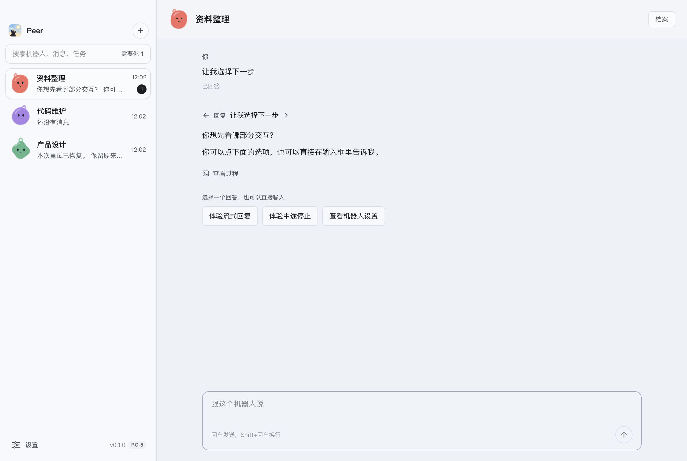

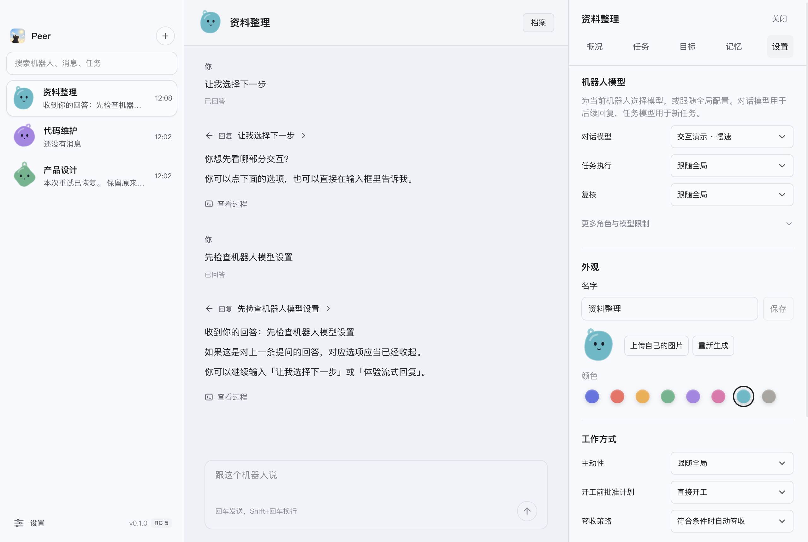

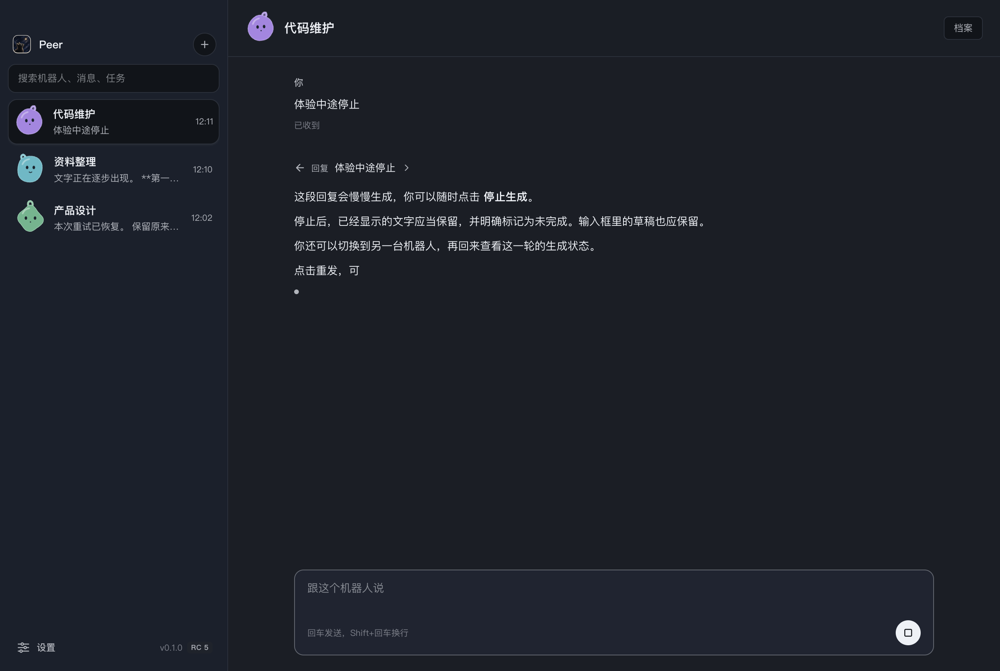

#### 引用修订的实机截图

以下为相同基线的隔离 renderer 修订，来源名称来自实际原消息角色与机器人身份。引用点击定位已在原生窗口核验，生产源码尚未修改。

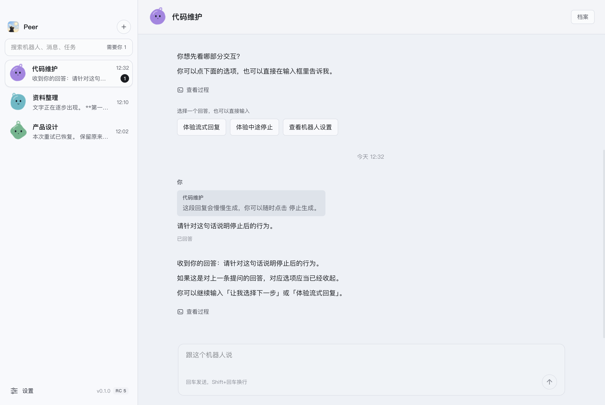

#### 说话者布局修订（2026-10-04）

用户消息靠右、Bot 回复靠左。用户气泡内可包含原消息引用；回执在气泡外下方靠右。Bot 名称来自当前机器人身份，流式与正式回复使用同一位置和宽度。这一修订替代上面旧截图的双左侧排版，引用定位与真实消息关联沿用上一轮实现。

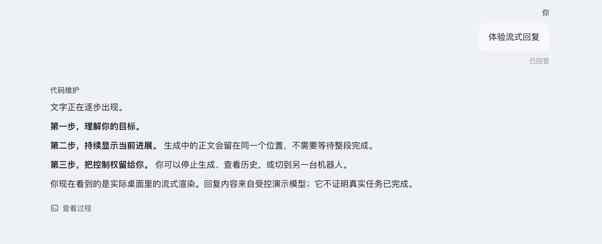

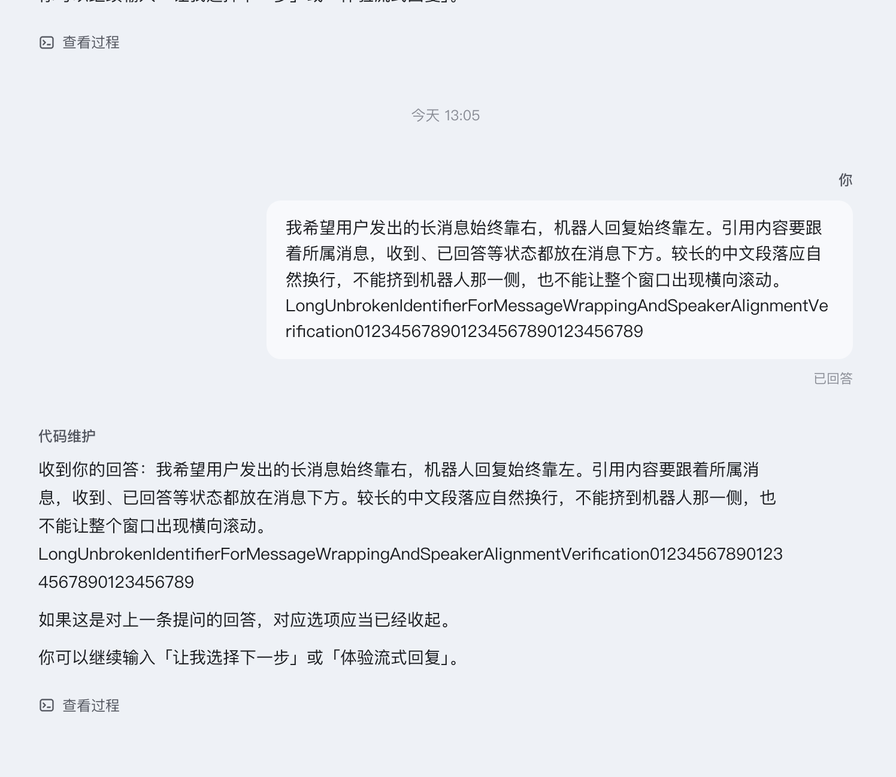

#### 顶部身份栏密度修订（2026-10-04）

常驻顶部栏从 73 px 收紧为 48 px，减少 25 px（约 34%）高度。头像从 40 px 改为 28 px；名称为 14 px。此轮档案为 52 × 32 px 的纯文字入口，已被负责人否定；当前方案以 §17 的图标与文字控件为准。

### Demo 的覆盖范围

受控服务通过现有模型回合入口提供回复和增量，preload、输入队列、问题绑定、停止路径及存储使用当前生产实现。renderer 在隔离源码中补入连续回复的引用展示规则、显式原文预览、点击定位及用户右侧 / Bot 左侧的角色排版；其余会话行为沿用基线。没有创建第二条 Bash、文件写入、授权或 Evidence 执行通道，也没有用假工具日志宣称真实工作完成。

提案样式在隔离构建中调整了正文外框、引用密度、操作行、读写列宽、输入区与档案导航。引用组件与呈现规则的修订同样只在隔离副本中实施，尚未提交为生产改动，需要用户先评审。本轮没有升级或替换安装的 RC5。模型覆盖实机检查发现受控 Demo 的路由目录最初遗漏已保存的模型 ID，已在隔离适配器修复并复测；随后模型覆盖仍保存且正常生成回复。该修复不涉及生产源码。

本 Demo 不覆盖真实云模型服务质量、复杂写任务完整证据、计划与权限的实战交接、所有终端和远程场景、更新包安装迁移，也不覆盖全部空态/窄窗/长会话组合。完整方案的任务、目标、验收细节仍需要对应真实工作场景验证。本轮没有填充虚构完成任务或执行证据来补齐演示。

## 12. 已核验、待修与发布门槛

| 项目 | 当前状态 | 结论边界 |
|---|---|---|
| 当前源码桌面构建 | 本轮通过 | 能构建运行；不能等同于全功能验收 |
| 原生增量回复、切换恢复 | 隔离受控实机已核验 | 证明界面与回合链能实时呈现，不证明真实模型稳定性 |
| 停止保留部分内容 | 隔离受控实机已核验 | 当前回复停止；派发任务取消需要独立验收 |
| 普通问题自由输入后收起选项 | 隔离受控实机已核验 | 仅普通澄清问题；不代替权限、计划或签收 |
| 失败重试 | 隔离受控实机已核验 | 一次受控故障；不代表所有网络错误与副作用重试安全 |
| 模型与颜色设置 | 见 Demo 本地保存记录 | 模型服务实际切换与真实响应另测 |
| 过程默认人类文案、技术数据折叠 | 当前源码已观察 | 过程独占详情视图尚未完成 |
| Frost 正文与密度提案 | 可点击隔离样式 | 待负责人审美与交互评审，不是已发布设计 |
| 学习习惯开关的可用性表达 | 待修 | 暂未生效的能力不应作为常用可用项 |
| 复杂写任务 command Evidence descriptor/snapshot 闭环 | 已知未关闭问题 | 不能声称所有真实任务已经 Ready |
| 安装升级、真实远程、长时间日用 | 本轮未验证 | 沿用对应测试手册与证据，不能用本 Demo 替代 |

正式版之前的门槛：负责人认可完整交互方案；剩余功能与表达缺口关闭；真实委托的执行、复核、签收、合回链路有可复查证据；所有相关自动化门槛通过；完成[详细验收手册](../../playbook/v0.1.0/acceptance-test-guide.md)的实机测试与明确的残留问题清单；最后由负责人全面评测并批准正式发布。

## 13. 推荐的实施顺序

先把主会话做到稳定：增量、停止、重试、选项归属、引用定位、滚动和切换。第二步统一过程/证据/档案的详情视图，明确所有动作的归属与状态。第三步统一机器人设置、全局设置、任务、目标、记忆的密度与可用性表达。最后以真实委托、更新迁移、长会话和多入口场景验收，而非继续堆小卡片或以功能数量替代产品成熟度。

以上为设计方案与评审顺序；运行时契约、权限、Evidence、System Context 和存储边界沿用现有治理基线。实现时若发现必须改变这些边界，先按 A/B 级变更流程更新对应架构决定。

## 14. 本轮复查记录

实际窗口检查通过：用户回执位于正文下方；普通助手回复及问题区域的 computed box-shadow 均为 none；当前 1280×860 窗口无根节点横向溢出；技术详情没有默认展开；renderer 未报告 pageerror。另读回隔离的实际存储，确认自由输入和点击选项都携带对应 answerTo、头像为湖水蓝、对话模型覆盖仍引用目录中存在的模型 ID、停止后存在 agent_stopped 记录且没有同一轮正式回复、重试后存在关联原输入的正式回复。

检查范围只覆盖上述实际场景。没有把未运行的正式验收用例填成通过。截图与本机报告都绑定本轮源码基线和提案样式；后续生产变更需重新复测。

引用修订补充核验：隔离构建及 typecheck 通过；3 个针对紧邻、跨消息、多来源、主动推送、时间分隔及流式一致性的展示规则测试通过。原生窗口完成选取原文、引用、取消、携带引用发送、点击回到原文、浅色切换和重启后的保留检查。读回实际存储确认 quoteRefs 仍指向存在的原消息，正式回复仍关联本次输入。当前窗口普通助手引用栏为 0；已发送预览使用两行布局、6 px 圆角、0 px 边框、box-shadow none，无 SVG 箭头；窗口无横向溢出和 pageerror。此结论不包含未加载、删除、不可达原文和全部窄窗场景。

说话者布局补充核验：隔离 renderer 构建通过；实机检查用户右侧气泡、Bot 左侧实际名称、正文和回执的归属，并发送长中文及连续英文标识符验证换行。原生窗口的实际宽度分别为 1280、1800、1040 px；所有用户消息右边缘与阅读区域右边缘一致，Bot 正文左边缘与阅读区域左边缘一致，回执低于用户正文，引用没有超出气泡，无消息阴影、根节点横向溢出或 pageerror。流式场景经历等待与完成，完成截图只表示已经完成的回复，不能当作尚在增量输出的截图。当前宿主最小宽度为 1040 px，900 以下规则未实机验证；附件与全部极端缩放组合也未覆盖。生产源码和已安装 RC 均未被这次演示修订修改。

顶部栏密度补充核验：隔离构建通过，1280 px 原生窗口中标题栏实际为 48 px、头像 28 px、名称 14 px；档案打开和关闭均可操作，展开时主区域变窄但标题栏保持 48 px，无根节点横向溢出或 pageerror。computed app-region 仍为标题栏 drag / 档案按钮 no-drag。本轮没有验证全部长名称、字体缩放和窗口拖动组合；不把这些设计要求记为已经通过的实机测试。

## 15. 滑动分段选择与附件恢复（2026-10-04）

### 交互

档案的概况、任务、目标、记忆、设置共用等宽轨道，选中块平滑移动。支持点击、左右拖动、方向键、Home / End；减少动态效果偏好下停用过渡。控件随可用宽度分配五个格子，不换行堆成多排。

机器人输入框恢复选择文件、图片粘贴与文件拖放入口。普通文字粘贴保留默认行为。附件在草稿上方显示，可以移除、打开图片预览；附件单独发送有效。读取中的附件不会误入下一条输入。用户消息右侧回显文件或图片，回执继续位于消息下方。

图片最多 8 MiB、文本最多 512 KiB，单条最多 8 个附件；未支持格式明确显示“仅文件信息 · 正文未读取”。接收范围沿用经典输入框。PDF / Word 正文解析不是此次恢复的能力。

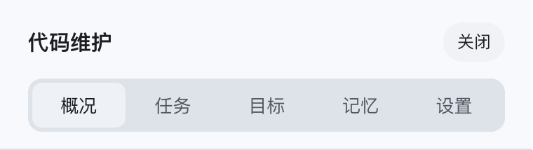

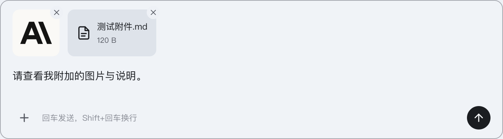

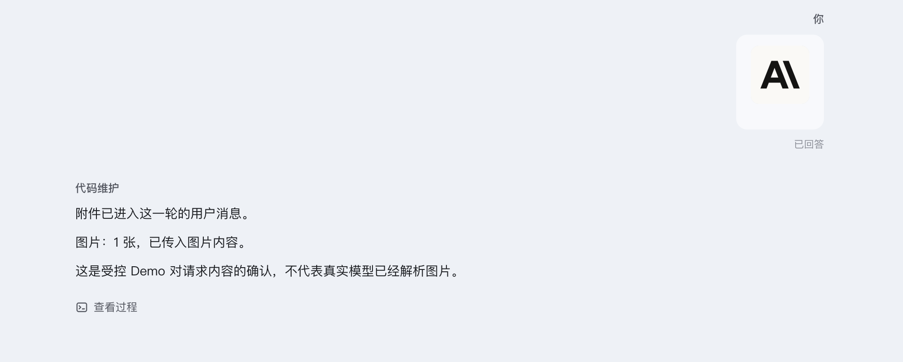

### 原因与修复边界

新 BotComposer 没有接入已有的附件 intake、图片粘贴或文件选择；机器人提交服务也没有转交 attachments，InputQueue 原先只保留截图缩略图。此次已修改生产修复分支，补全协议、入队校验、乐观显示、重试、重启恢复与锚定委托，并复用既有 canonical history 投影。与之前只改隔离展示副本的修订不同，此次附件和分段组件存在生产源码修复。架构接口见 [用户附件接收契约](../../knowledge/architecture/project-agent-input-attachments.md)。Frost 样式和前几轮引用/排版提案仍通过隔离 overlay 展示，不把提案样式视为已发布 RC。

### 已验证与限制

- 原生实机：点击分段、从概况拖到设置、Home / 方向键、1040 px 最小窗口下五格约 66.8 px 且无根节点横向溢出。
- 原生实机：多行文字粘贴；同时选择文本、图片、未支持格式；图片预览与关闭；移除图片后其余附件和文字保留；文字 + 文件发送；系统预览复制 PNG 后粘贴；只发图片；重启后图片与文件回显。
- 读回模型入口实际请求：文本文件的事实编号进入 user text；图片单独发送包含 image_url part；未支持格式只传元数据，没有伪装正文。受控模型只确认请求形状，没有真实云模型视觉识别结论。
- 三个包的回归：Protocol 227、runtime-node 1032、Desktop 5331 通过，Desktop 5 项既有跳过。随后补强委托完整性规则，73 项相关委托测试通过。Desktop typecheck、runtime-node build、i18n 和 architecture:check 通过。
- 文件拖放入口已实现，本轮未做跨应用原生拖放验收；超限/非法附件、队列重启、同 inputId 重试与锚定任务传递有自动化覆盖。大量大图、全部图片格式、全部模型视觉与故障组合仍需专项验收。
- 尚未发布安装包；用户当前已安装 RC5 不包含本次修复。原生 Demo 已运行新的修复代码，可用于交互评审。

## 16. 机器人直接选择模型与推理强度（2026-10-04）

### 交互

输入框底部在附件入口旁显示实际解析的对话模型和推理强度。点击模型沿用经典对话的级联选择器，渠道在菜单中分组，常驻位置只显示模型名。强度沿用已有滑块，只出现所选模型真实支持的档位。无需去全局设置即可为当前机器人单独配置。

档案设置与输入框共享同一份配置。对话、任务执行、复核分别选择模型和强度，其他已接入角色按需展开。继承仍是可选项，但字段显示实际模型；“跟随全局”作为来源说明。恢复继承只清除当前角色的模型与强度覆盖。

生成期间输入框显示本轮冻结配置并禁用修改；设置页可以调整下一轮。已有任务保留创建时的角色配置，新任务才使用新值。模型保存未完成时保留草稿并暂停发送，写入失败显示错误。

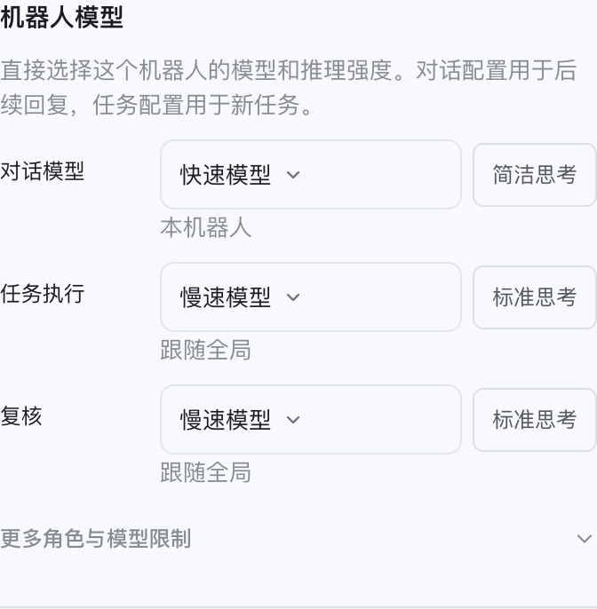

### 生产修复与实效

本节模型控件与路由改动已进入生产修复分支，代码 PR #121、提交 `d22c307a`。契约见[机器人模型选择与推理强度](../../knowledge/architecture/project-agent-model-controls.md)。复用已有 IPC、profile 存储、路由与 Provider encoder，无新增权限或执行通道。压缩没有独立角色路由，已隐藏该未生效选项；旧配置保持兼容。

原生 Demo 验证实际请求 modelProviderId / high、输入框与档案同步、机器人隔离、重启恢复、1040 px 窗口，以及生成期间本轮 high / 下一轮 low 的区分。相关路由、执行、任务快照和记忆整理测试通过；完整工作区类型检查和架构检查通过。详细回归计数及一次 watcher 时序失败的隔离重试记录见架构记录。

截图为受控模型渠道的原生窗口，不证明真实云服务的推理质量。前几轮 Frost 视觉与引用提案仍在隔离 overlay 中；本节、附件与分段控件属于已提交生产修复。已安装 RC5 不包含这些未发布改动。后续候选须按测试手册 I11–I15 复测，不把本 Demo 代替全面验收。

## 17. 档案入口与下拉对齐修订（2026-10-04）

### 评审结论

负责人指出右上角档案入口显得廉价，以及机器人模型设置的箭头位置错误。本次先捕获原生窗口的收起、展开两种状态，再修改生产控件并复查。原入口只有贴在标题栏右侧的文字，点击范围和展开归属较弱；模型字段沿用了紧凑选择器的箭头排列，造成宽字段末端留白且箭头跟在名称后。

档案继续作为低强调的常驻入口。复用既有 `fileText` SVG，图标 16 px、图文间距 6 px、控件高 32 px、圆角 6 px；当前中文宽 68 px。使用纸面底色和细边界，展开时轻微加深底色与边界，焦点使用明确轮廓。按钮不使用阴影或光晕，与机器人身份组在垂直方向居中。点击、再次点击收起、Escape 返回和已有焦点恢复语义保留。

完整设置字段中模型名称左对齐，箭头固定在右侧；输入框里的紧凑模型选择器仍采用紧凑排列。两个场景的宽度语义分别处理，避免把宽设置字段的布局套到输入框。

### 原生截图与核验

1. **收起入口**：旧文字入口与新 SVG 控件对照，明确可点击区域；按钮 `no-drag`，标题栏仍可拖动。
2. **展开与收起**：实际点击可展开、再收起；展开态底色和边界同步，浅色和深色均可辨认。
3. **键盘与字段对齐**：键盘打开、Escape 关闭后焦点返回；focus-visible 为 2 px 轮廓。设置三个主角色的箭头距字段右边界均为 11 px；1040 px 窗口无根节点横向溢出。

### 修复与验证边界

生产 UI 修复为 C 级，代码 PR #121 的 `51904c50`；`1fb9c787` 补正窗口验收的隔离模型分组。未改变运行时契约、权限、IPC、存储或依赖。桌面 typecheck、architecture:check、脚本语法检查与隔离原生构建通过；原生窗口已核验本节列出的状态。本次 Demo 构建包含同一 UI 改动，但启动时源 HEAD 仍为 `d22c307a`，该 UI 当时为未提交修改；不把截图标为后来 CI 提交的重建。

此前模型控件 CI 的 build / typecheck / architecture / test 在两平台均通过，窗口验收因仍查询旧模型按钮名称而失败。本次更新验收以操作真实级联菜单与强度滑块，并通过已有隔离目录 seam 声明测试模型能力；不改生产模型资格规则。代码 HEAD `1fb9c787c60eb0e83253db3bedcc59d51603a62b` 的 [CI 37201994686](https://github.com/ly-ccx/Peer-Agent/actions/runs/37201994686) 在 macOS 与 Linux 均通过构建、类型、架构、测试和窗口验收。Linux 窗口报告 `ok: true`、无 pageerror，模型配置检查覆盖持久化、重开、强度保留、恢复继承及角色/机器人/全局隔离；受控窗口通过不等同于真实云服务验收或整体正式版 Ready。

本节新档案控件与设置箭头已提交生产修复分支；48 px 顶部密度及前几轮 Frost 排版仍属于隔离提案。已安装 RC5 和发布包未被替换。本次不证明全部字体缩放、长机器人名称、触控与真实云模型组合已验收。

## 18. 通用设置的层级与排版修订（2026-10-04）

### 评审结论

负责人指出全局设置页面显得粗糙，尤其是右侧文字和排版。本次在同一 1040×860 原生窗口捕获修改前后状态。旧页缺少页面标题及分组标题，设置项与说明字号接近，两个大圆角卡片横向铺开；回复语言被截断，安静时段的开关与四个独立下拉框挤在同一行。

按 Frost 的纸面、石墨文字和克制强调整理：页面标题 → 分组 → 设置项 → 说明四层分明。标准字号下标题为 20 px / 600，分组 13 px / 600，标签 14 px / 500，说明 13 px / 400、行高 1.65。移除通用页外围大卡片，以行间细分隔和留白组织内容；导航选中态改为中性浅底与石墨文字。所有箭头和搜索/返回图标沿用现有 SVG。

内容容器最大 880 px（含内边距），居中；常规控件列 224 px，1040 px 窗口下为 208 px，标签和控件保持两列。下拉控件高至少 36 px、圆角 6 px、纸面轻边界。关闭时用“跟随提问语言”显示完整选值，菜单保留“自动（跟随提问语言）”的完整语义。安静时段开关独立放在标签行右端；开始和结束各组成一个 HH:mm 控件，保留分别选择小时/分钟的操作和无障碍名称。每日小结沿用同样的时间控件。

### 原生流程与修复

1. **进入通用设置：已复查。** 同尺寸前后对照确认页面标题、分组、行对齐及说明层级。最终浅色和深色窗口无根节点横向溢出，实际说明文字对比度分别约 7.09:1、8.87:1。大字号下按原有字体偏好放大，内容可纵向滚动。
2. **展开回复语言：已复查。** 关闭态选值完整，菜单在窗口内显示并可滚动，当前项有选中提示；Escape 关闭后焦点返回原按钮。本轮核验菜单显示、小时菜单选择和方向键选择，没有据此声称完整读屏验收通过。
3. **保存、切换分区和主题：已复查。** 主动性从标准改为少，实际存储为 low；安静时段开关、22:00 → 23:00 和恢复值均写入原设置。发现原页面返回时读启动快照，显示与已保存值不一致，已改为每次挂载通过现有 getSettings 读取当前配置；读取完成前暂停修改，失败显示错误并要求重开。原生窗口验证改为开启 / 23:00，切到外观再返回仍显示新值；窗口退出重启后配置保留。中英文、浅深色和标准/大字号均已实际切换。

实机还发现原开关关闭态的圆点与深色轨道接近，以及已开启状态在悬停时被普通 hover 样式覆盖。本次只在通用页修复：关闭圆点使用主题石墨次级色，开启状态保留石墨填充和反色圆点。最终浅色/深色关闭态圆点与轨道对比度约 6.26:1 / 7.58:1；开启悬停态在修正构建中约 13.90:1。

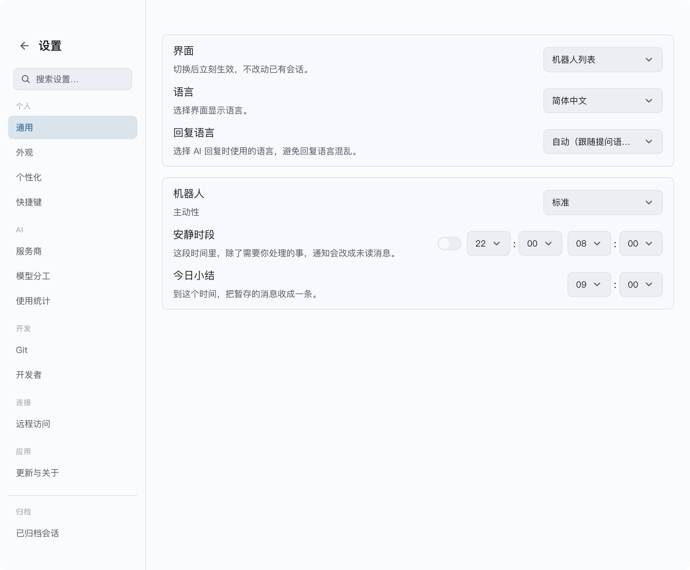

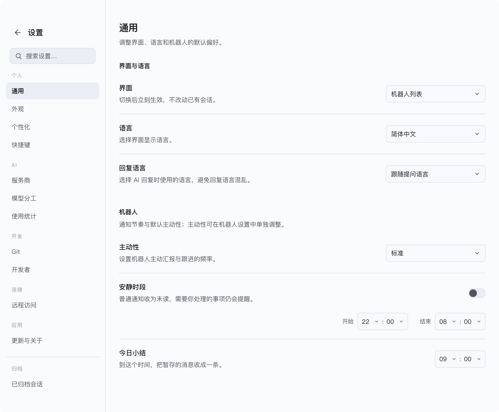

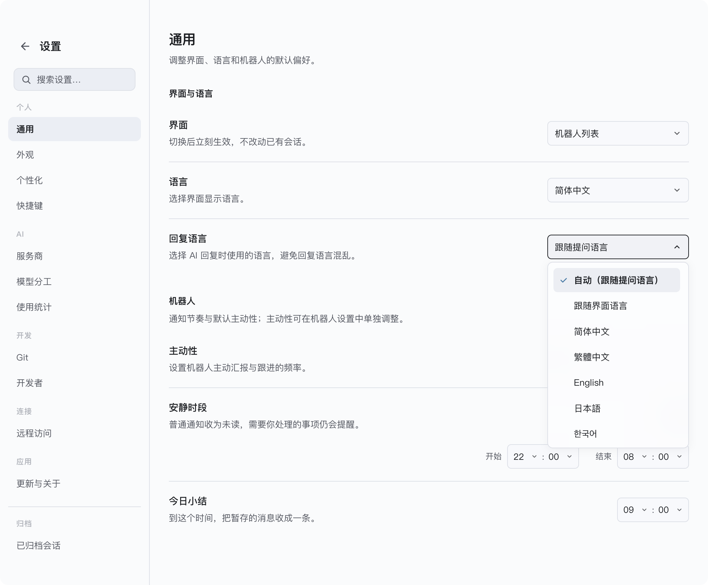

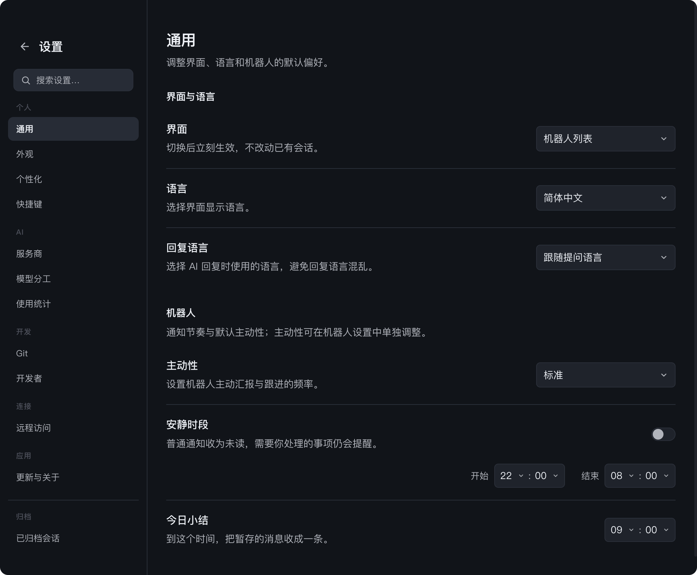

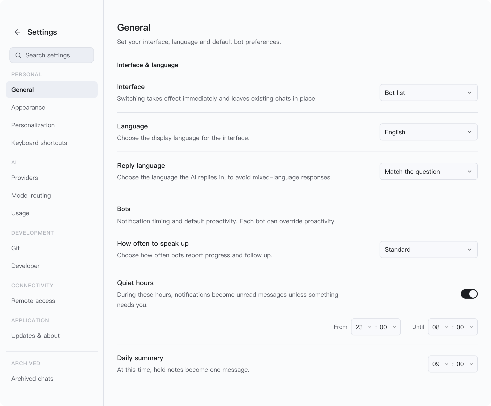

### 验证与边界

生产修复为 C 级，代码 PR #121，通用页整理从 `8126213a` 起，回显修复 `802163db`，最终视觉校准 `ac2692159ee39add9e77fe87689d0b0bd0be2d65`。沿用已有读取/保存接口、时间字段和 Switch，不改变运行时、IPC、存储、权限或依赖。内容重排集中在通用页，共享导航同时调整；服务商、模型分工、远程访问等内容没有被这次重排，不能称为所有设置分区已完成统一设计。

i18n build、Desktop typecheck、architecture:check、7 项现有设置/下拉/时间字段测试及脚本语法检查通过。桌面完整回归 5337 通过，5 项既有跳过；该完整回归在回显补修之前执行，回显新增场景由最新两平台窗口验收检查。最终 `ac269215` 的 [CI 37204596237](https://github.com/ly-ccx/Peer-Agent/actions/runs/37204596237) 在 macOS / Linux 均通过 build、typecheck、architecture、完整测试和窗口验收；两平台窗口报告均为 ok=true、pageErrors=[]。新增回归确认切换分区后读取当前已保存的安静时段。CI 实际检出 GitHub PR 合成合并提交 `24223ab2`，其父提交包含当前代码 HEAD `ac269215`，两份报告记录该检出 SHA。

最终浅色、菜单和深色大字号截图来自 `ac269215` 的干净源码重建；英文保存后返回截图来自 `802163db`。原生 Demo 继续带此前对话 Frost 提案 overlay 和受控模型渠道，通用页没有额外样式 overlay。源码、窗口测量与各截图来源见[本轮记录](../../playbook/v0.1.0/evidence/general-settings-native-20261004.json)。安装包尚未发布，原安装应用未被替换；此记录不证明 760 px 以下规则、全部设置分区、全部读屏/主题组合、真实模型或正式版整体 Ready。
