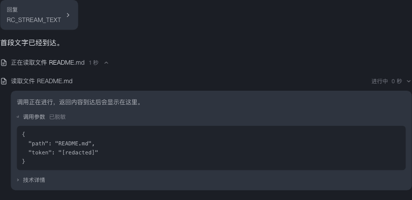
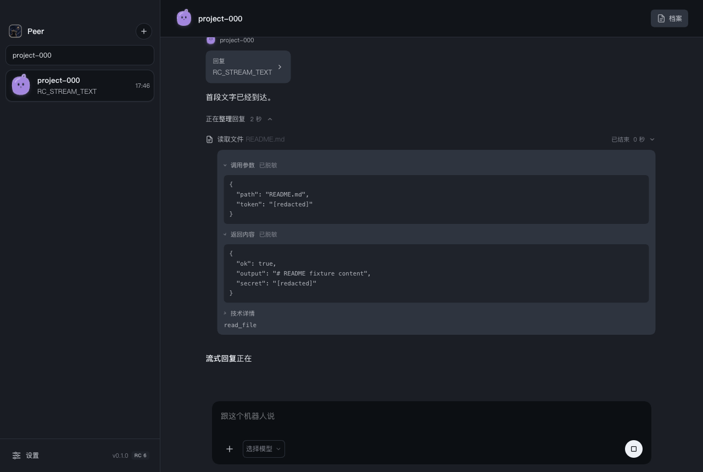
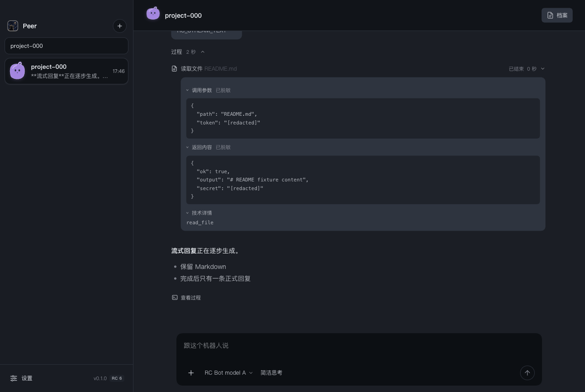
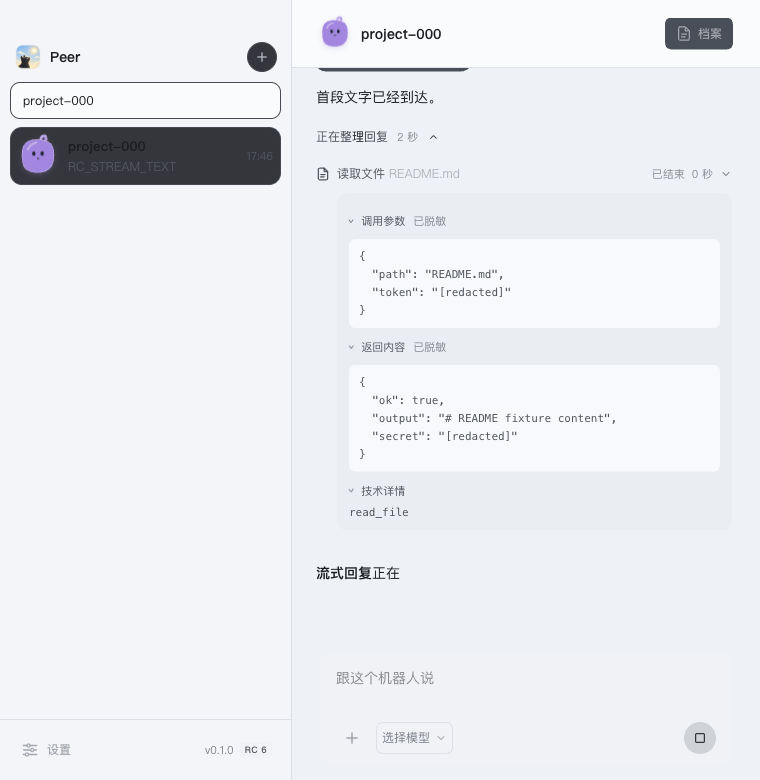

# Peer Frost 实时过程交互验收

创建时间：2026-10-05
最后更新：2026-10-05
状态：本机验证通过，开发线 CI 待提交后运行。
关联：[工作卡](../../playbook/v0.1.0/rc-live-process.md)、[ADR 87](../../knowledge/decisions/87-user-turn-live-process-presentation.md)。

## 交互结论

- 正文保留原有流式输出。公开进度文字先出现，其后是一行当前动作、实际目标与耗时；没有公开内容时只说明等待可展示内容，不展示隐藏思维链。
- 进行中的文字有轻量扫光。点击展开本回合步骤，再展开单个步骤，再查看参数、返回内容和技术详情。步骤从实际调用事件进入执行中，从实际返回事件结束。
- 完成时取消扫光，正式回复接替预览，所有展开层级保留。进入下一回合后，已完成的过程由对应持久回合提供，使用同一有界、脱敏的展示函数。
- 停止保留未完成正文、输入草稿和实际步骤；失败撤销未接受正文但保留已发生步骤。重试不重复正式回复。
- 档位保存期间保留用户选择；失败回退已生效配置并提示。长档位名称完整显示，按钮与弹层保持几何稳定。

## 正式组件实机画面

Electron 使用正式主进程、preload、renderer、IPC 和持久配置。认知提供者替换为受控事件夹具，文件内容和错误均为测试数据；这些画面验证展示链，不证明真实模型响应时延或真实文件能力执行。

### 进行中与嵌套详情

### 返回到达，回复仍在流式生成

### 完成后保留展开状态

### 窄窗口浅色主题

## 自动检查

- `pnpm --filter @peer-agent/desktop build`、`pnpm typecheck`、`pnpm architecture:check`：通过。
- runtime-node：1,042 / 1,042 通过；protocol：229 / 229 通过；desktop：5,344 项，5,339 通过，5 项既有跳过；i18n 命名空间检查通过。
- Electron：进行中扫光位置变化、键盘逐层展开、reduced-motion 无移动且可读、深浅主题 760px 窗口无横向溢出、流式正文及历史阅读位置、完成/下一回合交接、停止/失败与重试，均通过。
- 设置栏和输入栏分别覆盖 650ms 延迟保存、失败回退、每帧按钮/弹层几何采样，以及保存期间 Escape 返回焦点。帧数与截图哈希见 [机器报告](../../playbook/v0.1.0/evidence/live-process-qa-20261005.json)。
- CI 增加 macOS / Linux 的 streaming 与 effort-stability 检查。最终结果以对应源码 PR 的检查为准。

## 交付范围

本卡是 RC6 反馈修复，不新增版本号，也未替换用户已安装的应用。既有执行命令 Evidence 缺口属于独立正式版门槛，本次不改变执行、权限、Evidence 或持久存储路径。
