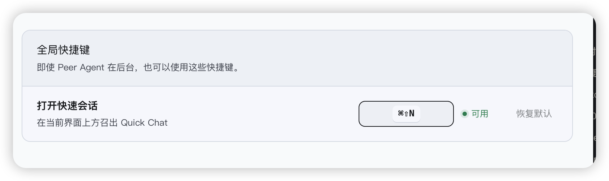
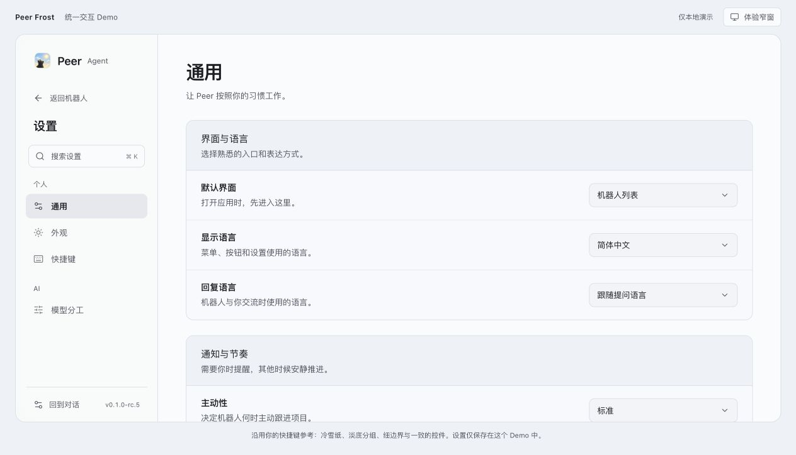
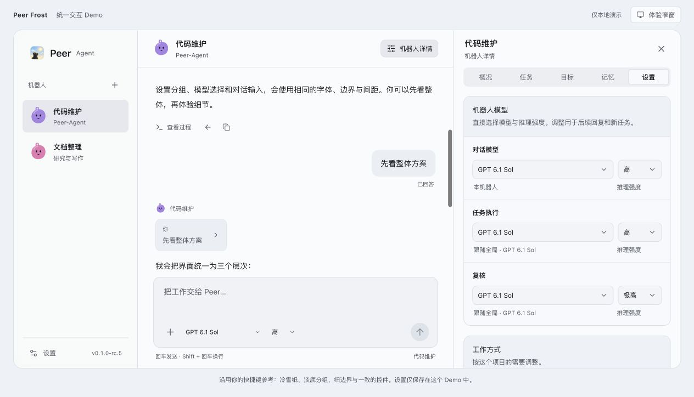
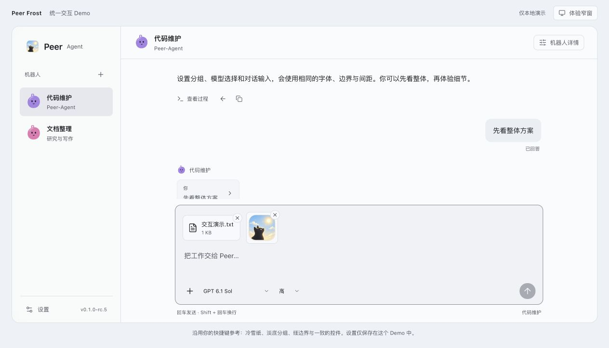
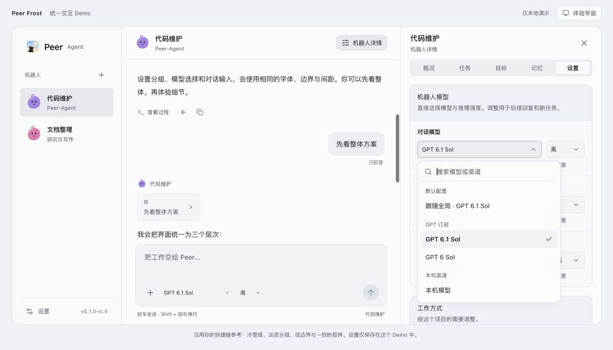
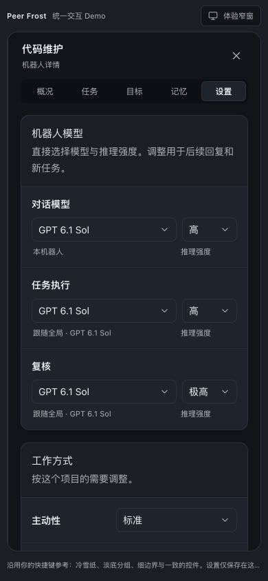
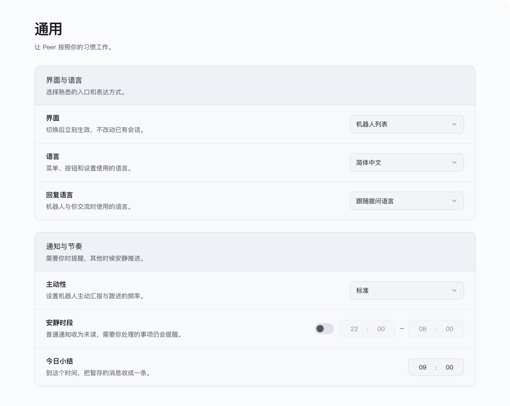
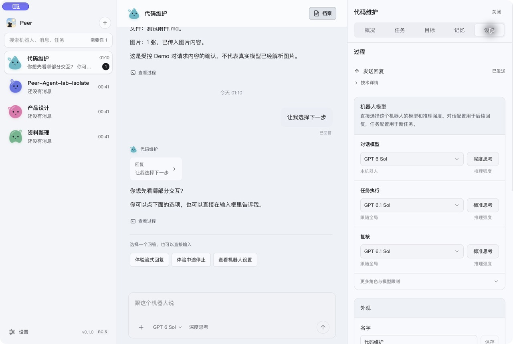

# Peer Frost：全局统一设计提案

创建时间：2026-10-04
最后更新：2026-10-05

> 状态：负责人已认可 Demo 并授权落地；生产 renderer 已实施，见 §8。本文不修改产品北极星、运行时契约或发布门槛。采用负责人选中的「全局快捷键」截图作为视觉参考；前一轮通用设置普遍去框的方向未获认可，保留为历史记录。

## 1. 设计结论

Peer Frost 的意象是「清晨冰面上的工具集」：冷玻璃外壳、冷雪纸内容、石墨文字和操作、少量冰湖青印记。精致来自稳定的部件关系、细致的文字层级、对齐和完整的状态反馈。

[产品北极星](peer-product-alignment.md)定义的关系是：用户负责目标、边界与关键判断，Peer 持续推进，在交还之前验证结果。对应的交互表达是安静、明确、按需展开：主区把意图、结论和需要用户决定的事说清楚；过程、证据、模型和高级配置都有清楚入口。

负责人选中的分组具备适合全局复用的结构：浅色标题带、单层细边界、名称与说明左对齐、操作区有明确尺度、细分隔保持行归属。新的 Demo 以此建立共享组件，再用于设置、模型、机器人详情和对话输入。

## 2. 一套全局部件

| 部件 | 统一规则 | 适用位置 |
| --- | --- | --- |
| 分组 | 12 px 圆角、1 px hairline；标题带 `--paper-base`，内容 `--paper-sheet`；普通组无外投影 | 通用、外观、模型、快捷键、机器人设置；后续扩展至其他设置分区 |
| 字体层级 | 页面标题 30 px / 600；组标题 15 px / 400；设置名称 14 px / 600；说明 13 px / 400；元信息 11–12 px | 所有页面使用同一 sans 字体栈，按所在层级变化 |
| 行与网格 | 设置行纵向 17 px、横向 23 px，组间 24 px；常规控件列固定，长说明自然换行 | 宽窗双列、窄窗上下；模型与强度始终保持同组关系 |
| 选择器 | 常规 38 px 高、8 px 圆角、右端 caret 约 13 px 间距；轻底色、细边界；展开、悬停、焦点状态完整 | 全局和机器人设置共用；输入区采用同一控件的紧凑密度 |
| 模型与强度 | 模型主字段、强度次字段并排；下一行分别说明来源和强度语义；菜单可搜索、按渠道分组 | 输入框、机器人对话/执行/复核、全局模型分工 |
| 开关 | 中性轨道、清楚的圆点，开启时石墨填充；有 `aria-checked`；禁用原因使用邻近说明 | 安静时段、半透明外壳、工作方式 |
| 时间 | 一个 HH:mm 为一个完整控件，开始与结束组成一个范围；关闭时禁用时间输入 | 安静时段、今日小结 |
| 操作 | 主操作石墨；次操作轻描边；弱操作文字和 SVG；状态附文字 | 发送、保存、选项、恢复默认、查看过程 |
| 层次与动效 | 导航外壳和临时菜单可用玻璃，内容实色；动效表达选中、生成和展开；响应减少动效/透明度偏好 | 避免消息光晕、装饰左线和大胶囊 |

详情里的选择器为 35 px 的紧凑密度；与常规设置共享部件结构、字重、状态和边界，避免每个场景独立画一套控件。大字号下调整网格和换行，保留完整模型值和推理强度。

## 3. 主界面与对话

### 身份与入口

左侧项目机器人列表，中央当前机器人对话，右侧详情按需打开。机器人名字、头像和上下文构成稳定身份组；详情入口使用 SVG 与短标签。底部是有明确语义的设置入口；版本置于右侧，更新渠道留在设置。

Demo 展示的是这一结构的部件与密度；新增机器人、第二机器人和更新入口采用说明反馈，尚未复刻它们的完整业务流程。

### 消息、引用与状态

| 状态 / 对象 | 用户看到什么 | 交互要求 |
| --- | --- | --- |
| 用户消息 | 右侧浅底气泡；回执在正文下方，弱化字号和颜色 | 回执来自真实接收/回答事实；停止生成不能写成已回答 |
| Bot 回复 | 左侧实际机器人名称和正文，保持段落节奏；底部有弱操作 | 正文为视觉主项；查看过程、引用、复制按需操作 |
| 显式引用 | 两行来源与原文摘要，小型纸面预览，可点击定位原消息 | 保持 source ID；无左侧强调线、无双向箭头、无大胶囊 |
| 问题选项 | 位于提出问题的消息下方，使用相同次级按钮 | 按钮回答或自由输入都收起对应原消息的选项；权限/计划/签收仍需自己的明确决定流程 |
| 等待与生成 | 生成状态轻量可见；正文在同一条回复逐步出现；输入区显示停止动作 | 不重复产生临时与正式两条回复；不把排队写成思考，不伪造工具活动 |
| 停止 | 已生成部分保留，标为已停止生成 | 与任务取消分开；输入可以继续使用 |
| 过程 | 打开这一轮的独立详情，用可理解的步骤、时间和结果表达 | 结构化事实投影；技术参数按需查看，普通界面不展示 raw `post_reply` 或 JSON |

现有原生流式链仍是生产实施依据。本 Demo 用预设内容分片验证展示、停止、滚动、选项归属与控件变化，不代表真实模型运输层或工具执行已验收。

### 输入区

一个完整的输入面：文字、引用草稿、附件、当前模型与强度、发送/停止。文件和图片位于草稿区，预览、名称和移除有明确位置；普通文字粘贴保留原有编辑行为。输入区常驻显示实际激活的模型，点击即可修改；机器人详情同步同一配置来源。

生成期间保留该轮模型快照，配置调整用于后续回合。机器人设置显示实际继承模型，把“跟随全局”放在来源说明；选择器保留恢复继承入口。模型支持的档位、保存错误、任务快照和真实附件接收继续沿用现有运行时规则。

## 4. 设置与机器人详情

- **全局设置**：导航 → 页面标题 → 分组 → 设置行 → 说明/状态；分类切换返回页面顶部，保留已保存选值。常规修改自动保存；需要主动确认的输入有明确保存动作。
- **模型分工**：对话、任务执行、复核采用同一 Model + Effort 部件；展示当前值、渠道和来源。实际模型能力目录决定可选模型与档位，Demo 的示例目录不替代生产目录。
- **机器人详情**：概况、任务、目标、记忆、设置使用同一滑动分段轨道，支持点击、左右拖动与方向键。窄窗转为覆盖层，标题和关闭不会被主导航覆盖。
- **机器人设置**：模型优先，工作方式与外观继续分组；当前机器人和全局作用范围可读。名字为空不能保存，保存后同步身份。
- **全局扩展**：服务商、Git、远程、使用统计、更新等页面后续应使用同一组部件与状态层级。本 Demo 未逐页复刻它们；迁移要检查长选值、无模型、无权限、保存失败、加载、空态和多语言，不能只替换默认样式。

## 5. 自适应与可用性

宽窗中标签和控件分列，内容容器居中；中等宽度收紧内边距；窄窗中名称、说明与控件上下排列。详情抽屉使用覆盖层，主导航不压在标题上。共享 token 同时支持浅色、深色和较大字号，portal 菜单跟随当前主题。

键盘可打开选择器、搜索、移动选项、确认和 Escape 返回。选择、状态和禁用附带文字或语义，不只依赖颜色。过程弹层有焦点限制和关闭后焦点恢复。390 px 检查用于布局约束验证，并不改变当前原生应用的最小窗口定义。

## 6. Demo 评审路线

当前本机预览已打开。可依次体验：

1. **快捷键**：对照负责人选中的分组，点击录制、输入普通键看错误、输入组合键、恢复默认。
2. **通用**：展开下拉、切换选值，开启安静时段、编辑时间；去外观再回来检查保存。
3. **外观**：切浅/深色、较大文字、半透明外壳；用工具条「体验窄窗」看自适应。
4. **模型分工**：搜索模型、查看渠道、选择推理强度；没有结果时菜单反馈完整。
5. **返回机器人**：点击问题选项或自行输入，看原选项收起、同一条回复逐步出现、停止后保留部分内容；试引用、定位原文、查看过程。
6. **机器人详情 → 设置**：直接选当前机器人模型与强度，检查输入区同步和来源说明；拖动分段、用方向键、修改名字。
7. **输入区**：粘贴文字或图片、附加文件、移除、带附件发送，检查用户消息中的回显和下方回执。

完整自查见 [Demo 设计 QA](peer-frost-unified-design-qa.md)。本轮 build 成功；1264×724、1128×724、1024×860、390×844 及 760 px 内置窄窗完成检查。修复了字重、密度、强度字段截断、标题带、设置切页滚动和最窄窗口的覆盖层问题；失败和修正截图均保留。

## 7. Demo 阶段的交付与实施边界（历史）

原型源码保留在独立本地原型目录，包含 README、运行配置与 QA。知识仓只保存本提案、报告和静态证据，遵循不存可执行代码的规则。代码仓本轮未修改，仍为 `ec03318e914b3f3ad3240f25fcd61149e04679cf`；未合并 PR #121、未发布新 RC。

原型是前端交互演示：模型回复预设分片、过程数据模拟、不执行项目能力、不注册 OS 快捷键、不更改正式应用配置。演示的全局配置只保存于该预览域名，Bot 配置与消息只保留本次页面会话；语言选择只展示控件状态，文案仍为中文。

后续生产实施顺序：先以负责人评审后的规则固化共享设置与控件部件；再迁移全局设置和机器人详情；随后核验对话、模型和附件的生产事实链；最后逐页检查全部分区的主题、字号、长文案、空态和失败状态。正式版仍按既有完整验收门槛推进。

此次为 C 级设计提案，界面只表达已有对象，不改变能力链、权限、Evidence、System Context、协议或存储边界。若落地时发现边界需要变化，再按工程契约先处理 A/B 级设计。

## 8. 已批准方案的生产落地

2026-10-05，负责人明确“demo 看着不错，那你落地吧”。已在代码 PR [#121](https://github.com/ly-ccx/Peer-Agent/pull/121) 实施，界面提交 `2160ece1`，原生窗口验收同步提交 `10c943d1`。本轮不需要移动任何运行时边界，按 C 级处理。

| 位置 | 已落地 |
| --- | --- |
| renderer/ui/settings | SettingsGroup 共享语义与 Frost 样式，统一标题带、边界、文字层级、行、控件和窄窗布局 |
| 全局设置 | 通用、外观、模型分工、Git、更新采用共享组；其余服务商/个性化/快捷键/远程/统计/诊断/归档复用统一表面和页层级，保留完整业务入口 |
| 机器人设置 | 模型/强度共享网格与来源说明；外观/工作方式共享组；高级配置继续按需展开 |
| 对话与输入 | 用户右侧气泡与下方回执；Bot 左侧真实身份；紧凑引用定位；选项附着消息；弱化过程操作；原生流式、停止、模型、附件和草稿沿用现有实现 |
| 抽屉 | 414 px 阅读宽度、纸面滑动轨道、共同紧凑控件密度；保留点击/拖动/键盘逻辑 |

原生隔离验收直接加载正式 renderer 构建，没有视觉 overlay；受控模型只用于可重复验证请求事实和展示状态。实机 1280×860 浅色标准字号、1040×760 深色大字号检查完成，源与实机同输入比较通过。完整 Desktop 5337 通过、5 既有跳过；typecheck、build、architecture 检查通过。最终 CI 与详细范围见[生产设计核验](peer-frost-production-design-qa.md)。

代码已推送，当前 PR 仍未合并，未发布新 RC；现有 RC5 不包含这些待合入变化。正式版仍等待既有自测门槛、负责人全面评测和明确批准。
