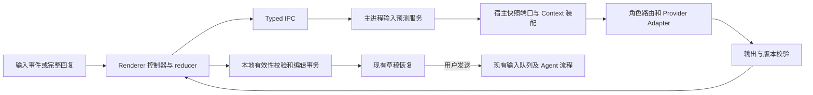

# Peer 智能输入建议：完整产品与技术方案

创建时间：2026-10-31
最后更新：2026-10-31
状态：Proposed；完整设计已登记，代码未实施，产品未验收。
决策：[ADR 115](../../knowledge/decisions/115-input-prediction-and-draft-boundary.md)。
任务拆分：[IP-00—IP-07](../../playbook/v0.1.0/input-prediction.md)。

## 1. 用户目标与产品边界

根据当前任务、最近对话和用户已经输入的文字，提前准备一条用户可能愿意说的话，以灰色建议显示，Tab／右方向键采纳后再由用户编辑或发送。目标是少组织语言、少决定如何表达，同时保留用户意图、草稿和注意力控制。

预测不是任务推进的前提。已经获得目标和授权、能够继续的工作仍由 Peer 推进，不依赖用户接受“继续”。没有足够依据时不展示候选；不以“每轮都有建议”作为成功条件。

外部截图作为交互参考，不推断 Codex 的私有实现，也不引入其品牌、组件库或物理常数。

## 2. 两种模式与首期覆盖

| 模式 | 输入条件 | 示例 | 产物 |
| --- | --- | --- | --- |
| next_turn | 当前会话有完整公开回复，草稿为空 | “再把全文串起来检查一下，重点看第三段到技术部分的过渡。” | 完整短句 |
| continuation | 草稿非空，光标折叠在全文末尾，输入停顿 | 已输入“再把全文”，预测“串起来检查一下，重点看第三段到技术部分的过渡。” | 仅追加 suffix |

首期按主 Bot → 经典可编辑 Composer 顺序交付两种模式。无上下文的新会话、编辑历史消息、只读任务现场、Quick Chat、TUI、CLI 和远程入口不显示预测。没有专门路由／预算或设置未启用时保持原输入行为；不能为了跨端覆盖提前扩大入口。

首版不提供多候选、逐词采纳、自动发送、自动回答问题卡、跨项目个性化、主动检索或持久预测历史。

## 3. 触发、停用与键盘契约

### 3.1 请求资格

只有应用前台、当前输入表面可见、草稿加载完成、当前会话身份确定、配置已读取且启用时才可能请求。展示和键盘采纳还要求焦点在该输入框，或用户主动操作其采纳按钮。后台完成回复最多标记“待预测”，恢复前台后重新核对最新版本，不提前外发大量后台会话上下文。

next_turn 在最新一轮完整公开回复终结后短暂去抖；不能将 token、公开 Activity、工具结果、子任务每次进展或“已接收”回执当作完整回复。重新打开历史默认不自动为每条旧回复发请求；当前会话首次获得焦点时最多按最新快照请求一次。

continuation 在 input 事件后去抖，不由 keydown 猜测文本。compositionend 后重新排程；输入法处理中、非末尾光标、有选区或新回复仍在生成时暂停。用户粘贴也经过相同输入准入、长度和版本检查，不专设旁路。

下列情况首版不建议：目标相关的有效权限／计划批准／结果签收／结构化问题未决；草稿有附件或 resourceFeedback；草稿／引用尚在加载、保存失败尚未恢复或发送待确认；编辑历史消息；上下文／政策读取失败；必需约束无法保留。与当前输入无关的其他项目审批不应全局禁用预测。

### 3.2 按键与鼠标

| 操作 | 行为与事件责任 |
| --- | --- |
| Tab | 仅存在可见有效候选、无修饰键／composition／更内层交互时启动采纳；成功留在输入框 |
| ArrowRight | 还需 selectionStart = selectionEnd = text.length，无 Shift／Ctrl／Meta／Alt；全文末尾才采纳 |
| Escape | 在更内层输入法／命令菜单／浮层未消费时隐藏当前建议，同一快照不立即重生 |
| Enter | 按原发送偏好处理真实草稿；绝不隐式采纳；空草稿候选不构成 hasContent |
| Shift+Tab | 原有反向焦点导航，不采纳 |
| 其他编辑／光标移动 | 原操作优先，失效旧候选，不覆写原文字 |
| 可聚焦“采纳建议”按钮 | 与键盘共用采纳事务；点击前保留目标 selection，失败不回填、不抢其他控件焦点 |
| 撤销／重做 | 统一编辑事务；整次采纳可一步撤销，后续编辑顺序保持，不回滚附件或引用 |

消费顺序：IME → 现有 slash／@ 补全列表 → 有效浮层与编辑上下文 → 智能建议 → 其他编辑／发送。不得用新建议抢走已存在菜单的 Tab 或 Escape。

忽略 key repeat 的重复采纳；采纳中合并相同请求，采纳后同一输入交互代次不立即再弹候选，第二次 Tab 能导航离开。隐藏／过期建议不占键盘或 Tab 顺序，Escape 后按 Tab 必须能离开。

## 4. 状态、事实来源、控制与恢复

| 状态 | 事实来源 | 展示／控件 | 恢复 |
| --- | --- | --- | --- |
| disabled | 宿主设置或项目关闭 | 原 Composer；设置中可启用 | 保存成功后下次资格检查生效 |
| ineligible | IME／selection／结构化状态／材料资格 | 不显示建议，不新增聊天提醒 | 条件变化后重新检查 |
| waiting | 当前输入版本与去抖时钟 | 输入照常可用，无转圈 | 编辑取消旧排程 |
| requesting | 实际已派发的预测请求 | 首版静默，不代表 Agent 正在执行 | 可取消、超时，不阻塞输入 |
| visible | 已校验、未过期的单候选 | 灰字、快捷键说明与可访问采纳入口 | 编辑／离开建议交互组／目标变化立即失效 |
| accepting | 用户动作锁定 candidateId，本地有效性检查在途 | 清理旧交互，正常编辑继续 | 版本变化或验证超时放弃采纳 |
| accepted | 本地编辑事务提交 | 真实草稿颜色，原发送流程 | 撤销恢复采纳前文字／selection |
| dismissed | 用户 Escape 或显式关闭 | 不再显示当前候选 | 新真实上下文或实质草稿变化才可重新排程 |
| none | 模型合法返回无建议或候选不合格 | 不显示“预测失败” | 等下一次有效触发 |
| unavailable／error | 路由、预算、准入、传输或解析事实 | 输入正常；设置按需可读原因 | 配置修复或下一有效触发；不自动循环重试 |

下一句候选不是承诺执行的进度，也不触发通知、声音、未读数或历史自动滚动。生成完成、采纳和恢复均不恢复用户已经关闭的历史跟随。

## 5. Module、Interface 与接线



核心能力集中在共享 input-prediction Module，内部可分 policy／context／service，不为每一步增加浅透传包。小 Interface 提供 request、cancel、validateCandidate、dispose；注入 readContextSnapshot、resolveModel、inferText、usage、clock 端口，具体端口名在 IP-01 固化。

Renderer 控制器只消费结构化资格状态与候选，不处理供应商 wire format、凭据或文件 I/O。输入实例 reducer 管理版本、事件优先级和编辑效果；高频草稿订阅停留在 Composer 叶子，不能唤醒全量历史、引用索引或 Bot 列表。

Desktop 组合根创建唯一服务 owner，窗口销毁、宿主退出时取消并 dispose。若现有 Adapter 接口仍强耦合 webContents，抽取最小纯推理传输 seam，保留原聊天调用兼容；禁止伪造 webContents 或使用 chat:send 偷跑一轮。

新增服务从 runtime-node 的适当领域子路径导出，沿既有子路径／构建清单；不复制 Desktop-only 实现给未来 TUI，也不借本功能启动大规模 Provider 重构。

## 6. 上下文装配与信任

### 6.1 准入表

| 来源 | 处理 | 不变量 |
| --- | --- | --- |
| 最近有界公共对话 | 宿主读取当前会话公开投影，保留 role、messageId、顺序、截断信息 | 不含私有 agent_turn／隐藏推理；不全量扫描所有会话 |
| 用户目标与限制 | 保留相关原文和锚点；既有摘要仅作导航 | 摘要不替代授权、Evidence 或原限制；必需限制不可丢 |
| 最近完整公开回复 | 优先保留，绑定回复身份与版本 | 不以半截 stream／Activity 判定终结 |
| 已选择的文字引用 | 确认原身份、已准入范围和内容版本 | 只是事实；不可用不猜相似来源 |
| 结构化任务／决策状态 | 读取当前输入目标的轻量可信投影 | 不从 assistant 句子推断权限或完成 |
| 当前草稿 | 仅 continuation 启用且通过长度／隐私准入 | 不改写原前缀，不从日志或其他输入框取代 |
| 项目／模型元信息 | 仅角色所需的名称、语言和路由政策 | 不泄露秘密／账户配置或扩大范围 |

首版不展开附件、resourceFeedback、新文件、MCP resource、Skill body、剪贴板或其他项目记忆。引用与当前材料过大、无法确定合法来源时不请求；不能把输入内容静默裁掉后仍称“完整续写”。

### 6.2 profile 与预算

新增显式 input-prediction Context Source，声明来源 ID、版本、适用 profile 和信任级别；由现有 assembler 接受独立 registry／profile。保留原 chat 默认注册表与层序，预测专用规则不得泄漏到正式 Agent。

可适用的项目／Bot 强制限制仍沿已有准入 seam 进入。新 profile 不因为“预测无工具”就豁免提示词来源治理，也不全量复制通用执行策略。原始会话、草稿、附件文字始终位于事实／用户上下文通道。

输入上限初始为总计 4K tokens，最近公共消息上限 8 条；两者取先到者。必须保留当前草稿、最近用户约束和最新完整回复的必要部分；预算不可满足则 abstain。continuation 草稿超过 2,048 UTF-16 code units 首版不请求，不截成一个会误导模型的伪完整前缀。来源索引与截断说明属于快照 metadata，不包含新的工具访问权。

普通 prompt snapshot／trace 只保留 profile、sourceRef／版本摘要与用量，不保存输入正文或候选；禁止对短草稿保存可枚举的裸 hash 当作脱敏。缓存内部可使用进程随机密钥的指纹，日志只保留无内容的代次标识。

## 7. 模型角色、输出契约与候选质量

input_predictor 是可跳过角色，目标为低延迟短输出。采用既有模型角色体系和项目范围；fast 仅是档位，实际可能仍指向主聊天模型。预测必须有明确选定并被功能启用认可的路由：不得把 buildDefaultModelRouting 自动填出的普通默认值视为用户已选择后台外发。

模型必须能够进行无工具文本推理。结构化输出支持由 Adapter 能力配置决定，不靠模型名猜测。支持原生 schema 就编码；不支持时解析同样的有界 JSON，失败直接丢弃，不追加修复调用。禁用可选长推理或选择模型支持的最低适当档位，不能发送该 Provider 不支持的 effort 字段。

```ts
type PredictionOutput =
  | { kind: 'none' }
  | { kind: 'next_turn'; text: string }
  | { kind: 'continuation'; suffix: string };
```

角色规则：只根据已知意图生成用户视角短表达；保留用户语言、语气和明确限制；不回答用户，不宣布完成，不编造偏好／秘密／未知答案，不提出绕过授权的句子。输出必须和请求模式匹配；suffix 只追加，不带回原前缀。

候选校验检查 schema、模式、长度、控制字符、工具调用、重复历史、复述 assistant、人称错误和明显违反限制。不得执行、渲染 HTML 或从文字解析真实命令。语义过滤只能降低风险，不能证明模型准确理解；有效权限及执行闸门仍独立强制。

候选最多 120 个 grapheme clusters，且最多 240 UTF-16 code units；模型输出预算初始 128 tokens。不完整句、截断 JSON、超长候选整体丢弃；不能屏幕只展示前两行却采纳不可见尾部。语言分割使用实际支持的 Unicode grapheme seam，降级不能破坏 surrogate pairs。

首版不采信模型自报 confidence，不用第二个模型给每次建议打分。质量以人工评审样本、采纳后修改／撤销和后续发布证据观察，不把“不展示”作为错误。

## 8. Protocol 与 IPC 草案

以下为待 IP-01 固化的 Interface 草案，不表示字段或通道已经存在。

```ts
interface InputPredictionRequest {
  requestId: string;
  workspaceId: string;
  conversationId: string;
  composerInstanceId: string;
  surface: 'desktop_bot' | 'desktop_classic';
  mode: 'next_turn' | 'continuation';
  draftVersion: number;
  draftText: string; // next_turn 必须为 ''
  selectionStart: number;
  selectionEnd: number;
  quoteMessageId?: string; // 仅引用身份，宿主核对正文和准入
}

interface InputCandidate {
  candidateId: string;
  requestId: string;
  composerInstanceId: string;
  workspaceId: string;
  conversationId: string;
  mode: 'next_turn' | 'continuation';
  insertionText: string;
  draftVersion: number;
  contextToken: string; // 不透明、宿主生成；不是授权 token
  expiresAt: string;
}

type PredictionResult =
  | { kind: 'candidate'; candidate: InputCandidate }
  | { kind: 'none'; reason: 'abstain' | 'rejected' | 'ineligible' }
  | { kind: 'unavailable'; reason: string }
  | { kind: 'cancelled' }
  | { kind: 'error'; code: string };
```

建议 IPC：input-prediction:request、input-prediction:cancel、input-prediction:validate；用 invoke 有界返回，不引入新的聊天 stream。validate 返回 valid／stale／expired／unavailable，不写草稿。所有通道注册 catalog、preload source、类型声明与 clientApi；生成文件只能经既有生成流程更新。

主进程核验可信窗口、允许 surface、当前 workspace 与实际 conversation 归属、请求大小与 selection 范围。不能相信客户端自报“无审批／已授权／本地模型”；不接受模型 URL、认证信息、任意 Context Source 或正文历史。

请求键含可信 sender、workspaceId、conversationId、composerInstanceId 和 requestId；cancel／validate 只允许同 owner，过期／未知 ID 不能恢复旧候选。Renderer 可见／焦点字段是交互意图，不是权限真值。窗口销毁立即撤销其全部候选和在途请求。

## 9. 版本、时序、取消与多窗口

### 9.1 版本职责

| 版本 | owner | 变化条件 |
| --- | --- | --- |
| draftVersion | Renderer 输入实例 | 每次正文、selection、引用、附件或输入目标变化，发送／重置／恢复亦递增 |
| requestId／candidateId | 服务与控制器 | 每次实际请求／候选；不按墙上时钟判断请求先后 |
| contextToken | 宿主 | 公共回复、关键状态、主体、指令／模型政策、配置或版本集合变化 |
| 持久草稿 revision | 既有草稿存储 | 成功写回；不能替代逐键版本，也不成为候选授权 |

缓存键至少绑定宿主 owner scope、workspace／conversation、模式、原草稿指纹、引用版本、contextToken、profile 版本、模型／路由／设置版本。不同窗口不共享可采纳候选身份；需要复用推理结果也必须重新签发绑定和检查，首版不跨窗口复用。

### 9.2 请求与采纳顺序

1. 控制器在输入事件后立即失效旧候选，记录快照后去抖。
2. 服务核验资格、读取一致快照、解析路由并预约预算／并发；快照读取前后版本不一致则放弃，不发送混合代次。
3. 单次无工具推理，完整缓冲并校验；请求返回前重新核对宿主版本。
4. Renderer 核对身份、requestId、draftVersion、焦点、IME 和 TTL 后展示。即使 AbortSignal 已失效而响应晚到，也不得显示。
5. 采纳动作锁定候选与本地快照；服务 validateCandidate 重新检查原上下文、设置、路由和关键状态，最多等待 150ms 的本地处理，不请求模型。超时不采纳且不自动重试。
6. 返回后 Renderer 再检查与动作快照完全一致，原子插入并建立编辑事务。期间发生任何输入、发送尝试、焦点／目标变化或 composition 均放弃。
7. 采纳候选一次即消费；重复 Tab／点击不重复插入。后续发送仍走原输入链。

宿主校验与 Renderer 提交之间不承诺对所有外部事实的分布式原子事务；此令牌只限制建议时效，不是业务授权。最新上下文事件一旦到达即使建议失效；正式发送、决策卡与执行闸门继续按各自事实校验。

首版每次编辑都清掉建议，不实现“匹配前缀就继续消耗候选”的缓存优化。以后增加该优化须证明当前前缀等于候选原前缀加已消费片段，并重新定义版本／采纳检查，不能简单沿用旧 draftVersion。

### 9.3 失败与恢复

传输失败、超时、非法结构返回和预算耗尽均静默回到正常输入，设置里按需呈现具体原因。无自动重试循环，不显示聊天错误气泡。取消尽力停止上游，迟到 usage 仍归原请求记账。

重启后不恢复灰字或在途预测；用户已采纳的文字由原草稿库恢复。多窗口草稿冲突保留既有存储 CAS／恢复责任，预测不能在 DRAFT_CONFLICT 等故障时偷偷换写法或覆盖另一窗口。

## 10. 编辑、展示、焦点与动效

保留原生 textarea 与原值，在只读 aria-hidden 覆盖层绘制“透明原文字＋可见灰色 suffix”；空输入时绘制完整候选。覆盖层 pointer-events: none，不接受编辑或复制，不进入 accessibility tree 的第二份输入内容。只展示候选时隐藏普通 placeholder，恢复时保持原 accessible name 和说明。

字体、行高、宽度、padding、换行、tab-size、text-indent、scrollTop／scrollLeft 和缩放均随真实输入框；原生 field-sizing 与 min/max-height 保持现有语义。经典引用覆盖层共享同一坐标 seam，不另设冲突测量器。建议不增加 Composer 高度或改变线程阅读位置；空间不足完整显示候选时不展示，或使用可完整阅读的无抢焦点替代表达后再允许采纳，首版优先不展示。

几何变更由 resize／滚动／样式事件驱动并按帧合并，不逐键强制多次 getBoundingClientRect／scrollHeight，也不因建议更新重算所有消息。measurement／API 不可用时降级为普通输入，不伪装已对齐。

编辑事务至少包含采纳前文本与 selection、插入内容、采纳后版本和目标身份。它属于输入编辑 seam；持久化仍只保存原有草稿值。所有改写路径与浏览器 beforeinput historyUndo／historyRedo、平台撤销快捷键协调，后续手工输入先撤销手工输入再撤销采纳；新编辑清除不适用 redo。不得把原生撤销未经验证地当作自动获得。

灰字使用现有 Frost／--ui-* 语义 token，保证可读并区分建议／真实输入；强制颜色模式保留文字区别和快捷键说明，不只靠颜色。键帽是文字说明，所有图形图标复用 PeerIcon／SVG。

高频建议默认静态切换，不逐字流出、弹跳、呼吸或播放声音。若采用淡入只复用共享 motion primitive；失效立即结束交互，不等待退场。减少动效／透明、无动画 API、关闭／卸载均有完整静态终态。

焦点留在用户正在编辑的位置；textarea 与其采纳按钮构成同一建议交互组，焦点由输入框移向该按钮时保留候选和原 selection，不能在 blur 时先删掉按钮导致点击失效。焦点离开整个组才失效；按钮采纳按发起者归还输入，若期间用户已转移到组外则不抢回。读屏只在新候选稳定出现时适量告知“有输入建议，可采纳或忽略”，不逐 token 朗读；提供关联的完整候选与明确按钮。不能仅添加 aria-autocomplete 就宣称符合读屏模式，也不能为装饰灰字伪造 combobox/listbox。

## 11. 设置、隐私与存储

目标设置 schema 草案：

```ts
interface InputPredictionSettings {
  schemaVersion: 1;
  enabled: boolean;
  continuationEnabled: boolean;
  disabledWorkspaceIds: readonly string[];
  dailyRequestLimit?: number; // 缺省 100；0 表示不派发
  dailyTokenLimit?: number;   // 缺省 100_000，含输入和输出；0 表示不派发
}
```

settings.inputPrediction 缺省关闭；显式启用后默认仅 next_turn。开启 continuation 独立说明“未发送草稿会交给输入建议所选模型”。路由位于原 modelRouting.roles.input_predictor，项目原策略仍可收紧，项目关闭不修改全局路由。暂不新建每 Bot 路由库或配置文件；复用原设置事务、迁移与错误反馈。

正常保存用原控件内 busy／失败反馈，以宿主保存回执更新实际值，不在对话和输入框间插入常驻提示。关闭立即使在途请求和候选失效；已交给 Provider 的数据不能追溯撤回，界面不能声称“关闭即撤回云端数据”。

普通日志只记用途 input_prediction、请求随机 ID、无正文来源代次、实际模型、排队／推理／校验耗时、token／费用、结果码。不得保存草稿、候选、正文 hash 或请求 body；通用 provider trace／prompt snapshot 必须有 prediction 用途的 metadata-only 策略。无额外外发遥测；如既有用量记录缺少用途字段，只做必要加法协议和兼容变更。

缓存仅进程内，初始 TTL 60 秒、最多 64 项／256 KiB，任一先到则淘汰；这也是候选有效期上限，不代表上下文变化后仍有效。宿主销毁、配置关闭、会话目标变化清理对应数据。没有新持久候选文件；采纳前内容不写 Conversation、记忆、Evidence 或 ProjectInput。

## 12. 调度、预算与性能目标

| 参数 | 首版初值／目标 | 含义 |
| --- | --- | --- |
| 回复完成去抖 | 300ms | 完整公开回复后去重，不逐进度请求 |
| 输入去抖 | 500ms | 停顿后请求；composition 不计稳定输入 |
| 同实例节流 | 两次实际请求至少间隔 3 秒，滚动一分钟最多 12 次 | 调度触发仍以最新版本为准，不排旧请求 |
| 预测并发 | 每宿主 1，每实例 1 | 正式用户请求到来时取消／让出，不等预测完成 |
| 推理截止 | 从请求受理起 2 秒，包含本地排队 | 超时不展示；不阻塞原输入 |
| 本地采纳验证 | 150ms 上限 | 不含模型调用；超时放弃该次采纳 |
| 输入／输出 | 4K input tokens；128 output tokens；单短候选 | 模型能力／token 编码由既有 Adapter 处理 |
| 可展示候选延迟 | 合格参考模型上端到端 P95 目标 1.5 秒，单列去抖 | 设计目标，未测得，不构成当前性能结论 |

不创建预测任务队列堆积。全局预算 Module 在派发前预约 token 上界／可知费用，结束后结算实际，避免并发绕过限额；取消后未知用量保守保留预约或按既有预算策略处理，不能马上当作零消费。

复用每日支出限额；预测的请求／token 上限保存在 settings.inputPrediction，首版初值分别为每日 100 次／100,000 tokens，允许用户配置有限非负整数，0 表示不派发；继承的全局／角色费用限额仍同时生效，取更严格的约束。计数在同一设备 profile 下跨项目聚合，日界沿既有用量账本，不由 Renderer 时钟各算一份。重启不能清零当日消费；未知实际用量保留明确标记的保守估算，不能伪造实际 tokens。没有可知价格的订阅模型也受 token／次数约束，费用记 unknown，不能伪填 0。这些是待实际反馈调整的产品初值，不承诺某家供应商的价格或速度；IP-00 必须核对既有用量存储是否支持必要计数与恢复，缺口先回写 ADR 再实现。

input_prediction 用量计入用户真实消耗，但不伪装主任务输入／输出或污染当前 Agent 上下文占用。开发只埋必要统计 seam；没有用户授权的采集出口不上传原文或行为数据。

## 13. 质量评估与发布验收

### 13.1 质量目标

以有效展示次数为分母观察采纳率，结合采纳后立即撤销、发送前编辑程度、避免的输入量和单次有效采纳消耗。不得用短泛“继续”提升数字；用户不看建议或根本无资格的时段不计入展示分母。

无原文日志时无法无损重建所有修改语义，指标只记录有界计数／长度／是否撤销；准确性样本使用明确同意的脱敏或合成材料，不借统计建立长期画像。

### 13.2 必需反例与场景

| 类别 | 发布前覆盖 |
| --- | --- |
| 意图边界 | 空草稿 Enter、真实前缀 Enter、Tab 后再发送、候选不进入复制／字数／恢复 |
| 输入法与键盘 | 中文／日文候选、composition 尾随回车、Tab／ArrowRight／Escape、选区、行中光标、修饰键与 repeat |
| 编辑恢复 | 一次采纳撤销、后续输入再撤销、重做失效、粘贴、引用、附件、存储失败、重启与多窗口冲突 |
| 时序 | 请求期间编辑、发消息、切 Bot、窗口关闭、晚响应、取消不生效、验证期间输入、回复变更与 TTL |
| 权限与政策 | 当前目标审批／签收／问题卡、恶意回复要求授权、localOnly、项目范围收紧、功能关闭、模型切换 |
| 隐私 | 请求／响应 trace、prompt snapshot、错误日志、缓存淘汰不保正文；next_turn 不携带非空草稿 |
| 资源 | 预算预约与取消结算、不可知价格、节流／超时、正式用户请求优先、隐藏面不发请求 |
| 表达 | 两类 Composer，长历史／并行回复，浅深主题、放大、窄窗、引用缩进、内部滚动、强制颜色、减少动效 |
| 辅助技术 | 完整候选可读、按钮可达、Tab 可离开、焦点恢复、无重复输入朗读、实际目标读屏软件 |
| 模型质量 | 有依据短句、合法 abstain、未知答案、约束冲突、无工具、非法 JSON、截断／超长、多语言 |

实际实现补测试和产品场景，日常不自动运行。发布前先合入全部开放 PR，再冻结联合候选，执行完整 build／tests／type／architecture／IPC 和产品 capture／逐图 review.json／verify。参考模型实际样本、安装包与读屏属于单独覆盖声明，脚本成功不能替代。

## 14. 当前代码锚点与实施顺序

所有代码路径相对 Peer-Agent；基线 HEAD `5dffbd4b4ced0bb841c9e879debd50b8bb081b9c`，仅定位用途，不是发布验收。

| 现有锚点 | 可复用职责 | 当前缺口 |
| --- | --- | --- |
| apps/desktop/renderer/src/project-agent/conversation/BotComposer.tsx | 原生 textarea、IME、引用／附件、发送 | 没有灰字、预测状态或采纳事务 |
| apps/desktop/renderer/src/project-agent/conversation/BotConversationComposer.tsx | Composer 草稿订阅和装配 | 预测订阅不能上移到整个历史 |
| apps/desktop/renderer/src/project-agent/state/useInputRecovery.ts | 按 workspace／surface 的恢复会话 | 不把该 session 键当预测会话身份 |
| packages/runtime-core/src/project-input-recovery.ts | edit／flush／send／接收回执 | changed 为内部计数，持久 revision 非逐键版本；不承诺撤销 |
| packages/protocol/src/project-input-recovery.ts | 草稿、待确认输入与回执 Interface | 候选不能混入 draft／pending |
| apps/desktop/renderer/src/chat/components/ComposerDraftControls.tsx | 经典 textarea、slash／@、引用覆盖层 | 要共用键盘仲裁和覆盖层几何，不能吞原补全 |
| apps/desktop/renderer/src/chat/state/compositionGuard.ts | 共享输入法事件序列保护 | 新行为继续先调用 guard |
| apps/desktop/renderer/src/chat/state/composerPersistence.ts | 经典草稿持久化 | 经典入口保持原发送与存储，不强迁主 Bot 草稿 |
| packages/runtime-node/src/model-router.mjs；packages/protocol/src/model-routing.ts | 角色、范围、档位、费用限制 | 新角色与显式预测路由准入 |
| packages/system-context/src/prompt-assembler.mjs；prompt-source-registry.mjs | 唯一装配、显式来源、snapshot 元数据 | 新预测 profile／Source 与正文保密策略 |
| packages/runtime-node/src/provider-adapters/；provider-encoders/ | Provider 通道、用量、取消、编码 | 纯推理 sink 与 metadata-only tracing 按实际接口适配 |
| apps/desktop/electron/main/ipc/；electron/ipc/channels.mjs；preload/preload.source.cjs | Typed IPC、owner、catalog／生成流程 | request／cancel／validate 与可信 sender |

IP-00 先收敛治理／规范与实作路径；IP-01 固化契约／reducer；IP-02 推理与 Context；IP-03 Desktop 服务和隐私设置；IP-04 主 Bot next_turn／编辑事务；IP-05 continuation；IP-06 经典入口；IP-07 最终候选发布验证。没有任何卡默认授权发布、安装或重启应用。

## 15. 规范、依赖与本轮交付

本地知识工作树尚缺下列文档。本轮从 origin/main 固定提交 `f805c053ca84e45bfb0a83a7f465d769d8f58e95` 只读查阅，未切分支、未搬运或覆盖规范。实施前须把实际适用版本整合进工作树并重新核对；不能把远程引用存在视为实施分支已满足依赖。

| 规范／覆盖 | 已读取的固定来源 |
| --- | --- |
| Frost 视觉与组件契约 | [peer-product-experience-standard.md](https://github.com/ly-ccx/Peer-Knowledge/blob/f805c053ca84e45bfb0a83a7f465d769d8f58e95/knowledge/specifications/peer-product-experience-standard.md) |
| 人机交互与键盘／草稿 | [peer-human-agent-interaction-contract.md](https://github.com/ly-ccx/Peer-Knowledge/blob/f805c053ca84e45bfb0a83a7f465d769d8f58e95/knowledge/specifications/peer-human-agent-interaction-contract.md) |
| 动效、静态终态与减少动效 | [motion-system.md](https://github.com/ly-ccx/Peer-Knowledge/blob/f805c053ca84e45bfb0a83a7f465d769d8f58e95/knowledge/specifications/motion-system.md) |
| 对象／草稿／焦点／读位连续性 | [transition-system.md](https://github.com/ly-ccx/Peer-Knowledge/blob/f805c053ca84e45bfb0a83a7f465d769d8f58e95/knowledge/specifications/transition-system.md) |
| 实施与发布验证流程 | [product-experience-development.md](https://github.com/ly-ccx/Peer-Knowledge/blob/f805c053ca84e45bfb0a83a7f465d769d8f58e95/playbook/product-experience-development.md) |
| 页面／组件覆盖 | [peer-interaction-standardization-matrix.md](https://github.com/ly-ccx/Peer-Knowledge/blob/f805c053ca84e45bfb0a83a7f465d769d8f58e95/design/product/peer-interaction-standardization-matrix.md) |
| UI／动效／过渡覆盖 | [peer-ui-motion-transition-matrix.md](https://github.com/ly-ccx/Peer-Knowledge/blob/f805c053ca84e45bfb0a83a7f465d769d8f58e95/design/product/peer-ui-motion-transition-matrix.md) |
| 共享运行时加载与 owner | [ADR 112](https://github.com/ly-ccx/Peer-Knowledge/blob/f805c053ca84e45bfb0a83a7f465d769d8f58e95/knowledge/decisions/112-runtime-module-and-loading-boundaries.md) |

适用矩阵包含 P06（Bot 对话）、P34／C128 等现有 Composer 项，以及 U02／U06／U14、T01／T03／T06／T08 等输入、控件与连续性角色；编号以实施时矩阵实际行含义为准，不在当前旧工作树复制整张表或分配可能冲突的新编号。各实现卡将建议状态逐项写回原矩阵，状态只到内容审阅／待发布验收，不能代填验证通过。

本轮完成完整方案、ADR、八张实施卡和目录入口；仅文档内容／diff 实现者自审。没有代码、配置、运行时实例或既有未提交工作的修改，没有运行测试、构建、截图、交互或真实模型验收；未完成任何功能交付，未加入已冻结候选。
