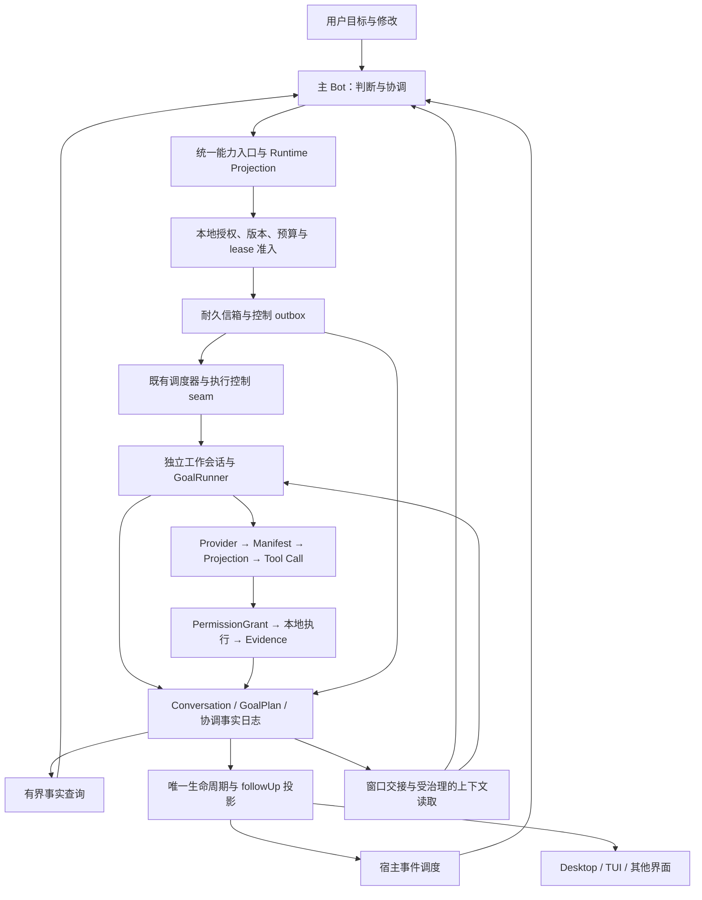

# 双向监督与连续工作的设计理念及模块架构

创建时间：2026-10-28
最后更新：2026-10-28

状态：设计基线；2026-10-28 本批源码已接入，尚未发布验收，范围与限制见[实施记录](../../playbook/v0.1.0/code-structure-refactoring.md)。决策以 [ADR 111](../decisions/111-project-agent-duplex-supervision-and-continuity.md) 为准，工程任务见[实施文档](../../playbook/v0.1.0/duplex-supervision-implementation.md)。

本文把[产品北极星](../../design/product/peer-product-alignment.md)转译为工程原则，不另立产品理念。遵守[架构治理](20-architecture-governance.md)、[System Context 架构](19-system-prompt-context-architecture.md)和现有任务、权限、Evidence 契约。

## 1. 用户委托的是持续推进的工作

用户交代目标后，主 Bot 应理解目标、安排执行、观察关键进展、处理普通问题并核对结果。子 Agent 退出一次模型回合，并不意味着工作已经完成；主 Bot 回复了一句话，也不意味着它已解除跟进责任。

持续推进需要两种不同能力共同成立：模型判断下一步，本地系统可靠保留下一步的责任。把可靠性全部寄托在主 Bot 的上下文里，压缩、断线或重启就会遗忘；把判断全部写成宿主自动重试，又会忽略用户意图、副作用和工作的真实语义。

因此延续 Peer 的分工：模型负责认知，本地负责能力，界面负责表达，契约负责边界，证据负责治理。监督是既有委托链的闭环，不是凌驾其上的第二个执行平台。

## 2. 六项工程原则

### 2.1 责任跨越回合，权力不随责任膨胀

主 Bot 负责未完成工作的下一步，仍只使用读取与协调能力。它可以回答子 Agent 的工作问题、修订目标范围内的方法、安排恢复或接手；实际写入与其他副作用由工作执行者经统一能力链完成。主 Bot 无法用一句“我来处理”代替 PermissionGrant 或人工验收。

### 2.2 观察、信息与控制各有语义

观察取得带版本的事实；消息提供信息；控制请求改变执行。三者不能用一个“发消息成功”回执混合表达。双向通道保持开放，并不意味着任何消息都会立即打断运行、任何回执都代表实际生效。

### 2.3 本地系统保存义务，模型选择处置

开放问题、未决恢复、未知副作用和未完成核验是可持久检索的事实。宿主在模型离线时也能保留这些事实、恢复 outbox、维护 lease 和阻止过期控制；宿主不凭错误字符串猜测任务方法或用户偏好。

### 2.4 恢复沿用目标与证据，重试遵守边界

恢复保留 task/work/GoalPlan，新的执行 attempt 留下明确关联。用户停止优先，未知副作用先核对，预算与停滞计数持续累计。换模型、换执行者和换窗口都不能洗掉失败与消耗。

### 2.5 上下文是可检索工作集

模型需要当前目标、关键决定、未完成义务和必要材料，不需要每次读取整本历史。Hint 是交接，Notes 是工作笔记，History 是可回溯记录，checkpoint 是原生续接，Evidence 是执行事实。它们可以互相引用，但不能互相冒充。

### 2.6 协调成本随当前工作增长

关键事件驱动主 Bot，增量索引服务界面，分页读取服务观察。高频进度只改变必要的展示数据。不能通过更频繁地唤醒模型、遍历完整 ledger 或刷新全界面实现“及时监督”。本原则约束本设计的性能，不表示已证明或消除了全部卡顿原因。

## 3. 目标架构

所有模型发起的观察、通信、控制及笔记/历史工具均通过统一能力链。宿主自身的恢复 outbox、lease 维护与投影属于该运行时的内部机制，不能借此新建隐藏的模型执行入口。界面只读取投影并提交有类型的用户动作。

## 4. Module 划分与 Interface

下表是目标职责；具体是否拆出新文件由实施卡决定。新 Module 必须集中一个完整问题，提高 Locality 或 Leverage，不能只包一层转发。

| Module | Interface：调用方必须知道什么 | Implementation 与 Seam | Leverage / Locality |
| --- | --- | --- | --- |
| 生命周期与责任投影 | 输入权威事实和读版本；输出唯一 lifecycle/followUp；未知事实保守处理 | 延伸现有 Protocol projector；所有宿主共用 | 调度、列表与计数不再分别解释失败/暂停 |
| 通信与决策请求 | 地址范围、message/request ID、版本、投递意图、回答约束、错误和幂等键 | 扩展 AgentMessage 与父子通信；持久化经既有 store | 问题路由、重复回答与迟到消息集中处理 |
| 可靠投递 | 已提交事件、接收方游标、待唤醒义务；查询排队/观察/准入/生效回执 | outbox + 条件提交；可替换宿主唤醒 adapter | 统一处理入箱到启动之间的崩溃窗口 |
| 执行控制 | mandate、expectedRevision、attempt/epoch、停止意图与未知副作用；失败不能隐式重跑 | 复用 SessionSupervisor、TaskTransition 与 takeover；Provider 能力在 adapter seam 声明 | 控制规则无需散落进 Renderer 或各模型编码器 |
| 协调调度 | 读取当前可处置义务、事件版本与去重键；模型失败保留责任；不持锁等待 | 既有 runner、repair ownership 和调度分道 | 主 Bot 关注新事实，不靠全量轮询保持在线 |
| 工作上下文 | 范围、读游标、窗口 ID、预算、笔记版本、来源；检索不生成权限事实 | 既有 Context Source + Provider encoder；native checkpoint 单独 custody | 压缩与不同 Provider 不破坏工作的连续性 |
| 协调存储 | 原子提交/可恢复关联、稳定分页、lease fencing、schema 版本、保留策略 | 复用 coordination-v2、不可变正文与可重建索引 | 单一事实账，不新增监督数据库 |

GoalPlan 与 Conversation 仍定义任务和执行历史；上述 Module 不另造可独立完成的监督任务。工作上下文也不能把笔记当成新任务状态库。

公开对话、旧 AgentMessage 和新增监督信封的 canonical 归属按 ADR 111 §9 区分。新增监督信封与唤醒义务一次提交，Conversation 只保留它的源引用投影；索引或投影丢失可以重建，不需要让两个存储同时充当一条消息的权威来源。

## 5. 三条典型链路

### 5.1 子 Agent 运行中请求选择

1. 子 Agent 提交结构化问题，宿主绑定 requestId、目标版本和父代理范围，持久化后发布关键事件。
2. 唯一投影显示 Bot 负责跟进；主 Bot 在协调执行名额上读取问题和有界材料，选择答案或明确升级给用户。
3. 宿主校验答案对应当前开放版本，提交解决事实及恢复 outbox。接收者仍在运行时，在支持的安全边界纳入答案；空闲时经准入启动。
4. 回执依次证明已提交、已纳入上下文、恢复是否准入、是否真实开始。恢复失败保留已答事实，Bot 继续承担恢复责任。

若问题是权限批准或人工验收，继续使用原生入口，不进入可由主 Bot 代答的普通工作请求。

### 5.2 子 Agent 异常中断

1. 宿主记录可信来源和执行状态；主 Bot 不从一句报错推断用户已停止。
2. 安全且有预算的临时故障先走既有有界恢复。需要工作判断时，主 Bot 获取失败原因、最后进展、未决工具与可续接信息。
3. 主 Bot 通过已有协调能力提出继续、调整方法或接手。宿主核对目标版本、停止意图、lease 和副作用，再执行结构化转换。
4. 新 attempt 接续原任务；旧 epoch 迟到结果只补充历史。核验与 Evidence 仍按原完成标准收口。

若工具是否实际执行未知，先核对；即使主 Bot 认为“应该重试”，宿主也不能跳过这一条件。

### 5.3 上下文接近容量边界

1. 宿主固化窗口边界、历史游标、预算引用、开放问题、控制 outbox 和工具未决引用；它们不依赖摘要成功。
2. 模型生成 Hint 并维护带来源的 Notes，宿主按范围和预算准入新工作集。需要旧细节时检索 History 或原始结果。
3. Provider 原生续接可用时按其 encoder/custody 契约使用；不可用时启动明确的新上下文窗口，保留工作身份和责任。
4. 新窗口先处理当前有效义务；历史问题不会仅因被摘要再次要求用户回答。

## 6. 并发、故障与安全边界

同一项目的事实提交由持有有效 lease 的宿主串行化；模型网络请求、工具执行和等待子 Agent 均在提交锁之外。入箱与回答采用条件提交；执行准入前再次读取版本与停止事实。并行工作共享事实契约，不共享可任意改写的模型上下文。

中断控制可及时阻止下一次不适用的 dispatch，但不能撤销已执行的工具。目标修订、权限撤销和停止到达时，宿主须在工具准入点检查；仅把通知送进模型提示词不够。

事件至少一次送达，operationId 与目标版本保证幂等。对“效果未知”保留 unknown，恢复先核对执行事实；不能为简化界面直接标为失败或完成。主 Bot 不在线时，宿主可维持安全与耐久性；没有模型判断就不擅自发明新的工作方案。

## 7. 连续性与记忆的边界

| 维度 | 生命周期 | 持久位置/准入原则 |
| --- | --- | --- |
| 未完成义务、控制和回答事实 | 跨回合、跨重启，直到有明确收口 | 既有设备侧协调日志，不能仅存提示缓存 |
| 工作 Notes 与窗口 Hint | 当前工作及其可追溯历史 | 既有日志与正文引用；事实层准入，受范围与版本限制 |
| Provider continuation | 适配器与其有效期约束内 | 原生 custody，不伪造跨 Provider 状态 |
| 长期项目记忆 | 独立治理的跨会话知识 | 保持 ADR 81 的边界；本设计不自动晋升笔记 |
| 工具结果与 Evidence | 按既有事实保留政策 | 保留原始引用，摘要不能覆盖 |

ContextWindowBudget 用于控制工作集容量，WorkBudget 用于约束实际执行消耗。上下文摘要、检索和协调本身的模型消耗也应进入既有 usage/budget 口径；无法精确计量时明确估计/未知，不能记作零成本。

## 8. 用户可见行为与完成标准

用户目标是把工作交出去后仍能随时补充、观察和停止。运行、等待主 Bot 决策、正在恢复、等待用户、停止未确认与结果待核验必须由结构化事实表达。主 Bot 的进展文字可以解释原因，不能改变事实状态。

后台普通问题不增加用户角标，真正需要用户时只出现一个与原问题关联的入口。用户回答后，恢复失败转为 Bot 的责任。投递已排队时显示排队事实，只有执行开始回执才表达已续跑。停止控制始终可达，状态反馈不抢焦点、不重置草稿与阅读位置。

架构完成需要能证明：消息不丢、重复不多执行、责任不随回合退出丢失、过期控制不生效、未知副作用不盲重放、真实人工边界保留、换窗后仍能找到原始事实。静态界面存在或一次模型演示不能证明这些条件全部成立。

本轮仅形成设计与内容审阅。实现与发布验证按[实施文档](../../playbook/v0.1.0/duplex-supervision-implementation.md)逐卡推进；不得以本文件状态宣布运行时已交付。
