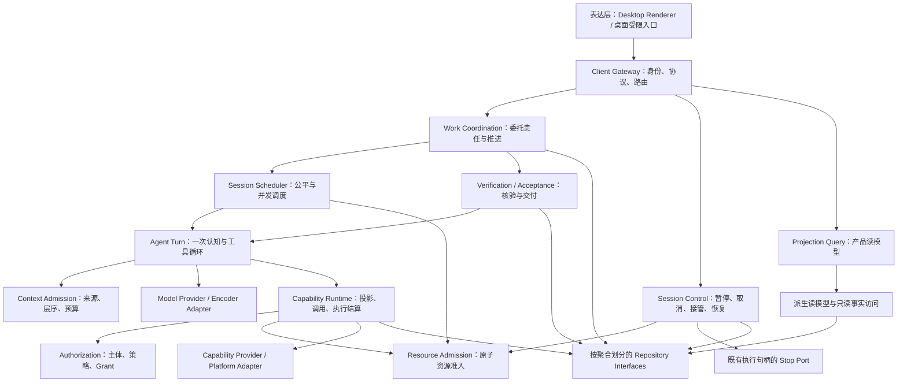
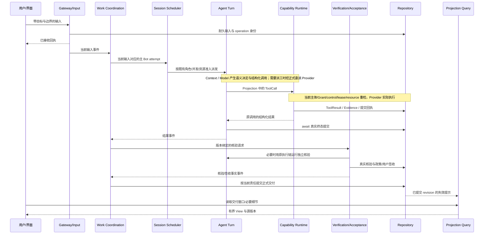

# Peer 本地代理系统总体设计

创建时间：2026-11-11
最后更新：2026-11-16（与 ADR 129 / ADR 133 收口：限定为 Desktop 隔离设计及 Desktop Shell ↔ Rust Core 逻辑边界，移除 Bun CLI/TUI 进程假设与 TS 全量内核重写假设；仍为 Proposed）
状态：ADR128 的总体设计提案；尚未接受、未实施、未证明现有代码已经解耦。本文由同一 Agent 设计并自审，不称独立审查。

> [!NOTE] 2026-11-16 与 ADR 129 & ADR 133 收口边界
> 本总体设计的逻辑模块（`M00–M14` 职责、事实归属、依赖规则与 4 条端到端时序）延续作为 **Desktop Shell（`M00/M01/M14` 平台网关）↔ 唯一 Rust Core（`M02–M11` + 底层存储/投影）** 的目标逻辑契约。原生 CLI/TUI 按 `ADR 129` 直接在 Rust workspace 内运行，**不采用**任何 Bun/Node 隔离 sidecar；Desktop TS 侧仅落地 `RI-00`/`RI-01` 有界查询止损，不再按 TS 重写整套 `M00–M14` 运行时替代冻结中的 `@peer-agent/runtime-sdk`。

决策入口：[ADR128](../decisions/128-local-runtime-isolation-and-bounded-query-contract.md)。现场依据：[架构审查](../experience/desktop-runtime-responsiveness-architecture-audit.md)。迁移：[实施包](../../playbook/runtime-isolation-implementation.md)。

## 1. 从产品责任推导架构

产品唯一方向是[把真实工作委托给本机代理](../../design/product/peer-product-alignment.md)：用户给目标和边界，代理持续推进，在交还前证明结果；用户只在关键判断时回来。由此产生六项系统责任。

| 产品责任 | 必须的技术保证 | 验证方式 |
|---|---|---|
| 用户能随时表达和阅读 | 输入、焦点、草稿、阅读位置与后台工作隔离 | 满载下原生输入/滚动、IME、长历史与多窗口 |
| 工作跨天推进 | 委托、输入、派发、控制与提交有持久身份和恢复位置 | 断线/进程故障后的不重放与续接 |
| 本机能力受用户控制 | 同一能力链、当前主体、逐调用 Grant、执行时重检 | 降权、拒绝、过期、换父、旧 epoch 与跨宿主反例 |
| 结果有依据 | 工具事实、Evidence、核验和签收分别有唯一来源 | 缺证据、伪文本、提交失败、核验失败不能变成功 |
| 只在必要时打扰 | 事实变化与模型认知、状态投影和通知各自分离 | 无变化不重算全部历史、不无谓唤醒模型、不抢注意力 |
| 能更换模型和入口 | 领域核心不依赖 Electron、具体 TS SDK 或正文物理格式 | Desktop Shell / 原生 Rust CLI（ADR 129 / 133）、云/本地模型、Store Adapter 契约对照 |

响应性是这些责任共同要求的架构属性。它不能依赖某个页面恰好命中缓存。长期历史、并发任务、新 Provider、插件和索引重建必须遵守同一成本与执行位置约束。

## 2. 系统边界与身份

系统内包括客户端、用户侧运行时、能力执行、授权、canonical 数据、读模型、恢复和平台 Adapter。云模型服务、本地推理引擎、MCP Server、外部应用/浏览器和操作系统是经 Adapter 连接的外部依赖。远程入口只取得既有允许的查询/命令权限，不因本地进程拆分开放新的网络端口。

身份层次沿用现有对象，不建立平行 Task 表：

```text
Workspace / Bot 主体
  → 用户输入 / 项目目标 / Work·Intent（委托责任）
    → Session / GoalPlan（一个具体任务及其验收目标）
      → Attempt / ExecutionEpoch（一次实际执行）
        → ToolCall / ToolResult / Evidence / Artifact

横向关联：PermissionGrant、ControlOperation、ResourceClaim、DeliveryReceipt
```

Work 是否仍被委托、Session 是否已停止、工具效果是否已知、资源是否可交接、结果是否签收，是不同事实。消息文字、窗口连接、PID 存活、超时或 UI 状态均不能把它们合并成一个 running/done。

Bot 主体、writer/lease、数据根、进程 generation、执行 epoch 和 request/operation 身份必须贯穿接口。客户端只能提供选择目标的请求，实际权限与执行身份由受信宿主解析。

## 3. 逻辑结构：先定 Module，再决定进程

下面是职责与允许调用关系，不是线程图。箭头表示调用公开 Interface；结果事件通过有界、带身份的持久事件入口重新进入协调，不反向持有上层对象。



领域规则由已有纯 kernel/reducer 提供；跨模块 DTO/schema 属于 Protocol。Host Composition 只构造、连接和管理这些 Module，不成为图中所有判断的实现者。`Local Runtime Host` 是部署单元，里面不能再出现一个同时拥有协调、查询、授权、核验和恢复算法的总管理器。

## 4. Module 责任合同

Interface 包括输入输出、事实归属、顺序、错误、权限、配置和成本。下面的名字是逻辑职责；优先深化已有 Module，不要求一个名字对应一个新 package 或 pass-through wrapper。

| Module | 唯一职责与主要 Interface | 拥有/提交的事实 | 不得承担 |
|---|---|---|---|
| Presentation | 渲染窗口、草稿/焦点/阅读意图；消费 View/Activity；发 typed request | 仅本地表达状态 | 本地 I/O、权限真值、任务推进 |
| Client Gateway | 验证调用方、协议版本、scope 与请求预算；路由 command/query/subscription | 连接身份、请求生命周期与命令交付/对账日志；不拥有领域成功 | 业务修复、模型循环、全历史查询、通用 fs/shell |
| Work Coordination | 接收已耐久输入/事件，消费模型语义决定与纯处置内核，选择推进/等待/交还；`handleInput/handleEvent` | 既有 Work/Intent/mandate/disposition/交付关系 | 签发 Grant、判断工具已停、构建 UI 全量任务卡 |
| Session Scheduler | 排序、配额、公平、依赖与并发；`enqueue/select/onSettlement` | 既有排队/调度事实，不另立任务真源 | 杀进程、猜验收、用展示状态代替资源预留 |
| Session Control | 同一执行的 pause/cancel/takeover/resume 屏障；`request/reconcile/readControlFacts` | ControlOperation、StopBarrierReceipt 与兼容镜像 | 模型规划、从 cancelled 推断停稳、删除 unknown |
| Resource Admission | 按实际执行身份原子 inspect/reserve/activate/settle | 原资源账本的 claim/receipt/protection | 调度语义、用户授权、结果签收 |
| Agent Turn | 运行一个已准入 attempt 的上下文—模型—工具循环；`run/interrupt/reattach` | attempt、流式 sidecar 与真实终态提交回执 | 承诺根目标完成、改权限、替上层处置所有任务 |
| Context Admission | 将有来源的项目指令、当前输入、引用、记忆、能力与连续性组装为受预算请求 | 既有 context epoch/snapshot/source refs | 执行能力、把工具/网页/文件内容提升成系统指令 |
| Model Provider / Encoder | 按已冻结角色/渠道/模型执行认知请求，负责凭据seam、Provider编码与结构化流 | 原模型dispatch/计量来源；usage由既有owner记录 | 本地能力执行、签发Grant、决定验收或复制UI/协调规则 |
| Capability Runtime | 统一 Manifest/Projection、ToolCall、Grant 校验、Provider 路由与结果/Evidence 结算；`invoke/settle` | 真实调用生命周期；提交 Provider 产生的结构化结果与 Evidence | 新增 Bash/MCP/Plugin 旁路、依据助手文字生成成功 |
| Authorization | 解析当前主体与策略，审查决定并生成/验证逐操作 Grant；`resolve/review/validate` | 原策略 revision、待批准与 PermissionGrant | 调用工具、调度任务、以 UI 选中值当批准事实 |
| Verification / Acceptance | 绑定准确结果版本，发出既有核验任务，按证据和政策决定验收/签收；`requestReview/applyVerdict/accept` | 核验请求/结论、既有 resultAcceptance/交付回执 | 为展示补 passed、用报告反向调用自己的完整验收投影 |
| Projection Query | 按 scope/字段/页/字节/版本生成产品视图；`query/subscribe/cancelRead` | 可丢弃的读模型与其 checkpoint | 业务命令、自动恢复、更新 Grant/lease/验收 |
| Canonical Repositories | 按现有聚合提供 typed read/prepare/commit，保证锁、CAS、fence、耐久与原格式 | 物理 canonical 记录；遵循对应业务 Module 的写接口 | 一张万能 State 表、任意字段 patch 给 UI、显示或认知策略 |
| Host Lifecycle / Recovery Composition | 持有进程、连接、配额和 start/drain/dispose；按依赖次序调用各 owner 的恢复接口 | 宿主代次、资源生命周期、恢复进度回执 | 自行重建业务结论、统一扫描所有正文或另写一套恢复算法 |

各 Module 的内部实现允许替换，但上表中的顺序、错误和事实归属也是 Interface，不随实现替换而省略。跨进程不是权限沙箱的证明，受限平台 Broker 与 OS 权限另行验证。

### 4.1 最重要的几条接口约束

- `AgentTurn.run` 接收已校验的 attempt 身份、必要事实与可检索来源，不接收能随意改动上层的 Supervisor 对象。结果是同一身份的终态回执，不能直接写 Work accepted。
- `CapabilityRuntime.invoke` 只消费 Runtime Projection 中的调用；在实际执行前重检当前 policy/control/resource/lease。超时或断线不产生重放许可。
- `Verification.requestReview` 从独立、版本绑定的原始报告/证据入口取得输入，不能调用“带完整验收状态的 session.get”再回到自己。Agent Turn 不反向依赖 Verification。
- `Repository.commit` 是每个聚合的具体 typed 命令，校验 expectedVersion、writer fence、operation identity；不是公开任意文件写入或万能 mutation API。
- `Query.query` 返回有界 View、source revision vector 和 availability；没有规范化全项目再 slice 的隐含成本。索引落后或不可用时不能返回冒充最新的空成功，也不回主线程重算。
- `Control.request` 的收到/耐久接收/排空/停稳分别有回执。即使查询很慢也必须能接收请求；实际停稳不能通过提前显示 stopped 达成。

## 5. 用依赖规则保证解耦

### 5.1 编译/导入依赖

1. Protocol/schema 和纯 kernel 不依赖 Electron、Store、Provider SDK、React 或任何业务装配对象。
2. 领域 Module 使用自己的消费 Ports；具体 Adapter 在外层实现，Host Composition 完成依赖注入。公开跨层对象进 Protocol，内部 Ports 放在其消费者附近，不能建立一个全系统万能 Ports 文件。
3. Query 的产品入口不 import SessionSupervisor/GoalRunner/PermissionGate 的执行实现。共享的状态投影使用同一个纯 kernel，所需事实从有界 Repository/读模型提供。
4. 执行、控制与验收不 import UI Query Service。它们使用当前权威事实/明确报告入口，不能把缓存 View 拿来授权。
5. Runtime 共享核心不反向 import Desktop；Node/Electron 平台边界、原生 Rust 宿主适配及云/本地模型差异留在 Adapter。Model Encoder 的请求格式不进入调度、权限或展示。
6. `Composition Root` 只能选择 Adapter、声明资源 owner 与装配配置。新增 capability、view 或 source 不增加中心 `if capabilityId` 分支。

导入无环仍不够：不得通过回调隐藏 `report → acceptance → report` 等运行时递归。需要纯函数依赖图、实际 producer/consumer trace 与递归/调用次数测试共同证明。已有 ADR102 的报告/验收反例必须成为固定门禁。

读事实的依赖必须无环；工作推进的合法反馈可以形成多轮，但必须经有身份的事件/命令和当前准入。委派、等待、跨 Agent 消息等已有本地调度能力仍是正式 Capability Provider：Adapter 调用既有委派/会话命令端口，不从通用执行器直接访问父协调器内部。父子主体、来源、角色和当前版本继续检查。等待子任务不得持有聚合写锁或控制循环，必须沿已有等待/唤醒协议让出执行；不能因“无环”而废除正常 Agent 工具循环，也不能用无界同步递归实现它。

### 5.2 状态与时间依赖

Module 不共享可变 Plan、整份 State 对象或可任意访问的全局 service locator。跨 seam 使用必要的不可变事实、身份、版本和回执；大正文保留引用。缓存按源版本失效，不能仅用 TTL 缓存执行权限。

一次异步操作后重新检查该操作所需的当前版本/control/lease，不把跨 await 的观察当成事务。真正需要原子的约束由现有聚合的锁/事务/fence 保证，不以多个“刚才读取成功”的对象模拟全局事务。

模块反馈使用有类型、有 causal/operation identity 的结果事件。某个任务结束可以唤醒 Work Coordination 处理下一次事件，但 Task Executor 不直接回调修改其父协调器内部状态。事件反馈不是无限同步调用链。

### 5.3 通信约束

命令、查询、事实事件、展示增量四种消息分别定义 schema、来源、身份、大小、顺序、超时和恢复。它们可以复用基础传输，但不能全部变成 `emit(name, any)`。

命令以 operationId/requestDigest 幂等，已接收后用耐久回执对账；队列满且未接收可明确拒绝。事实事件在 canonical commit 后发布，以已验证 cursor 补缺口；通知丢失不丢真源。展示 delta 可以按现有流式缓冲/最终提交恢复，不能按 token fsync。查询按 requestId/连接代次丢弃迟到结果；取消查询不取消任务。

## 6. 数据所有权与一致性

| 事实 | 逻辑写者 | 物理真源/提交边界 | 展示如何取得 |
|---|---|---|---|
| 用户输入、公开交互、过程与终态消息 | 原输入服务、Agent Turn/交付服务 | Conversation / 原 sidecar / terminal barrier | Session Service 的窗口/preview/过程页 |
| 目标、任务结果、成功标准 | 原 GoalPlan/委派命令 | GoalPlan Store | TaskSummary 或指定 SessionReport |
| 委托版本、责任、协调决定 | Work Coordination | 原 coordination-v2 | 版本化 Work/Intent 事实投影 |
| 暂停、停止和交接 | Session Control | 原 ControlOperation/StopReceipt | 同一生命周期 kernel 的状态元组 |
| 并发占用和 unknown 保护 | Resource Admission | 原设备资源账本/claim receipt | 有界 blocker/protection 视图 |
| 授权政策与具体许可 | Authorization | BotAccessPolicy、Approval/Grant 的既有存储 | 受限策略/批准视图，执行时仍重检 |
| Tool Result / Evidence / Artifact | 原 Provider 与 Capability Runtime 提交 | 原结果、Evidence index/body、Artifact refs | 产品取引用与有界摘要；模型取正文仍经能力链 |
| 核验与验收/签收 | Verification / Acceptance | 原 GoalPlan 核验、resultAcceptance 与交付回执 | 同源版本投影，文字不补真值 |
| 长期记忆、目标与模型配置 | 原各功能 owner | 原 memory/objective/settings/credential Store | 有界查询/Context Source/配置回执 |
| 各页面读模型 | Projection owner | 可重建、可丢弃的派生索引 | 自带源版本/availability，不是新业务真源 |

这张表区分逻辑 owner 和物理 Repository；没有“只有一个 Store 能写所有状态”的结论。原生 SQLite/JSONL、journal、blob 的差异隐藏在 Repository Adapter 中；物理格式迁移另行治理。

一次跨源查询携带 revision vector。read-model checkpoint 不得超前于真实提交；落后时按结果契约标识其版本/可用性，并有界追赶。用户基于 View 发命令时，Runtime 重新校验当前事实，陈旧按钮不能签发操作许可。多源事务不因引入消息总线自动成立。

## 7. 四条端到端链路

### 7.1 正常委托与交付



模型输出语义决定；本地 kernel 校验其作用域、版本和可执行性。Work Coordinator 不用硬编码流程代替模型的规划；Provider/命令成功也不直接替代核验与签收。

### 7.2 打开长历史或刷新角标

客户端请求 `InteractionWindow` 或 `Badge` → Gateway 验证身份和预算 → Query 选择命名读模型 → 在 limit/byteBudget 内读取 → 返回版本与 availability。读模型缺失时，重建进入受限 worker pool，当前请求返回 rebuilding/明确等待；主线程不接管重建。整个链路不调用执行监督器、不补写业务状态、不读取完整检查点。

### 7.3 后台重建时用户取消

控制命令走独立有界控制队列，不排在 Query 的工作后。Session Control 持久记录停止意图并封闭新执行准入，调用原 Stop Port，按受管句柄/结果和资源账本收口，取得停稳或明确 unknown 回执。已有结果照原屏障耐久提交；迟到回执绑定旧 epoch，不能释放新执行者 claim。查询、动画或超时不能制造 stopped。

控制队列保留接收容量，控制循环不运行全文 JSON/索引扫描。已有不可抢占的磁盘提交仍需按协议完成/对账；必须区分“请求已收到”和“实际已停止”，不能承诺操作系统永远即时停稳。

### 7.4 崩溃恢复与后续任务

Host 先验证数据根/schema、进程代次、lease/fence，再对各 owner 恢复必要候选；未决派发/工具/提交使用 operation/执行回执对账，未知效果不重放。各领域 Module 恢复自己的控制与提交状态，Host 只排定依赖和配额。Query 可以独立重建，不能参与决定资源已释放。完成合法收口后重新评估新任务准入，不能让一个历史 unknown 无范围地封死所有项目，也不能擅自清除原保护。

## 8. 部署与性能隔离

逻辑 Module 数量不决定进程数量。第一阶段目标部署如下，全部仍在用户侧节点：

| 部署单元 | 放入的 Module | 隔离目的 |
|---|---|---|
| Electron Renderer | Presentation | 草稿、IME、绘制与阅读控制 |
| Electron main | Desktop Gateway/窗口、受限平台操作、Desktop Host Capability Adapter | 保住 UI broker 的响应与桌面系统 API 所属线程 |
| Local Runtime process（终局对应独立 Rust Core 进程） | Work Coordination、Scheduler、Control、Agent Turn、Authorization、Capability、Verification | 隔离 UI，保持唯一执行宿主（`ADR 133`） |
| Query process / 有界只读投影 | 产品 Query 与 Projection reader | 慢查询不影响 UI 和执行控制 |
| 有界 Storage/CPU workers | Store prepare/commit Adapter、历史/索引重建、必要 CPU 计算 | Runtime 控制循环也不承受长同步工作 |
| 已有 Provider/工具子进程或未来本地推理进程 | 对应 Adapter 的实际执行 | 可观测资源、取消、故障与能力边界 |

Desktop 过渡期可先以 `utilityProcess` 止损有界查询（`RI-01`/`RI-02`），**终局直接由桌面组合层拉起并接入同一原生 Rust Core 进程（`ADR 133`）**；CLI/TUI 按 `ADR 129` 直接在原生 Rust 进程内装配核心并零 JS sidecar。独立 OS 常驻服务是部署 seam 的后续选择，不在本篇强制安装。进程退出后的任务/副作用状态只按回执与现有保护处理，不承诺父进程死后子进程必然存活或死亡。

控制、执行、查询、重建分别有队列、deadline、在途字节和配额。CPU/rebuild pool 在同一数据根跨宿主共享限制，不能每 Bot 派一套 pool；本版不新增跨独立数据根的机器daemon或宣称整机硬上限。优先级不能打断已经运行的同步 JS；单个正常控制/main 工作片的设计预算为 8ms，超出须移出或在重检版本后分批让出。任何慢任务都能定位其 request/operation、排队、CPU/I/O、返回字节与来源版本。

## 9. 已有功能与未来扩展的接入位置

| 功能/变化 | 正式扩展位置 | 不应修改 |
|---|---|---|
| 新模型、云/本地推理、编码差异 | Model Provider/Encoder 与角色路由 Adapter | 权限内核、生命周期、UI 状态机 |
| MCP、Skill、Plugin、新 OS 能力 | Provider/Manifest/Projection；需要的指令走 Context Source | 中央执行器按 capabilityId 继续分支 |
| 项目指令、长期记忆、附件、连续性 | Context Admission 的已治理 Source 与原功能 owner | Provider 内拼 system 字符串 |
| 定时目标、Automation、文件/CI 变化 | 原受准入的 Signal/Input Source → Work Coordination | Renderer 定时器直接开始执行 |
| 新页面、角标、报告或资源列表 | 新的命名 View/Projection 与有界 Query | Scheduler、Authorization、Agent Turn |
| 文件/浏览器/文档编辑或预览 | 原受限资源/能力 Provider 与平台 Adapter；表达消费返回事实 | Renderer 直接 fs/进程/凭据 |
| 设置、模型目录、OAuth 与凭据 | 原配置 owner、typed 配置命令和 credential Adapter | 通用 Query 返回原始秘密 |
| 诊断、升级与进程更新 | Host Lifecycle 的受限用例；诊断只读、升级遵守用户授权与 writer 版本 | 以诊断名义修任务、以查询重试名义重启执行 |

这些是接入位置，不批准新的能力/记忆/调度策略。例如 `123-main-bot-unnoticed-memory.md` 仍为 Proposed；本篇不把情节记忆实现或存储保留/GC 提案顺带接受。模型选项的表达继续遵守共享 ModelPicker，设置策略与任务冻结沿 ADR83。

## 10. 从现有代码迁移，明确删除目标

| 当前 seam | 目标职责 | 必须退出的耦合 |
|---|---|---|
| `main.mjs` / `project-agent-host.mjs` | Host/Adapter composition 与 Gateway | main 创建并同步运行全部 Store/循环，装配函数包含业务判定 |
| `session-supervisor.mjs` | 保留协调/调度/控制的正式公开入口，逐职责深化已有 Module | UI list/get 反复做 acceptance/report/Evidence 联接，消费者持有整个 Supervisor |
| `llm-chat-service` / AgentTurnExecutor / TurnSink | 一次 attempt 的可替换执行与提交 seam | 窗口对象成为执行生命线、Provider 格式进入无关模块 |
| `permission-gate` / BotAccessPolicy / ApprovalStore | Authorization 的原接口与事实 | UI 缓存或模型文字取得权限效力 |
| GoalPlanEvidence / Session report / ProjectFacts | 选择性事实读取、独立报告与命名读模型 | 每个调用者取全索引再筛选，报告/验收运行时递归 |
| TaskOverviewAggregator / BotDirectory | 产品 Projection reader | 读取补 passed/runner 状态，返回一个数字却完整 hydrate |
| Conversation Store / Session Service | 原格式下的窗口、preview、提交与恢复 Adapter | 产品完整历史回退、把大数组跨进程复制 |
| 视图订阅/轮询与托盘 | 按 scope 的共享失效/订阅，后台读取暂停、恢复补读 | 每个视图独立全量轮询且无背压 |

迁移必须为每条链列出旧入口、新入口、同版本对照和最终删除项。仅移动文件、创建 Interface 名称、把原 Supervisor 整体搬进另一个进程，都不能算完成。

## 11. 如何证明职责清晰且解耦

| 检查 | 通过条件 | 失败反例 |
|---|---|---|
| Interface 与实际调用 | 调用方只需必要身份/事实/回执；cost/错误/顺序可验证 | 调用方仍要理解并修改 Plan 全部字段 |
| 依赖图 | 公开出口白名单、纯内核无基础设施、Query/命令实现互不反向依赖 | import 无环但通过回调递归 report/acceptance |
| 事实所有权 | 一个业务事实只有原 owner；读路径禁止 canonical 写 | 打开页面把 qualityReview 改 passed |
| 替换 seam | 更换 Model/Storage/Host Adapter，核心控制与授权用例不改 | 换 Provider 要在权限/窗口里加条件 |
| 复杂度 | 加十倍无关历史，当前页不新增全库 hydrate/normalize | 返回条数小但扫描/复制全历史 |
| 故障隔离 | Query/rebuild 故障下输入与控制可用，已接收命令可对账 | Query 超时重启 Runtime，工具被重放 |
| 生命周期 | start/drain/dispose owner 清楚，无残留订阅/worker；旧结果不污染新代次 | 为每个 Bot 留全局定时器或无法结束的 Promise |
| 交付结果 | 同规模真实链、异常恢复和后续准入通过，安装/平台限制真实列出 | 单测全绿或有限 IPC 实验代替应用验收 |

静态规则、计数测试、真实 Module/进程契约、故障注入、复杂度实验和产品负载共同执行这些约束。没有这些证据，只能说设计有边界，不能说实现已经解耦。

## 12. 方案完整性与详细设计

2026-11-11 用户要求在重构前一次补齐并审查详细设计，取代本篇初版“每阶段再补细节”的安排。总体设计管职责，ADR128管边界，实施包管顺序；现已新增[完整详细设计目录](../specifications/runtime-isolation/README.md)。

| 设计部分 | 固定规格 |
|---|---|
| 模块接口/事实/依赖 | [15个核心M模块、11个已有Feature owner](../specifications/runtime-isolation/02-module-contracts.md) |
| 协议/schema/回执 | [01：方法目录、身份、幂等、错误、订阅](../specifications/runtime-isolation/01-protocol-and-command-delivery.md)，以及411项现有IPC冻结映射 |
| 读模型 | [03：21种View、字段/索引/分页/版本/重建](../specifications/runtime-isolation/03-query-models.md) |
| 队列与资源 | [04：14条队列、容量/保留通道/期限/背压](../specifications/runtime-isolation/04-queues-and-scheduling.md) |
| 写入与恢复 | [05：物理数据、命令日志、锁/CAS、崩溃点、旧writer](../specifications/runtime-isolation/05-storage-and-recovery.md) |
| 宿主/平台/凭据 | [06：进程入口、bootstrap、Broker白名单、ticket、secret、打包](../specifications/runtime-isolation/06-host-and-platform.md) |
| 迁移与验证 | [07：入口/删除项、D01–D18、候选与发布门](../specifications/runtime-isolation/07-migration-and-verification.md) |

本轮先完成这些设计的自上而下内容审查，再进入重构；不把接口、队列或恢复分叉留给实现者选择。容量和平台适配必须在实现时被证实，失败须回写设计而非现场降级。当前仍是Proposed设计候选，未修改产品实现；设计闭合不表示运行验收完成。
