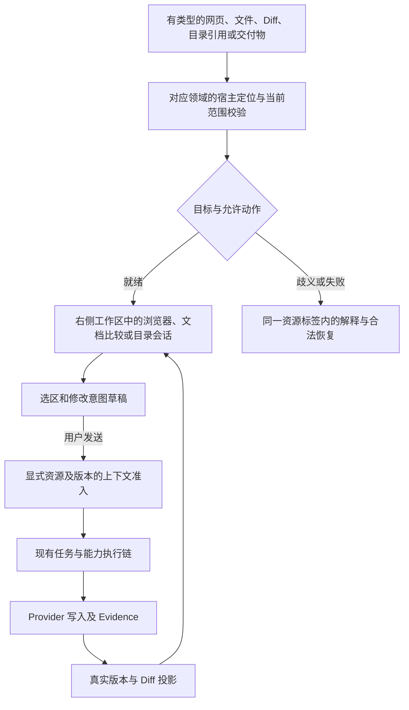
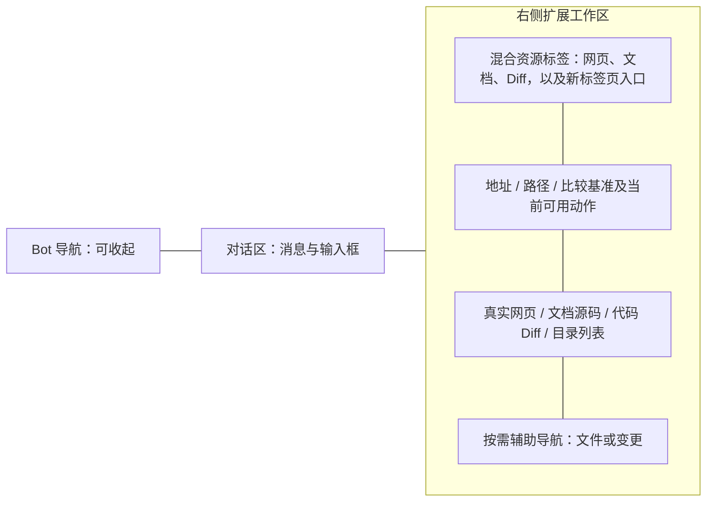

# ADR 109：内容引用、资源预览与产物协作契约

创建时间：2026-10-25
最后更新：2026-10-25（补充混合资源标签、新标签页启动器、独立窗口及前后端回归边界）
状态：Accepted（2026-10-25 用户明确允许开工，先实施第一阶段 R1–R4d、本地试用）；独立窗口、版本增强与协作修改仍按后续包评审/实施，不表示实现或验收通过。
级别：A。涉及跨层引用协议、资源版本、编辑存储、上下文准入及写入边界；落地中的会话投影和 IPC 属于 B 级，局部表达属于 C 级。
范围：Bot 回复、任务交付物，以及统一资源工作区中的网页浏览、文档/代码阅读、代码 Diff、目录导航；覆盖右侧、专注视图与独立窗口的承载，随后围绕同一资源进行局部讨论和修改。现有任务详情与 Bot 信息面板的承载方式纳入迁移计划，业务规则保持原归属。

## 1. 决策摘要

建立一条连续的用户路径：**看到有依据的引用 → 打开准确对象 → 阅读适配内容 → 针对具体版本提出修改 → 在原授权与执行链内修改 → 查看真实变更与结果**。

这项设计同时建立可靠引用和同屏右侧工作区，覆盖**网页、文档、代码 Diff、目录**四类需求，再统一细节体验，最后补齐协作修改。复用现有 BrowserSession、DocumentSession、文件/Git 服务、UserArtifact、PermissionGrant、Evidence 和 System Context，不从头重建运行时。

核心决定：

1. 可点击对象必须有类型、来源和动作契约。文件名、分支名、函数名不再共用“含斜杠或扩展名就打开文件”的规则。
2. 展示名称与真实目标分开。正文可以写 `host-lease.mjs`，目标必须保留来源和 `packages/runtime-node/src/project-agent/host-lease.mjs`；完整相对路径配合来源同样有效。
3. 引用、资源、交付物、Evidence、阅读会话和编辑草稿分开建模。模型文字不能创建文件存在性、权限或完成事实。
4. 预览按格式适配，打开同一对象后保持位置和身份。读取、讨论、写入、验证、签收分别表达。
5. 修改绑定明确资源及基础版本。写前检查冲突，恢复时先对账，不因预览、重启、重连或重新打开任务重跑已完成的写入。
6. 按阶段实施，先稳定 Markdown、纯文本和代码，再按需要扩展复杂格式。产品主入口继续围绕 Bot 与委托工作，资源区按需出现。
7. 右侧工作区是主界面布局的一部分，打开后与对话并排共存。网页、文档、Diff、目录具备可发现入口，任务详情及 Bot 信息逐步沿此承载方式收敛；普通查看不使用遮罩、焦点锁定或嵌套弹层。窄窗口采用同一对象的整页切换，不退回模态预览。
8. 网页用 BrowserSession，文档与文件 Diff 用 DocumentSession，目录用导航状态。共享布局、入口与标签表达，不合并成一个同时管理 WebContents、文件和 Git 的万能状态机。
9. 顶部以已打开对象组织一排混合资源标签：网页、文档和具体 Diff 可直接互切。类型决定内容、工具栏和领域行为，不要求用户先切“网页/文档”分类再寻找对象。
10. “＋”创建新标签页启动器，提供网址/有界资源查找、文件/目录、查看更改和当前上下文最近资源。启动器本身不创建网页实例、不创建文件、不启动工具。
11. 资源身份、呈现视图和原生窗口分开。独立窗口保持来源归属；文档可另开阅读视图，网页保活迁移与新开地址副本明确区分，不能把重载说成同实例迁移。

2026-10-25 用户补充的布局方向已经明确：采用参考截图中“对话 + 右侧文档标签 + 按需文件/变更导航”的同屏关系。该方向纳入本草案，不再把资源承载方式列为弹层与分栏二选一；后续协议、存储和编辑扩展仍保持 Proposed。

同日用户进一步明确：网页、文档、代码 Diff 和目录都需要。四类均为本次改造的必需范围；其中网页指已有真实可交互浏览器接入新工作区，不是仅把 URL 交给系统浏览器，也不是把普通网页浏览推迟到未来“HTML 运行预览”阶段。目录可独立进入，不能只能依附某个已打开文档显示。

后续参考图进一步显示文档与网页入口在同一排标签中，以及带工具/最近记录的新标签页。本文据此修正早期“固定分类入口 + 各类第二排标签”的默认 UI，采用混合资源标签与启动器；领域 kernel 继续独立。独立窗口是 Peer 在此基础上需要补齐的承载设计，不根据截图推断 Codex 内部的实例迁移机制。

## 2. 权威、关联与生效方式

产品方向以[产品理念与价值对齐](../../design/product/peer-product-alignment.md)为准。工程边界以[架构治理](../architecture/20-architecture-governance.md)、[工程哲学](../architecture/00-engineering-philosophy.md)、[项目结构](../architecture/01-project-structure.md)和 [System Context 架构](../architecture/19-system-prompt-context-architecture.md)为准。

已有相关契约：

- [ADR 47：Workbench 多资源标签模型](47-workbench-multi-resource-tabs.md)：文档会话与浏览器等领域会话分离，工具目标显式绑定。
- [ADR 40：内嵌浏览器与 Agent 操控](40-embedded-browser-and-agent-control.md)、[ADR 46：会话绑定的多标签浏览器](46-conversation-bound-browser-tabs.md)、[ADR 59：Browser 主动展示](59-browser-panel-reveal-capability.md)：真实网页实例、会话/标签目标、可见性与 reveal/ack。
- [ADR 51：统一文件工具](51-unified-desktop-cli-file-tools.md)、[ADR 64：源码高亮](64-workbench-source-highlight-without-monaco.md)：目录沿受控文件能力，源码复用已有只读呈现。
- [ADR 63：用户产物与 Evidence 边界](63-user-artifact-evidence-boundary.md)：交付物来自 Provider 的真实结构化结果，读取与日志不自动成为交付物。
- [ADR 108：Bot 回复文件引用的有界只读预览](108-bot-reply-document-preview.md)：现有只读入口、来源检查、权限边界与历史候选兼容规则。
- [ADR 15：Plugin、Skill、MCP 系统](15-plugin-skill-mcp-system.md)与 [ADR 16：Skill 调用生命周期](16-skill-call-lifecycle.md)：能力继续走既有主链。
- [Frost 体验规范](../specifications/peer-product-experience-standard.md)、[人机交互契约](../specifications/peer-human-agent-interaction-contract.md)、[动效体系](../specifications/motion-system.md)、[过渡体系](../specifications/transition-system.md)。

本草案不修改上述文件的 Accepted 状态。评审通过后，按实施包逐项扩展 ADR 108 的引用范围、ADR 47 的文档元数据与导航表达、ADR 46/59 的窗口归属和展示/注意力处理、ADR 63 的版本关联；不能仅凭本草案存在就开启编辑、增加访问根或改变验收规则。部分能力先落地时，明确标注实际支持范围，不能把只完成文档的候选称为完整工作区。

与 ADR 47 的明确差异：资源会话分离、Files 是导航器、Diff 是文档模式、工具目标显式等不变量保留；“顶部先按能力分类、内部各自展示标签”的可见结构拟由混合标签替代。此为待评审的导航契约扩展，不能因复用组件就假称完全没有架构影响。ADR 46 的单窗口可见/活跃归属假设也须在独立窗口包中明确升级。

## 3. 已核实的问题与根因

### 3.1 文件存在，但回复引用丢失了定位信息

现场工具读取过 `packages/runtime-node/src/project-agent/host-lease.mjs`，对外进展却只保留了 `host-lease.mjs`。界面将这个短文件名识别为文件候选，预览请求只有 Bot 工作区与该短路径。宿主按允许根精确解析，无法凭文件名定位多层目录中的文件，因此返回 `not_found`。

同一现场中，完整仓库相对路径可以解析。问题不是“相对路径都不能用”，而是**完整目标没有从工具事实持续传到回复引用和预览请求**。把所有回复改成机器绝对路径只能缓解一部分情况，无法解决多仓库、历史版本、工作树迁移和同名文件问题。

### 3.2 回复要求没有把可读展示与可定位目标分开

当前 `packages/system-context/src/sources/runtime-source.mjs` 要求工作区内文件优先用相对路径。项目代理规则对路径、分支、标识符都使用代码样式，缺少完整目标、来源和引用类型要求。模型缩短名称之后，前端只能从表面语法猜测。

这是上下游契约缺口：提示词没有要求保留定位信息，消息模型没有稳定承载目标，渲染器又把语法候选表达得像确定可打开的文件。不能只在提示词中补一句“必须绝对路径”，也不能把正确性全交给模型。

### 3.3 当前解析器的有界行为应当保留

`apps/desktop/electron/main/bot-document-reference.mjs` 只在当前项目、已登记工作区和已确认 companion knowledge 根内解析，并进行词法与 realpath 检查。裸相对路径的跨根兼容采用相同相对位置的有界精确检查，不递归搜盘。

无法定位一个裸文件名时拒绝猜测是必要边界。修复应补齐引用来源并改善错误表达，不能扩大根目录、遍历磁盘或挑一个同名文件打开。

### 3.4 “文件不存在”混淆了几类问题

以下事实不同：目标明确而文件确实缺失；引用缺少基准；相同位置存在多个候选；来源工作区未挂载；无权读取；只有历史记录但未保存历史正文。统一展示“可能已移动或删除”，用户会把产品定位失败理解为文件丢失。

宿主不能从裸文件名失败推断“完整目标原来存在”。没有定位依据时应说明“未能按这个引用定位文件”，同时展示当前使用的来源，提供合法的选择入口。

### 3.5 抽屉留白来自两套几何约束叠加

共享抽屉采用贴边拉伸布局；`bot-document-preview.css` 又将面板高度限制为 `min(900px, calc(100dvh - 32px))`，并覆盖共享抽屉样式。贴顶布局与受限高度叠加，底部出现外部空隙。错误态继续使用大阅读容器，又产生大量内部留白。

这解释了现有留白的直接原因。按最新用户要求，最终方向进一步改为页面内右侧扩展工作区，不继续把文档阅读做成模态抽屉；尺寸责任由页面分栏承载。读取失败与正文阅读也不能共用“必须撑满正文高度”的排版。

### 3.6 回答内容需要围绕用户目的组织

该次问题主要是询问按钮含义，回复进展却连续暴露内部函数名和查找步骤。普通用户因此得到多个看似可操作的代码标识，既影响理解，也放大误点击。

默认交还应先说明实际行为、影响范围和是否需要用户决定；技术位置放到确有解释价值的来源或按需详情。用户明确要求根因、代码审查时再展开路径和调用关系。这个表达规则不能用来隐藏失败、权限阻断或需要用户处理的事项。

## 4. 用户目标与首个完整流程

用户应能完成以下流程，不需要复制路径到其他软件，也不需要重新向 Bot 解释正在修改哪份文档：

1. Bot 说明结果并提供来源明确的文件或交付物引用。
2. 用户点击，同屏右侧扩展工作区打开该对象；Markdown 默认显示正文，代码默认显示源码。对话和输入框仍可操作，不出现遮罩。
3. 标题区可查看所属项目、仓库或来源，以及当前查看的是实时文件还是已保存的历史版本。
4. 用户选中一段，输入“这里改成按 Bot 独立继承”。该内容先成为反馈草稿，点击发送才进入会话。
5. 发送内容绑定资源、基础版本和选区。Bot 能读取什么、能改什么仍由已有能力投影及授权决定。
6. 修改经过现有任务与工具执行。成功后展示新版本或 Diff；失败保留反馈及草稿，冲突明确说明。
7. 用户可随时在对话和资源间操作；切换文件使用右侧标签，原对话位置与输入草稿保留，已完成任务不会再次执行。

这就是本产品借鉴“画布”的关键价值：让双方围绕一个持续存在、可定位、可比较的工作对象协作。大面积空白画布、无限白板、另一个首页、通用 IDE、实时多人光标不属于本次目标。

还必须走通三条等价主路径：网页引用 → 右侧真实网页 → 切文档后再返回原页面；查看更改 → 选择文件 → 完整 Diff → 切回源码；目录入口 → 浏览代码仓或知识库 → 打开文件 → 返回原目录位置。它们与文档预览一起构成完整工作区，不能用系统浏览器、悬停摘要或仅在文档内出现的文件树替代。

## 5. 领域对象与事实所有权

| 对象 | 回答的问题 | 真值与持久化责任 | 不能替代什么 |
|---|---|---|---|
| ContentReference，内容引用 | 这段回复指向什么？ | 消息中的有类型定位信息；宿主校验其目标 | 不证明文件存在、可访问或任务成功 |
| Resource，资源 | 现在实际读写的是哪个对象？ | 文件系统或对应已授权 Provider | 不因被打开就成为新交付物 |
| BrowserSession / BrowserTab | 这段会话操作的是哪个真实网页实例？ | 原浏览器会话 reducer 与宿主 WebContents Registry | URL 不等于网页实例，不授予 Agent 操作权限 |
| DirectoryNavigation，目录导航 | 正在浏览哪个允许根及其目录？ | 受控列举结果与领域导航状态 | 不把目录当文档正文，不成为新的执行工作目录 |
| Comparison，比较描述 | 这份 Diff 比较了哪两个状态？ | 宿主核对的来源、比较基准与版本 | 不等于已应用 Patch，不等于本次任务交付 |
| UserArtifact，用户交付物 | 这次执行交付或修改了什么？ | Provider Tool Result → EvidenceIndex，沿 ADR 63 | 不等于所有文件、stdout 或消息附件 |
| Evidence，执行依据 | 哪次操作实际发生了什么？ | 现有 Evidence 系统 | 不等于用户正文，也不自动证明验收通过 |
| DocumentSession，阅读会话 | 用户正在怎样查看哪些文档？ | 领域 reducer 与现有会话设置元数据 | 不提供权限，不充当工具目标 |
| ResourceTabRef，资源标签引用 | 当前窗口按什么顺序展示哪些领域对象？ | 呈现层的有类型引用、顺序和选择 | 不复制 BrowserSession/DocumentSession，不作为工具执行目标 |
| ResourceView / WindowOwner，视图与窗口归属 | 同一资源在哪里展示，哪个宿主持有实际实例？ | view 元数据与宿主窗口/实例 Registry | 不因多开窗口获得新权限，不把窗口焦点当任务完成事实 |
| ResourceRevision，资源版本 | 这份内容具体是哪一版？ | 宿主确认的版本描述，必要时关联受控快照 | 不等于文件名、mtime 或模型声称的版本 |
| EditDraft，编辑草稿 | 用户尚未提交哪些修改？ | 独立的本机恢复存储，绑定用户上下文和基础版本 | 不覆盖原文件，不产生成功 Evidence |
| ChangeProposal，修改提议 | 希望对哪一版做什么？ | 已发送用户意图与实际执行过程 | 不等于已写入、已验证或已签收 |

现有文件仍以原文件为真源，不额外复制一份“画布正文”作为竞争真源。已有 Evidence 和任务模型继续负责执行、验证与签收，资源面板只消费其投影。

## 6. 哪些内容可以点击

### 6.1 点击策略

| 内容类型 | 成立条件 | 点击动作 | 默认展示与限制 |
|---|---|---|---|
| 本地文件 | 有完整定位目标与允许来源，或明确标为待定位的旧引用 | 请求宿主解析及只读读取 | 文档预览；点击前不承诺存在 |
| 本地目录 | 明确的目录目标与允许来源，经宿主校验类型 | 激活目录入口并定位/展开目标 | 受控列举；不使用文本读取，不因缺扩展名当成 Git 分支 |
| 文件/代码 Diff | 明确来源与比较描述，或真实交付物中的变更关联 | 在文档领域打开 Diff，联动变更列表 | 基准可见；普通点击不只出现悬停摘要 |
| 已交付文件、图片、代码变更 | Evidence 中有受治理的 UserArtifact | 打开交付物，按需查看对应文件或 Diff | 显示任务与版本关联；当前文件已变时明确区分 |
| HTTP/HTTPS URL | 通过现有链接解析与导航策略 | 在右侧网页领域打开真实浏览器；外部打开是明确的替代动作 | 不作为本地文件读取，不自动抓取网页入模型；被策略阻断时说明原因 |
| 任务或工作会话 | 结构化 ID 与当前可访问的归属 | 相应任务详情 | 保留任务真实状态，不自动恢复执行 |
| Evidence 引用 | 已登记且归属可核对 | 操作依据详情 | 按 ADR 63 区分正文、仅索引、未知引用和读取失败 |
| Git 分支、提交、标签 | 明确仓库和 Git 引用类型 | 已实现时打开只读 Git 详情 | 未实现时保持文本，不伪装文件入口 |
| 函数、类、代码位置 | 有真实文件及定位范围 | 已实现时跳至源码位置 | 无定位时只是代码文字 |
| 命令、UUID、版本号、普通行内代码 | 无专门动作契约 | 无默认点击动作 | 不生成假链接，不把命令点击变执行 |

内部引用不使用“任意字符串 URI → 任意处理器”的通道。新增动作必须登记类型、校验规则、权限责任和失败行为；未知类型安全退回普通文本。

### 6.2 新引用与旧候选的表达不同

- 新回复中的结构化引用保留完整目标，名称可以简短。宿主尚未读取时标记为未解析，不能显示“已确认存在”。
- 有真实 Tool Result 或 UserArtifact 的引用优先使用其已保存定位信息，但每次访问仍重新校验当前范围和权限。
- 旧消息只有明确完整文件特征时保留请求预览的能力。只有裸文件名、没有来源的候选，展示为“定位文件”动作或保持普通代码文字，不能承诺打开成功。
- 旧分支引用如 `codex/rc24-release-evidence` 保持文本；不会因斜杠、点号或邻近文件而获得文件或目录身份。
- 普通渲染不批量探测磁盘。点击后才有界解析；后台清点全部历史文件不属于迁移任务。

## 7. 引用协议设计

### 7.1 定位目标与显示文字分离

以下是拟议语义模型，字段命名在实施时与现有 protocol 对齐；它不是已实现的 IPC，也不是要求模型自行填写可信 ID 的输出格式。

```ts
type ReferenceTarget =
  | { kind: 'local-file'; rootId: string; relativePath: string;
      location?: { line: number; column?: number } }
  | { kind: 'local-directory'; rootId: string; relativePath: string }
  | { kind: 'file-diff'; rootId: string;
      left: DiffEndpoint; right: DiffEndpoint }
  | { kind: 'artifact'; evidenceRef: string; artifactRef: string }
  | { kind: 'web'; url: string }
  | { kind: 'task'; workspaceId: string; sessionId: string }
  | { kind: 'evidence'; evidenceRef: string }
  | { kind: 'git'; rootId: string; refType: 'branch' | 'tag' | 'commit'; ref: string };

interface ContentReference {
  id: string;
  label: string;
  target: ReferenceTarget;
  origin: {
    messageId: string;
    toolCallId?: string;
    sessionId?: string;
  };
  revision?: ResourceRevision;
}
```

`rootId` 是宿主登记来源的引用，不是 renderer 声明的授权根。允许源集合仍由既有项目、工作区和 companion 规则决定。消息引用中的 `origin` 是可核对关联，不因字段存在就变可信；关联不到真实记录的引用仍按未确认目标处理。

`DiffEndpoint` 必须是有类型的比较端点，例如 `{ kind: 'file'; relativePath; revision }` 或宿主确认的 `{ kind: 'absent' }`。revision 区分工作树、暂存区、不可变 Git 提交和已保存快照；工作树/暂存区附本次观察版本，Git 引用先由宿主解析到具体提交。新增/删除的缺侧不等于“历史正文没保存”，不能用空字符串混淆两者。比较参数不能是任意 Shell 命令或 renderer 提供的 `git` 参数串；重命名可保留左右各自路径。

文档内相对链接使用“当前已解析文档的真实来源目录”为基准。Bot 新回复使用显式来源与项目相对路径。两者不能共用一个会随着可见标签变化的全局基准。

网页中的相对 URL 由原浏览器依页面 URL 解析，不按工作区目录拼接；网页也不能因为包含本机路径文字就获得文件访问。类型和来源都明确后才在对应领域路由。

### 7.2 身份的三个层次

1. **来源身份**：本机登记的 rootId，与所属工作区、仓库身份及当前挂载位置关联。Git remote 仅作来源校验，不能当唯一文件身份；同一仓库的两个 worktree 是两个可区分的来源。
2. **资源定位身份**：rootId + 规范化相对路径。第一阶段明确不保证自动跟随重命名；移动后通过用户选择或宿主可证明的映射重新绑定。
3. **版本身份**：宿主确认的内容版本。文本可用内容摘要辅助校验；仅凭 mtime、大小或 inode 不足以证明版本一致。摘要不是权限票据，也不单独承担资源身份。

跨机器只迁移可解释的来源描述与路径，不移植本机绝对路径和授权。另一个设备尚未映射来源时显示“来源未连接”，由用户绑定既有工作区；不能自动扫描或开放磁盘。

### 7.3 消息与引用的关联

消息存储保留引用的稳定 ID 及其关联位置，不能仅靠渲染时按 label 重新匹配。流式展示可以暂为普通文本，确认引用后原位置升级为入口，不改写正文、不重排整段消息。

消息中相同名称可能指向不同目录，关联必须区分具体出现位置。模型给出的结构化引用先经过宿主校验；无法核对时降为待定位候选，不能冒用一个已存在的 artifactRef。

模型可以提出“路径和显示名”，但引用 ID、可信来源关联及可用动作由宿主核对后登记。renderer 不能凭模型提供的 toolCallId 取任意工具记录；宿主必须核对消息、会话、工具调用及其实际结果的归属。行列、选区和文本范围均需校验边界，失效定位只退回阅读，不改为另一个文件。

兼容不支持结构化引用输出的模型时，沿现有 Provider encoder / 上下文 seam 提供完整路径规则，并由宿主维护可核对的引用关联。不能按“最后读过的文件”全局替换正文中的同名词，也不能把任意工具调用后的文字自动认作该工具产物。

### 7.4 Revision 的最小语义

```ts
type ResourceRevision =
  | { kind: 'live'; observedVersion?: string }
  | { kind: 'snapshot'; snapshotRef: string; contentVersion: string }
  | { kind: 'git'; commit: string; relativePath: string };

type DiffRevision =
  | { kind: 'working-tree'; observedVersion: string }
  | { kind: 'git-index'; observedVersion: string }
  | { kind: 'git'; commit: string }
  | { kind: 'snapshot'; snapshotRef: string; contentVersion: string };

type DiffEndpoint =
  | { kind: 'file'; relativePath: string; revision: DiffRevision }
  | { kind: 'absent' };
```

`observedVersion` 由宿主生成和重核对。`snapshotRef` 必须指向确实持久化且仍可访问的快照。Git 内容必须绑定不可变提交，分支名不能冒充不可变版本。未保存历史正文时不得从当前文件拼出“当时内容”。

## 8. 宿主解析、范围与权限

### 8.1 解析顺序

1. 校验引用类型、长度、编码、来源和调用上下文，拒绝未知危险 scheme；不得通过双重解码绕过路径检查。
2. 结构化来源优先；旧绝对路径只在原允许根内接受，旧 `relativeTo` 先按 ADR 108 核对真实来源。
3. 规范化路径，先做词法范围判断，再校验根与目标 realpath；目录、文件、符号链接及缺失路径分别处理。
4. 定位到对象后，由既有读取服务按当前权限、大小、编码与格式限制读取。
5. 返回宿主确认的定位、版本与结构化结果。缓存结果不授予下一次访问权限。

此顺序是本地目标的共同安全前提，后续按类型路由：文件进入受控 read，目录进入受控 list，Diff 进入现有 Git/版本读取适配；网页进入既有浏览器导航与注册链。不能把所有类型先塞进 `readFile`，让目录以 `not_file` 失败或让网页被当成本地路径。旧引用无法确认类型时不凭名称臆断；已确认的目录可以提供明确的“在目录中打开”动作，分支文字仍保持普通文本。

显式来源解析失败时不换仓库。裸相对路径的有限候选兼容继续沿 ADR 108：只检查允许根中的同一相对位置，最多返回既有上限的候选，不提前返回正文，用户明确选择后重新校验。

缺少目录的 `host-lease.mjs` 不触发递归 basename 搜索。优先使用消息已保存的完整工具定位；没有这种绑定时说明信息不足，允许用户在已授权来源中明确选取。新选取关联作为用户补充记录保存，不伪造原消息当时的来源。

### 8.2 读取不扩大权限

- 来源属于已登记工作区，不代表任意 Bot 或模型都能读取其全部内容；UI 阅读范围与模型能力投影分别检查。
- 当前人类只读预览复用 ADR 108 的 typed readFile / file:read / FileAccessApplicationService；不虚构一次模型 Tool Call 或 UserArtifact 来证明用户看过文件。
- 模型随后读取、修改、导出或执行资源时，仍走 Capability Provider → Manifest → Runtime Projection → Tool Call → PermissionGrant → Evidence。
- 引用、选择候选、打开面板、点击“加入对话”不能新增 root、持久 Grant 或 Bot 能力。
- 既有授权已经足够时沿既有策略执行；不另加一套每次预览或每次编辑都必须批准的交互。

### 8.3 错误契约

| 情况 | 用户表达 | 可恢复动作 | 禁止行为 |
|---|---|---|---|
| 缺少来源或路径不完整 | 未能按这个引用定位文件；展示采用的来源 | 选择已允许来源中的文件，查看引用详情 | 宣称文件已被删除、递归搜盘 |
| 已定位路径不存在 | 文件不存在或已移动；展示准确位置 | 重试、由用户重新定位 | 自动创建空文件 |
| 有多个合法来源 | 找到多个位置，请选择 | 展示来源与完整路径 | 悄悄选择第一个 |
| 范围或权限不足 | 当前范围无法访问 / 当前没有读取权限 | 走既有授权入口或返回 | 自动加根、自动提升权限 |
| 根离线或设备不同 | 来源当前不可用 | 重新连接或显式映射来源 | 当成文件永久删除 |
| 内容过大、二进制或不支持 | 此格式或大小暂不支持正文预览 | 已允许的源码、下载或外部打开动作 | 静默截断成完整正文、偷偷安装适配器 |
| 历史正文未保存 | 保留了操作记录，未保存该版本正文 | 明确选择查看当前文件 | 用当前内容冒充历史快照 |
| 当前版本变化 | 文件已更新，当前选择基于旧版 | 查看差异、重新选择、保留草稿 | 自动把选区移到相似位置后写入 |

`not_found`、`relative_base_required`、`ambiguous_path`、`scope_denied` 等既有状态优先兼容；新增状态在 protocol 中定义，不靠错误字符串判断。原始 OS 路径和诊断按当前脱敏策略进入按需详情。

## 9. 模块结构与现有落点



| Module / Seam | Interface 与不变量 | Implementation 方向与 Leverage |
|---|---|---|
| 引用契约与消息关联 | 有类型目标、显示名、来源关联、兼容版本；不授予权限 | protocol 与消息持久化的可选字段，让渲染与宿主不再重复猜字符串 |
| 右侧布局与承载 kernel | 当前承载领域、尺寸、布局模式和来源导航；不保存工具目标、正文或业务事实 | 在 Bot 页面和已有 Workbench 布局 seam 集中处理分栏、关闭、返回、焦点与窄窗，消除文档和任务各自嵌套弹层 |
| 混合标签呈现与启动器 | 有类型领域引用、标签顺序、选择、入口与最近资源；不复制执行/内容真值 | 对原领域 reducer 发显式导航/关闭请求，消费结果更新投影；统一操作和恢复，不创建万能业务 Tab |
| 窗口/视图归属 Registry | windowId、viewId、owner、generation 与实例所有权；创建/迁移/关闭可核对 | 复用现有窗口管理与安全 preload，在宿主集中验证窗口上下文、draft 归属、浏览器 owner 和展示 ack |
| BrowserSession / WebContents Registry | 会话、browserTabId、真实实例及可见性登记；不回退到其他会话 | 复用 BrowserView 和原宿主 Registry，保持网页挂载与 reveal/ack，避免“换个视图就重载网页” |
| 目录导航 kernel | 允许根、当前目录、选中项、展开/列举状态；不隐式改变工具 cwd | 复用 FilesView 及受控 list/watch seam，供独立目录页和辅助文件树共享同一导航状态 |
| 比较加载 seam | 有类型左右端点入，版本明确的 Diff/失败出；不执行 Patch | 复用既有 Git/版本读取与 DiffViewer；集中处理基准、缺侧、过期和多文件索引 |
| 宿主文件解析 | 显式目标入，受限定位或结构化失败出；不执行、不搜盘、不自动换根 | 扩展 `bot-document-reference.mjs`，保留 FileAccessApplicationService；其他类型按领域路由，不堆进一个文件解析器 |
| 文档呈现注册表 | 由实际媒体类型、有限内容与可用模式选择 Adapter；不读盘、不执行工具 | 组合现有 MarkdownDocument、SourceViewer 等，统一加载、错误、来源和焦点框架 |
| DocumentSession kernel | 文档身份、模式、活跃项与恢复规则；不拥有权限和执行事实 | 演进现有 `documentSessionState.ts`；Browser、任务详情仍有各自领域状态 |
| 选区与修改意图准入 | 明确目标、基础版本、选区和用户指令；用户发送前只是草稿 | 使用既有输入/附件/Context Source seam，不追加任意系统 prompt |
| 文本版本及条件写入 | 当前版本读取、版本冲突、写入回执与恢复语义 | 在现有文件 Provider 内补深接口，供用户编辑与代理修改复用，避免 renderer 直写 |

具体代码锚点：

- `packages/protocol/src/document-reference.ts`：兼容现有只读对象和结果，先增加可选来源/引用关联，避免一次替换全部调用方。
- `apps/desktop/renderer/src/chat/components/markdown/documentReference.ts`、`InlineMarkdown.tsx`：分离结构化引用、旧候选和普通代码文字。
- `apps/desktop/renderer/src/project-agent/BotListShell.tsx`、`conversation/BotDocumentPreview.tsx` 与对应样式：将文档预览的目标控制和内容呈现解耦，接入页面内右侧承载；BotListShell 保持组合层，布局状态进入独立 kernel。
- `apps/desktop/renderer/src/project-agent/drawer/` 的现有 Bot 信息、回复依据和任务详情，以及 `drawer/SessionDetail.tsx`：分批迁移承载，保留各自业务状态；特别清理“任务弹层内再挂 Workbench / 文档弹层”的重复结构。
- `apps/desktop/renderer/src/workbench/documentSessionState.ts` 与 Workbench 文档承载：复用领域内身份和模式，不把整个工作台挂到 Bot 回复上。
- `apps/desktop/renderer/src/workbench/browserSessionState.ts`、`views/BrowserView.tsx`、`browserPanelReveal` 相关 seam 和宿主浏览器 Registry：真实网页多标签、稳定挂载、会话注册与可见性。
- `apps/desktop/renderer/src/workbench/views/FilesView.tsx` 及其刷新/过滤 seam：目录独立入口和辅助树复用，避免两个不同步的目录真源。
- `apps/desktop/renderer/src/workbench/file-preview/DiffViewer.tsx`、`diffLines` 与现有 Diff 加载 seam：点击直接进入可读 Diff，不能把悬停预览作为唯一阅读路径。
- `apps/desktop/electron/main/bot-document-reference.mjs`、`file-access-application-service.mjs`：定位、限额、真实读取与错误分类。
- `packages/system-context/src/sources/runtime-source.mjs` 及项目代理已有 Context Source：更新回复引用规则，保持准入与执行分离。
- 现有 Provider / EvidenceIndex / UserArtifact 投影：补版本关联时保留原事实归属，不在 renderer 创建交付物表。

新增 Module 必须集中真实复杂度。只转发参数的“CanvasService”、万能 `Tab<any>`、全局 `activeResource`、单独的编辑 fs 服务均不采用。Electron main 只做组合，不继续增长领域分支。

## 10. 格式适配与安全边界

| 格式 | 首选模式 | 可选能力 | 阶段与边界 |
|---|---|---|---|
| Markdown | 正文 | 只读源码；后续局部反馈、文本编辑和 Diff | 第一批；相对链接沿当前文档来源解析 |
| 代码、纯文本 | 源码 | 行定位、选区反馈、Diff、后续文本编辑 | 第一批；不自动运行代码 |
| 真实网页 | BrowserView | 地址栏、导航控制、多标签、真实页面交互 | 必需范围；已有浏览器安全与控制链不变，不当成本地 HTML 文件 |
| 文件/代码比较 | Diff | 文件索引、左右行号、基准、按需切回源码 | 必需范围；不把查看当应用 Patch、暂存或提交 |
| 本地目录 | FilesView 导航 | 根选择、路径面包屑、展开/列举/有界搜索 | 必需范围；没有已打开文档也能进入 |
| 图片 | 有界图片预览 | 缩放、来源、下载或既有外部打开 | 优先复用已有能力；不因读图开启模型看图权限 |
| PDF | 有安全适配器时正文分页 | 页定位；后续经单独支持的选区反馈 | 无适配器时明确退化，不声称全文可读或可编辑 |
| CSV / 表格文本 | 有界表格或源码 | 明确行列、截断范围 | 后续；公式按文本处理，导出避免公式注入 |
| HTML / SVG | 安全静态呈现或源码 | 运行预览作为独立受治理动作 | 不默认执行脚本、访问网络、本机文件或调用 preload |
| DOCX / PPTX / XLSX | 有已授权 Adapter 时展示内容或安全转换结果 | 版本明确的下载、外部打开 | 后续，不能把“可下载”标成“可编辑” |
| 未知、二进制、超限资源 | 元数据与原因 | 当前允许的下载、外部打开 | 无支持时保留完整静态失败和返回入口 |

格式支持由真实 Adapter 注册结果决定，不按扩展名承诺能力。文件名、声明 MIME 和有限内容探测不一致时采用更保守的安全路径，不能因为 `.md` 后缀执行其内嵌 HTML。

Markdown 的脚本、事件属性、危险链接和主动内容必须经过现有安全策略；远程图片等网络资源默认不因打开本地文档自动请求，涉及网络时走明确策略。复杂格式转换同样不能绕过能力主链另开进程。预览缓存不能通过共享 URL、日志或跨 Bot 缓存键泄露内容。

## 11. 同屏右侧扩展工作区与交互连续性

### 11.1 参考图中采用的结构

用户提供的截图展示了三个协作位置：左侧持续对话和输入，中间使用当前资源，最右侧按需要查看文件或变更。采用这个结构后，当前资源既可以是文档，也可以是真实网页或代码 Diff；目录还可独立成为主视图。不能把截图中的 Markdown 阅读误当成整个工作区的功能边界。

Peer 采用这一空间关系，沿自己的 Bot 列表、Frost 组件与领域模型实现。右侧扩展工作区以下简称“扩展区”；它在打开期间稳定存在，但不要求应用启动时自动展开。



图表达区域关系；辅助导航在宽窗口位于扩展区内部的右侧，不是必须纵向堆在正文底部。Bot 导航、对话、文档、辅助导航各自只承担必要信息，不固定为四列等宽。

### 11.2 容器与非模态语义

- 扩展区参与主页面的 grid/flex 布局，打开时合理分配对话与资源宽度；不遮住对话，不使用全页 backdrop。
- 语义为具名 region / complementary 区域；不标成 `aria-modal`，不把对话置为 inert，不锁定焦点在面板内。
- 点击对话、输入文字或选择消息不会关闭扩展区。选区反馈通过原会话输入路径发送，不额外制造一个竞争的聊天框。
- 文档、来源歧义、读取失败、加载、版本变化均在同一资源标签内表达；不弹出第二个文档层。
- 文档与持久详情内容退出现有 Drawer/Overlay 承载。菜单、tooltip 仍是轻量锚定层；原策略确需的批准或危险操作确认可保留，不能借此给所有资源动作新加确认。
- 高度由页面可用内容区统一分配，标题与动作栏稳定，正文独立滚动。文档自身不再设置一个与父布局竞争的固定最大高度。

当前 `BotDocumentPreview` 的 Drawer 内容应拆为可嵌入的文档视图，目标控制交给文档会话。真实网页、目录和 Diff 分别接入现有领域视图。移除仅为旧模态阅读存在的遮罩、焦点锁定和几何覆盖；不能在旧弹层外包一层 div 就称为工作区完成。共享 Overlay 继续服务真正需要的模态交互。

### 11.3 扩展区内的信息架构

| 层 | 内容 | 行为约束 |
|---|---|---|
| 可发现入口 | “＋”启动器，文件/目录、查看更改等必要快捷入口 | 四类可发现；不强制先选择类别；启动器不执行工具或注册新来源 |
| 混合资源标签 / 当前标题 | 网页、文档和具体比较的稳定标签；必要的来源区分和关闭 | 同一排只投影领域引用；领域会话各自持有真实状态；目录导航不按文件夹无限创建标签 |
| 当前对象工具栏 | 网页地址与导航；文档正文/源码；Diff 比较基准；目录面包屑与刷新 | 根据领域切换，只显示真实支持的动作；窄时合并非关键动作，不把所有工具栏同时堆叠 |
| 主内容 | 真实网页、Markdown 正文、源码、Diff、目录列表或当前领域详情 | 加载和错误局部发生，不让整个右侧闪白、变灰或重播入场 |
| 可选辅助导航 | 文件树或变更列表 | 默认不强制展开；独立滚动，不挤占正文最低阅读宽度 |

标题可用短名称，来源详情展示完整路径、项目、仓库和版本。同名文件通过来源片段区分，不能给两个无法区分的同名标签。内部 ID、Evidence URI 和缓存信息放诊断详情。

上表是语义层次，不要求每项单独占一整行。默认是一排混合标签、随选中对象变化的工具栏、主内容和按需辅助导航，避免固定类别栏再套第二层标签。“查看更改”有明确入口，内部仍复用文档比较承载，保持 Diff 是文档模式。目录可通过启动器或快捷入口独立浏览，并保留返回原资源的路径。

交付物可显示关联任务；普通阅读不显示“已完成”。交付后文件又变化时，当前版本和当时版本分开表达，不能靠标签颜色暗示任务已重新完成。

### 11.4 混合资源标签与文档规则

同一排标签可以依次出现文档 A、网页 B、文档 C 和文件 D 的具体比较；可见顺序独立于各领域数组顺序。新增的 ResourceTabRef 仅引用 browserTabId 或 documentTabId，包含明确 owner；“新标签页”有自己的 launcherId。选择某类标签时调用该领域的显式激活动作，更新对应工具栏，不维护第二份网页 URL/文件正文真源。

目录保持一个可复用导航视图，可独立占用内容区或作为辅助树；任务、设置、概况等也通过有类型视图引用承接。它们没有被改造成每个文件夹、每张设置卡都占一个资源标签。进入这些视图时不能继续把某个未显示的文件标签标为当前正文；返回时恢复原资源选择。

1. 从回复、任务产物或文件导航显式打开文件，在同一扩展区打开并激活文档标签。已打开的同资源同版本直接激活，保留原模式与阅读位置。
2. 打开 B 不关闭或替换 A。首批不用鼠标悬停即打开、自动替换的临时预览标签，避免对象突然消失。
3. 当前版本和固定历史版本可并列；标签身份包含来源及版本，不按 basename 去重。返回旧标签不自动用新版本覆盖旧选区。
4. 标签过多时采用可访问的横向导航和标签列表，不多行换行撑高工具栏，不自动关闭用户正在阅读或有草稿的标签。
5. 关闭当前可见标签按混合呈现顺序选择右邻，否则选左邻；领域内部仍各自完成关闭。没有用户可见资源时显示启动器，不自动跳 Bot 设置、随机文件或另一个任务。BrowserSession 兜底空白页可保留为内部元数据，不强行再显示一个重复空白资源标签。
6. “收起扩展区”与“关闭文档标签”是不同动作。收起保留文档集合与恢复状态；关闭标签不等于删除文件，不取消任务。
7. 有草稿时先保持其恢复责任。已安全保存草稿可按既定策略关闭并提示恢复入口；无法保留的未提交输入须明确处理，不能静默丢弃或自动写入原文件。
8. 标签呈现层不创建或改写工具目标。激活网页沿已有浏览器显式激活协议；文档/目录的切换不改浏览器目标，文件工具使用显式路径/版本。任何切换都不自动把内容发给模型。

### 11.5 文件树与变更列表

目录提供独立入口，同时可作为当前内容旁边的辅助导航。即使没有打开任何文档，用户也可以选择允许根、浏览目录，再打开文件。两种呈现消费同一领域导航状态与受控服务，不维护两份不同步的树。

辅助导航可显示“文件”和“变更”；用户也可在浏览网页时保留已选择的目录导航，点击文件转到文档领域，网页实例继续保留。当前任务交付列表与工作区 Git 变更列表各自说明范围；不能把仓库中所有脏文件都说成 Bot 的本次成果。

- 来源选择只包含当前允许和已登记的根。知识库作为已确认 companion 来源明确显示，与代码仓分别归属，不拼成虚假的单一仓库。
- 文件列表通过现有受控 list/read 服务按需分页或展开，renderer 不遍历文件系统。过滤说明是当前加载范围还是实际受控搜索，不把未加载目录的零结果称为全仓无结果。
- 点击文件仍经过相同引用解析和权限检查；目录选中、勾选或树的展开状态均不产生权限。
- 变更状态来自实际 Git / Provider 结果；不从 assistant 的“我改了”推导新增、修改或删除。可用基准明确，仓库未提交变更与某个任务的交付依据不能混为一份 Diff。
- 删除文件可在真实支持时查看实际保存的 Diff 或历史记录；没有正文时说明缺失，不创建假空文件。
- “打开到外部编辑器”沿已有受控策略；没有集成时隐藏或说明，不拷贝参考图中特定编辑器的品牌入口作为占位按钮。

辅助导航默认收起或遵循当前会话的用户选择；打开另一份文档不会强行展开树。独立目录入口始终可发现，不依赖辅助树已打开。目录/变更列表本身不创建文件标签；点击具体变更项才打开对应文件的 Diff。

### 11.6 与任务、Bot 信息及现有 Workbench 的关系

同一个 Bot 页面只设一个右侧扩展承载位置。文档、任务详情、回复依据、Bot 信息可以分别进入该位置，由各自领域控制内容与内部页签。当前领域切换不清空文档标签，返回文档可恢复原位置；不能把这些不同领域塞进同一个 `Tab<any>` 或共享业务 reducer。

| 入口 | 扩展区行为 | 必须保留的领域边界 |
|---|---|---|
| 网页 URL / 网页入口 | 激活 BrowserSession 中明确目标的网页标签 | 会话、真实实例、地址与原浏览器权限链保持，不借外部浏览器代替内嵌能力 |
| 回复文件 / 交付物 | 激活文档领域及对应标签 | 来源、版本、只读或编辑责任由文档会话持有 |
| 查看更改 / 具体文件 Diff | 激活文档 Diff 模式与对应比较，显示变更导航 | 明确比较基准；不应用 Patch、不暂存、不提交 |
| 目录 / 文件夹引用 | 激活目录入口或定位已有树中的目录 | 根、当前目录与选择由导航状态持有；不改变任务 cwd |
| 查看任务 / 工作会话 | 显示对应任务领域 | sessionId 与执行状态沿原任务链；打开不触发重跑 |
| 回复依据 | 显示该消息的依据领域 | Evidence 与文档正文不混同，缺正文如实表达 |
| 机器人设置 / 概况 / 记忆等 | 显示对应 Bot 信息领域 | Bot 独立草稿与已有页签规则保持，不默认跳设置 |
| 从任务中打开文件 | 转到文档领域，保留“返回该任务”来源 | 仍使用原任务和文档身份，不在任务里再套一个文件弹层 |

来源导航只保存有界的页面访问历史，不保存或执行任务动作。例如从任务 A 打开文档后，“返回任务 A”恢复任务查看位置；不是重新调用执行、重新审批或恢复运行。不能通过连续嵌套侧栏累计无限层级。

从子任务打开文档不会把主 Bot 的 Composer 悄悄改成对子任务发送。主输入仍发给当前 Bot；用户明确进入工作会话并使用其输入区时才走该会话。选区反馈卡保存显式发送对象，发送前可见，不以当前扩展区领域猜测收件会话。

现有 Workbench 的文档、浏览器和任务状态继续各自持有。复用其尺寸、资源标签、呈现器和 reducer seam，避免 Bot 页面新建另一份竞争的文档真源。原来 `SessionDetail` 中 ChatSurface 与 Workbench 的组合需要明确父级布局归属，不能在右侧扩展区内再嵌一个右侧 Workbench，挤出第三套工具栏。

浏览器、任务 ChatSurface 等真实运行对象的生命周期和 conversationId 绑定不能因承载调整被破坏；原浏览器被隐藏不等于关闭、停止任务或改变工具目标。相关迁移是独立工作包，不在第一批文档改造中顺手重写业务规则。

“机器人设置”按钮高亮依据其对应 Bot 信息领域是否实际可见；查看该领域的概况、记忆、目标等页签时规则一致，不能只在设置页签高亮。查看文档时不能因为内存里记住设置页签就继续高亮。启动和普通切 Bot 保持此前默认收起设置的要求。

### 11.7 布局模式、尺寸与窄窗口

| 模式 | 进入条件 | 布局与恢复 |
|---|---|---|
| 收起 | 启动默认或用户显式收起 | 对话使用可用宽度，文档元数据和草稿仍保留 |
| 并排 | 对话和资源均能满足最小可用宽度 | 对话在左、扩展区在右，中间可调整分隔；两边可同时操作 |
| 专注资源 | 用户主动展开 | 资源占当前内容区，对话状态保留，可明确返回；无模态遮罩 |
| 窄窗口单区 | 当前宽度无法容纳两个可用区域 | 在对话/资源之间整页切换，保留同一资源身份和返回入口；恢复足够宽度时回合法并排布局 |

最低宽度与断点依据现有布局 token、Composer 可用性、字体缩放与资源类型约束统一制定，不直接照搬截图像素。适配顺序是：收缩非关键元信息 → 收起辅助导航 → 必要时收起 Bot 导航但保留入口 → 仍不足则切单区。不能靠持续压窄对话把输入、停止或恢复控件挤掉。

显式收起、选中的文档、当前阅读位置和草稿都不是 resize 可以覆盖的决定。自动窄窗适配与用户主动专注资源需要分别记录；窗口变宽不能擅自退出用户主动选择的专注模式，也不能把用户已收起的面板重新打开。

自动进入单区时优先保留当前实际焦点所在的主区域；用户正在 Composer 输入或 IME 组合时不能因缩窗把输入藏到另一页。之后显式打开资源才切到资源页。因空间临时隐藏的导航与用户主动收起分别记录，恢复宽度不改写原偏好。

分隔条复用现有 pointer resize 和键盘 seam，具备 separator 语义及合法范围；支持键盘调整、取消、pointercancel、失焦和卸载清理。宽度持久化采用已有设置边界并在新窗口尺寸中夹取合法值，不能写死一个导致对话不可操作的恢复宽度。

跨启动保留宽度、领域内页签与文档导航元数据；不恢复未完成的拖动，不因上次打开面板而自动展开设置或发送反馈。用户显式深链打开文件/任务属于新的导航意图，可按目标进入。

### 11.8 状态责任

| 状态 | 可见反馈 | 用户控制与恢复 |
|---|---|---|
| resolving / loading | 当前标签局部读取反馈，来源框架保持稳定 | 可切其他标签或继续对话；原草稿保留 |
| ready | 正文与准确来源 | 切模式保留该资源各自阅读位置 |
| ambiguous / failed | 标签内显示原因、当前引用与合法动作 | 同一标签选择或重试，不弹新层、不自动换根 |
| changed | 当前版本变化提示 | 保留旧阅读/选区，用户决定刷新 |
| feedback-draft | 选区与尚未发送的输入 | 可编辑、移除引用或取消，不自动发消息 |
| editing / conflict | 未保存草稿或冲突说明 | 保留输入；提供比较、重定位和明确提交 |
| applying / applied / failed | 当前对象的真实执行阶段和结果 | 收起或关闭标签不当作取消写入；任务状态仍沿原投影 |

### 11.9 焦点、滚动、键盘与动效

- 从对话显式打开资源时，保留对话阅读锚点和 Composer 草稿，焦点可落到资源标题或已请求的位置。关闭时只有焦点确实位于被移除区域才转移；用户已经回到 Composer 时不能再抢焦点。
- 扩展区不 trap focus，用户可经键盘到达对话和资源；提供具名“聚焦对话 / 聚焦扩展区”动作，快捷键沿现有注册与冲突策略安排，不在组件内抢占全局键位。
- Escape 先关闭当前菜单或取消当前手势；普通阅读区不因按一次 Escape 自动关闭所有标签。专注/窄窗模式提供明确返回操作，避免继承模态关闭逻辑。
- 标签符合 tabs 的选中与焦点语义，关闭按钮可达；方向键只移动标签焦点，不执行编辑或任务动作。焦点移动与昂贵内容激活沿既有策略区分。
- 对话消息、Composer、正文、辅助导航各自拥有明确滚动范围，不出现整页滚动和多个嵌套正文滚动竞争。用户阅读历史时后台更新不恢复自动滚动。
- 打开扩展区导致宽度变化时，保留对话的消息级阅读锚点和偏移，不能只保留旧 scrollTop 而让换行后的内容跳走。
- 保存或反馈只影响当前对象，不使整个对话或扩展区变灰；状态反馈占用稳定位置，避免瞬时文案挤压正文。
- 模式切换、宽度改变、并排与单区切换保留选区、草稿与 IME 状态；快速 A→B 激活时 A 的迟到结果不能覆盖 B。已收起后读取完成不得重开面板。
- 动效使用现有分栏、宽度和显隐基元；标签切换、重新读取不重播整个扩展区入场，不把对话与文档同时做大位移。减少动效或 API 不可用时完整静态终态仍成立。
- 图标复用 SVG，视觉、材质、圆角和密度沿 Frost；不因为采用同屏结构引入另一套设计系统或整块模态阴影。

### 11.10 网页是完整的既有浏览器领域

网页视图复用 BrowserView，至少具备现有地址栏、前进/后退、刷新/停止、加载与导航错误、多网页标签和页面交互；用户可在右侧登录、阅读、点击和输入。普通网页链接默认请求进入这个领域，外部打开保留为明确动作；危险 scheme、被策略拦截的地址或不可用来源留在网页标签内说明原因。

“浏览真实网页”“静态预览本地 HTML”“启动开发服务后运行网页”是三件事。前者本次必须接入；后两者按已有能力与独立契约决定，不能因为支持浏览网页就自动运行本地代码、启动服务、开启端口或授予文件/网络范围。已有合法本地开发地址可沿既有浏览器导航策略访问。

网页标签的身份是 conversationId + browserTabId，不是 URL。相同 URL 可能有不同表单、登录或导航状态，不能像文件路径一样全局去重。点击一个普通新链接默认保留原网页；只有明确绑定的已打开标签才能直接激活，不根据同 URL 擅自覆盖另一个正在填写的页面。关闭最后一个网页标签时 BrowserSession 继续沿 ADR 46 保留兜底空白元数据，混合工作区没有可见资源则回启动器；启动器不因此挂一个空白 guest。显式打开网页或既有 Browser reveal 才建立所需实际实例。

切到文档、Diff、目录、任务或调整宽度，只改变可见布局，不能随意卸载或重排 `<webview>` 所在宿主节点。现有 Workbench 已针对 Electron guest 的挂载顺序做稳定化；迁移必须复用稳定挂载点与现有活页策略。仅保留 React key 不足以保证 WebContents 存活，不能在不同 DOM 父节点之间反复搬迁网页来实现布局切换。

沿 ADR 46：运行中在既有有界活页集合内可保留 DOM、滚动和导航历史；应用退出、guest 崩溃或被既有资源策略回收后，只按真实保留的元数据恢复，不承诺跨重启恢复表单、未提交输入或完整 history stack。当前浏览器持久分区共享登录态；Bot 的会话/标签隔离不等于独立账号沙箱，本方案不新增 Browser Profile。

Agent 操作仍走原浏览器 Provider、Registry、权限门与 Evidence。工具使用其 Tool Context 所属会话及按原协议解析的网页标签，不回退到当前屏幕另一个 Bot 的网页。文档标签切换不修改 BrowserSession 的活跃网页；用户在浏览器内切网页仍沿既有浏览器目标规则，不借本次布局改造悄悄重定义。

接入 Bot 主界面时，必须由既有宿主映射明确 workspaceId、主 Bot 的真实 conversationId、子任务 sessionId 及其 conversationId。不能以 workspaceId 冒充 conversationId，也不能让多个 Bot 的网页都落到无会话 `__none` 桶。尚未取得合法会话归属时显示未就绪，不登记一个可被模型控制的跨会话网页。

如果本次重构需要让异步操作在准入后固定标签/导航 generation，应在对应浏览器工具契约中明确补齐，不能只在 UI 缓存一个“当前页面”冒充目标固定。页面消失、导航变化或会话无可用实例时走真实失败或重新核对，不对另一个标签重试点击、提交或输入。

浏览器展示沿 ADR 59 的 reveal/ack 取得真实可见结果，不虚报“已打开”。本草案需补充的注意力边界是：用户主动转去文档/目录、会话已经不在前台时，迟到的展示请求不能抢回当前区；返回明确的未展示/待用户进入状态，保持任务原有进度。需要可见网页的动作不能在这种状态下伪称可见或偷偷落到另一实例；也不静默退回抓取网页或系统浏览器。此结果形态和恢复操作须在 R1 明确，沿原能力链处理，不能靠组件计时器自动重放浏览器副作用。

网页下载、弹窗、证书错误、外部协议仍沿现有宿主策略。首批接入不自动放开 `window.open` 或下载权限；确实保存到受控本地位置的下载文件，才可按实际记录提供文档入口。

### 11.11 代码 Diff 是明确基准的完整阅读视图

用户点击“查看更改”或某个变更文件，直接在右侧文档领域进入可持续阅读的 Diff。悬停摘要最多作为补充，不能成为唯一入口；鼠标、键盘都能打开完整比较。Diff 可切回同一文件源码，保留比较描述，继续查看时不悄悄改基准。

| 比较范围 | 左侧 / 右侧 | 必须展示的来源语义 |
|---|---|---|
| 未暂存修改 | 暂存区 / 当前工作树 | 当前仓库与观察版本；未跟踪文件单独标记，不伪装已跟踪修改 |
| 已暂存修改 | HEAD / 暂存区 | 暂存区与未暂存部分分开，有混合变更时不丢一边 |
| 提交或分支比较 | 宿主解析后的不可变提交 A / B | 明确方向、提交与范围；分支移动后旧比较不冒充新比较 |
| 任务交付比较 | 实际保存的修改前 / 后版本，或原工具真实保存的 Diff | 绑定真实任务、UserArtifact 与 Evidence；不是全仓所有本地改动；仅存 Diff 时不承诺完整旧正文 |

没有 Git 的允许目录仍可浏览文件；有受控前后版本时可比较版本，没有比较依据时明确说明，不能把“不是 Git 仓库”扩成“目录打不开”。Git 仓库无变更时显示真实空态，未提交、未跟踪、删除、重命名、二进制和冲突分别说明；未核实的重命名不凭相似名称猜测。

Diff 的最小内容包括文件/范围、比较两端、增删摘要、旧新行号和可读变更块。代码阅读复用现有高亮与 DiffViewer；统一 Diff 是首批基线，左右分栏可按 Adapter 与宽度增量提供，窄窗不强制双栏。多文件比较提供变更索引，点击切到相应文件，不为每个文件强制开新的模态层。

读取比较期间文件又变化，标记比较已过期并允许明确刷新；固定提交/快照不跟着当前工作树静默变化。超限、缺失历史正文和二进制变化如实退化。删除的旧正文有真实版本才显示，不能用空白伪造删除前内容。

模型消息里的 `diff` 代码块默认只是文本提议，不能成为“已应用修改”。查看 Diff 不触发应用 Patch、暂存、撤销、提交或重跑原工具。未来提供这些写操作时逐项接入已有能力、授权和 Evidence，保留本次任务之外的本地改动。

### 11.12 目录既可独立浏览，也可辅助定位

目录入口在没有文档、没有网页时也可打开。基础内容包括允许根选择、当前路径面包屑、按需目录树/列表、展开与折叠、刷新、选中项和明确范围的过滤/搜索。目录默认是导航，不是另一个可被模型解释为正文的资源标签。

点击目录只改变导航位置；点击文件进入文档/代码阅读，点击已确认变更进入 Diff。目录本身可以有可点击的类型引用，例如工具返回的工作目录或明确文件夹位置；纯粹带斜杠的分支仍不能成为目录链接。

代码仓、知识库、已登记工作树按真实根分别显示。切树中根或目录不修改 Bot 项目路径、不改变任务执行 cwd、不新增工作区授权。同步文件 watch 时保持展开状态、选中项和用户滚动锚点；删除项消失后转移到合法邻近节点，不自动重建被删文件或替换编辑草稿。

权限不足、列举失败、空目录、根离线、结果截断和过滤无结果分别表达。存在不可读子目录时不能把整棵树伪装为空。大目录使用现有受控列举/搜索的有界策略，不递归扫盘做“智能补全”。

现有目录中的新建、重命名、删除等能力不因换布局而扩大或暗中移除；按已实现、已授权的原语义承接，不额外发明另一条 UI 文件写入通道。首批最小交付是可靠导航与打开，新的文件管理功能需另列范围，不能混入资源阅读改造。

### 11.13 四类对象的切换与状态责任

| 从 → 到 | 保留什么 | 不应发生什么 |
|---|---|---|
| 网页 → 文档/Diff | 网页实例、网页标签与原活页范围内页面状态 | 重载、丢登录、把浏览器目标改成文件 |
| 文档/Diff → 网页 | 文档标签、基础版本、阅读位置与草稿 | 页面导航回执覆盖文档状态，或自动发送文档正文 |
| 目录 → 文件 → Diff → 目录 | 同一允许根、目录展开/选择、文件身份及比较基准 | 修改 Bot 项目或任务 cwd、扩大访问根 |
| 任务交付 → Diff → 全仓变更 | 各自任务范围与比较描述 | 把原有脏文件认领为 Bot 成果，或自动提交所有更改 |
| 任意视图 → 收起/窄窗/再展开 | 各领域自己持有的状态与明确恢复限制 | 因布局恢复而重放写入、网页表单提交或任务执行 |

### 11.14 “＋”启动器、查找与最近资源

“＋”创建具备独立 launcherId 的入口页，其状态不是 about:blank 网页、空白文档或一次工具调用。启动器可以出现在混合标签栏中，用户选择动作后再创建或激活对应领域对象。关闭所有用户资源后回到一个稳定启动器，避免重复空白页堆积。

| 输入或动作 | 目标与行为 | 安全和恢复 |
|---|---|---|
| 明确 HTTP/HTTPS 地址 | 沿原浏览器策略打开网页标签 | 不自动抓取入模型；不把地址当文件或命令 |
| 文件名、路径或查找词 | 在当前允许来源内用既有受控搜索，展示完整来源供选择 | 无权限不搜索；有界结果；输入文字不执行 Shell、不自动注册根 |
| 文件/目录入口 | 进入允许根的目录导航或既有文件选择路径 | 不要求先开文档；目录不改变任务 cwd |
| 查看更改 | 打开明确根及比较范围，进入文档 Diff 模式 | 无 Git/无比较依据明确说明，不伪造 Diff |
| 最近资源 | 按已保存的访问元数据重新校验目标后打开 | 历史不是授权票据，失效来源有合法解释 |
| 新建文档 | 仅在 draft/创建契约实际支持时建立未提交草稿 | 不因点“＋”就写文件，不冒称 UserArtifact；保存仍走原能力链 |

输入尚有歧义时展示可选择结果，不把任意文本默认作为执行命令。网址搜索若需要外部搜索服务，必须是明确动作并走已有网络策略；首批不隐式增加搜索引擎账号或后台请求。

第一批“最近”使用当前 Bot/会话范围的确定性访问记录，按真实最近顺序展示。若提供推荐，必须能解释为当前任务/项目已登记资源，不调用模型猜路径、不静默联网拉取私人记录。展示前过滤可访问元数据；撤回来源或已失效引用不能泄露另一个 Bot 的标题/路径。历史缺失与当前权限不足分别处理，原始访问记录不被改造成执行 Evidence。

工具卡按实际已实现入口和当前能力状态展示。参考图中的终端、侧边聊天不自动纳入第一批四类交付；未支持动作不显示假按钮，也不能因卡片出现就启动进程或新增权限。启动器仍是按需资源入口，不替代 Bot 对话默认首页。

### 11.15 统一标签的最小呈现接口

```ts
type ResourceTabRef =
  | { kind: 'document'; conversationId: string; documentTabId: string }
  | { kind: 'browser'; conversationId: string; browserTabId: string }
  | { kind: 'launcher'; launcherId: string };

interface WorkspacePresentation {
  windowId: string;
  owner: { workspaceId: string; conversationId: string };
  orderedTabs: readonly ResourceTabRef[];
  selectedTab: ResourceTabRef | null;
  navigator: 'files' | 'changes' | null;
}
```

这是拟议呈现契约，不是替代 BrowserSession/DocumentSession 的业务存储。目录/任务/Bot 信息视图另用明确的导航或 inspector 引用承接，资源标签不复制这些领域对象。宿主及领域 kernel 校验 owner，不能信任 renderer 自报的 windowId/conversationId。

关闭、移动或激活资源先经过所属领域的合法动作；成功后更新呈现投影。失败或尚有未保存输入时保留可恢复状态，不能先删掉可见标签再丢掉错误。纯标签顺序可保存在呈现元数据中，不通过重排真实 `<webview>` DOM 来同步顺序。

同一文档的源码/正文沿原模式切换；需要固定一个独立比较时，DocumentSession 提供有明确 comparisonId/基准的视图身份，再投影到混合标签。不能仅复制同一个 documentTabId 两次，造成两个标签共享不可解释的模式覆盖。网页仍按真实 browserTabId 区分，相同 URL 不全局去重。

### 11.16 独立窗口与实例所有权

资源定位身份、版本、viewId、windowId 和实际执行实例是不同概念。新窗口保留原 Bot/会话归属、来源、版本及返回入口，标题可识别原项目；主窗口切 Bot 后，辅助窗口不自动改绑到新 Bot。对话上下文不因窗口焦点改变，来自哪个会话的反馈在发送前明确可见。

独立窗口复用原受控 preload/IPC 的最小必要能力，只装载受信应用页面；远程网页继续放在隔离 guest 中，不能直接带应用 preload 装入窗口。窗口由宿主创建并登记 sender/owner，不接受任意窗口声明可访问别的工作区。关闭窗口与停止/取消任务分开；主窗口关闭时子窗口的存续由现有应用退出策略和明确窗口契约决定，不能借资源窗口重定义“关闭应用即取消任务”。

本批不新增模型任意管理窗口的工具。人类窗口动作沿既有受控 UI/typed IPC；模型已有 Browser reveal 仍由宿主从真实会话解析 owner，不接受模型提供任意 windowId/viewId 获得窗口或资源访问。可见性、用户注意力与授权分别核对，不因窗口打开就建立新 Grant。

| 操作 | 文档/代码/Diff | 目录 | 网页 |
|---|---|---|---|
| 在新窗口另开视图 | 引用同一 resource/version，阅读位置可独立 | 相同允许根，导航位置可独立 | 明确“在新窗口打开地址副本”，是新 browserTab/guest；原页保留 |
| 移到新窗口 / 放回右侧 | 迁移同一 viewId，保留草稿、选择、比较与返回关系 | 移动导航视图，不改变根授权 | 只有宿主能证明同一 WebContents 接续时提供“移动”；不承诺 DOM reparent 可以保活 |
| 关闭新窗口 | 关闭该呈现，原文件与已完成写入不动 | 释放该导航/watch 引用 | 沿该 guest 的真实关闭/注销语义，不重放导航、输入或 POST |

文档/Diff 的只读多视图可共享内容缓存，但每个 view 自己持有滚动、选择与模式；来源与版本变化按既有规则核对。直接编辑阶段默认一个 draftId 只有一个 writerViewId，其他视图只读。用户显式接管编辑时由宿主转移写者并校验 generation；如允许另建独立草稿，必须明确新 draftId 和基础版本，提交时仍做条件写入，不能靠 UI 禁用作为唯一并发约束。

窗口关闭时草稿仍有持久恢复责任；安全保存失败不能静默丢弃或自动提交原文件。该写者归属只约束草稿编辑/提交，不把整个文件锁死、阻断其他合法 Provider 操作；其他写入导致版本变化时草稿走真实冲突处理。

网页同一实例只允许一个实际呈现/控制 owner，多个窗口不能以相同 browserTabId 注册不同 guest 并相互覆盖。当前 Browser Registry 的 conversationId + browserTabId 保留领域身份，宿主另绑定 windowId/viewId/instance generation。工具准入、执行与 reveal/ack 均核对真实 owner；前台判断不能只看主窗口，也不能因辅助窗口存在就无条件放宽后台执行。

网页保活迁移需独立技术验证。若支持，宿主采用可核对的 prepare → ready → commit；目标窗口与实例就绪后才提交 owner 变化，过程中阻止新动作误入旧/新 owner。中断时保留原 owner 或明确目标不可用，不让双 owner 同时有效。携带旧 generation 或错误 sender 的注册/ack/动作必须拒绝；已执行但结果未知的操作先对账，不能为迁移自动重试。

如果宿主不支持真实保活接续，隐藏“移动网页”动作，保留明确的“在新窗口打开地址副本”。新实例只沿原浏览器登录分区与导航策略工作，不声称带走原 DOM、history 或未提交表单；原页不因创建副本被关闭。具体资源支持哪些窗口动作形成能力矩阵，不使用一个统一按钮掩盖差异。

窗口/guest 崩溃后依据真实存储和 Registry 恢复，不能凭界面布局恢复执行成功或自动重放表单/文件写入。副本/迁移请求也须幂等，重复 ack 或窗口创建失败不产生幽灵 owner、多份自动写入或重复标签。

## 12. 会话、版本与持久化

### 12.1 阅读会话

沿 ADR 47 保持 conversationId 内的 DocumentSession，外层补足 Bot/workspace 归属校验。同一文档的实时视图可复用标签；固定历史版本与当前版本可以并列，去重键必须包含版本语义，不能只看 basename。

BrowserSession 沿 ADR 46 保持其独立标签、活跃页面和宿主登记；目录导航持有根、路径、展开和选择；Diff 的比较描述归属于对应文档模式/多文件比较视图。共享壳只路由领域引用，不把网页 DOM、文件正文、目录树和 Diff 全量内容复制进一个状态对象。

扩展区布局状态保存混合标签引用的顺序和选择、收起/并排/专注等模式、合法尺寸、导航/inspector 显隐及有界返回位置。文档对象、BrowserSession、任务详情、Bot 信息仍由各自 kernel 保存；呈现 kernel 通过明确 owner / conversation / workspace 引用承接，不复制其正文或业务状态。当前可见引用只决定表达，不是新的全局工具目标。

普通打开保留用户已有模式；显式“查看差异”才切到 Diff。标签关闭规则继续沿 ADR 47。切换 Bot 时不把 A 的临时预览或草稿移给 B；返回原上下文可以恢复其已保存元数据。打开任务产物使用显式 sessionId 关联，不能改变正在执行任务的工具目标。

### 12.2 持久化分工

| 数据 | 存放原则 | 恢复行为 |
|---|---|---|
| 文件正文 | 继续在原文件 / 原 Provider | 实时视图重新受控读取 |
| 网页标签元数据 | 现有 BrowserSession 设置与独立浏览器分区 | URL/标题按既有范围恢复；不重放表单输入、提交或 Agent 点击 |
| 网页实例、DOM、表单与 history | 既有 WebContents 运行态，有界活页策略 | 切视图保持真实实例；回收、崩溃和退出后不虚构可恢复状态 |
| 标签、模式与来源描述 | 现有文档会话设置，带 schema version | 恢复导航元数据，不恢复执行 |
| 目录根、路径、选择与展开 | 明确归属的目录导航元数据；列举结果缓存有界 | 重新核对根和列举，路径失效给合法邻近位置；不改任务 cwd |
| Diff 比较描述 | 所属文档会话的有类型基准及来源 | 重核对工作树/暂存区；固定版本保持固定，缺快照明确说明 |
| 扩展区尺寸与辅助导航偏好 | 既有布局设置或明确的版本化扩展 | 恢复合法宽度；启动不自动展开设置，不恢复拖动中间态 |
| 扩展区领域返回位置 | 当前上下文内的有界导航元数据 | 返回原任务/消息/文档视图，不重放操作；来源消失时安全退回 |
| 混合标签顺序/选择与启动器 | 按 owner/window 归属的版本化呈现引用 | 重新核对领域对象，孤儿引用移除/说明失效；不创建网页或文件补齐旧引用 |
| 最近资源元数据 | 当前上下文的有界访问记录，不存正文、表单或权限票据 | 展示/访问重新核对，撤回来源不泄露跨 Bot 元数据 |
| view/window 位置与编辑写者 | 视图元数据与宿主 owner/草稿存储；原生句柄不进 settings | 窗口/实例 generation 重建核对，旧句柄不复活；草稿不自动提交 |
| 阅读锚点 | 独立有界 view-state；不塞文件正文进 settings | 资源版本匹配才恢复；不匹配回合理位置 |
| 反馈与编辑草稿 | 本机独立 draft store，按上下文、资源、基础版本隔离 | 标为未发送或未提交；不自动执行 |
| 内容快照 | 经治理的版本存储，保存明确用途、来源、保留策略 | 只有真实留存的版本可作为历史正文 |
| 执行与交付关联 | 原 EvidenceIndex、UserArtifact 与任务记录 | 查询和对账，不能由面板补写成功 |

draft store 和版本存储是本草案提出的新增存储边界，不代表当前已有。实施前需在具体 schema 中确定有界容量、删除策略、迁移版本、敏感内容处理和用户清理入口；不将正文塞入通用 settings、日志或另一个 renderer 数据库。

草稿只在本机恢复，不默认同步或导出。普通预览不快照整个仓库。第一批快照仅限发生受治理修改的文本前后版本及明确固定的交付版本；遵循现有大小限制，超限明确声明历史正文未留存。涉及敏感内容时按既有脱敏和保留规则执行，不能为了“版本历史”永久复制秘密。

删除草稿、清理快照与删除原文件是不同动作。清理后保留必要审计关联及“正文已清理”状态，不能重建缺失正文或篡改旧 Evidence。

## 13. 局部反馈与协作修改

### 13.1 反馈先是用户草稿

选区记录包括：资源引用、基础版本、选区范围、有限引用文本和定位锚点。代码用行列；Markdown 正文选择需要映射到源码范围，无法可靠映射时只允许引用讨论，不承诺精准替换。图片、PDF、表格的区域/页/单元格语义后续各自定义，不硬塞成字符偏移。

用户点击“针对这段提问”后，Composer 展示可移除的引用卡和草稿。切换当前可见文档不能改变已经捕获的目标。只有用户发送，才形成新的输入；不因选中、悬停或打开反馈框自动发消息。

### 13.2 内容准入

打开文档不等于把文档交给模型。发送反馈时，按既有用户输入、附件和 Context Source 路径准入有限选区与来源；超出选区的读取仍由现有能力及权限决定。

文档正文、代码、网页和工具输出始终是非可信内容。不能将文档里的“忽略规则”“执行命令”等文字升级成系统指令。若模型没有目标能力，明确说明限制或进入既有授权流程；不能由 renderer 把整篇内容暗中拼进 system prompt 来绕过限制。

### 13.3 两种修改入口，共用写入边界

1. **交给 Bot 修改**：已发送用户意图交给现有认知与任务调度。项目代理保持现有只读/调度职责，有副作用的工作仍由既有执行角色承担。
2. **用户直接编辑**：编辑器先保存在 draft store，明确提交后，由宿主接入已有文件 Provider 和授权策略。renderer 不直接 fs 写入，不另开不留 Evidence 的编辑服务。

第一批默认自动保存草稿，原文件采用明确提交。是否需要新确认取决于已有授权策略，而不是另设统一弹窗。后续若增加原文件自动保存，须单独定义用户授权意图、频率、冲突、取消和恢复语义。

### 13.4 修改提议的生命周期

```text
用户反馈草稿
  → 已发送意图（明确目标和基础版本）
  → 任务/工具按原策略推进
  → 写入前版本及权限检查
  → 成功写入 / 冲突 / 拒绝 / 失败 / 结果待核对
  → 成功回执与 Evidence 关联
  → 展示实际新版本与 Diff
  → 原任务验证、签收策略继续处理
```

“文件已写入”“任务已完成”“验证已通过”“用户已签收”保持独立。动画、面板关闭、模型一句“改好了”均不能推动后面三个事实。

## 14. 并发、冲突与写入恢复

### 14.1 条件写入

修改请求必须包含显式目标、基础版本和请求身份；不能从当前标签或最新选区临时读取目标。Provider 在写入前重新校验目标 realpath、权限、内容版本及适用范围。

若基础版本已变化，返回冲突，不自动覆盖。用户可查看差异、更新基础版本后重新提出修改，或保留原草稿。即使只有一处看似相同的文本，也不能把旧选区悄悄重新锚定后提交。

单文件写入应使用现有 Provider 可提供的安全替换机制。实现必须说明写前检查与实际替换之间的竞争窗口：仅增加 hash 检查并不能宣称对外部编辑器具备原子 compare-and-swap。对 Peer 内写入可使用资源级串行与版本重核对；对不可控外部并发无法保证时，要保留恢复信息并明确限制，不能作“绝不覆盖”的虚假承诺。

多个文件的任务不假装具有跨文件事务。记录逐文件实际结果、部分完成与冲突；已经完成的写入不因后一个文件失败再次运行。

### 14.2 中断与结果未知

- 为修改提交保存稳定 requestId / operationId，关联实际 Tool Call 与 Evidence；重复请求先查现有记录。
- 请求去重包含所属上下文、Provider、规范化目标与请求内容摘要；相同 ID 携带不同修改内容应拒绝，不能把另一个请求的成功回执复用过来。正在执行的重复提交返回同一操作状态，不并行启动第二次写入。
- 若写入已发生但回执尚未持久化，恢复时先核对执行日志、目标版本和受控恢复记录，状态保留“待核对”；不能默认成功，也不能直接重跑。
- 单凭内容恰好相同不能补造“该次操作已执行”的 Evidence，只能作为对账材料。
- 取消请求与实际取消结果分开。执行已完成时取消不能回滚事实；面板关闭只关闭阅读。
- 对不能提供幂等或可核对语义的外部 Provider，明确恢复限制并要求合法后续决定，不承诺通用 exactly-once。

### 14.3 撤销与版本回退

编辑器内撤销先作用于未提交草稿。已写入的版本回退是一次新的受治理修改，展示将改哪些内容，重新检查基础版本，产生新的结果依据；不删除历史 Evidence，不自动执行 Git reset，不回退无关文件。

## 15. 回复生成与历史兼容

### 15.1 新回复要求

在已有 System Context Source 中补齐以下要求，避免散落到多个 prompt 拼接处：

1. 面向用户先说明结论、作用和需要处理的事项；过程细节按需披露。
2. 引用文件保留可定位来源及完整路径。显示名称可缩短，真实目标不可缩短。
3. 工作区相对路径必须有来源；跨仓库明确仓库归属；绝对路径只作已核对的本机定位形式，不能当跨机身份。
4. 分支、命令、标识符与文件分别表示；没有定位依据的函数名保持文本。
5. 新交付物只能引用真实 Tool Result / UserArtifact。未保存的内容不声称已交付，当前文件不冒充历史版本。
6. 不支持结构化引用时使用完整文字路径；渲染器不能因为模型不配合而放松宿主校验。

提示词帮助模型输出好引用；宿主仍执行校验，前端仍按类型选择动作。不能只改回复文案就宣称本设计落地。

### 15.2 旧消息迁移

不批量重写历史 assistant 正文，不重跑旧任务，不重新执行历史文件写入。读取旧消息时按三层兼容：

- 已有结构化产物或精确工具关联：复用其真实定位，访问时重核对。
- 完整相对路径或绝对路径：沿 ADR 108 只读解析和来源选择。
- 裸文件名或来源不足的文件候选：保留原文，提供明确的待定位动作；无法恢复来源时如实说明。
- 分支、命令和无文件定位的标识符：保持普通文字；不提供文件定位动作。

用户修正旧引用后可以保存独立关联记录，绑定消息和具体引用位置，不回写原工具结果、不伪造原 Evidence。旧记录缺少可信关联时，不根据时间邻近、同名或模型叙述补全事实。

## 16. 与 Bot 独立配置及共享资源的关系

同一份全局共享文件可以被多个 Bot 引用，资源真源仍只有一份；各 Bot 的阅读会话、反馈草稿和执行归属独立。Bot 独有内容仍保留其所属范围，不因为预览注册表共享就进入其他 Bot 的上下文。

UI 能阅读一个已允许文件，不代表某个 Bot 自动获得 MCP、Skill 或文件工具权限。Bot 能力的继承、覆盖和动态投影仍沿各自契约；资源面板不修改能力开关。对共享文件的并发修改采用同一资源版本核对，不能按 Bot 各自认为自己拥有独占版本。

## 17. 实施分期与工作包

本节是可拆解计划，不是现有 0.1.0 任务卡的隐式增项，也不承诺在一个 PR 或一次发布中完成全部能力。每个 A 级包先确认对应边界已获评审。

### 第一阶段：可靠引用与四类内容的同屏工作区

| 包 | 级别 / 依赖 | 主要交付 | 退出条件 |
|---|---|---|---|
| R1 契约定稿 | A / 本 ADR 评审 | 网页/文件/目录/Diff 引用、可信关联、错误、浏览器展示与布局/领域归属 | 四类动作各有来源、权限、目标及恢复责任；补齐跨领域 reveal/ack 注意力语义；无隐式扩权 |
| R2 消息引用与回复约束 | A/B / R1 | 消息可选引用关联、现有 Source 规则、Provider 输出兼容 | 短 label 保留完整 target；同名文件不混绑；无原正文重写 |
| R3 宿主解析与错误 | B / R1 | 各领域适配中校验文件/目录类型、浏览器来源与比较基准，保留有界候选 | 文件不搜盘，目录不当文本；比较不猜基准；网页不退回别的会话 |
| R4 右侧工作区与混合标签 | A/B/C / R2、R3 | 页面分栏、有类型混合标签引用、上下文工具栏、可调宽度、非模态单区适配 | 网页/文档/具体 Diff 同排互切；无竞争领域真源；文档退出模态；对话可输入；旧响应不串资源 |
| R4a 网页接入 | A/B/C / R1、R4 | BrowserSession、真实 BrowserView、地址/导航/多标签、稳定挂载与 reveal/ack | 网页可真实交互；切文档/Diff/目录不重载；Agent 目标与原权限链保持，未展示不虚报可见 |
| R4b 目录接入 | B/C / R3、R4 | 独立目录入口、允许根、面包屑、列举/展开/刷新与打开文件 | 无文档时也可浏览目录；代码仓/知识库分明；不改 cwd、不扩根；列表错误明确 |
| R4c Diff 接入 | A/B/C / R3、R4 | 查看更改入口、版本明确的单/多文件比较、变更索引与完整 DiffViewer | 点击即进入可读 Diff；未暂存/暂存/提交/任务来源可区分；无比较依据时如实说明；不应用修改 |
| R4d 新标签页启动器 | A/B/C / R4；各入口随 R4a–R4c 实际能力接通 | “＋”入口、有界查找、四类工具入口、确定性最近记录、空工作区恢复 | 启动器不分配无用 guest/文件；查找不执行命令；最近记录按 owner/权限过滤；最后资源关闭回启动器 |

本阶段的文档、目录、Diff 改造只读，不新增文件写入和编辑存储；网页复用现有交互及受治理 Agent 能力，不扩大网页操作权限。**四类基本使用、混合资源标签和“＋”启动器均属于本阶段交付**，不能只完成文档弹层替换就称第一阶段完成。独立窗口在第二阶段单列，不能把尚未交付的窗口动作说成第一阶段已支持。可以逐包提交，但交付说明须标明哪些未完成。

网页和文档标签优先复用现有 BrowserSession / DocumentSession；目录沿现有 FilesView；Diff 沿现有 Git/版本读取及 DiffViewer。R4c 先接实际已有的比较来源，缺历史版本时明确失败或缺失状态，不为凑齐按钮造快照。后续固定版本演进在 R5/R7 完成。现有任务与 Bot 信息内容在迁移前保持原行为，不在 R4 中顺手重写业务。

### 第二阶段：统一阅读与资源连续性

| 包 | 级别 / 依赖 | 主要交付 | 退出条件 |
|---|---|---|---|
| R5 领域会话与版本演进 | A/B / 第一阶段 | 来源/版本感知的 DocumentSession、BrowserSession/目录恢复协同，兼容 ADR 46/47 | 实时与固定版本不混淆；各领域状态不串用；网页恢复限制真实；旧设置可读 |
| R5w1 独立文档/比较/目录窗口 | A/B/C / R5 | viewId/windowId/owner Registry、文档与 Diff 多视图、目录窗、返回原上下文及安全 preload | 无自动换 Bot/扩权；阅读位置与草稿归属清楚；关闭不取消任务或写文件 |
| R5w2 网页窗口与实例接续 | A/B/C / R5w1、R4a | 单 guest owner、窗口感知 Registry/reveal/ack、显式新地址副本；保活迁移需技术验证 | 不同 guest 不冒用同 tab；复制不声称移动；无 owner 竞争/旧 ack 成功；未支持保活则隐藏迁移动作 |
| R5a 现有详情承载迁移 | B/C / R5 | 任务、回复依据和 Bot 信息逐域接入同一扩展位置，保留返回来源和独立 reducer | 无任务内再套文档模态；无重复嵌入右侧 Workbench；Bot 高亮和启动收起规则保持；执行真源不变 |
| R6 呈现适配与安全增强 | B/C / R5 | Markdown/源码/图片适配、复杂 Diff 退化、网页错误及安全边界一致性 | 文档 Adapter 不执行；网页运行与本地静态预览分离；没有同屏切换导致的安全降级 |
| R6a 辅助导航与比较增强 | B/C / R5、R6 | 文件/变更辅助侧栏、工作树动态刷新与多来源比较体验 | 独立目录和 Diff 已在第一阶段可用；此包增强联动，不承担首次提供入口；不认领其他脏文件 |
| R7 交付关联与历史表达 | A/B / R5、R6 | 真实 UserArtifact、Evidence 与当前资源关联 | 无历史正文时明确缺失；不从文本创建交付物或完成事实 |

PDF、表格、Office 等按真实 Adapter 增量接入；首批不把所有格式编辑能力作为共同退出条件。

### 第三阶段：局部反馈、版本与受治理修改

| 包 | 级别 / 依赖 | 主要交付 | 退出条件 |
|---|---|---|---|
| R8 反馈与上下文准入 | A/B/C / 第二阶段 | 固定资源和版本的选区反馈、可移除草稿、明确发送 | 选择不发消息；预览不自动入模型；切文档不改已捕获目标 |
| R9 版本、草稿与恢复 | A/B / R8 前可并行设计，落地依赖 R5 | draft / snapshot schema、限额、清理、条件写入与恢复协议 | 原文件单一真源；冲突可恢复；结果未知先对账不重跑 |
| R10 文本协作闭环 | A/B/C / R8、R9 | Markdown/源码的 Bot 修改、可选直接编辑、Diff 与结果反馈 | 权限、执行、验证与签收各自真实；外部改动不被静默覆盖 |

第一轮建议优先“选区反馈 → Bot 修改 → 查看实际 Diff”，随后增加用户直接编辑。这样先复用现有委托链，同时完成 R9 的安全前提；两种入口最终复用同一个受治理写入接口。

### 后续扩展

复杂格式区域反馈、自动启动本地开发服务/运行生成 HTML、Office 编辑、跨设备草稿同步、实时多人协作各自另立范围与 Adapter 契约。普通真实网页浏览已是第一阶段范围，不能归入这里延期。

实施时同步[交互标准化矩阵](../../design/product/peer-interaction-standardization-matrix.md)、[UI、动效与过渡矩阵](../../design/product/peer-ui-motion-transition-matrix.md)中实际改变的条目，并补具体任务卡。本次草案不修改这两份已有在途文件，也不将 Proposed 能力登记为已实现。

## 18. 迁移、启用与回退

1. 引用 schema 采用可选字段和明确版本，新旧读取兼容；未知字段不影响旧回复显示，未知目标退回文本。
2. 第一阶段复用现有引用入口和受控读取链，替换为同屏右侧承载；不是保留旧文档模态作为默认。新编辑与运行能力默认关闭，待对应契约、实现和验收成立后逐项启用。
3. DocumentSession 迁移只调整导航元数据；不得扫描历史正文、删除旧标签或重放工具调用。旧绝对路径仍受本机范围检查，跨设备来源缺失时明确说明。
4. 草稿/快照迁移有 schema version，失败保留原记录与恢复入口。清理规则不能在升级时悄悄删除未提交草稿。
5. 回退 UI 或关闭新功能保留原文件、已完成写入、Evidence、任务状态和草稿；不能通过回滚资源文件来“回滚功能”。
6. 已打开任务和恢复中的任务不为迁移而重跑。引用修复仅改变定位与展示；任务完成、取消、恢复仍由原事实链决定。
7. 每阶段记录源码身份、启用范围和未支持格式；日常本地试用不写成发布验收通过。
8. 任务、Bot 信息、回复依据按领域分批迁移；进入已迁移域不再挂旧承载，也不销毁其他域的恢复状态。布局功能临时回退时应明确显示实际使用的旧体验，不将旧弹层称为本方案已完成；回退仍不影响已完成写入和任务真值。
9. BrowserSession 元数据及 WebContents Registry 不能与文件标签做破坏性合并。工作区承载回退不得重发网页导航、表单提交或已完成 Agent 操作；比较/目录视图重开只做合法读取。

## 19. 验收场景与反例

### 19.1 验收阶段与执行时点

以下为后续实现必须准备的验证清单。本次文档编写只做内容/diff 审阅，不运行测试、构建或产品回归；普通实施同样遵守当前 Validation Scope，明确要求提前验证或准备发布时再执行相应验证。

实施分期回答“先做什么”，本节验收阶段回答“做到什么程度、用什么事实判断通过”。二者不是同一组编号。每阶段可形成独立可试用交付；开发日常仍以内容/diff 审阅交接，不把逐阶段测试、截图或等待 CI 变成新的每日门槛。

G0–G8 是本方案的验收检查点，不替代真实任务的验证/签收状态，也不创建另一份运行时完成真源。下文为待执行计划，不能因为文档或界面静态存在就标为通过。

### 19.2 阶段总览与依赖

| 阶段 | 验收对象 | 对应实施包 | 可交还的明确结论 |
|---|---|---|---|
| G0 契约与保留基线 | 范围、边界、来源、未改内容、旧任务和已完成写入的基线 | R1 | 四类范围锁定，实施前后保留什么有核对依据 |
| G1 工作区壳层 | 混合资源标签、“＋”启动器、同屏尺寸、窄窗与焦点 | R4、R4d | 同排互切/空态/最近入口成立；对话始终可用，无文档模态替代品 |
| G2 引用与文档 | 引用识别、跨仓库定位、多标签、正文/源码与错误 | R2、R3、R4 | 文档能准确打开，不能定位时解释准确，不打开另一个文件 |
| G3 独立目录 | 根选择、目录树/列表、面包屑、刷新、打开文件 | R4b | 无文档也能浏览目录，来源与任务 cwd 不混淆 |
| G4 真实网页 | 浏览器标签、导航、页面交互、实例保留与 Agent 归属 | R4a | 真实网页可用，切视图不误重载、串会话或重放操作 |
| G5 代码 Diff | 比较基准、变更索引、完整 Diff、源码切换 | R4c | 看得到正确的变更，任务成果与其他本地修改分清 |
| G6 联调与连续性 | 四类互切、详情、版本、独立窗口/多视图、权限与恢复 | 基础联调覆盖 R4 系列；增强覆盖 R5–R7 及 R5w1/R5w2 | 工作流连续；窗口/实例/草稿归属清楚，恢复不丢内容、不重复副作用 |
| G7 协作修改 | 选区反馈、明确发送、草稿、冲突、写入与依据 | R8–R10 | 围绕明确对象和版本完成修改，成功、验证与签收分别真实 |
| G8 最终发布候选 | 最终组合源码、安装包、全套检查与产品回归 | 计划纳入该版本的全部包 | 仅对该候选和实际覆盖范围形成发布验收结论 |

依赖顺序：先确认 G0 和 G1 的基础布局/呈现接口，再分别交付 G2–G5；G1 中真实启动器路由及跨类型交互随四类实际接入收口，不要求尚未接通的领域先假通过，也不形成“先完整 G1 才能做 G2–G5”的循环依赖。第一实施阶段完整试用需要 G1–G5 及 G6-基础；第二阶段补 G6 的详情、版本和窗口增强，G4 中相应窗口用例同时收口。第三阶段验 G7。G8 仅在用户明确准备版本/RC 时执行。

### 19.3 各阶段的场景、证据与退出条件

#### G0：契约与保留基线

- 范围：锁定网页、文档/代码、Diff、目录四类，确认各自入口、身份、动作、错误、权限与恢复责任；列出首批实际支持格式，未承诺格式不伪装支持。
- 基线：记录待交付源码身份和已有脏文件范围；当前任务、已完成子任务、实际写入回执及重要成果的保留范围。需要内容摘要时仅用于受控比对，避免把私有正文写进通用日志。
- 证据：本 ADR 的评审结论、实施包映射、源码/差异身份与受控的保留清单。初始状态未知就标未知，不补造历史执行记录。
- 退出条件：新增边界与已有 Accepted 契约的关系明确；不混入无关本地修改；不计划重跑已完成写入来验证保留效果。当前草案的存在本身不等于 G0 已获接受。

#### G1：同屏工作区壳层

- 场景：同排激活网页/文档/Diff，“＋”进入启动器、查找和最近资源，关闭最后资源；打开/收起右侧、调整宽度、专注/窄窗再恢复；原 Composer 继续输入和发送。
- 重点：无文档遮罩或焦点锁定；正文与对话独立滚动；没有顶贴底空的几何错位；输入、停止、返回始终可达；窄窗不丢 IME、草稿和消息锚点。
- 证据：实际启用候选的布局/交互记录；截图只证明几何和静态状态，不能独立证明输入、焦点及滚动连续性。对应 A10、A18–A19、A21、A25–A27。
- 退出条件：基础壳层单独可用。只把 Drawer 改宽或去掉背景色仍不算通过；若用户输入受阻、焦点被困或未提交内容丢失，则阻塞。

#### G2：引用与文档

- 场景：短 label 指向完整路径、完整相对路径、知识库跨仓库路径、同名文件、嵌套 Markdown 链接；分支/命令保持文本；连续打开与关闭多个文档。
- 反例：路径不完整、缺失、歧义、无权限、根不可用、越界/软链接、超限；确认每种说明与合法恢复动作，且没有扩大允许根。
- 证据：受控样本的实际定位结果、正文/源码对照和标签状态；对应 A01–A09、A17、A22。旧引用缺少事实时，正确失败也属于通过，不能要求猜开一个文件。
- 退出条件：目标正确，多标签不串资源，Markdown 默认正文、代码默认源码，错误不冒充成功；不能以“链接都变蓝了”作为通过依据。

#### G3：独立目录

- 场景：没有文档时打开目录入口，选择代码仓与知识库，展开/折叠、面包屑返回、刷新、过滤、打开文件，再返回原目录。
- 反例：空目录、不可读子目录、失效根、大目录截断、文件被外部移动或删除；导航和 watch 更新保持合法选择、展开状态与阅读锚点。
- 证据：列举来源与实际受控根、导航状态和打开结果；对应 A05–A07、A24、A33，并核对根切换没有修改 Bot 项目路径、任务 cwd 或授权。
- 退出条件：目录可独立使用，也能按需作为辅助树；不是只有打开文档后才偶尔出现的附属区域，不通过 renderer 扫盘实现。

#### G4：真实网页

- 场景：在右侧输入合法地址、导航、前进/后退、刷新/停止、新开和切换混合标签中的网页；填入未提交文本后切文档、目录和 Diff 再返回。窗口包纳入后，分别验新地址副本和实际支持的保活移动。
- 反例：导航失败、危险 scheme、guest 崩溃、关闭最后标签、同 URL 多标签、A/B 会话切换、用户阅读文件后的迟到 reveal。Agent 控制仅在已允许的受控会话验证，不对用户真实账号页面重放操作。
- 证据：页面实际交互与错误记录、宿主确认的 conversationId/browserTabId/WebContents 身份及必要导航事件；不能只用 URL 没变化证明未重载。对应 A28–A32、A37。
- 退出条件：真实 BrowserView 可交互；原活页范围内切视图保留实例；无跨 Bot 控制、隐形实例替代或假 visible 回执。跨重启恢复限制明确，不承诺未保存 DOM 或表单仍在。

#### G5：代码 Diff

- 场景：未暂存、已暂存、混合修改、提交范围、任务交付比较；选择不同文件进入完整 Diff，切源码再返回；新增、删除、重命名、未跟踪、二进制、冲突及无变更各自表达。
- 反例：工作树在加载中变化、分支移动、历史正文或快照缺失、无 Git 的允许目录；比较失败不变成目录或文档无法使用。
- 证据：实际左右端点、基准/版本与可读变更对照，来源索引和查看前后不发生写操作的记录；对应 A09、A17、A34–A36。只有原工具保存的 Diff 时注明没有完整旧正文。
- 退出条件：点击可持续阅读，键盘同样可达；比较方向与范围明确；不把其他本地脏文件算作 Bot 成果；查看不应用 Patch、不暂存、不提交、不重跑原写入。

#### G6：四类联调、详情与恢复

此阶段按实际实施范围形成两个有区别的结论，不能把第一次基本联调称为全部增强完成：

- **G6-基础联调，第一实施阶段收口**：从“＋”启动器打开网页 → 目录中找文件 → 文档中跟随跨仓库引用 → 查看代码 Diff → 在同排混合标签间返回原网页及对话。核对四类身份、顺序、上下文工具栏、输入、焦点、阅读位置、最近记录、权限和错误恢复；确认收起/缩窗/再展开不重跑任务和写入。
- **G6-增强验收，第二实施阶段收口**：在上述路径上加入任务详情、回复依据、Bot 信息的承载迁移，文件/变更辅助导航，当前版本与历史版本，独立窗口/多视图归属、来源离线和 schema 恢复。确认没有任务内再套右侧工作区，窗口 copy/move 能力描述真实，没有把当前文件当历史正文。
- 证据：同一候选、同一受控上下文的完整交互序列，以及必要的读取/调用归属、任务状态与实际执行记录。对应 A08、A12、A17–A27、A28、A30–A37，并复核各单域阶段受这次集成影响的部分。
- 保留核对：真实当前任务和成果只做允许的状态/回执/内容核对；断连、崩溃、半写入等故障注入使用隔离的临时任务与测试资源，不在当前已完成写入上制造故障或重新执行。
- 退出条件：四类可以组成连续工作流；原有成果和任务归属未改变，已完成子任务不被表达为仍在执行；无串 Bot、越权读取、输入丢失、假成功、重复写入或网页提交。增强范围未做时明确记录尚未完成。

#### G7：局部反馈与受治理协作修改

- 场景：在 Markdown/源码选择一段 → 创建可移除反馈草稿 → 明确发送 → Bot 按既有任务链修改 → 查看实际 Diff；如本批纳入直接编辑，再检查草稿保存、明确提交和撤销语义。
- 反例：选择后换标签、基础版本变化、外部编辑、另一 Bot 并发修改、权限撤回、取消、多文件部分成功、写入已发生但回执未落库时中断恢复。
- 证据：明确目标/版本/发送对象、真实 Tool Call、PermissionGrant、Evidence 与结果版本的关联；故障情境核对真实调用次数和逐文件结果，不能只看界面文案。对应 A11–A16、A20、A23、A26。
- 退出条件：选择不自动发消息，预览不自动入模型，冲突不静默覆盖，未知结果先对账，已完成写入不重跑。写入成功、验证通过与签收保持独立；直接编辑未纳入时明确说明，不冒称整个编辑器已验收。

#### G8：最终组合候选与发布验收

- 进入条件：用户明确准备版本/RC；本版本承诺的范围及其阶段问题已收口。只发布第一/第二实施阶段也可定义候选范围，但不能声称第三阶段协作编辑已完成。
- 候选：按仓库规则清点并处理全部开放 PR，冻结最终组合源码。早期阶段、较旧 HEAD 或不同 dirty 状态上的结果不能替代该候选的验证。
- 执行：完整 build、测试、类型/架构/IPC 检查与标准产品回归；AI 逐张审阅规定截图并填写真实 `review.json`，再执行 verify。真实模型、安装包、升级恢复及辅助技术的实际覆盖和缺口分别记录。
- 退出条件：最终候选所承诺功能及必需门禁全部通过，无未解决阻塞；给出候选身份、证据、覆盖限制与是否独立复核。阶段试用、CI 单项通过或截图看起来正常均不能代替。
- 发布动作：验收计划、试用通过和候选验收不自动授权发布；实际发布仍按用户当前明确指令处理。当前指令为先不发布。

### 19.4 场景编号与阶段关联

| ID | 场景 | 应满足的结果 |
|---|---|---|
| A01 | 工具读完整目录，回复显示 `host-lease.mjs` | target 保留完整来源及路径，打开真实文件 |
| A02 | 旧消息只有该 basename | 不递归搜索，不谎称原文件删除；明确待定位 |
| A03 | `codex/rc24-release-evidence`、命令或函数名 | 无文件假链接，无点击执行副作用 |
| A04 | 两个仓库同名文件、同仓库不同 worktree | 可区分来源，不按名称去重或自动选首项 |
| A05 | 相对链接、跨仓库知识文档、嵌套 Markdown | 基准明确；沿允许来源打开；显式来源失败不切换 |
| A06 | `../` 越界、软链接替换、危险 scheme、伪造 rootId | 宿主拒绝，正文为空，不添加授权根 |
| A07 | 权限撤回、来源离线、文件缺失、格式过大 | 对应原因与合法恢复，重试重新校验 |
| A08 | A→B 快速打开、关闭时读取返回、切 Bot | 无迟到串写、无重开、无跨 Bot 草稿泄露 |
| A09 | Markdown 正文/源码、代码行定位和 Diff | 同一对象可切模式，保留阅读锚点，错行号安全退化 |
| A10 | 右侧打开、错误、短文档、窄窗及 resize | 无文档模态遮罩；尺寸责任单一；正文独立滚动，无顶贴底空错位 |
| A11 | 选区后换标签、修改草稿、IME 输入、Escape | 捕获目标不变；不自动发送；保留输入并合理归焦 |
| A12 | 预览包含恶意指令、脚本、远程图片或公式 | 无系统指令升级、无默认执行或静默网络请求 |
| A13 | 发送局部修改，但 Bot 缺少能力或权限 | 原链路明确阻断；不借预览内容或 renderer 绕过 |
| A14 | 外部编辑器或另一 Bot 修改基础版本 | 冲突明确；旧草稿与当前文件可比较，不静默覆盖 |
| A15 | 写入成功后断连或应用退出，回执尚未到达 | 恢复先对账；结果未知不直接重跑，不造成功事实 |
| A16 | 多文件任务部分写入成功后取消/失败 | 保留逐文件事实，已完成写入不重复 |
| A17 | 历史产物已变化，旧正文未保存或被清理 | 历史/当前清楚区分；无快照不伪造历史正文 |
| A18 | 用户阅读历史时后台流式、加载、保存完成 | 不抢焦点、不恢复自动滚动、不整区闪灰 |
| A19 | 减少动效、API 缺失、键盘和辅助技术 | 所有动作与静态终态仍成立，名称/状态可感知 |
| A20 | 功能关闭、schema 回退、切换设备 | 任务、Evidence、原文件、草稿保留；来源重绑显式 |
| A21 | 文档保持打开时点击对话、输入、发送 | 扩展区不关闭，对话不 inert、焦点不被锁；输入遵守原发送/排队规则 |
| A22 | 连续开 A/B、重复开 A、关标签、收起后恢复 | 标签按来源/版本去重；收起保留集合；无误删文件、无任务动作 |
| A23 | 资源、任务、Bot 信息与回复依据来回切换 | 同一承载位置；返回原查看位置；独立状态不串用；不嵌套另一个右侧区 |
| A24 | 收起辅助树、选代码仓/知识仓、查看全部变更 | 只访问允许来源；导航不抢正文宽度；Git 脏文件与任务成果清楚区分 |
| A25 | 打开扩展区导致消息换行、拖动分隔条、缩放字体 | 对话消息锚点保持，输入/停止可达；键盘分隔、取消与边界成立 |
| A26 | 并排→窄窗单区→变宽，或用户主动专注资源 | 同一对象和草稿保留；有返回入口；无遮罩降级；主动收起/专注意图不被 resize 覆盖 |
| A27 | 重启或普通切 Bot，后台任务产出新文档 | 不自动展开设置，不因后台产物抢占扩展区；仍保留可按需进入的来源入口 |
| A28 | 网页 → 文档 → Diff → 目录 → 网页 | 活页范围内保持原 WebContents、导航与页面状态；不能仅因 URL 相同就声称实例未重载 |
| A29 | 多网页同 URL、有表单输入、关闭最后网页 | 标签身份独立，不覆盖别的页面；内部兜底 blank 与可见启动器分清，不挂重复空白 guest |
| A30 | A/B Bot 或工作会话分别有网页，Agent 在 A 发起操作 | 只命中原协议允许的 A 标签；无 A 实例则失败，不回退 B；布局切换不伪造工具目标 |
| A31 | 用户主动阅读文档后迟到的浏览器 reveal 请求 | 不抢当前区域；ack 与可见性真实；未就绪不偷偷点击其他页或自动重放操作 |
| A32 | 普通 URL、本地开发 URL、恶意 scheme、页面加载失败 | 合法网页进入真实浏览器；来源/协议受控；错误可恢复；不默认启动本地服务 |
| A33 | 无文档打开时进入目录、选择知识库、返回原目录 | 独立导航成立，root/cwd 不被混淆，允许根与目录状态正确 |
| A34 | 未暂存、已暂存、混合变更、提交比较、任务交付比较 | 基准和方向始终明确；真实数据各归其范围；原有本地改动不被认领 |
| A35 | 点击变更项、删除/重命名/未跟踪/二进制/冲突文件 | 直接进入完整 Diff 或明确退化；不依赖 hover，不造正文或变更事实 |
| A36 | 比较加载中工作树变化、Git 分支移动、历史快照缺失 | 过期或缺失明确；固定比较不静默更换；刷新不触发应用 Patch |
| A37 | 关闭工作区、guest 崩溃或应用恢复 | 恢复限制真实；不承诺未保存 DOM；不重放表单、写入和任务操作 |
| A38 | 文档、网页、固定 Diff 在同一排标签中交错开关 | 可见顺序/选择与领域状态一致；上下文工具栏准确；不重排真实 guest 或生成全局工具目标 |
| A39 | “＋”、空工作区、输入地址/查找词、选择工具卡 | 一个稳定启动器；不预创建网页/文件/进程；四类入口真实；歧义输入不当命令 |
| A40 | 最近资源含撤回根、缺失目标、另一 Bot 私有记录 | 展示和访问分别核对；来源明确；无跨 Bot 元数据泄露或隐式权限恢复 |
| A41 | 同一文档/Diff/目录另开窗口、移回右侧 | 资源/版本/view 语义明确；位置与返回关系保留；不改变项目/cwd 或任务归属 |
| A42 | 两窗口看同一草稿，显式接管或原写者关闭 | 宿主约束 writer/generation；草稿可恢复；旧写者不重复提交，合法外部修改走冲突 |
| A43 | 网页保活迁移的创建失败、乱序 ready/commit、旧 generation | 同实例接续有真实依据；未支持则隐藏；无双 owner、幽灵实例或副作用重放 |
| A44 | 在新窗口打开网页地址副本 | 新 guest 明确为副本；原页/表单保留；不伪称带走 DOM/history 或同实例移动 |
| A45 | 主窗口/辅助窗不同 Bot、前后台与 reveal/控制 ack | sender/owner/会话/generation 精确绑定；不只认主窗口或无条件放开后台，不跨窗误控 |
| A46 | 关闭/崩溃/恢复资源窗口或半初始化失败 | 只结束相应呈现/实例；任务与成果保留，草稿有责任方，无重放与句柄泄漏 |

### 19.5 记录格式、通过口径与回归责任

每阶段交还最少记录：阶段 ID、承诺范围、实现包、源码/运行实例身份、实际步骤、期望与观察结果、证据定位、缺陷、覆盖限制和状态。使用既有产品回归包时复用它的记录，不再创建一套会与任务/Evidence 冲突的成功账本。

状态分为：未执行、具备试用条件、已观察部分场景、通过、失败、受外部条件阻塞。尚未运行的用例不能填通过；代码审阅完成不能填真实交互通过；用户反馈“看起来可以”只覆盖实际看过的范围。外部条件阻塞应说明具体来源与恢复动作，不冒充产品缺陷已排除。

通过要求：该阶段适用范围有实际依据，关键路径与必要反例均满足约定，未出现阻塞问题。错误打开对象、越权、跨 Bot、丢输入、静默覆盖、伪造结果、重复执行副作用及无法合法恢复都阻塞相应阶段，不能以“主路径能走”豁免。

后续修改使已验收的引用解析、公共布局、领域身份、授权、版本或恢复行为变化时，先标记相应旧结论需要重新核对，并按影响范围复核；不机械重做所有无关阶段。日常仍不自动运行测试；需要提前执行则按用户明确要求，发布时在最终候选上完成必需全量检查。

验证层次：协议/解析与 reducer 用确定性用例；受治理写入用临时目录和可控并发/故障注入验证；产品路径用标准截图及交互包；真实 Provider、安装包、辅助技术和跨设备覆盖分别记录，不用模拟通过代替。

准备版本/RC 时，依仓库发布规则对最终合并候选执行完整构建、测试、类型/架构/IPC 检查及产品回归，逐张查看规定截图并写真实审阅结果。实现者自审不能称独立评审。

可观察数据应优先记录去敏后的错误类型、引用类别、Adapter、阶段与恢复结果，避免日志收集正文、完整敏感路径或选区文本。重点看“信息不足”“权限拒绝”“真实缺失”的分布和恢复是否成功；不能用“全部链接必可打开”作为指标，因为拒绝非法或失效目标是正确行为。

### 19.6 前后端回归用例集

具体用例见[右侧资源工作区：G0–G8 前后端回归用例设计](../../playbook/resource-workspace-regression-test-design.md)。每个阶段分别定义前端 F、后端 B、跨层 X 用例，含夹具、操作/故障、可观察断言、验证层次、A01–A46 追踪与异步清理；新增窗口/启动器用例按候选支持范围记录，不冒称已执行。

后端范围包含 Electron main、Protocol/IPC、本地 Runtime、Provider、权限、Evidence 和存储；前端覆盖 reducer、DOM、真实窗口与原生能力的明确差异。网页保活用真实 WebContents/导航观测，写入恢复用真实隔离写入及执行记录核对，不以 UI 文案代替。

该文件是测试设计，不代表用例已编码或执行；当前仍只审阅知识库内容和差异。实施时按包补测试实现，执行时机继续遵守 Validation Scope；最终候选的全套发布门禁不被分阶段结论替代。

## 20. 备选方案及取舍

| 方案 | 收益 | 不采用为主方案的原因 |
|---|---|---|
| 所有回复强制机器绝对路径 | 本机部分文件更容易打开 | 无法表达版本、多工作树和跨设备；泄露机器布局；仍会误识别分支 |
| 扩大正则并递归搜文件名 | 旧 basename 看似更容易命中 | 同名误开、越界和性能风险，来源正确性不可证明 |
| 只改提示词 | 低成本改善部分新回复 | 历史消息、模型偏离、权限、协议与布局问题仍在 |
| 从头做全能画布与统一 Tab | 视觉入口统一 | 侵入产品主线，混淆文档、浏览器与任务生命周期，重复现有运行时 |
| 预览时复制到独立画布文件再编辑 | 容易实现独立版本 | 原工作区与副本竞争真源，交付归属和回写冲突难解释 |
| renderer 编辑后直接写文件 | 局部代码最短 | 绕过主链、权限和 Evidence，无法可靠恢复与审计 |
| 本方案的分阶段契约演进 | 先可靠定位，再围绕同一对象协作 | 需要明确来源、版本和恢复成本；通过分期控制范围 |

## 21. 推荐默认值与评审边界

本草案给出可实施默认值，避免把关键行为留给实现者临场决定：

- 工作区按需在右侧同屏打开，完整覆盖真实网页、文档/源码、代码 Diff、独立目录；网页/文档/Diff 用混合资源标签互切，类型决定工具栏，目录独立导航；对话保持可用，窄窗采用整页切换。
- 第一阶段接齐四类基本使用、混合标签和“＋”启动器，文件/目录/Diff 不新增写入；网页沿已有受治理交互。第二阶段补独立窗口与 owner/实例边界；后续局部协作先做 Markdown、纯文本、源码。
- 新标签页按需加载入口与当前允许范围内的最近资源，不建空文件、不自动联网推荐。新建文档、终端和侧边聊天等只按已实现能力展示，不自动扩大首批范围。
- 独立窗口的另开视图、副本、同实例移动分别表意；网页保活移动需要宿主可验证支持，未支持时隐藏。关闭窗口不取消任务、不重放已完成操作。
- 短名称允许，真实目标必须完整；旧裸文件名降为待定位。
- 预览不自动入模型；反馈显式发送；直接编辑先自动保存草稿、明确提交原文件。
- 已有工作区与权限不扩大；陌生来源不自动注册；执行沿现有能力链。
- 固定历史版本有真实快照才展示；缺失如实说明；新写入才形成新修改版本与依据。
- 有冲突保留现场，结果未知先对账，恢复与迁移不重跑已完成写入。

评审时需逐项确认：是否接受这些默认值；是否批准第三阶段的 draft/snapshot 存储及条件写入契约；首批是否包含直接编辑，还是先交付“反馈给 Bot 修改”。未确认的后续边界保持关闭，第一阶段可靠引用不被后续复杂格式拖住。

## 22. 外部交互参考与适用范围

OpenAI 的公开[Artifacts Viewer 文档](https://learn.chatgpt.com/docs/artifacts-viewer)展示了在对话旁阅读文件，并对局部内容提出修改的交互方向；[Annotations Extensibility 文档](https://learn.chatgpt.com/docs/annotations-extensibility)说明了保留选区上下文、捕获明确目标，以及由用户发送反馈的语义。

本方案据此提炼“共同工作对象、明确局部目标、用户控制发送”的价值，不推断其内部架构，不把公开 viewer/annotation 能力等同于经典 ChatGPT Canvas 的完整功能清单，也不承诺 Peer 已支持所有格式。资源身份、PermissionGrant、Evidence、版本冲突和任务恢复责任按 Peer 自己的契约设计。


## 23. 第一阶段补齐的具体边界（2026-10-26）

本节细化 R2–R4d 的既有范围；不提前启用 R5–R10。用户已要求继续第一阶段，按以下 Interface 先补契约再接线。

- 有界文件查找复用 workspace:search-files 通道，追加可选 BotDocumentReference；宿主必须先按当前 Bot 解析所选目录，以解析后的真实目录代替 renderer 给出的 workspacePath。旧 Composer 调用保持兼容；带 Bot 引用而新服务不可用时失败关闭，不退回原始路径扫描。返回 scoped 标记、已确认根、相对文件/目录结果、truncated/visited；不返回正文、不新增根或模型可见工具。查询最长 256 字符，最多 40 个结果、4000 个条目及有限目录深度；不跟随符号链接，跳过依赖/隐藏目录；扫描不完整明确展示。只有用户明确提交查找才扫描，查询文本不执行为命令。
- 选中搜索结果后仍携带当前 Bot 引用重新核对读取。启动器中的绝对/明确相对路径先按原引用读取；无法确定的裸文件名或查找词进入显式查找。模型回复中的裸文件名没有唯一同轮来源时保留普通文本，并可提供独立“查找位置”操作，不能伪装成已确定的预览链接；同轮多个结构化候选只供用户选择，选择不授予读取权限。
- Diff 变更索引必须让用户在同一面板选文件并读完整变更，不能用仅悬停截断预览代替。比较范围与实际两端保留，当前文件源码与比较正文区分；删除/二进制/重命名/无改动和读取失败局部说明。没有宿主可证明的任务比较基准时明确缺失，不从任务标题或助手文字推断提交，不把全仓已有改动冒充任务产物。查看不写文件、不启动/恢复任务。
- 引用选择/查找、目录与比较的状态按当前 Bot 会话隔离，切 Bot 撤销迟到结果；回到原文件或网页保留领域实例与草稿。增强版本身份、独立窗口和协作编辑仍属于后续阶段。

契约细化与编码不构成阶段验收，G1–G5、G6 基础联调仍须按实际最终候选覆盖；本轮不自动执行构建/测试/产品回归，不重跑现场成果。


实时回复的 R2 关联沿同一已有 TurnSink Activity 投影补可选 resourceReferences：只从本 turn 已成功的结构化本地文件 Tool Result、在截断显示预览之前归一出 path/tool，有界 256 项且不包含正文。provider 恢复新尝试/销毁时清除，快照复制元数据；段落只消费同 turn 的提示，不能跨回复组借用其他执行尝试的来源。既有规范历史与派生索引不改写；此字段不证明读取权限、Artifact 或 Evidence，也不改变执行和事件顺序。
