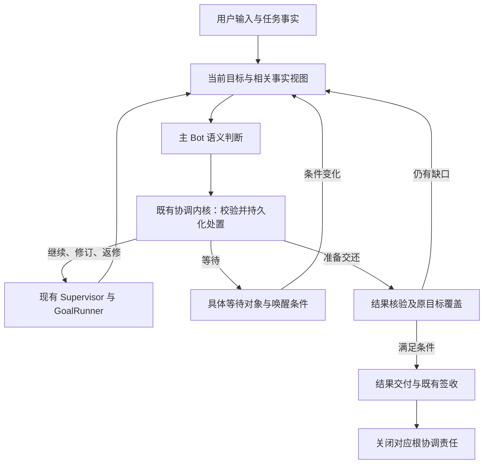

# ADR 117：意图驱动的协调判断、持续责任与目标闭环

创建时间：2026-11-01
最后更新：2026-11-01

状态：Proposed（用户要求将源码审查后的优化方案写入知识库、完善 ADR 并拆分四个工作包；本轮仅授权文档，不授权代码实施）。未实现、未运行验证，不自动纳入任何版本或 RC。

级别：A（协调协议、目标关闭、上下文准入及存储兼容），B（Runner、交付、失败隔离和进展策略）。产品表面若需调整，另按 C 级体验流程处理。

产品依据：[产品理念与价值对齐](../../design/product/peer-product-alignment.md)。工程依据：[架构治理](../architecture/20-architecture-governance.md)、[System Context](../architecture/19-system-prompt-context-architecture.md)。

关联：[ADR 88](88-project-agent-execution-continuity.md)、[91](91-project-bot-autonomous-coordination.md)、[93](93-verification-continuity-and-repair-ownership.md)、[94](94-reply-attempts-silent-wait-and-recovery.md)、[95](95-progress-driven-execution-policy.md)、[110](110-follow-up-responsibility-and-current-list.md)、[111](111-project-agent-duplex-supervision-and-continuity.md)、[112](112-runtime-module-and-loading-boundaries.md)、[113](113-checkpoint-content-addressed-storage-and-retention.md)。实施入口：[IC-01—IC-04](../../playbook/v0.1.0/intent-driven-coordination.md)。

## 1. 目标与范围

用户关心的是意图进入后如何被理解、如何分配判断权、何时继续推进以及何时交还。外部渠道只改变输入来源，不是本决策的主轴。

主 Bot 持有用户目标、约束、优先级与跨任务关系；工作 Agent 在已准入范围内自主解题；宿主维护来源、版本、执行、等待、恢复及责任交接；核验提供结果是否成立的依据。保留主 Bot → 工作会话 → 临时 Explorer/Verifier 层级。

本决策深化现有协调内核，不新增任务表、常驻意图 Agent、自由群聊、固定业务工作流、独立授权系统或第二个执行器。模型选择下一步，代码约束合法边界。普通讨论和轻量问答无需建立 GoalPlan，也不强制增加模型调用。

## 2. 核对基线与证据边界

源码基线：Peer-Agent `5dffbd4b4ced0bb841c9e879debd50b8bb081b9c`。知识整合基线：Peer-Knowledge `10707b62945cf47d7080cfb9161b166f07ffae23`。以下来自源码和现有用例的静态阅读，不是故障复现、模型质量评测或发布验收。

| 已有机制 | 代码锚点（相对 Peer-Agent） | 判断 |
| --- | --- | --- |
| 持久输入、独立 ID、消费与执行确认 | `packages/runtime-node/src/project-agent/input-queue.mjs` | 保留 |
| 用户优先、安全点让出、原生检查点 | `packages/runtime-node/src/project-agent/runner.mjs`、`apps/desktop/electron/main/agent-host/agent-turn-executor.mjs` | 已有实际执行路径 |
| 协调来源、CAS、goalRevision、executionEpoch | `packages/runtime-node/src/project-agent/coordination-kernel.mjs` | 保留授权和当前性检查 |
| 双向工作问题、等待父答、保护真实人工门 | `packages/runtime-node/src/project-agent/agent-communication.mjs`、`agent-supervision-communication.mjs` | 沿 ADR 111 复用 |
| 技术责任、返修接回与统一 followUp | `packages/protocol/src/task-overview.ts`、`packages/runtime-node/src/project-agent/repair-ownership.mjs`、`repair-custody.mjs` | 不能描述为尚无主动推进 |
| 子任务核验、有限返修、签收 | `packages/runtime-node/src/goal-runner.mjs`、`project-agent/acceptance.mjs` | 保留原闸门 |

| 缺口 | 可确认的源码行为 | 影响及置信边界 |
| --- | --- | --- |
| 原目标关闭偏向子任务状态 | `coordination-lifecycle.mjs:lifecycleOf` 在关联 session 全 accepted/cancelled、无待完成 transition 时返回 fulfilled；`coordination-lifecycle.test.mjs` 有对应用例 | 先签收调查、下一 wake 再安排实现的合法多阶段流程可能丧失协调资格；不是所有调查都会失败，具体运行未复现 |
| 回合结束缺少统一语义处置 | `continuation-policy.mjs` 对非 yielded 默认 delivered，再由 `runner-coordination.mjs`、`repair-ownership.mjs`、`reported-wait.mjs` 修正 | 已有补偿，但讨论答复、阶段交付与原目标完成没有统一记录 |
| 故障影响面偏大 | `reply-delivery.mjs` 串行追加消息与 accept；`runner.mjs:pump` 有 pending delivery 即退出；`circuit-breaker.mjs` 为 workspace 级失败计数 | 签收补偿可能挡同 Bot 独立输入，局部判断失败可能扩大为整个 Bot 的准入拒绝 |
| 默认决策事实不完整 | `event-mapper.mjs` 将失败明细写入 payload；`project-roster-source.mjs:normalizeEvent` 不保留这些字段 | 默认 L7 摘要不足，原始事实仍在，模型可经工具补查 |
| 无进展判据分散 | 回合事实指纹、协调失败的自由文本 reason 完全相等、watchdog 同因失败分别计数 | 判据存在局限；误停或空转的实际频率未测量 |

上述缺口不是放宽授权、删除核验或增加默认累计上限的理由。

## 3. 真值归属与不变量

1. Conversation 持有公开输入/回复；GoalPlan 持有子任务目标、执行结果、核验与签收；现有 coordination work/日志持有原始委托的解释、处置与持续协调责任。不得复制一份 Task 完成状态。
2. 子任务 accepted 证明其自身结果已按原政策签收，不单独证明原始委托已满足。根协调责任 fulfilled 不反向签收子任务、不释放执行资源。
3. 模型解释、目标覆盖判断与方法选择都是有来源的认知记录，不是用户原话、权限、Tool Result 或 Evidence。宿主能验证引用、身份和版本，不能用 schema 证明模型理解正确。
4. 每条用户输入保留独立处置；新修订有当前 canonical 输入来源。引用限定范围，无关目标继续推进。普通 wake 不从历史文本创造新目标。
5. 回复、回合、执行片段、阶段结果与根责任分别收尾。用户停止当前回复不等于撤回委托；撤回仍走既有控制入口。
6. 持续责任不等于无条件运行。真实人工门、明确暂停/取消、未知副作用、显式预算、租约和存储不可用继续阻止相关执行。
7. 所有模型发起的能力仍经 Provider → Manifest → Runtime Projection → Tool Call → PermissionGrant → Evidence。Renderer 只消费事实投影，主 Bot 保持只读与协调能力模式。

## 4. 输入解释与原始意图契约

在既有 work 中加法保存 `InputDisposition` 与 `IntentInterpretation`，不建立全局 Intent 表。名称为接口草案，IC-01 冻结实际 Protocol 定义。

| 记录 | 必需内容 | 约束 |
| --- | --- | --- |
| InputDisposition | inputId、所属 Bot、目标 work 引用、讨论/回答/委托/补充/修订/撤回关系、理由、decisionRef | 一次可理解多条输入，但逐条保存身份与处置；一条输入可影响多个明确目标 |
| IntentInterpretation | 原始/修订输入引用、当前期望结果、约束/非目标、未决问题、目标版本、要求与来源的映射 | 是模型解释；不能覆盖原始文本或自动批准新能力 |
| GoalCoverageAssessment | 当前目标版本、要求与已绑定子结果/核验/Evidence 的覆盖关系、剩余要求、不确定性、判断来源 | 不把摘要或路径当执行证据，不另造 resultAcceptance |

对同一意图的补充或修订绑定原 work；独立委托建立独立 work。查询进展不重建任务，提供线索不自动扩大范围，讨论/建议不自动升级为执行。用户要求“先分析，能修就修”可以形成明确的连续委托；“只给方案，先不要改”保留执行限制。

意图记录由主 Bot 原回合产生，不增加独立分类模型。简单回答沿原发送路径保存最小处置即可；有持续委托时才保存持续责任。语义目标修订由宿主单调增加 goalRevision；观察和回合处置不无故递增目标版本。

## 5. 判断接口与持续处置

深化既有 `coordinate_work`：query 可按合法 workId 查询尚无子任务的当前工作，也可由 sessionId 解析绑定；新增结构化 assessment/disposition 提交分支，复用 Delegation Provider 与协调 kernel，不另造工具执行端口。具体 discriminant 在 IC-01 冻结。

提交包含 operationId、来源输入/事件/既有决定引用、expectedWorkRevision、expectedGoalRevision、模型判断及下一步处置。两个 revision 分工：work revision 防止协调记录覆盖，goalRevision 防止对过期目标执行；不得混用 journal 的全局序号。

| 处置 | 宿主必须确认的承接事实 |
| --- | --- |
| continue | 已准入协调操作，或同目标下持久且唯一的 runnable 后续；“我会继续”不是承接事实 |
| wait | 具体 session/问题/资源/恢复记录及版本、唤醒来源；用户等待必须引用真实请求 |
| return | canonical 回复引用、当前版本的目标覆盖判断、必要子任务核验/签收及无未决义务 |
| blocked_system | 真实失败类别、影响范围、保留责任、可查询的解除条件或诊断入口 |
| withdraw | 当前真实用户来源、原控制/停止回执；不删除未知历史结果或伪造成功 |

模型提交的 assessment 字段不能签发后续执行权限；本次协调元数据能力调用仍经过既有 PermissionGrant，项目执行另经对应能力准入和授权。内核先验证并耐久记录处置意图，既有 adapter 再完成派发、修订、返修、等待或交付。recorded 与 applied 分开：return 意图可先引用已准备的回复，只有实际交付及必要签收回执满足后才能关闭根责任，不能要求“先已送达才能登记发送意图”形成循环。副作用按既有稳定操作身份补偿，不宣称跨 Conversation/GoalPlan/日志的原子事务。

事件 handled 表示责任已由持久 work 接走，不表示目标完成。事件已消费而后续仍待推进时，使用已准入决定引用与稳定的宿主待办身份恢复；不能重新冒用旧输入为“新用户请求”，也不能要求每次继续都有新的外部事件。只唤醒仍有效的有界待办，不定期调用模型询问没有变化的目标。

原生执行切片让出时可沿用上一份未尽责任和完整 checkpoint；无需强迫模型在每次安全点输出总结。正常协调收尾需要合法处置；缺失时在原预算内至多一次修正，仍缺失则保留系统阻塞，不推定 fulfilled。普通无委托问答继续允许原有轻量答复；资格在提交时根据当前事实判断，不能只看回合开始时的空 roster。

## 6. 原目标关闭与阶段自治

对采用新契约的 work，取消 `all sessions accepted/cancelled → fulfilled` 的充分条件。子任务依旧独立签收、退出子任务当前列表；主 Bot 仍可能持有原目标的后续责任。

根责任关闭必须同时满足：当前目标版本的要求已经覆盖；必要子任务结果与引用版本有效；没有本目标仍未处理的工作问题、控制转移、未知 dispatch、真人门或已准入后续；关联结果已实际交付并完成既有必要签收；宿主成功提交关闭回执。部分取消不能被当作被取消要求已经完成；整个委托撤回走 cancelled/withdraw，不写 fulfilled。

准备交还时，优先复用已绑定、确实覆盖原要求的既有核验。覆盖不足时，经既有只读 Verifier seam 做一次目标覆盖复核，沿配置、预算、能力链与版本检查；不为每次观察新增核验调用。语义判断失败返回具体剩余要求，仍由主 Bot 选择方法；已发生结果和签收历史保留。复核判断不是用户验收或工具权限。

工作 Agent 自主选择范围内的方法、局部实现和普通返修。主 Bot 负责目标修订、跨任务关系、不可沿用的错误方向和最终覆盖；不强制 worker 每一步请求父 Bot。既有核验返修、任务接手和工作问题仍走 ADR 111，不因新增原目标责任再创建监督者。

## 7. 交付和故障隔离

在原交付日志中分别记录消息提交回执与签收补偿回执：消息是否已追加、签收是否待办/成功/不适用/失败、来源版本、稳定操作身份和下一次重试依据。沿原 outbox/日志持久化，不新增交付数据库。

旧 `reply_delivered` 的综合语义保持兼容：只有消息提交及必要签收达到原完成条件才写入；不能将“消息存在”自动解释为任务已签收或旧回复错误已 recovered。新回执允许宿主继续处理独立输入，而相关 work 仍等待补偿。若来源变更，原消息保留，追加失效/更新事实，不删除已发生的公开表达。

同 work 的有序交付与目标关闭依赖保留；一项 prepared/settlement_pending 不再令整个项目 pump 退出。失效租约、权威日志损坏等全局安全故障仍可停止宿主。每个待交付项有独立错误、重试预约和恢复入口，失败项不能无限占用协调名额，也不能因无关 work 运行而遗失补偿。

| 故障范围 | 处置 |
| --- | --- |
| 单 work 的重复失败/无进展/不合法处置 | 限制该目标或 attempt，保留原责任；独立输入仍可处理 |
| Provider/账号/渠道故障 | 复用现有路由与健康准入，影响实际依赖该渠道的请求；不能擅自换模型或账号 |
| 单操作 unknown | 保留相应执行及资源保护，先对账；不阻止不冲突工作 |
| 租约/权威存储不可用 | 停止相关宿主写入/派发，给出宿主可证明的不可用事实 |

无可用模型或显式预算耗尽时不额外调用模型生成通知。隔离故障不代表承诺模型离线时仍能回答；接收/排队回执与真实处理分开表达。

## 8. 决策事实视图与进展治理

`DecisionFrame` 是从现有 work、GoalPlan、followUp、监督请求及操作回执派生的只读视图，不是新真值。优先选择当前输入/事件关联目标，包含：当前意图及来源、目标/工作版本、剩余要求、相关结果、开放问题、原始错误类别及必要 payload、真实人工门、未知副作用、已尝试方法、可用动作及拒绝原因。

保留事件 ID、输入 ID、源版本和检索引用；有大小/条数上限、稳定分页或回查入口，显式标注遗漏。不能以无关新任务挤掉本次事件对应的旧目标；不把 payload 原样无限塞进提示词，不带私有思考或凭据。通过既有 project-roster L7 Source 准入，L1 只放稳定角色规则。视图是观察快照，执行前仍回读权威事实。

统一 `ProgressObservation` 的含义：新观察、已接纳动作、要求覆盖增加/阻塞解除分别记录。不同工具结果不自动等于目标推进；有价值的调查可以产生新证据，不能要求每次读取都完成一项要求。

重复失败使用宿主可核对的 work/目标版本、操作类别、错误类别及相关对象身份；reason 改写、UUID、时间、重启、换执行者不清零。模型声称“换方法”不能单独刷新额度；新材料或可行替代以来源与实际操作记录支撑。启发式无法证明方法一定有效，需保留诊断与语义质量验收。

回合、协调操作和 watchdog 共用归一化事实，各自仍负责切片、操作及停滞唤醒；不简单合并为一个全局失败次数。保留 ADR 95 的无默认累计硬上限及显式预算，禁止新增 maxIntentSteps 等隐蔽累计截止。主动性来自未完成且有依据的责任，不来自反复轮询。

## 9. Module、持久化与并行工作边界

| Module / Seam | Interface 与 Depth | 实施方向 |
| --- | --- | --- |
| 协调 Kernel | 验证并提交输入处置、目标解释、覆盖判断、下一步及关闭；维护来源/CAS/唯一承接 | 深化原 kernel/reducer，不堆入 Runner 或 Supervisor |
| Decision Frame | 按目标选择事实、保留错误和版本、返回合法动作与回查入口 | 深化 project facts/roster Source，减少调用方拼接 |
| Runner Adapter | 接收唤醒、让出、保存原生现场、消费内核决定 | `runner-coordination` 收敛重复收尾，Runner 只执行循环 |
| Reply Delivery | 同 work 有序提交、签收补偿、幂等恢复和局部调度 | 原交付 Module；accept 继续调用原权威端口 |
| Progress Policy | 归一化失败与观察、作用域、重复判定 | 现有 continuation/watchdog/coordination adapter 共用 |

新记录复用 coordination-v2 journal/blob 与派生 SQLite。Conversation、GoalPlan、原 Evidence 和权限库不迁成新存储；不新增本机目录。涉及内容寻址、保留/回收时遵守 ADR 113：活跃责任、待交付和恢复引用必须成为保留根，不能 GC 掉仍有作用的事实。

并行设计接口：2026-11-01 已发现另一工作树在途的 ADR 116“任务控制与资源交接”及 SC 工作包；它不属于上述已合入知识基线。117 不定义停止屏障、资源账本或 claim 释放算法。实施开工时核对其合入状态：如已合入，只消费其 Session Control/Resource Admission 事实；如未合入，使用当前接口 Adapter 并明确能力限制。共享 Protocol、coordination schema、Supervisor 的修改需串行整合；任何版本号不得与其他工作包抢占。文档存在不代表在途能力已可用。

## 10. 兼容、恢复与回滚

1. 只有有来源的新记录启用新关闭语义。旧 accepted/fulfilled/取消、原始消息和执行事实不批量重开或改写；历史摘要不能补造执行委托。
2. 活跃 legacy work 先按既有 mandate 与来源解析范围；仅可添加有依据的解释，无法确定时保持 legacy/unknown，可查询或提出具体范围问题。不能以兼容为由扩大授权，亦不能要求用户重复批准已有明确范围。
3. IC-01 根据届时 manifest/head、minimumReader/Writer/Executor 和所有已合入协议冻结版本矩阵；新增事实要求不能兼容读取时严格提高门槛，不在本文预占数字。旧 writer 拒绝写入新活跃工作；重建/manifest 丢失不能降低门槛。
4. 迁移为追加式、幂等、可中断恢复。分别覆盖决定记录、待办入队、真实派发、消息追加、签收和关闭前后崩溃；对账已知结果，unknown 写入不重放。
5. 回滚先停止新语义准入、安置未决责任与交付，保留记录和版本门槛；不删除字段让旧程序强行接管。根责任未关闭不代表已取消的子任务可以复活。

## 11. 对应 ADR 的衔接

| 原决策 | 本提案获准并实施后拟调整的部分 | 必须保留 |
| --- | --- | --- |
| ADR 88 / 91 | 原目标解释、阶段签收与根关闭、typed disposition | 来源、预算、CAS、epoch、取消/恢复及唯一能力链 |
| ADR 93 / 110 | 子任务责任与根责任分层；已签收阶段退出子列表不消除原目标 | 唯一 followUp、真实人工门、历史结果和 Evidence |
| ADR 94 | 分列消息提交/签收补偿，使局部故障不挡独立输入 | silentWait、原 recovered 证据条件及旧回执语义 |
| ADR 95 | 统一进展观察及局部失败范围 | 无默认累计上限、真实预算与未知用量 |
| ADR 111 / 112 | 统一根责任处置入口和当前事实视图，减少事后拼接 | 结构化工作问题、双向执行回执、原生续接和模块所有权 |

本提案未获准实施前，不覆盖这些 Accepted 决策及其历史验收。

## 12. 实施、验收与当前状态

四包依赖为 **IC-01 → IC-02 → IC-03 → IC-04**。每包的文件边界、必补用例、退出条件、交接与最终验收见实施入口；不得跨包并行修改同一协议和协调内核，也不将任务卡当作代码实施授权。

最终必须证明：调查阶段签收后仍能在原目标内继续；讨论不升级执行；用户修订及时约束旧执行；技术问题先由 Bot 消化；真实人工门保留；局部交付失败不挡独立输入；同因失败不能靠改写理由清零；重启/迟到结果不丢责任或重复副作用；原目标最终仅关闭一次且有当前版本依据。

本轮仅文档内容、交叉引用与 diff 审阅。后续实现应补必要协议/内核/恢复用例，日常不自动运行测试、构建、类型/架构/IPC 检查或产品回归；按代码仓 Validation Scope 在版本/RC 前对最终组合候选执行完整门禁，用户明确要求提前验证时另记授权与范围。真实模型、安装包、辅助技术与独立审阅分别记录，不能用受控传输用例冒充。
