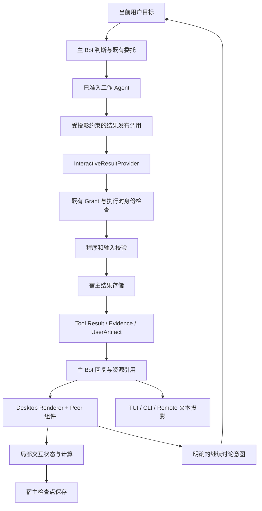

# ADR 118：OpenUI 可交互结果复用与运行时边界

创建时间：2026-11-02
最后更新：2026-11-02

状态：Proposed。用户已要求形成完整设计；本 ADR 待评审，不代表已批准实现、开放新能力或完成产品验收。

级别：A。扩展用户产物、资源引用、交互状态持久化、能力投影和 System Context 准入契约；共享实现与宿主装配属于 B 级，局部组件与布局属于 C 级。

范围：在 Peer 的既有对话与资源工作区中提供可恢复、可追溯的交互结果。首期支持有界表格、图表、筛选与确定性试算；复用 OpenUI 语言内核和 React 渲染接口，继续使用 Peer 的模型通道、Frost 组件、本地能力链、Conversation、GoalPlan 和 Evidence。

## 1. 决策摘要

采用 **OpenUI 内核复用、Peer 组件注册、宿主管理结果与状态、能力执行沿既有 Runtime** 的方案。

1. 以 `@openuidev/lang-core`、`@openuidev/react-lang` 为首批依赖候选，固定版本评估。使用其公开解析、状态绑定与渲染接口；不复制一套语言解析器，不整体引入示例应用。
2. 交互结果是用户产物的一种表达，由真实 Provider 发布后进入既有 UserArtifact / EvidenceIndex 投影。助手文本、代码块和文件后缀不自动创建可执行产物。
3. 模型组合经注册的 Peer 组件和确定性函数。Renderer 处理局部选择、筛选与试算，不持有权限、任务完成、签收或工具执行真值。
4. 第一批由已准入的工作 Agent 调用结果发布能力；主 Bot 保持只读与调度，引用已发布结果。普通问答继续直接回答，不因引入交互结果而强制创建任务。
5. 首期禁用 OpenUI `Query`、`Mutation`、MCP 直连、任意 HTML/JavaScript 和主动网络组件。未来需要实际能力时，扩展显式动作契约并继续经过统一能力链。
6. 程序、数据快照、组件库版本、文本降级与用户交互状态分别保存。重开、切换窗口、升级和恢复不重新生成结果、不重跑工具。
7. Desktop 提供完整交互；TUI、CLI 和首期 Remote 提供同一结果的有界文本与来源。图形依赖不得进入 TUI/CLI 的必要启动路径。
8. 本设计分阶段交付。仅写完 ADR、能解析示例或出现静态界面，不构成模型效果、权限安全或发布验收通过。

## 2. 产品目标与非目标

用户把工作交给 Peer 后，应能在同一项目中理解结果、比较条件、检查依据，并把明确的新意图交回 Bot。交互结果服务于交付，不形成第二套聊天产品或任务系统。

首个完整故事：用户要求比较若干实施方案；工作 Agent 使用已取得的数据生成对比结果；Bot 在主对话解释结论并提供入口；用户在资源区筛选方案、调整预算进行试算；关闭后再次打开仍保留选择；需要继续实施时，用户把当前条件放入原 Bot 草稿并明确发送。此前的筛选和计算没有批准文件写入、创建新执行或签收结果。

| 目标 | 用户可观察的行为 |
| --- | --- |
| 少解释 | 结果保留当前项目、原问题、数据来源和版本 |
| 少切换 | 从回复或任务产物直接打开同一资源区，讨论回到原 Bot |
| 少怀疑 | 实际观测、模型判断、用户参数和试算结果能够区分 |
| 可恢复 | 关闭、切换、失败与升级后保留已保存内容及交互状态 |
| 可退出 | 随时切回文本摘要、关闭视图或停止局部计算，不影响后台任务 |

不在首期范围内：通用网页生成与托管、任意脚本运行、地图与图片搜索服务、第三方 MCP 客户端接入 Renderer、交互卡批准权限或验收、跨用户实时协作、模型自由安装组件、自动导出或自动执行表单，以及把所有 Bot 回复改成 OpenUI 程序。

本设计提升结果表达能力，不把 UI 语言或可点击控件当作模型推理质量、数据真实性或任务可靠性的保证。

## 3. 权威与关联决策

产品方向遵从[产品北极星](../../design/product/peer-product-alignment.md)。能力与层级遵从[架构治理](../architecture/20-architecture-governance.md)、[工程哲学](../architecture/00-engineering-philosophy.md)、[项目结构](../architecture/01-project-structure.md)和 [System Context 架构](../architecture/19-system-prompt-context-architecture.md)。

| 既有契约 | 本 ADR 的关系 |
| --- | --- |
| [ADR 15](15-plugin-skill-mcp-system.md)、[ADR 16](16-skill-call-lifecycle.md) | 所有实际能力继续经过 Provider、Manifest、Projection、Tool Call、Grant 和 Evidence |
| [ADR 63](63-user-artifact-evidence-boundary.md) | 拟增加交互产物类型；保留 Provider 产生 UserArtifact 的规则 |
| [ADR 80](80-project-agent-delegation-model.md)、[ADR 101](101-bot-owned-access-policy.md)、[ADR 106](106-readonly-git-and-delegation-capability-admission.md) | 主 Bot 只读与调度、动态授权继承、委托能力准入保持原归属 |
| [ADR 109](109-resource-reference-preview-and-artifact-collaboration.md)、[ADR 114](114-reply-citation-resolution-and-open.md) | 在既有资源身份、引用、混合标签、草稿和受控打开契约上扩展一种内容 |
| [ADR 111](111-project-agent-duplex-supervision-and-continuity.md)、[ADR 117](117-intent-driven-coordination-and-goal-closure.md) | 交互状态和结果发布不创建第二份持续责任或目标完成状态 |
| [ADR 112](112-runtime-module-and-loading-boundaries.md) | 领域逻辑集中、跨宿主复用、低频图形依赖按需加载 |
| [ADR 113](113-checkpoint-content-addressed-storage-and-retention.md) | 不可变正文与引用、保留、清理和恢复沿现有存储 seam；不能擅自复用执行检查点身份 |

视觉与交互依据：[Frost 体验规范](../specifications/peer-product-experience-standard.md)、[人机交互契约](../specifications/peer-human-agent-interaction-contract.md)、[动效体系](../specifications/motion-system.md)、[过渡体系](../specifications/transition-system.md)和[开发规程](../../playbook/product-experience-development.md)。上游颜色、图标、动效与壳层不成为 Peer 的第二套标准。

本 ADR 拟扩展上述接口，不修改它们已有的权限、验收及实际实现状态。只有对应契约评审接受、模块完成接线后，才可在投影中开放本能力。

## 4. 核对基线与上游事实

### 4.1 固定基线

| 对象 | 本次审阅的固定身份 | 用途 |
| --- | --- | --- |
| Peer-Agent | `4a58e2846875f85de69915764a127096721c5b0d`，RC35 / 当前开发线基线 | 确认现有 Renderer、Provider、产物、存储与多入口边界 |
| Peer-Knowledge | `f952a447fc46a325f7c5b79267f35df21e5643b1` | 关联本次 ADR 使用的最新治理与编号 |
| open-intelligent-ui | `16ef26475999e3a021a50b1607a03717c0721255` | 确认示例应用、组件、动作、存储、提示和检查方式 |
| 示例锁定的 SDK | `lang-core@1.0.0`、`react-lang@1.0.0`、`react-ui@0.18.1` | 区分示例代码与底层引擎，检查发布包而非只读宣传页 |
| OpenUI 主仓参考 | `729ac8bbdf60a1cfe914f4a02683bce6262fe245` | 补充当前公开接口文档；与固定发布包有差异时以实际选择的包版本为准 |

依赖发布包仅被下载用于静态审阅，没有在 Peer 中安装或运行安装脚本。上游 README、基准描述和 PR 自述不作为 Peer 的验收证据。

### 4.2 已确认的复用能力

- 示例用 `createLibrary` 注册组件、函数与动作，React Renderer 可独立消费程序、流式状态和初始状态；宿主可以接收状态变化、动作和结构化错误。[U2][U9]
- 语言包含表达式与 `$variable` 状态绑定，可在局部交互后重新计算显示；常用列表、数学、日期与数据变换函数已经实现。[U2][U3]
- 默认云路径提供 OpenUI 输出校正；直接兼容 API 路径在本地构造提示并转发模型输出，没有同等云端校正。因此 Thesys 云不是必要依赖，生成正确性仍需 Peer 自己处理。[U4]
- 示例的完整基础生成提示文件约 3.3 万字符。这个数字是该固定文件的字符量，不是所有模型上的 token 数，也不构成 Peer 上下文预算。[U10]
- 示例应用是私有标记的 Next.js 工程；可复用的 npm 库来自 OpenUI 主仓，不应把整份示例当成 Peer 的生产模块。[U1][U9]

### 4.3 需要替换或收口的行为

| 上游行为 | Peer 的处理 |
| --- | --- |
| 后端仅整理用户/助手文本，并保留最后 60 条输入 | 保留 Peer 的 Provider encoder、工具结果、附件准入、压缩与 Evidence，不移植聊天后端 |
| 会话与交互状态存进浏览器 localStorage | 使用宿主持有的版本化结果和状态，localStorage 不是真源 |
| Renderer 可把 Query/Mutation 交给函数表或 MCP client | 首期不提供 toolProvider，并在解析政策层拒绝这些节点，避免仅靠缺省回调限制 |
| SearchImage、地图和媒体组件可自行请求接口或外部资源 | 首期不注册；未来数据获取沿正式 Provider 与网络政策 |
| HtmlView 使用 allow-scripts iframe，允许部分 CDN 与 HTTPS 图片 | 首期不注册；运行 HTML 另按独立执行和沙箱设计处理 |
| 组件主题包含全局 token，聊天页还替换 window.open | 注册 Peer 组件与导航动作，不复制全局主题或覆盖浏览器 API |
| 示例有可配置 PostHog；SDK 有开发工具和安装遥测行为 | 依赖准入检查脚本与默认行为；禁用未授权遥测和开发工具自动挂载 |

`lang-core@1.0.0` 的运行时遥测为显式 opt-in，浏览器环境不发送该运行时遥测；安装脚本遥测另有禁用机制。不能把不同层的行为混为“默认上传聊天内容”。具体外发字段与禁用策略以固定发布包和其后续审阅为准。[U8][U9]

## 5. 方案比较

| 方案 | 收益 | 代价与边界 | 决定 |
| --- | --- | --- | --- |
| 整体移植 Next.js 示例与 AgentInterface | 快速得到类似 Demo 的壳与交互 | 并列的模型请求、会话存储、外部数据与设计系统；破坏 Peer 的统一事实来源 | 不采用 |
| 复用语言内核与 Renderer，注册 Peer 组件 | 复用解析、状态和流式能力，保留既有 Runtime | 需要限制语言子集、动作与数据适配、版本和恢复契约 | 采用 |
| 只复制图表与表单组件 | 引擎依赖较少 | 仍需自行维护语言、状态、流式与错误协议 | 作为 SDK 无法满足边界时的静态降级选项 |
| 模型直接生成 HTML/JS | 表达能力广 | 额外脚本、资源、隔离、性能与恢复负担 | 不纳入本 ADR 首期 |
| 全部继续用 Markdown | 现有链路稳定、可跨入口 | 交互比较与试算能力有限 | 保留为默认回答和始终可达的降级 |

选择 OpenUI 不意味着以后必须依赖某个云端模型或托管服务。语言引擎、组件目录、数据获取和能力执行应能分别替换。

## 6. 架构与真值归属



| 对象 | 唯一事实所有者 | 不能替代的对象 |
| --- | --- | --- |
| 用户目标、公开输入与 Bot 回复 | Conversation 与既有协调对象 | UI 程序不能签发用户输入身份 |
| 程序、输入快照、兼容要求和文本降级 | InteractiveResultStore 的已发布版本 | 助手正文和 Renderer 缓存不能制造正式产物 |
| 用户筛选、参数和局部选项 | 宿主持有的交互状态检查点 | 不代表文件已写入、任务已启动或结果已签收 |
| 焦点、滚动、展开和当前可见标签 | 现有资源会话与视图状态 | 不携带执行权、数据源或工具目标 |
| 工具执行、权限与结果 | 既有 Runtime / PermissionGrant / Evidence | OpenUI action 成功、动画或状态变量不能代替 |
| 任务核验、签收与原目标闭环 | GoalPlan、验收政策和协调内核 | 交互结果发布成功不意味着任务完成 |

本设计遵守两类既有路径：模型调用真实能力走完整能力链；人对已准入结果的只读导航与局部视图状态走资源 ApplicationService。后者不能承接模型工具、项目文件写入、网络查询或执行控制。

## 7. Module 与 Interface

下表是拟实施的职责与相对代码位置，不表示文件已经存在。

| Module | 建议位置 | Interface 与核心责任 |
| --- | --- | --- |
| 交互协议 | `packages/protocol/src/interactive-result.ts` | 发布输入、已发布引用、状态 CAS、错误和兼容对象；不得引用 React 或文件系统 |
| InteractiveContent | `packages/interactive-content/` | 共享目录规格、语言子集校验、输入/状态归一化、复杂度计算、文本投影；框架无关且无 I/O |
| InteractiveResultProvider | `packages/runtime-node/src/interactive-results/provider.mjs` | 声明能力、校验执行身份与 grant、发布并返回真实 UserArtifact/Evidence |
| InteractiveResultStore | `packages/runtime-node/src/interactive-results/store.mjs` | 不可变版本、幂等发布、状态写者/CAS、恢复、保留和导出准入 |
| OpenUIRendererAdapter | `apps/desktop/renderer/src/interactive-results/` | SDK 渲染、Peer 组件、局部状态和结构化错误；不直接调用能力 |
| 宿主适配 | 既有 Desktop/TUI composition root 与 typed API | 绑定真实 sender、owner、当前调用/视图身份；不复制领域规则 |
| Context Source | `packages/system-context/src/sources/interactive-result-source.mjs` | 按投影准入本次组件/语言规则与其版本；不执行能力 |

`InteractiveContent` 提供小而有深度的 Interface：`catalogSpec`、`validateDraft`、`validateState`、`projectText`。其 Implementation 统一处理目录版本、AST 白名单、数据边界和计算限制，避免 Host 与 Renderer 各维护一套正则过滤或语法判断。

OpenUI 依赖只在这些 seam 内消费。通用 Runtime Core、Provider encoder 和 ConversationStore 不理解 OpenUI 节点；替换渲染引擎时，工作应集中于内容适配与 Renderer，而不改权限或任务执行器。

## 8. 首期组件、函数与语言子集

### 8.1 组件目录

| 组 | 首期内容 | 约束 |
| --- | --- | --- |
| 排版与布局 | Col、Row、Card、Title、Text、Caption、Divider | 使用 Peer token，禁止任意 HTML、style 或 CSS 注入 |
| 数据展示 | Table、Chart、Metric | 仅消费已绑定快照；图表提供表格/文本等价表达 |
| 局部输入 | Input、NumberInput、Select、Checkbox、Slider | 明确标签、约束和受控值；仅改变本产物状态 |
| 局部动作 | Button | 只允许受限 Set/Reset；不注册权限、签收、运行命令等动作 |
| 来源 | SourceReference | 只接受宿主登记的 bindingId；导航沿既有引用解析 |

上述名称是 Peer 目录的设计名称，不承诺与上游所有参数一一兼容。正式规格由同一目录生成：参数名、顺序、选项、限制与描述均有版本；改变任一项需更新 libraryVersion/specHash。

Frost 组件、SVG 图标、键盘与焦点基元继续作为唯一界面实现来源。不加载上游整套 `react-ui` 样式，不把可配置模型列表做成生成式 Select；模型配置仍用 Peer 标准 ModelPicker。

颜色、间距、圆角和尺寸使用目录中的有限语义值。禁止模型提供 CSS 字符串、任意 style、事件属性、固定定位或覆盖原生治理区域的层级；图表绘制参数由受信组件实现计算。

### 8.2 函数与表达式

首期只准入有限数值运算、比较/条件、字符串格式化，以及输入长度已有上限的筛选、分组与聚合。优先复用已审阅的上游函数；函数输入输出都需再次检查有限数值、集合长度、文本长度与嵌套深度。

首期不开放任意循环、递归、Range/Each 扩张组合、Query、Mutation、Run、动态组件注册、OpenUrl、HtmlView、搜索/媒体组件或 JavaScript 求值。Table/Chart 自己处理已归一化的有限行集合。计算需要日期时使用固化输入，不在重开视图时调用 Now/Random/Shuffle 改写结果。

限制必须由 `InteractiveContent` 的 AST/目录政策和组件实现执行，不能只写进提示词。SDK parser 的宽容解析不等于允许显示所有可解析内容。若公开 SDK 接口无法在求值前可靠识别并限制节点，此阶段停止准入，补充适配方案；不得退回仅用字符串正则拦截或自行重写完整语法。

### 8.3 确定性与格式

同一程序、目录版本、输入快照和状态应产生相同计算结果。金额、百分比、日期、单位与 locale 均作为明确输入或目录规则；拒绝 NaN/Infinity。浮点与货币舍入规则必须记录，示例试算不得冒充专业结论或来源已核实的业务事实。

## 9. 发布协议与能力投影

### 9.1 拟新增能力

新增 `local.interactive.publish`，模型工具名拟为 `publish_interactive_result`。Provider 只向宿主管理的内部结果空间写入经过校验的内容，不接受项目路径、任意 URL、命令、MCP 配置或自定义组件代码。

Manifest 拟声明 `L2_local_write`，数据等级按实际输入继承且不得降低；输入包含标题、文本降级、程序和已有材料引用。沿既有本地写入政策取得绑定本次调用的 PermissionGrant，已有自动授权政策可按其现有条件决定，不因创建交互结果默认增加第二次人工确认。

grant 的有效范围是当前 workspace/conversation、已准入工作、此次 toolCall 和内部结果写入参数。它不授予项目文件写入、网络访问或后续动作权限。实施时在现有权限 Interface 中表达该受限目标；若无法表达，应先补齐契约，不能伪装成 file-read 或直接写盘绕过链路。

首期仅为实际有该能力的工作 Agent 投影。主 Bot、Explorer、Verifier 默认不获得本能力；主 Bot 可以读取已发布元数据并在 post_reply 中引用。`requiredCapabilities` 必须包含发布能力及实际数据获取、验证所需能力，缺失时由原准入契约返回技术阻断。

### 9.2 模型输入与宿主事实分离

模型可提供的 `InteractiveResultDraft`：

```ts
interface InteractiveResultDraft {
  title: string;
  textFallback: string;
  program: string;
  inputs: Array<{
    bindingId: string;
    source: AdmittedMaterialReference;
    selector?: BoundedDataSelector;
  }>;
}
```

`AdmittedMaterialReference` 和 `BoundedDataSelector` 必须是协议内白名单对象：引用已准入的工具结果、用户材料或结构化模型数据；选择器只允许有限字段/行选择，不接受脚本或任意 JSONPath。模型自行填入一个存在的 Evidence ID 仍不足以通过宿主归属检查。

workspace、conversation、session/plan、原用户输入、attempt/epoch、发布者、目录版本、specHash、数据等级、权限、产物 ID 和 Evidence 关联均由宿主推导或核对。模型自报这些字段既不生效，也不能覆盖当前上下文。

已发布描述至少包含：`schemaVersion`、`resultId`、不可变 `contentVersion`、owner/source 引用、`engine`、SDK/目录版本、`specHash`、程序与数据快照引用、数据来源分类、`textFallback`、实际发布 Evidence 引用、时间、兼容要求和当前可用性。Conversation 只保存有界引用/展示元数据，不复制另一份正文真源。

### 9.3 发布顺序与幂等

1. 核对当前执行、停止、lease/epoch、角色、投影和授权；拒绝越权引用及未知 schema。
2. 解析并验证程序、目录、输入、数据来源与资源预算，确保校验完成前没有代码、网络或工具执行。
3. 固化程序、数据及文本降级；权限等待、异步解析或来源读取后，在存储提交前再次核对 owner、停止、当前 lease/epoch 和有效 policy/grant。通过后先写不可变 blob，再提交版本 manifest 与发布操作记录。
4. 由既有 Tool Result/Evidence 流程记录实际结果，返回 `UserArtifact.kind = interactive` 的受治理元数据；EvidenceIndex 保留原 Provider 来源，不被包装回执覆盖。
5. 主 Bot 通过既有报告、核验与 post_reply 关联结果。发布成功只证明该交互产物已生成，不表示输入全部正确、任务通过核验或已签收。

相同 toolCallId/规范参数摘要映射到同一次发布。相同 ID 不同参数拒绝；不同内容产生新不可变版本。结果中途未知时先核对操作记录、已写 blob 和实际调用回执，不在视图恢复时重发发布调用。缺失证据不能从文件存在或助手文字补造。

### 9.4 失败契约

校验失败返回稳定 code、可恢复性及有界字段位置；权限拒绝、取消、超时、存储错误和未知提交分别沿既有 Tool Result 状态/错误对象返回。未知对象不能被归一化为一份空表或成功结果。所有失败保留原 toolCall、来源与实际执行阶段，重试建议不得携带伪造 grant。

```text
Capability Provider → Manifest → Runtime Projection → Tool Call
  → PermissionGrant → 受限发布与真实结果 → Evidence / UserArtifact
```

## 10. 数据绑定与真实性

每个输入快照记录来源类别、原始引用、所选范围、内容版本、获取时间、截断信息和继承的数据等级。模型生成数据可以用于示例或假设，但明确标为模型构造；工具结果只证明工具实际返回，业务结论仍按原任务标准核验。

程序通过目录中受限的 `@Data(bindingId)` 纯函数读取已固化输入。bindingId 必须是本结果已有的字面量标识，函数只读取已载入的有限快照，不解析路径、不访问网络或工具。宿主校验绑定完整性，Renderer 使用相同绑定表；模型不得重定义该函数、遮蔽保留命名空间，或用 Set/Reset 修改输入快照。程序中的内联业务数据按模型构造处理，不能仅因附近出现来源引用就继承其真实性。

| 数据类别 | 展示与使用 |
| --- | --- |
| 已准入 Tool Result / 用户材料 | 可以生成有限快照；来源和观察时间可达 |
| 用户修改的参数 | 显示为当前试算条件，不覆盖原始观测 |
| 派生计算 | 显示计算条件、单位和输入版本；不写回数据源 |
| 模型构造或 Demo 数据 | 明确为示例/假设，不包装成实时业务数据 |
| 缺失、过期、截断或已撤回来源 | 显示对应状态；不自动补数、取其他项目数据或发起查询 |

首期结果是固定数据快照。打开、重绘、筛选、重试 Renderer、重启和恢复都不刷新来源。用户需要新数据时，将明确请求交回原 Bot，由现有能力取数并发布新版本。只有本地计算重新求值不增加模型请求，也不创造 Tool Result。

数据进入结果前须核对当前材料准入与父链范围；不能借结果引用从其他 Bot、未准入附件或过去任务读取资料。源引用失效后，可否继续显示已保存快照由现有留存与访问政策决定，不能把来源失效等同于自动删除已交付内容，也不能用快照恢复已撤销的执行权限。

## 11. 版本、结果引用与资源承载

### 11.1 四个独立版本

1. `schemaVersion`：Peer 结果包与状态协议的读写格式。
2. `contentVersion`：不可变程序、绑定快照、目录规格和文本降级的规范内容摘要；不含会变化的用户状态和窗口位置。
3. `libraryVersion/specHash`：此次可用组件、函数、参数语义和限制的身份。相同组件名称不证明版本兼容。
4. `stateRevision`：同一内容版本下用户交互状态的 CAS 版本。它不推进任务 goalRevision 或 executionEpoch。

SDK 版本另行记录，用来选择已登记的兼容适配。哈希用于一致性和索引，不是权限令牌或文件存在性证明。Renderer 不能自行接受结果包指定的 npm 地址或下载旧引擎。

### 11.2 稳定引用

扩展既有资源联合类型，新增受控 `interactive` 引用，至少绑定 owner、resultId 和 contentVersion。打开沿 ADR 109 的宿主 resolver 核对来源、可用性、归属与读取范围，再进入对应领域会话；不把内部路径暴露成任意文件读取入口。

同一版本在同一 owner 下去重激活；不同版本可以并列。新版本发布不替换用户正在操作的旧版本，也不静默把旧状态套到新程序上。提供明确的“打开新版本”和“保留当前试算”。

混合标签只保存领域引用；InteractiveSession 保存本领域状态，不把交互状态塞进 DocumentSession、BrowserSession 或万能资源 reducer。共享布局、窗口、导航和返回来源继续复用既有 seam。

### 11.3 不支持与失效

| 情况 | 呈现与动作 |
| --- | --- |
| SDK/目录版本尚无兼容适配 | 显示已保存文本与原因，可查看源码；不自动升级运行 |
| 程序或输入损坏、摘要不符 | 不执行；保留诊断、文本降级和返回入口 |
| owner/source 未连接或权限不足 | 显示真实不可用原因，不扫描磁盘、不借另一 Bot 打开 |
| 正文已清理 | 保留产物名称、来源及清理状态；不从当前数据拼造历史结果 |
| 旧 UI 状态与新版本不匹配 | 保留原检查点；仅在同版本恢复，或经明确映射建立新的状态副本 |

## 12. 用户状态、保存与多窗口恢复

### 12.1 状态边界

区分三类内容：不可变输入快照、可变用户参数/筛选、视图阅读位置。输入快照由发布版本固定；用户参数与筛选保存在交互检查点；焦点、滚动、展开和当前标签沿原视图/导航契约保存。

`InteractiveStateSnapshot` 至少绑定 resultId、contentVersion、specHash、stateSchemaHash、stateRevision、规范化 values、更新时间与最近保存 requestId。只接受目录允许的状态键与类型，不接受权限、执行回执、工具函数、URL 凭证、文件目标或任务生命周期字段。

所有交互字段、表格行和局部选项具有稳定键；不能用当前渲染次序为身份。输入中的未完成数字、中文组合等属于编辑草稿，不能被逐键数值归一化清空。组件分别保留输入草稿与有效计算值；只有合法值进入求值，原始草稿按有界字段保存。

### 12.2 保存路径

Renderer 的内存 Store 提供即时交互，`onStateUpdate` 只提交有界的状态修改请求。typed API 交给宿主 ApplicationService，核真实 sender、owner、内容版本、写者和 expectedRevision 后保存。与 ADR 109 的正文草稿一样，这是本机 UI 工作状态；不会调用发布能力、写原项目文件、刷新来源或发起模型回合。

状态保存不生成 PermissionGrant，不写成工具执行成功 Evidence。访问或修改实际项目/外部系统时仍必须转入完整能力链。Renderer 不直接访问 fs、localStorage 真源或持有数据库连接。

宿主状态 Interface 至少具有以下操作，均返回带明确 code 的结构化结果：

| 操作 | 输入与顺序约束 |
| --- | --- |
| open | resultRef + requestId；宿主核来源并返回本窗口 viewHandle、固定内容版本和最后确认状态 |
| readState | 有效 viewHandle；只能读该 owner/版本的状态，不接受任意文件或其他 resultId |
| acquire | viewHandle + 当前 stateRevision；显式 takeover 才可接管已有写者，返回不可复用的 writer generation |
| save | viewHandle + writer + expectedRevision + requestId + 规范参数/输入草稿；CAS 成功后返回新 revision 和保存时间 |
| release | 仅释放当前 writer；不清空内容或状态；断连/重启使旧句柄失效 |
| prepareFollowup | viewHandle + 已确认 stateRevision + 用户选取字段；只准备原 Bot 草稿材料，不直接发送 |

同 requestId 的相同保存参数幂等返回原回执，不同参数拒绝。viewHandle 由真实 sender/window/generation 约束，不能仅凭客户端提供的 token 授予读取或写入。失败至少区分 owner 不符、视图失效、版本不兼容、writer 过期、revision 冲突、超限、存储不可用与保存失败。

高频状态可以合并保存；只有宿主确认的 revision 才显示“已保存”。关闭、失焦和容器切换尝试刷新检查点，但崩溃只能保证恢复最后确认版本，不能承诺最后一次未确认按键已落盘。保存失败时保留当前内存草稿和明确未保存提示，重试只保存状态，不重新发布或执行工具。

### 12.3 单一写者

首期同一 resultId/contentVersion 的用户状态仅有一个活跃 writerView。宿主以真实 sender 和不可复用的 writer generation 校验；其他视图读取同一确认快照。用户显式接管后旧 writer 的迟到保存被拒绝，并保留其未提交草稿供选择。

与现有资源编辑一致，写者只约束本结果状态，不锁项目文件、不扩大执行授权。多个实例可以作为只读视图存在。首期主对话只显示摘要与入口，避免同时挂载另一个独立交互实例。

### 12.4 恢复顺序

1. 核对 owner、schema、不可变内容及受支持的目录/SDK 版本。
2. 加载固化数据和文本降级；不发网络、不查 MCP、不启动任务。
3. 校验同内容版本的已确认状态，并恢复输入草稿；未知状态字段隔离，不覆盖原检查点。
4. 进入用户实际打开的容器后恢复阅读位置；不自动聚焦输入、不重播历史入场。
5. 原来未完成的真实能力操作只展示其原生回执；没有当前事实时保持未知，不从 OpenUI 状态推断成功或自动重发。

## 13. System Context 与模型输出

### 13.1 显式准入

新增 `runtime.interactive-result` Context Source，规则层为 `L5_TOOL_RULES`。仅在当前 Projection 确实允许结果发布、相关结果格式已被本次执行选择、目录可用且上下文预算允许时装配。主 Bot 的普通回答、未启用功能的回合及 TUI 常规启动不注入整套 UI 语法。

Source 由可信目录生成语言规则、允许组件/函数、参数限制、错误修复说明与少量示例。输入材料、程序、用户状态和历史结果通过受治理引用进入 `L7_CONTINUITY` 或既有用户材料槽位；它们不能升为系统规则。L0–L7 层序与 Provider encoder seam 保持原契约。

记录本次目录版本、specHash、准入组件集合及 Source checksum，纳入 ContextEpoch 和提示快照。SDK 生成的提示只是该 Source 的输入，不在 Provider adapter、客户端 UI 或重试分支临时拼一段 system/developer 文本。

### 13.2 上下文预算

首期只使用基本目录。UI 规格与规则的准入目标上限为 4096 个宿主计量 token，同时设 16 KiB UTF-8 硬上限；这是拟实施的预算，不是已测模型效果。某 Provider 无可靠计量时采用现有保守上下文预算策略，不能把字符数冒充 token 数。

预算不足时缩减本次目录或回到普通文本产物；不能截断必要语法、参数说明或边界规则后继续开放发布能力。数据大对象保持本地快照与有界摘要，不逐轮把完整表格、程序和所有状态重塞给模型。

### 13.3 生成、校验与修复

工作 Agent 生成程序后调用发布能力。失败返回有界结构化问题，例如 `unknown_component`、`unsupported_node`、`invalid_binding`、`non_finite_value`、`resource_limit`、`incompatible_catalog`；附具体位置和允许的修正方式，不把全部用户数据或堆栈写入错误正文。

同一发布候选最多进行两次针对生成内容的模型修复，并共享原工作预算；只有校验已知未发布时才可提交修正版本。磁盘错误、权限拒绝、资料缺失和结果未知分别处理，不通过重新生成掩盖。超过修复范围时交还实际原因和已保留的文本结果，不伪造一个“可交互”入口。

首期发布完整、不可变结果后再启用交互。OpenUI 的流式能力作为后续表现适配候选；未完成程序只能作为明确的临时预览，不能登记正式 UserArtifact、启动动作或覆盖已发布版本。若要扩展分段预览协议，须单独补齐预算、取消和所有权后实施。

## 14. 动作与权限边界

| 动作 | 首期路径 | 权威语义 |
| --- | --- | --- |
| 筛选、选择、参数试算、恢复默认值 | 受限局部 Store 与纯函数 | 只改变这份结果的展示/用户参数 |
| 打开结果、查看数据表或来源 | 既有资源导航与受控读取 | 不授予模型新的读取范围 |
| 保存局部状态 | 宿主检查点 API | UI 状态已保存；不表示项目发生修改 |
| 把当前条件交给 Bot | 宿主原生控件准备有界草稿，用户明确发送 | canonical 用户输入沿原发送链产生 |
| 文件写入、Shell、MCP、外部查询或执行控制 | 首期不提供生成控件入口 | 后续必须通过显式动作协议和既有 Runtime |
| 授权、回答原生人工问题、验收或取消任务 | 使用 Peer 已有原生控件与记录 | 生成程序不能构造或替代这些决定 |

“把当前条件交给 Bot”由宿主提供固定控件，不由任意 OpenUI Action 直接调用 sendMessage。宿主仅从当前确认的内容/状态选择有限字段，用户可检查、编辑或取消；不会覆盖原 Composer 草稿。敏感数据是否进入模型沿原上下文准入政策，状态改变或保存均不自动发送。

未来如需 Query/Mutation，须逐项定义可用能力、目标来源、参数 schema、幂等键、版本、取消、结果未知及 Evidence 回传。适配器只能把受控意图送入现有 Runtime Projection，不能把原始函数表、MCP client、任意 capabilityId 或 preload 暴露给模型生成组件。未完成这些契约前，首期禁用保持有效。

## 15. 交互状态与体验

### 15.1 各状态独立表达

| 维度 | 事实来源 | 必需表达与恢复 |
| --- | --- | --- |
| 发布：准备/成功/失败/未知 | 实际发布操作与 Tool Result | 未成功不显示正式产物；未知先对账 |
| 读取：加载/可用/不可用/不兼容 | 宿主结果读取与版本校验 | 局部错误、文本降级、返回来源与只读重试 |
| 用户状态：未保存/保存中/已保存/冲突 | 宿主状态 revision 与当前草稿 | 保留用户输入，允许重试或显式接管 |
| 数据：固定/过期/截断/缺源 | 已绑定输入元数据和当前来源可用性 | 保留观察时间与范围，不用空表冒充成功取数 |
| 任务与权限 | 既有 Goal/授权事实 | 在原生任务/权限区域表达，不从生成界面推导 |

### 15.2 容器与注意力

主对话交还结论、摘要、来源和“打开交互结果”入口。正式互动在 ADR 109 的同一资源区中进行；宽屏并排，窄屏切换同一对象，关闭回到原消息和阅读位置。首期不另做 Chat 页面、强制弹窗或生成式全屏应用壳。

后台发布完成、数据变为过期、保存成功或模型追加解释都不抢焦点、不展开收起内容、不恢复用户已取消的自动滚动。只有用户明确打开或实际原生待决定事项才按既有注意力规则处理。

输入保护 IME、撤销、选区与输入草稿；主题、尺寸或内容容器变化不重建状态身份。图表、表格和筛选都有可访问名称、键盘路径与空/错误状态，图表提供相同数据的表格或文本。颜色与动画不单独承担状态信息。

沿用集中动效和减少动效语义；不复制上游弹簧常数、全局样式或逐 token 入场。隐藏视图暂停非必要绘制与计时，保留状态；停止局部计算不等于停止后台任务。

## 16. 安全与资源限制

### 16.1 威胁与处理

| 风险 | 强制边界 |
| --- | --- |
| 程序携带提示注入或伪造执行声明 | 内容始终是模型/用户材料；不能成为 Context Source 规则或 Evidence |
| 原型链、函数对象、动态模块与任意代码 | 严格协议/AST 白名单，拒绝保留键、非 JSON 数据、未知节点及可执行参数 |
| 程序构造任意工具/MCP 调用 | 解析前置政策拒绝，Renderer 无 toolProvider、MCP 或 capability dispatch 入口 |
| 图片、链接、字体、CSS 或 iframe 产生网络访问 | 首期不注册主动组件或任意 URL/CSS，第三方资源不进入基本目录 |
| 伪造通过/授权/签收控件 | 原生治理区域由宿主事实投影；生成文字和局部状态没有对应命令权 |
| 越项目读数据或猜中产物 ID | 每次 API 由宿主核真实 owner、sender、来源准入与内容版本 |
| 资源爆炸、深递归和同步卡顿 | 发布前 AST/数据预算、受控解析 Worker、函数与组件运行界限；不依赖 prompt |
| 陈旧窗口、状态覆盖或旧结果静默变新 | 单写者 generation、CAS、固定内容版本与显式版本切换 |
| 导入结果包伪造可信来源 | 导入只产生不可信材料，不复活 grant、Evidence、任务身份或执行 |
| 依赖安装脚本、遥测和开发工具外发 | 锁版本、审查脚本和包体，明确禁用未授权遥测与自动挂载 |

不向结果内容暴露 `clientApi`、preload、原生窗口对象、文件系统或 secret storage。Frame 是否隔离不能代替 Provider 权限；首期不需要运行生成脚本的 iframe。这里不承诺完整 OS 沙箱。

### 16.2 首期预算

以下是首批实现的保守设计上限，统一放入共享限制定义，由发布前真实样例验证。它们限制交互内容，不重置或代替工作 token/成本预算。

| 项目 | 初始上限及超限策略 |
| --- | --- |
| 程序 / 文本降级 | 分别 64 KiB / 32 KiB UTF-8；拒绝超限发布，保留普通结果路径 |
| 固定输入快照 | 每结果总计 512 KiB，最多 16 个 binding；明确选择和截断 |
| AST | 最多 1000 节点、嵌套 24 层；发布前拒绝超限 |
| 已展开组件树 | 最多 300 节点、嵌套 12 层；目录禁止无限展开构造 |
| 用户状态 | 最多 64 个字段、总计 64 KiB；状态更新不能更换代码/数据来源 |
| 表格 | 每页最多 100 行，当前页最多 1000 个单元格；其余分页且不假装全部显示 |
| 图表 | 最多 6 个系列、合计 500 个点；聚合/采样须说明，不静默丢数据 |
| 表达式集合 | 单集合最多 500 项，禁止首期未准入的扩张和嵌套循环 |
| 挂载 | 单窗口最多 2 个完整交互视图，其他仅摘要；不可见视图卸载昂贵 DOM |
| 宿主解析预检 | 受控 Worker 最多 2 秒，超时可终止且不执行 I/O |

时间监测不能中断已经在同一 JS 线程开始的同步工作。Renderer 的安全性必须来自已验证的结构/集合上限和受限函数；如 SDK 内部求值仍无法有界，相关节点不得进入首期目录。不能靠事后 timer 宣称已消除阻塞。

依赖动态导入，图表、目录或交互引擎仅在实际打开时加载。关闭/切换时取消本视图的解析或读取，清理订阅、观察器与计时；取消不会重新发送模型请求或重跑发布。真实输入延迟、长任务、内存与加载体积作为发布验收指标单列记录。

## 17. 持久化、保留和兼容

### 17.1 存储位置与所有权

沿已经登记的 `projectRuntime` 设备本地空间，新增 `project-runtime/<workspaceId>/interactive-results/` 子域，实施时登记其用途、schema 和保留规则。相对命名属于设计，不写入任何机器绝对路径。

该子域包含不可变程序/输入 blob、结果 manifest、发布操作记录和用户状态检查点。manifest 只保存必要索引与版本引用，数据大对象不进入 settings。保存顺序为 blob 持久化 → 条件提交 manifest/操作 → 返回确认；缓存、渲染 AST 和缩略投影可以重建，已发布原文和用户确认状态不能被当缓存丢弃。

内部路径由宿主从已核对的 workspace/result 身份生成。模型和 Renderer 不提交文件名、路径片段或任意存储根。读写拒绝路径穿越、符号链接替换、未知文件格式与不匹配 owner；错误不能自动重建成空结果或更宽的访问范围。

状态事务/CAS 与单写者沿现有跨进程存储 seam 实现，Node、Bun 和 Electron 使用一致的字节与版本语义。不能只用某一进程的 Map 声称已支持跨窗口/跨宿主一致性。

### 17.2 保留与清理

首期每 Bot 结果索引最多 256 项，结果正文、输入和状态总计不超过 128 MiB；manifest 最大 2 MiB。达到上限时阻止新增并给出清理入口，不静默驱逐用户已有结果或未保存状态。数值统一由共享限制声明，发布前按实际负载复核。

关闭标签只释放视图，不删除结果。显式清理需核对当前引用、活跃写者和未决发布；先持久化清理状态，再删除不再引用的 blob。保留有界墓碑、来源和清理事实。独立的输入快照清理不能改变已发布版本摘要或让历史数据悄悄变新。

结果内容按本机私有资料保存，数据等级不低于输入。原始程序、数据快照、用户输入与状态不写普通日志、遥测或异常正文；诊断只含有界错误、版本、计数和允许暴露的引用。密钥、凭据、原生权限/审批载荷不得进入交互状态目录。

### 17.3 跨设备与降级

首期此子域为 device scope，portable Conversation 只携带可解释的引用和必要文本降级。另一设备缺少产物正文或来源时，显示“结果保存在原设备”及实际可读摘要，不从引用重建执行授权，也不自动下载或扫描来源。

新增格式带最小 reader/writer 要求，并接入现有存储兼容/fence 机制。具体兼容版本号由实施包按实际代码分配；不能照抄其他 ADR 的历史编号。旧版本不理解新产物联合类型时，必须保留未知字段及文本引用；无法安全保留的 writer 禁止写受影响对象。

首次启用不重写旧 Conversation 或把旧代码块升级为 interactive。新消息、产物和目录使用加法协议。任何反向迁移、清理和恢复都保留原格式备份及未决责任；不能删掉新记录以允许旧二进制继续写。

## 18. 导入、导出与分享

首期不自动同步、发布到网站或建立分享服务。后续显式导出可以提供有版本的结果包，包含程序、兼容信息、必要输入、用户选择的状态和文本摘要；不包含 grant、凭据、设备 lease、原生执行句柄或可执行回调。

导出属于用户明确发起的文件能力，沿现有文件 Provider、Projection、PermissionGrant 和 Evidence；保存路径由原文件策略决定。不得以“下载”按钮绕过本地文件权限。数据等级、来源政策和用户选择决定是否允许导出，不能将敏感输入默认加入包。

导入先经既有受控文件读取与内容校验，作为不可信材料建立新的本地身份。包中的来源、Evidence ID、时间和任务状态只能作为外部声明；没有本机真实记录时不恢复可信绑定。导入不执行 Query、Mutation、代码或网络请求，不能携带依赖安装地址。

只有受支持且通过本地目录/预算检查的内容可交互；其他内容保持文本/源码可读。若未来要分享可运行结果，需要另补远程身份、授权、数据脱敏、网络与撤回设计。

## 19. Desktop、TUI、CLI 与 Remote

| 入口 | 首期支持 | 约束 |
| --- | --- | --- |
| Desktop | 摘要入口、资源区交互、状态恢复、来源与新版本 | 模型与存储仍由宿主持有；沿原生焦点/滚动和窗口生命周期 |
| TUI | 同一结果的文本、有限数据表、来源与状态说明 | 不依赖 Electron、浏览器或 react-lang；不伪造可拖动图表和网页控件 |
| CLI/exec | 稳定结果引用、schema/可用性元数据和有界文本/JSON | stdout 不注入 HTML；不启动 GUI 或额外模型回合 |
| Remote | 同一身份的摘要与当前可用状态 | 沿现有远程数据/权限政策；不增加远程审批、自动数据导出或离线执行 |

完整 UI 包和网络组件不从 `runtime-node` 根出口重新导出，TUI/CLI help/version 不加载解析引擎。只有对应能力实际注册、投影与调用时，才加载共享校验和 Provider。

同一设备有多个宿主时，沿既有租约、资源 writer 和当前性规则确定存储写者；不能让 Desktop 与 TUI 分别创建两个同 ID 的正式产物。读入口可以不同，产物内容、版本及保存结果只有一份。

## 20. 依赖、许可证与升级

### 20.1 依赖准入

首批以发布包 `lang-core@1.0.0`、`react-lang@1.0.0` 为审阅候选，正式实施固定精确版本和锁文件完整性；不因上游发了新版本自动放宽目录或语言政策。React Renderer 与内容校验必须使用已验证的兼容组合。

只引入需要的内核与绑定；不引入示例 Next.js/OpenAI 后端、AgentInterface、浏览器会话存储、PostHog 应用集成、整套主题、游戏数据或美术资产。借用上游组件/函数时记录其固定来源和本地改动，避免同时维护不知版本的复制代码与 npm 实现。

安装前审阅包 scripts、可选 MCP peer、开发工具 bootstrap 与遥测。使用包管理器的明确脚本准入和上游提供的禁用选项；不把未经执行核对的环境变量设置称为已证明无外发。生产包不挂载开发工具，不开启运行时遥测；如开发适配无法稳定禁用副作用，应先修复适配再进入生产构建。

### 20.2 许可证与资产

示例代码及本次检查的核心 SDK 发布包标注 MIT。复制代码或随产品分发时保留对应版权和许可，纳入现有第三方声明与锁文件清单。[U1][U9]

MIT 代码许可不替代图片、地图数据、字体和第三方服务条款。首期不带入游戏美术、远程照片或地图服务；未来引入时逐项核对实际来源、许可、署名和外发行为。

### 20.3 升级策略

SDK 升级先验证旧程序、输入与状态夹具，再新增适配组合。目录版本变化与 SDK 版本变化分别记录，不能靠“兼容大版本”直接运行所有历史产物。历史内容不自动重生成或按新语义重算。

长期保留可读文本与源码。旧引擎无法安全打包时保留静态降级，不能从外部 CDN 动态恢复运行时。若上游公开接口无法支撑必要边界，优先收窄目录或提交上游改进；不得在多个宿主散落私有 SDK patch。

## 21. 实施阶段与交付边界

本 ADR 的接受只批准这里明确的范围，不批准地图、HTML、动态数据查询或写入动作。每个阶段交付代码与知识记录，编译、测试和产品验证时点仍服从最新 AGENTS。

| 阶段 | 主要工作 | 交付与退出条件 |
| --- | --- | --- |
| IUI-00 依赖与公开接口验证 | 固定包，检查 AST/目录限制、状态恢复、无网络基本渲染、脚本与开发工具行为 | 确认无需私有深层导入即可强制执行首期限制；不满足则停在选型，不暴露生产能力 |
| IUI-01 协议与受治理发布 | 协议联合类型、InteractiveContent、Provider/Manifest/Projection、存储登记、幂等与真实产物投影 | 同一 Tool Call 可追溯到 grant、发布记录、Evidence 和可读文本；主 Bot 写能力不扩大 |
| IUI-02 Desktop 基本呈现与恢复 | Frost 组件目录、资源会话、文本降级、状态检查点、单写者与窗口恢复 | 关闭/切换/保存失败/冲突都有静态终态，不执行外部能力；完成体验矩阵的计划/实施登记 |
| IUI-03 模型生成与结果交付 | 显式 Context Source、按需规格、结构化错误修复、Bot 引用与核验、多模型格式适配 | 真实任务生成可发布结果；失败诚实降级，版本、来源与上下文预算可核对 |
| IUI-04 多入口、兼容与发布收口 | TUI/CLI/Remote 文本、旧版本读写保护、导入导出是否另包、包体与完整回归 | 在最终组合候选完成发布门禁和产品审阅；记录所有覆盖限制 |

阶段实现不得顺便重构整个聊天组件、替换 Provider transport、升级全部 UI 依赖或重写资源工作区。`main.mjs` 只增加必要装配替换，保持净零/减少；领域逻辑集中在上述 Module。各阶段都不自动安装、重启日常应用或发布新版本。

新增页面/组件/状态时，实施者更新[交互覆盖矩阵](../../design/product/peer-interaction-standardization-matrix.md)、[UI/动效/过渡矩阵](../../design/product/peer-ui-motion-transition-matrix.md)和[改造计划](../../design/product/peer-product-renovation-plan.md)的对应条目。本文为 Proposed，不把新表面登记成已实施或已验收。

## 22. 验证设计与发布验收

### 22.1 验证时点

本轮文档仅做内容、引用和 diff 审阅。普通实施按卡片准备必要测试与夹具，不自动运行测试、构建/类型/架构/IPC 检查、截图或交互回归；只有用户明确要求提前验证才执行。

版本/RC 发布前先合并全部 open PR，在最终组合候选运行完整门禁。产品回归沿 `qa:product:capture` → AI 逐图/交互审阅并写 `review.json` → `qa:product:verify`，覆盖本节新增流程。实施者自审标明非独立；CI 运行不能代替 AI 产品审阅或真实模型效果评估。

### 22.2 必需用例

| 编号 | 场景 | 必需结论/证据 |
| --- | --- | --- |
| IUI-T01 | 发布有效表格、图表、试算程序 | 真正 Provider 调用、grant、持久版本、Evidence 和 UserArtifact 同源可追溯 |
| IUI-T02 | 把程序放进普通助手文本或代码块 | 不自动执行、不注册正式产物、不伪造来源 |
| IUI-T03 | 未投影角色、主 Bot、旧/取消 attempt 调用发布 | 执行层拒绝，不能仅凭提示词阻止 |
| IUI-T04 | 无效组件、未知 AST、Query/Mutation/MCP/HTML/危险 URL | 校验阶段拒绝；无网络、工具、副作用或 preload 调用 |
| IUI-T05 | NaN/Infinity、超长值、深嵌套、膨胀集合和自引用 | 拒绝或结构化失败；不崩壳、不把部分结果当完整 |
| IUI-T06 | 跨 Bot 引用、未准入附件、伪造 Evidence/owner | 宿主按真实归属拒绝，不因 ID 存在而通过 |
| IUI-T07 | 同 ID 相同/不同参数的重试 | 只提交一次真实发布；参数冲突明确，原版本保留 |
| IUI-T08 | blob/manifest/Evidence 写入各中断点 | 恢复先核对真实记录，保持未知，不盲目重发或伪造证据 |
| IUI-T09 | 滑杆、筛选、重置和试算 | 无新增模型/工具请求，原始快照和任务状态不变 |
| IUI-T10 | IME、未完成数字、撤销与快速参数变化 | 草稿保留；有效计算值与输入文本分开，焦点不被重绘抢走 |
| IUI-T11 | 保存失败、状态超限、CAS 冲突 | 不显示已保存，不覆盖旧确认版本；可恢复未提交值 |
| IUI-T12 | 两窗口同时编辑、显式接管、迟到保存 | 只有当前 writer generation 生效，旧视图保持可解释状态 |
| IUI-T13 | 关闭、重开、主题/尺寸变化、应用重启 | 按固定版本恢复最后确认状态，不自动执行或刷新数据 |
| IUI-T14 | 内容/目录/SDK 版本变化 | 旧结果不被替换；不兼容时有文本/源码与清楚原因 |
| IUI-T15 | 新数据版本、来源撤回、截断和缺源 | 来源与观察范围真实可辨，不静默补数或换项目数据 |
| IUI-T16 | 把条件交给 Bot、有原 Composer 草稿、取消发送 | 用户可审阅；原草稿保留；仅明确发送后生成 canonical 输入 |
| IUI-T17 | 宿主权限/人工问题/验收状态被生成控件模仿 | 治理状态不变，原生入口与生成内容归属清楚 |
| IUI-T18 | 清理、磁盘/配额不足、损坏 manifest、未知 schema | 不重建为空，不删除有责任的数据，不谎称原文仍可读 |
| IUI-T19 | 旧 writer、回退/再升级、跨设备缺少正文 | 兼容保护与备份真实有效，静态摘要可读且不恢复权限 |
| IUI-T20 | TUI/CLI 独立安装、help/version、无 GUI | 不加载/依赖 Electron 或图形运行时；输出同一结果身份与文本 |
| IUI-T21 | 明暗主题、窄窗、键盘、读屏、减少动效/API 降级 | 等价静态终态、图表文本替代、完整焦点与返回来源路径 |
| IUI-T22 | 隐藏视图、多个结果、大数据与错误修复 | 记录输入延迟、长任务、CPU/内存、包体、规格 token 与实际调用成本；不靠放宽预算掩盖问题 |

真实模型验收至少覆盖两种已配置、可输出该格式的 Provider 编码路径，分别记录模型/通道、SDK/目录版本、首次发布率、修复次数、失败原因、文本降级和实际成本。相同模型不同上下文可用于原政策允许的独立核验；不为此强制用户新增通道或改变模型配置。

上游 parser/gallery 测试与 benchmark 可作为夹具来源，但不能证明上述授权、持久化、IME、取消、恢复和真实任务语义。截图成功、解析成功、发布成功与任务通过核验分别记录。

## 23. 回滚与故障处置

按 workspace/宿主功能开关分阶段启用，默认关闭直到对应实施包接线完整。关闭后停止准入新发布和交互挂载，保留既有版本、文本、状态及实际操作记录；不撤销已经发生的发布或原任务事实。

若发布调用尚未开始，沿既有取消路径结束；已开始则按真实记录判断成功/失败/未知。不能因为功能开关关闭就声称内部写入完全未发生。读取可以退回文本，状态写入在不兼容或损坏时保守拒绝，保留用户可恢复草稿。

依赖回退仅使用受支持组合；不把旧目录语义直接套到新程序。二进制降级遵循完整一致备份与存储兼容策略，不能只回滚 npm 包、删除版本标记或降低 reader/writer 要求。

| 故障 | 默认处置 |
| --- | --- |
| 模型生成错误 | 结构化诊断、有界修复，最终诚实降级 |
| 引擎/组件异常 | 保留同版本文本与状态，局部错误，不重启任务 |
| 来源或权限异常 | 保留实际限制，返回原有来源/授权入口 |
| 状态保存失败 | 保留未保存值，重试检查点，不重新发布 |
| 发布结果未知 | 对账发布记录和实际 Evidence，不自动重跑 |
| 兼容/依赖事故 | 停用交互，静态读取，按既有版本门槛回退 |

## 24. 代价、待核对事项与决策条件

采用方案增加一套有版本的内容语言依赖、目录维护和状态兼容责任。收益集中在复用已有的解析/状态/渲染功能，代价集中在 Peer 的治理、恢复和多入口适配；不能把“安装两个包”估成整个功能的工作量。

实施前必须消除的技术不确定性：

1. 固定 SDK 的公开 AST/求值接口能否支持首期限制与内容预算，且不调用私有包路径。
2. 基本目录在 Electron/Vite 与 Node/Bun 校验侧能否产生一致 specHash、解析与状态语义。
3. 局部状态恢复、开发工具/遥测禁用和依赖按需加载是否真实生效。
4. 既有权限 Interface 能否准确表达内部结果发布的受限写入范围；若不能，补齐后才能开放能力。
5. 新 UserArtifact/资源联合类型和 Conversation 写者能否保持旧数据与未知字段安全；不满足则先做兼容保护。

这些是 IUI-00/IUI-01 的退出条件，不把它们伪装成已经解决的实现事实，也不因此要求用户重复批准普通排查。图形组件、实时 Query/Mutation、HTML、远程交互与分享均保持明确的后续范围，不能由本 ADR 的架构图自动授权。

评审时需要确认的设计决定：采用内核复用路线；首期目录与禁止项；工作 Agent 发布/主 Bot 引用的角色边界；设备本地存储及文本降级；既有能力链与原生人工门保持唯一权威。接受后按 IUI-00—04 实施，不直接标记已交付或已发布。

## 25. 来源与当前交付状态

### 25.1 上游固定来源

- [U1：示例 package.json](https://github.com/thesysdev/open-intelligent-ui/blob/16ef26475999e3a021a50b1607a03717c0721255/package.json)及 [MIT LICENSE](https://github.com/thesysdev/open-intelligent-ui/blob/16ef26475999e3a021a50b1607a03717c0721255/LICENSE)：工程、直接依赖及代码许可。
- [U2：组件目录](https://github.com/thesysdev/open-intelligent-ui/blob/16ef26475999e3a021a50b1607a03717c0721255/src/lib/library.ts)：布局、输入、数据、媒体与绘图注册。
- [U3：函数集合](https://github.com/thesysdev/open-intelligent-ui/tree/16ef26475999e3a021a50b1607a03717c0721255/src/lib/functions)：列表、数学、日期、文本与数据变换。
- [U4：聊天处理](https://github.com/thesysdev/open-intelligent-ui/blob/16ef26475999e3a021a50b1607a03717c0721255/src/lib/chat-handler.ts)：云/直接 API、提示构造、纯文本输入与流转发。
- [U5：浏览器存储](https://github.com/thesysdev/open-intelligent-ui/blob/16ef26475999e3a021a50b1607a03717c0721255/src/lib/chat-storage.tsx)：localStorage、线程及状态保存。
- [U6：动作](https://github.com/thesysdev/open-intelligent-ui/blob/16ef26475999e3a021a50b1607a03717c0721255/src/lib/actions.ts)、[媒体](https://github.com/thesysdev/open-intelligent-ui/blob/16ef26475999e3a021a50b1607a03717c0721255/src/lib/components/media.tsx)与 [HTML 沙箱](https://github.com/thesysdev/open-intelligent-ui/blob/16ef26475999e3a021a50b1607a03717c0721255/src/lib/components/html-view.tsx)：客户端副作用和隔离边界。
- [U7：主题](https://github.com/thesysdev/open-intelligent-ui/blob/16ef26475999e3a021a50b1607a03717c0721255/src/lib/components/theme.css)与[聊天页](https://github.com/thesysdev/open-intelligent-ui/blob/16ef26475999e3a021a50b1607a03717c0721255/src/app/page.tsx)：全局样式、聊天壳和 window.open 适配。
- [U8：应用分析](https://github.com/thesysdev/open-intelligent-ui/blob/16ef26475999e3a021a50b1607a03717c0721255/src/app/analytics.tsx)与[开发工具设置](https://github.com/thesysdev/open-intelligent-ui/blob/16ef26475999e3a021a50b1607a03717c0721255/src/lib/devtools.ts)：可配置外发与开发工具行为。
- [U9：固定包锁文件](https://github.com/thesysdev/open-intelligent-ui/blob/16ef26475999e3a021a50b1607a03717c0721255/package-lock.json)、[lang-core 1.0.0 发布元数据](https://registry.npmjs.org/@openuidev/lang-core/1.0.0)、[react-lang 1.0.0 发布元数据](https://registry.npmjs.org/@openuidev/react-lang/1.0.0)及[当前 SDK 接口文档快照](https://github.com/thesysdev/openui/blob/729ac8bbdf60a1cfe914f4a02683bce6262fe245/packages/react-lang/README.md)：版本、依赖、许可、包中 source map 及 API；当前文档不能覆盖固定包的差异。
- [U10：完整基础提示](https://github.com/thesysdev/open-intelligent-ui/blob/16ef26475999e3a021a50b1607a03717c0721255/src/generated/system-prompt.txt)、[程序解析用例](https://github.com/thesysdev/open-intelligent-ui/blob/16ef26475999e3a021a50b1607a03717c0721255/src/app/gallery/programs.test.ts)与[benchmark](https://github.com/thesysdev/open-intelligent-ui/blob/16ef26475999e3a021a50b1607a03717c0721255/scripts/bench/run.mjs)：规格体量和上游验证范围。

### 25.2 交付状态

| 项目 | 当前状态 |
| --- | --- |
| ADR 设计与固定来源整理 | 已形成 Proposed 文档，完成作者内容/diff 审阅 |
| 依赖安装、代码实现、模型或本机能力开放 | 未实施 |
| 测试、构建/类型/架构/IPC、产品回归 | 本轮未运行，按约定留到发布或用户明确要求提前验证 |
| 真实模型、安装包、多入口与无障碍验收 | 待实施后的最终组合候选验证；作者文档审阅不属于独立验收 |

[U1]: https://github.com/thesysdev/open-intelligent-ui/blob/16ef26475999e3a021a50b1607a03717c0721255/package.json
[U2]: https://github.com/thesysdev/open-intelligent-ui/blob/16ef26475999e3a021a50b1607a03717c0721255/src/lib/library.ts
[U3]: https://github.com/thesysdev/open-intelligent-ui/tree/16ef26475999e3a021a50b1607a03717c0721255/src/lib/functions
[U4]: https://github.com/thesysdev/open-intelligent-ui/blob/16ef26475999e3a021a50b1607a03717c0721255/src/lib/chat-handler.ts
[U5]: https://github.com/thesysdev/open-intelligent-ui/blob/16ef26475999e3a021a50b1607a03717c0721255/src/lib/chat-storage.tsx
[U6]: https://github.com/thesysdev/open-intelligent-ui/blob/16ef26475999e3a021a50b1607a03717c0721255/src/lib/components/html-view.tsx
[U7]: https://github.com/thesysdev/open-intelligent-ui/blob/16ef26475999e3a021a50b1607a03717c0721255/src/lib/components/theme.css
[U8]: https://github.com/thesysdev/open-intelligent-ui/blob/16ef26475999e3a021a50b1607a03717c0721255/src/app/analytics.tsx
[U9]: https://github.com/thesysdev/open-intelligent-ui/blob/16ef26475999e3a021a50b1607a03717c0721255/package-lock.json
[U10]: https://github.com/thesysdev/open-intelligent-ui/blob/16ef26475999e3a021a50b1607a03717c0721255/src/generated/system-prompt.txt
