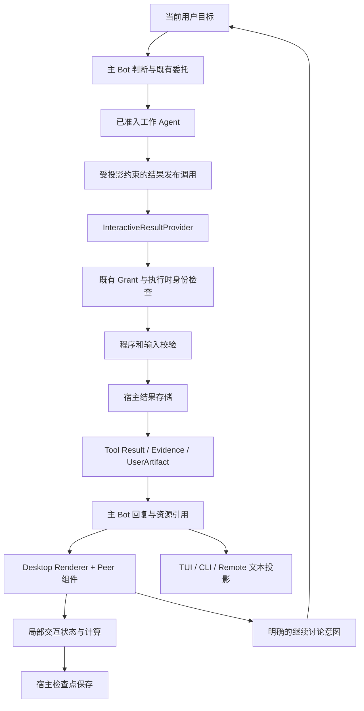

# ADR 118：OpenUI 可交互结果复用与运行时边界

创建时间：2026-11-02
最后更新：2026-11-04

状态：Proposed。七项评审问题已补齐契约、责任 Module、实施阶段及后续验收用例，仍待设计评审接受。设计补充提交仅含文档；后续实施与验证的实际提交、证据及剩余缺口分别保留在实施跟踪。关联实现分支、单项测试或后续实施任务均不自动改变本 ADR 状态，不代表能力开放或产品验收通过。

级别：A。扩展用户产物、资源引用、交互状态持久化、能力投影和 System Context 准入契约；共享实现与宿主装配属于 B 级，局部组件与布局属于 C 级。

范围：在 Peer 的既有对话与资源工作区中提供可恢复、可追溯的交互结果。首期支持有界表格、图表、筛选与确定性试算；复用 OpenUI 语言内核和 React 渲染接口，继续使用 Peer 的模型通道、Frost 组件、本地能力链、Conversation、GoalPlan 和 Evidence。

## 1. 决策摘要

采用 **OpenUI 内核复用、Peer 组件注册、宿主管理结果与状态、能力执行沿既有 Runtime** 的方案。

1. 以 `@openuidev/lang-core`、`@openuidev/react-lang` 为首批依赖候选，固定版本评估。使用其公开解析、状态绑定与渲染接口；不复制一套语言解析器，不整体引入示例应用。
2. 交互结果是用户产物的一种表达，由真实 Provider 发布后进入既有 UserArtifact / EvidenceIndex 投影。助手文本、代码块和文件后缀不自动创建可执行产物。
3. 模型组合经注册的 Peer 组件和确定性函数。Renderer 处理局部选择、筛选与试算，不持有权限、任务完成、签收或工具执行真值。
4. 第一批由已准入的工作 Agent 调用结果发布能力；只读工作任务可在独立授权下发布内部产物，不因此取得项目写能力。主 Bot 保持只读与调度，引用已发布结果。普通问答继续直接回答，不因引入交互结果而强制创建任务。
5. 首期禁用 OpenUI `Query`、`Mutation`、MCP 直连、任意 HTML/JavaScript 和主动网络组件。未来需要实际能力时，扩展显式动作契约并继续经过统一能力链。
6. 程序、数据快照、组件库版本、文本降级与用户交互状态分别保存。重开、切换窗口、升级和恢复不重新生成结果、不重跑工具。
7. Desktop 提供完整交互；TUI、CLI 和首期 Remote 提供同一结果的有界文本与来源。图形依赖不得进入 TUI/CLI 的必要启动路径。
8. 本设计分阶段交付。仅写完 ADR、能解析示例或出现静态界面，不构成模型效果、权限安全或发布验收通过。
9. 材料从可核对版本的规范记录解析，发布通过持久操作回执与待登记项收敛到既有 EvidenceIndex。核验者经只读能力检查实际内容；新版本使用基础版本 CAS，交回 Bot 的条件使用冻结快照。共享存储的兼容保护必须先于首次新格式写入。

## 2. 产品目标与非目标

用户把工作交给 Peer 后，应能在同一项目中理解结果、比较条件、检查依据，并把明确的新意图交回 Bot。交互结果服务于交付，不形成第二套聊天产品或任务系统。

首个完整故事：用户要求比较若干实施方案；工作 Agent 使用已取得的数据生成对比结果；Bot 在主对话解释结论并提供入口；用户在资源区筛选方案、调整预算进行试算；关闭后再次打开仍保留选择；需要继续实施时，用户把当前条件放入原 Bot 草稿并明确发送。此前的筛选和计算没有批准文件写入、创建新执行或签收结果。

| 目标 | 用户可观察的行为 |
| --- | --- |
| 少解释 | 结果保留当前项目、原问题、数据来源和版本 |
| 少切换 | 从回复或任务产物直接打开同一资源区，讨论回到原 Bot |
| 少怀疑 | 实际观测、模型判断、用户参数和试算结果能够区分 |
| 可恢复 | 关闭、切换、失败与升级后保留已保存内容及交互状态 |
| 可退出 | 随时切回文本摘要、关闭视图或停止局部计算，不影响后台任务 |

不在首期范围内：通用网页生成与托管、任意脚本运行、地图与图片搜索服务、第三方 MCP 客户端接入 Renderer、交互卡批准权限或验收、跨用户实时协作、模型自由安装组件、自动导出或自动执行表单，以及把所有 Bot 回复改成 OpenUI 程序。

本设计提升结果表达能力，不把 UI 语言或可点击控件当作模型推理质量、数据真实性或任务可靠性的保证。

## 3. 权威与关联决策

产品方向遵从[产品北极星](../../design/product/peer-product-alignment.md)。能力与层级遵从[架构治理](../architecture/20-architecture-governance.md)、[工程哲学](../architecture/00-engineering-philosophy.md)、[项目结构](../architecture/01-project-structure.md)和 [System Context 架构](../architecture/19-system-prompt-context-architecture.md)。

| 既有契约 | 本 ADR 的关系 |
| --- | --- |
| [ADR 15](15-plugin-skill-mcp-system.md)、[ADR 16](16-skill-call-lifecycle.md) | 所有实际能力继续经过 Provider、Manifest、Projection、Tool Call、Grant 和 Evidence |
| [ADR 63](63-user-artifact-evidence-boundary.md) | 拟增加交互产物类型；保留 Provider 产生 UserArtifact 的规则 |
| [ADR 80](80-project-agent-delegation-model.md)、[ADR 101](101-bot-owned-access-policy.md)、[ADR 106](106-readonly-git-and-delegation-capability-admission.md) | 主 Bot 只读与调度、动态授权继承、委托能力准入保持原归属 |
| [ADR 109](109-resource-reference-preview-and-artifact-collaboration.md)、[ADR 114](114-reply-citation-resolution-and-open.md) | 在既有资源身份、引用、混合标签、草稿和受控打开契约上扩展一种内容 |
| [ADR 111](111-project-agent-duplex-supervision-and-continuity.md)、[ADR 117](117-intent-driven-coordination-and-goal-closure.md) | 交互状态和结果发布不创建第二份持续责任或目标完成状态 |
| [ADR 112](112-runtime-module-and-loading-boundaries.md) | 领域逻辑集中、跨宿主复用、低频图形依赖按需加载 |
| [ADR 113](113-checkpoint-content-addressed-storage-and-retention.md) | 不可变正文与引用、保留、清理和恢复沿现有存储 seam；不能擅自复用执行检查点身份 |

视觉与交互依据：[Frost 体验规范](../specifications/peer-product-experience-standard.md)、[人机交互契约](../specifications/peer-human-agent-interaction-contract.md)、[动效体系](../specifications/motion-system.md)、[过渡体系](../specifications/transition-system.md)和[开发规程](../../playbook/product-experience-development.md)。上游颜色、图标、动效与壳层不成为 Peer 的第二套标准。

本 ADR 拟扩展上述接口；只读工作任务的内部发布例外见 §9.1，材料、核验读取和兼容契约见 §10、§17。主 Bot 权力、原项目/外部系统权限及验收归属保持不变。本文仍为 Proposed，不表示这些扩展已生效；只有对应契约评审接受、模块完成接线后，才可在投影中开放本能力。

## 4. 核对基线与上游事实

### 4.1 固定基线

| 对象 | 本次审阅的固定身份 | 用途 |
| --- | --- | --- |
| Peer-Agent | `4a58e2846875f85de69915764a127096721c5b0d`，RC35 / 当前开发线基线 | 确认现有 Renderer、Provider、产物、存储与多入口边界 |
| Peer-Knowledge | `f952a447fc46a325f7c5b79267f35df21e5643b1` | 关联本次 ADR 使用的最新治理与编号 |
| open-intelligent-ui | `16ef26475999e3a021a50b1607a03717c0721255` | 确认示例应用、组件、动作、存储、提示和检查方式 |
| 示例锁定的 SDK | `lang-core@1.0.0`、`react-lang@1.0.0`、`react-ui@0.18.1` | 区分示例代码与底层引擎，检查发布包而非只读宣传页 |
| OpenUI 主仓参考 | `729ac8bbdf60a1cfe914f4a02683bce6262fe245` | 补充当前公开接口文档；与固定发布包有差异时以实际选择的包版本为准 |

依赖发布包仅被下载用于静态审阅，没有在 Peer 中安装或运行安装脚本。上游 README、基准描述和 PR 自述不作为 Peer 的验收证据。

### 4.2 已确认的复用能力

- 示例用 `createLibrary` 注册组件、函数与动作，React Renderer 可独立消费程序、流式状态和初始状态；宿主可以接收状态变化、动作和结构化错误。[U2][U9]
- 语言包含表达式与 `$variable` 状态绑定，可在局部交互后重新计算显示；常用列表、数学、日期与数据变换函数已经实现。[U2][U3]
- 默认云路径提供 OpenUI 输出校正；直接兼容 API 路径在本地构造提示并转发模型输出，没有同等云端校正。因此 Thesys 云不是必要依赖，生成正确性仍需 Peer 自己处理。[U4]
- 示例的完整基础生成提示文件约 3.3 万字符。这个数字是该固定文件的字符量，不是所有模型上的 token 数，也不构成 Peer 上下文预算。[U10]
- 示例应用是私有标记的 Next.js 工程；可复用的 npm 库来自 OpenUI 主仓，不应把整份示例当成 Peer 的生产模块。[U1][U9]

### 4.3 需要替换或收口的行为

| 上游行为 | Peer 的处理 |
| --- | --- |
| 后端仅整理用户/助手文本，并保留最后 60 条输入 | 保留 Peer 的 Provider encoder、工具结果、附件准入、压缩与 Evidence，不移植聊天后端 |
| 会话与交互状态存进浏览器 localStorage | 使用宿主持有的版本化结果和状态，localStorage 不是真源 |
| Renderer 可把 Query/Mutation 交给函数表或 MCP client | 首期不提供 toolProvider，并在解析政策层拒绝这些节点，避免仅靠缺省回调限制 |
| SearchImage、地图和媒体组件可自行请求接口或外部资源 | 首期不注册；未来数据获取沿正式 Provider 与网络政策 |
| HtmlView 使用 allow-scripts iframe，允许部分 CDN 与 HTTPS 图片 | 首期不注册；运行 HTML 另按独立执行和沙箱设计处理 |
| 组件主题包含全局 token，聊天页还替换 window.open | 注册 Peer 组件与导航动作，不复制全局主题或覆盖浏览器 API |
| 示例有可配置 PostHog；SDK 有开发工具和安装遥测行为 | 依赖准入检查脚本与默认行为；禁用未授权遥测和开发工具自动挂载 |

`lang-core@1.0.0` 的运行时遥测为显式 opt-in，浏览器环境不发送该运行时遥测；安装脚本遥测另有禁用机制。不能把不同层的行为混为“默认上传聊天内容”。具体外发字段与禁用策略以固定发布包和其后续审阅为准。[U8][U9]

### 4.4 Peer 代码接线基线

2026-11-03 对 §4.1 的 Peer-Agent 固定提交做静态核对，以下是设计必须承接的现状，不是交互结果已经实现的证明：

| 现有 Interface / Implementation | 已核对事实 | 本 ADR 的实施责任 |
| --- | --- | --- |
| [只读任务执行闸](https://github.com/ly-ccx/Peer-Agent/blob/4a58e2846875f85de69915764a127096721c5b0d/packages/runtime-node/src/project-agent/session-supervisor.mjs#L83) | 未列入只读白名单的新能力会被拒绝；requiredCapabilities 不替代授权或投影 | 明确内部发布例外，并统一投影、准入和执行判断（§9.1） |
| [EvidenceIndex 归一化](https://github.com/ly-ccx/Peer-Agent/blob/4a58e2846875f85de69915764a127096721c5b0d/packages/runtime-node/src/goal-plan-files.mjs#L184)、[文件证据预览](https://github.com/ly-ccx/Peer-Agent/blob/4a58e2846875f85de69915764a127096721c5b0d/packages/runtime-node/src/project-agent/file-evidence-preview.mjs#L23) | 只认既有产物种类；索引不承载完整数据等级，文件预览会脱敏并截到 4000 字符 | 规范材料读取、完整性和数据等级单独解析；补新产物联合类型与持久投影（§9、§10） |
| [Desktop Evidence 登记](https://github.com/ly-ccx/Peer-Agent/blob/4a58e2846875f85de69915764a127096721c5b0d/apps/desktop/electron/main/chat-runtime/tool-orchestrator.mjs#L515)与 [TUI 登记](https://github.com/ly-ccx/Peer-Agent/blob/4a58e2846875f85de69915764a127096721c5b0d/apps/tui/src/tui-host.ts) | 登记失败可被捕获为警告，不能直接提供发布的持久收敛保证 | 增加可对账的发布回执和待登记项，不把登记警告当作完整发布（§9.3、§9.5） |
| [Verifier 快照](https://github.com/ly-ccx/Peer-Agent/blob/4a58e2846875f85de69915764a127096721c5b0d/packages/runtime-node/src/project-agent/verifier-evidence.mjs#L14)、[产物读取](https://github.com/ly-ccx/Peer-Agent/blob/4a58e2846875f85de69915764a127096721c5b0d/apps/desktop/electron/main/project-agent/project-agent-host.mjs#L674) | 核验依赖有界 bodyPreview；既有工件读取未接入交互结果 | 提供固定版本的只读结果检查与核验适配（§10.2） |
| [资源反馈草稿准备](https://github.com/ly-ccx/Peer-Agent/blob/4a58e2846875f85de69915764a127096721c5b0d/apps/desktop/electron/main/resource-feedback-preparation.mjs#L21)与 [ResourceFeedback](https://github.com/ly-ccx/Peer-Agent/blob/4a58e2846875f85de69915764a127096721c5b0d/packages/protocol/src/resource-feedback.ts) | 已有真实接收者核对、claim/ack 和有类型的版本材料 | 扩展原反馈/草稿链承载冻结条件，不另建发送路径（§12.5） |
| [协调写者 fence](https://github.com/ly-ccx/Peer-Agent/blob/4a58e2846875f85de69915764a127096721c5b0d/packages/runtime-node/src/project-agent/coordination-writer-fence.mjs#L22) | 保护协调存储，不能直接推出其他存储也能阻止旧 writer | 逐个共享存储明确保护方式，并在首次新写入前生效（§17.4） |

七项评审补充的文档提交仅更新设计并做内容/diff 审阅；关联实现分支的实际进度和测试另见[实施跟踪](../../playbook/v0.1.0/interactive-results.md)，不改变本节固定代码基线的事实。

## 5. 方案比较

| 方案 | 收益 | 代价与边界 | 决定 |
| --- | --- | --- | --- |
| 整体移植 Next.js 示例与 AgentInterface | 快速得到类似 Demo 的壳与交互 | 并列的模型请求、会话存储、外部数据与设计系统；破坏 Peer 的统一事实来源 | 不采用 |
| 复用语言内核与 Renderer，注册 Peer 组件 | 复用解析、状态和流式能力，保留既有 Runtime | 需要限制语言子集、动作与数据适配、版本和恢复契约 | 采用 |
| 只复制图表与表单组件 | 引擎依赖较少 | 仍需自行维护语言、状态、流式与错误协议 | 作为 SDK 无法满足边界时的静态降级选项 |
| 模型直接生成 HTML/JS | 表达能力广 | 额外脚本、资源、隔离、性能与恢复负担 | 不纳入本 ADR 首期 |
| 全部继续用 Markdown | 现有链路稳定、可跨入口 | 交互比较与试算能力有限 | 保留为默认回答和始终可达的降级 |

选择 OpenUI 不意味着以后必须依赖某个云端模型或托管服务。语言引擎、组件目录、数据获取和能力执行应能分别替换。

## 6. 架构与真值归属



| 对象 | 唯一事实所有者 | 不能替代的对象 |
| --- | --- | --- |
| 用户目标、公开输入与 Bot 回复 | Conversation 与既有协调对象 | UI 程序不能签发用户输入身份 |
| 程序、输入快照、兼容要求和文本降级 | InteractiveResultStore 的已发布版本 | 助手正文和 Renderer 缓存不能制造正式产物 |
| 用户筛选、参数和局部选项 | 宿主持有的交互状态检查点 | 不代表文件已写入、任务已启动或结果已签收 |
| 焦点、滚动、展开和当前可见标签 | 现有资源会话与视图状态 | 不携带执行权、数据源或工具目标 |
| 工具执行、权限与结果 | 既有 Runtime / PermissionGrant / Evidence | OpenUI action 成功、动画或状态变量不能代替 |
| 任务核验、签收与原目标闭环 | GoalPlan、验收政策和协调内核 | 交互结果发布成功不意味着任务完成 |

本设计遵守两类既有路径：模型调用真实能力走完整能力链；人对已准入结果的只读导航与局部视图状态走资源 ApplicationService。后者不能承接模型工具、项目文件写入、网络查询或执行控制。

## 7. Module 与 Interface

下表是拟实施的职责与相对代码位置，不表示文件已经存在。

| Module | 建议位置 | Interface 与核心责任 |
| --- | --- | --- |
| 交互协议 | `packages/protocol/src/interactive-result.ts` | 发布创建/修订、固定引用、检查请求、冻结条件、状态 CAS、错误和兼容对象；不得引用 React 或文件系统 |
| InteractiveContent | `packages/interactive-content/` | 共享目录规格、语言子集校验、输入/状态归一化、复杂度计算、有界确定性求值与文本投影；框架无关且无 I/O |
| InteractiveMaterialSource | `packages/runtime-node/src/interactive-results/material-source.mjs` | 从已准入规范记录解析固定版本字节、范围、脱敏和数据等级；不重读当前项目文件冒充历史输入 |
| InteractivePublicationSource | `packages/runtime-node/src/interactive-results/publication-source.mjs` | 人的原证据入口与对外报告/回复按真实任务/owner 核对固定发布来源；报告/回复仅投影元数据，人的正文读取另核对来源；不暴露模型读取 API、不重写历史或生成 Evidence |
| InteractiveResultProvider | `packages/runtime-node/src/interactive-results/provider.mjs` | 发布与只读检查的 Manifest/Projection、执行身份与 grant、真实 Tool Result/UserArtifact/Evidence |
| InteractiveResultStore | `packages/runtime-node/src/interactive-results/store.mjs` | 不可变版本与 head CAS、幂等发布回执/待登记项、状态写者/CAS、条件快照、恢复、保留和兼容准入 |
| OpenUIRendererAdapter | `apps/desktop/renderer/src/interactive-results/` | SDK 渲染、Peer 组件、局部状态和结构化错误；不直接调用能力 |
| 宿主适配 | 既有 Desktop/TUI composition root 与 typed API | 绑定真实 sender、owner、当前调用/视图身份；不复制领域规则 |
| Context Source | `packages/system-context/src/sources/interactive-result-source.mjs` | 按投影准入本次组件/语言规则与其版本；不执行能力 |

`InteractiveContent` 提供小而有深度的 Interface：`catalogSpec`、`validateDraft`、`validateState`、`evaluate`、`projectText`。其 Implementation 统一处理目录版本、AST 白名单、数据边界和计算限制，避免 Host 与 Renderer 各维护一套正则过滤或语法判断。`evaluate` 只消费已固化内容和明确状态，在相同预算内返回有界值/诊断；不接收工具、文件、网络或宿主回调。它不是任意代码求值器。

`InteractiveMaterialSource.resolveInputs` 负责有 I/O 的材料准入；Store 的发布事务和待登记项负责跨存储恢复。二者不塞进无 I/O 的 InteractiveContent，也不把领域逻辑分散到 Desktop/TUI 的登记分支。宿主适配只提供真实身份与已有规范记录读取端口。

OpenUI 依赖只在这些 seam 内消费。通用 Runtime Core、Provider encoder 和 ConversationStore 不理解 OpenUI 节点；替换渲染引擎时，工作应集中于内容适配与 Renderer，而不改权限或任务执行器。

## 8. 首期组件、函数与语言子集

### 8.1 组件目录

| 组 | 首期内容 | 约束 |
| --- | --- | --- |
| 排版与布局 | Col、Row、Card、Title、Text、Caption、Divider | 使用 Peer token，禁止任意 HTML、style 或 CSS 注入 |
| 数据展示 | Table、Chart、Metric | 仅消费已绑定快照；图表提供表格/文本等价表达 |
| 局部输入 | Input、NumberInput、Select、Checkbox、Slider | 明确标签、约束和受控值；仅改变本产物状态 |
| 局部动作 | Button | 只允许受限 Set/Reset；不注册权限、签收、运行命令等动作 |
| 来源 | SourceReference | 只接受宿主登记的 bindingId；导航沿既有引用解析 |

上述名称是 Peer 目录的设计名称，不承诺与上游所有参数一一兼容。正式规格由同一目录生成：参数名、顺序、选项、限制与描述均有版本；改变任一项需更新 libraryVersion/specHash。

Frost 组件、SVG 图标、键盘与焦点基元继续作为唯一界面实现来源。不加载上游整套 `react-ui` 样式，不把可配置模型列表做成生成式 Select；模型配置仍用 Peer 标准 ModelPicker。

颜色、间距、圆角和尺寸使用目录中的有限语义值。禁止模型提供 CSS 字符串、任意 style、事件属性、固定定位或覆盖原生治理区域的层级；图表绘制参数由受信组件实现计算。

### 8.2 函数与表达式

首期只准入有限数值运算、比较/条件、字符串格式化，以及输入长度已有上限的筛选、分组与聚合。优先复用已审阅的上游函数；函数输入输出都需再次检查有限数值、集合长度、文本长度与嵌套深度。

首期不开放任意循环、递归、Range/Each 扩张组合、Query、Mutation、Run、动态组件注册、OpenUrl、HtmlView、搜索/媒体组件或 JavaScript 求值。Table/Chart 自己处理已归一化的有限行集合。计算需要日期时使用固化输入，不在重开视图时调用 Now/Random/Shuffle 改写结果。

限制必须由 `InteractiveContent` 的 AST/目录政策和组件实现执行，不能只写进提示词。SDK parser 的宽容解析不等于允许显示所有可解析内容。若公开 SDK 接口无法在求值前可靠识别并限制节点，此阶段停止准入，补充适配方案；不得退回仅用字符串正则拦截或自行重写完整语法。

同时核对公开 token 与已准入 AST 的覆盖关系，拒绝被宽容解析忽略的尾随标识、字面量、分隔符和隐式调用；额外分组也受预解析嵌套上限约束。允许对已准入公共 AST 做规范打印以核对 token，不另建完整 parser/evaluator。纯函数输入/输出和表格/图表行物化共享一次求值的总工作预算，长字符串计入成本；不能让每个节点重置预算，用户改状态进入新分支时也要执行同一限制。目录身份包含统一资源限制；不能只计算组件参数 schema 而遗漏求值、状态和修复预算。

### 8.3 确定性与格式

同一程序、目录版本、输入快照和状态应产生相同计算结果。金额、百分比、日期、单位与 locale 均作为明确输入或目录规则；拒绝 NaN/Infinity。浮点与货币舍入规则必须记录，示例试算不得冒充专业结论或来源已核实的业务事实。

正式交付卡片只接受规范 EvidenceIndex 中的交互 UserArtifact，使用独立的固定领域引用，不填入文件定位字段。宿主在投影时核对发布 capability/tool、Evidence/Artifact 身份、真实工作 conversation/plan/session 及当前 Bot owner；普通文件或助手文本中的相同 URI 不升级成交互产物。打开卡片后，原生结果读取入口仍重新核对固定发布记录、当前 owner 和格式兼容性；卡片本身不是运行或核验成功回执。

## 9. 发布协议与能力投影

### 9.1 拟新增能力

新增 `local.interactive.publish`，模型工具名拟为 `publish_interactive_result`。Provider 只向宿主管理的内部结果空间写入经过校验的内容，不接受项目路径、任意 URL、命令、MCP 配置或自定义组件代码。

Manifest 拟声明 `L2_local_write`，数据等级按实际输入继承且不得降低；输入包含标题、文本降级、程序和已有材料引用。沿既有本地写入政策取得绑定本次调用的 PermissionGrant，已有自动授权政策可按其现有条件决定，不因创建交互结果默认增加第二次人工确认。

grant 的有效范围是当前 workspace/conversation、已准入工作、此次 toolCall 和内部结果写入参数。它不授予项目文件写入、网络访问或后续动作权限。实施时在现有权限 Interface 中表达该受限目标；若无法表达，应先补齐契约，不能伪装成 file-read 或直接写盘绕过链路。

授权前通过只读端口核对固定材料的实际分类，并取规范材料与当前 owner 上下文底线的最高等级；不在此预检中固化快照或执行取数能力。该等级与参数摘要、真实 owner/执行身份一起绑定在发布 scope 中。授权后来源或上下文变得更严格时，原 scope 不能继续提交，也不能暗中改写原 Grant；保留真实未提交/未知状态并重新走原授权政策。

同一 Bot owner 已经知悉的最高材料/发布等级，作为设备本地的保守上下文底线持久保存，防止工作 Agent 省略原材料引用、复制到 model-data 或在新工作中把已知敏感内容降级。该底线只从真实规范观测和已提交发布事实单调提高，与对应事实在同一事务内记录；它不开放历史内容读取、不准入新材料，也不替代每个来源的分类。普通结果/快照清理保留该底线，不能通过功能关闭、换工作或清除缓存自动降低；显式清除整个 owner 数据的流程另按既有留存政策处理。首次写入前仍须满足 §17.4 的 writer 保护。

首期仅为实际有该能力的工作 Agent 投影。主 Bot、Explorer、Verifier 不获得发布能力；主 Bot 可以经 §10.2 的只读入口读取已发布元数据/文本并在 post_reply 中引用。`requiredCapabilities` 必须包含发布能力及实际数据获取、验证所需能力，缺失时由原准入契约返回技术阻断；能力要求只是准入约束，不提供权限。

#### 只读工作任务的内部发布例外

本 ADR 拟明确区分“修改项目/外部系统”和“交付内部产物”：`readOnly = true` 的已准入 worker 可以在具备发布 Projection、有效 Grant 及当前执行身份时，写入本工作所属 Bot 的内部结果空间。Manifest 仍按本地写入声明，不伪装成文件读取；该例外不适用于主 Bot、Explorer、Verifier，也不放行项目文件、Shell、网络、MCP 写操作或模型自定路径。

| 判断点 | 必须采用的同一规则 |
| --- | --- |
| 委托能力库存和模型投影 | 只有内部发布 Provider 可用、角色为 worker 且边界可表达时，才将发布列入该只读工作的可用能力 |
| 执行闸与 Provider | 同时核对 readOnly 例外的精确 capability、角色、真实工作/owner、停止及 execution identity、租约/epoch、参数摘要和 Grant；只改 prompt 或投影不足以放行 |
| 原授权政策 | 继续动态继承 Bot policy；自动授权仅按原政策条件生效。内部发布许可不转换为 file-write、通用本机写入或后续调用许可 |
| 不满足例外 | 返回 `read_only` 或明确的技术阻断，保留普通文本交付；不得把任务改成 readOnly=false、扩大通用写能力或增加假文件授权来绕过 |

这属于对既有只读任务契约的明确扩展，须在 IUI-01 同时落实共享规则、Desktop/TUI 准入与执行适配。本文保持 Proposed，不提前修改 ADR 80/106 的实际生效范围。

### 9.2 模型输入与宿主事实分离

模型可提供的 `InteractiveResultDraft`：

```ts
interface InteractiveResultDraft {
  publication:
    | { kind: 'create' }
    | { kind: 'revise'; base: InteractiveResultReference };
  title: string;
  textFallback: string;
  program: string;
  inputs: Array<{
    bindingId: string;
    source: AdmittedMaterialReference;
    selector?: BoundedDataSelector;
  }>;
}
```

`InteractiveResultReference` 至少绑定 owner、resultId、contentVersion。`publication.base` 是模型提出的修订目标和预期 head，不授予读取或修订权；宿主按 §11.4 核对当前工作的材料准入和版本 CAS。创建时不接受模型自定 resultId。

`AdmittedMaterialReference` 和 `BoundedDataSelector` 必须是协议内白名单对象，具体材料分类和宿主解析契约见 §10.1。选择器只允许有限字段/行选择，不接受脚本或任意 JSONPath。模型自行填入一个存在的 Evidence ID 仍不足以通过宿主归属检查。

workspace、conversation、session/plan、原用户输入、attempt/epoch、发布者、目录版本、specHash、数据等级、权限、产物 ID 和 Evidence 关联均由宿主推导或核对。模型自报这些字段既不生效，也不能覆盖当前上下文。

已发布描述至少包含：`schemaVersion`、`resultId`、不可变 `contentVersion`、owner/source 引用、可选的 predecessor 引用、`engine`、SDK/目录版本、`specHash`、程序与数据快照引用、数据来源分类、`textFallback`、实际发布 Evidence 引用、时间、兼容要求和当前可用性。Conversation 只保存有界引用/展示元数据，不复制另一份正文真源；冻结反馈材料按 §12.5 保存其有界副本。

### 9.3 发布顺序与幂等

1. 核对当前执行、停止、lease/epoch、角色、投影和授权；拒绝越权引用及未知 schema。在任何新格式持久写入前，先满足 §17.4 的逐存储兼容门槛。
2. 经 §10.1 解析准入材料，并验证程序、目录、输入、数据来源与资源预算，确保校验完成前没有生成代码、网络或工具执行。
3. 固化程序、数据及文本降级；权限等待、异步解析或来源读取后，在提交事务内再次核对 owner、停止、当前 lease/epoch、有效 policy/grant 和修订基础版本。先持久化不可变 blob，再原子提交版本 manifest/head、真实 Provider 发布操作回执及 Evidence 待登记项；不能出现 manifest 已提交而待登记项未提交的状态。
4. 由既有 Tool Result/Evidence 流程幂等登记并读回核对 `UserArtifact.kind = interactive` 的元数据，确认后才返回完整发布成功。EvidenceIndex 保留原 Provider 来源，不被包装回执覆盖；登记失败不能仅记警告后继续返回完整成功。
5. 主 Bot 通过既有报告、核验与 post_reply 关联结果。发布成功只证明该交互产物已生成，不表示输入全部正确、任务通过核验或已签收。

同一 owner 下，相同 toolCallId/规范参数摘要映射到同一次发布，摘要包含 publication 意图与基础版本。相同 ID 不同参数拒绝；新的调用不会仅因标题或程序相似而被当成旧调用。结果中途未知时先经 §9.5 对账，不在视图恢复时重发发布调用。创建与修订、新版本与内容相同的情况按 §11.4 处理。

### 9.4 失败契约

校验失败返回稳定 code、可恢复性及有界字段位置；权限拒绝、取消、超时、存储错误和未知提交分别沿既有 Tool Result 状态/错误对象返回。未知对象不能被归一化为一份空表或成功结果。所有失败保留原 toolCall、来源与实际执行阶段，重试建议不得携带伪造 grant。

发布协议另带 `publicationStatus`，至少区分 `not_committed`、`index_pending`、`published`、`unknown`，不擅自给通用 Tool Result 联合类型追加一个成功状态。已提交但索引未确认时返回非成功结果和 `publication_index_pending`，明确 `effectCommitted = true`、操作引用及“只对账”的恢复方式；无法证明提交状态时返回 `publication_unknown`。两者都不能提示模型换一个 toolCallId 再发布。

```text
Capability Provider → Manifest → Runtime Projection → Tool Call
  → PermissionGrant → 受限发布与真实结果 → Evidence / UserArtifact
```

### 9.5 发布回执、待登记项与对账

Store 为每次真实 Provider 发布保存不可变操作身份、规范参数摘要、真实调用/工作/attempt 绑定、policy revision 与 Grant 审计引用、resultId/contentVersion、提交时间、输入摘要、稳定 Evidence 身份和应登记的 Tool Result/UserArtifact 元数据。Grant 引用仅供追溯，不可在恢复时充当新授权。Evidence 身份由宿主生成并在提交前固定；待登记项是已有能力链的持久回传责任，不是第二套 Evidence 索引。

模型 wire 的 toolCallId 可能在不同子会话重复，不能直接把裸 `tool-result://<toolCallId>` 当作全局唯一发布索引键。规范发布行使用包含 owner/resultId/contentVersion 的既有不透明产物引用作为主键，并保存真实子会话/plan/call 来源；通用回传登记的工具引用只是别名，不能改绑规范来源。首次登记须同步落盘并读回核对后，才结束待登记项；确认丢失时同步并复核原行，幂等返回，不重复追加产物。操作存储无法读取时返回 unknown，不能把“查不到确认”写成已证明未提交。

人的任务证据入口解析上述工具别名时，必须由受控资源 context 中明确的 plan/session、规范 Plan 的真实工作 conversation 及当前 Bot owner 确定原调用，再从已确认发布回执解析固定版本。共享发布来源读取 Module 核对该版本的真实 source、规范索引的 capability/tool/call、owner、时间、artifactRef 与 specHash；原资源投影继续核对真实 Session/report 后才读取或返回正文。仅有全局索引里最后一条同名工具记录、助手 URI 或没有任务 context 的别名，不推断一个交互结果。已确认操作但规范来源缺失、冲突或不可读时明确不可用，不退回另一工作、当前 head、文件路径或模型文本。读取返回原规范发布事实，不重写历史 Tool Result、不触发发布/补授权或把后续确认追溯为原调用当时已成功。此消费接线属于 IUI-02/IUI-03；Bot 回复仍应携带固定规范引用，不能要求界面猜测所属任务。

内容相同的修订若返回 unchanged，别名可指向同 owner 的原固定发布版本，但不能把其来源改成此次修订任务。宿主须先确认此次真实任务与调用的 unchanged 回执，再核对原发布任务及其 Session/report；投影采用原规范来源的任务 context。请求 context 与此内部来源 context 分别保留职责，Renderer 无权提供后者，也不产生新的产物、发布或核验事实。

#### 对外任务报告与主 Bot 回复的固定引用

IUI-03 在 Desktop/TUI 同时接入共享来源投影。既有 `get_session(detail: "report")` 仅将本任务报告中可由真实工作 conversation/call 定位、已发布且与原规范索引一致的工具别名替换为固定产物引用；已有固定引用也须核对真实 source 与同 owner 关系。未确认、缺失或不适用的引用保留原追溯值，不冒充已确认结果。此处理只作用于对外报告；内部完成审查、Verifier 输入和 sourceRevision 仍使用原报告/原任务证据，不因展示引用变化重写验收或已有核验事实。

共享投影只读固定 manifest、原发布操作及其 indexEntry 和规范索引，不读取程序/数据正文或求值；标题与 specHash 等展示元数据必须和真实原发布回执一致。它不经对外报告入口反向读取自身，不形成报告递归，也不替代人的正文来源核对或模型的 inspect 能力。

主 Bot 的 `post_reply` 在既有 replyTo、sources、statusClaims 校验通过后，按宿主真实 owner 与所引用任务提取已确认的固定结果引用，合入既有 `meta.evidenceRefs`。模型参数、正文 URI 或自报 UserArtifact 不提供该事实。每条回复最多保留现有上限 20 个去重引用，按原任务引用顺序选择，完整引用仍在原任务报告中；这不是全部产物的穷举清单，也不自动取当前 head。未确认结果不产生卡片，普通进展/受阻回复仍可如实发出。现有 objective Evidence 同时保留并共用预算，不能因新增交互结果将其覆盖。

该接线只增加宿主内部的报告/回复事实读取端口，沿已有报告和回复协议传输，不新增执行、授权、Evidence 或 System Context 准入路径。固定交互 URI 按既有产物引用的有界长度传递；不能用通用短 ID 的长度限制丢掉合法引用，其他引用的原约束保持不变。Conversation 与旧写者必须原样保留这些已存在字段中的固定字符串引用。

| 持久阶段 | 可证明的事实 | 对账与结束条件 |
| --- | --- | --- |
| prepared，尚无已提交操作 | 可能存在暂存 blob，不能证明发布发生 | 核对真实提交记录；确认未提交后终止操作，孤立 blob 仅按安全清理规则回收 |
| committed / index_pending | 发布操作、固定版本和待登记项已一起持久化 | 核对回执及内容摘要，用同一 Evidence/产物身份幂等登记既有索引；不重新解析生成、不调用发布执行体、不取得新执行授权 |
| indexed / published | 索引读回的来源、调用、owner、产物引用与回执一致 | 原子确认待登记项已结束；相同调用恢复返回同一已确认事实，不新增产物或重写任务结论 |
| unknown / conflict | 提交、正文或索引归属无法核对 | 保留原记录并返回结构化未知/冲突；不从文件存在、助手文字、goal_update_task 包装或另一调用补造证据 |

共享发布恢复服务在持有该存储当前写者/租约时处理有界待登记项；触发于宿主恢复、原调用查询及明确重试。瞬时失败可有界重试登记，损坏或来源冲突必须停止并保持可解释状态。即使原任务随后取消，也只允许投影已经提交的真实事实，不再开始发布、恢复执行或推断任务成功。

只读 inspect 查询返回已保存事实，可通知上述恢复服务处理已有待登记责任；它不把自己的读取 Grant 转成发布授权，不修改回执参数或注入新的待登记项。恢复服务只能处理原事务已持久化的那一项，不能执行来自检查请求的写入动作。

§10.2 的只读检查入口可按宿主核验过的原 publicationCallRef 查询进度，不能仅凭猜中的 toolCallId 读取其他工作。历史 Tool Result 在当时确为未知时保留该事实；后续确认通过原操作引用追加可追溯的对账结果，不把历史失败文字改写成从未中断。完整收敛是：已证明未提交并结束，或真实提交与索引一致并结束待登记项；长期未知保持阻断，不能被超时自动判成成功。IUI-01 必须同时接入 Desktop/TUI 登记和恢复，不能只在新 Provider 内写 manifest。

## 10. 数据绑定与真实性

每个输入快照记录来源类别、原始引用、所选范围、内容版本、获取时间、截断信息和继承的数据等级。模型生成数据可以用于示例或假设，但明确标为模型构造；工具结果只证明工具实际返回，业务结论仍按原任务标准核验。

程序通过目录中受限的 `@Data(bindingId)` 纯函数读取已固化输入。bindingId 必须是本结果已有的字面量标识，函数只读取已载入的有限快照，不解析路径、不访问网络或工具。宿主校验绑定完整性，Renderer 使用相同绑定表；模型不得重定义该函数、遮蔽保留命名空间，或用 Set/Reset 修改输入快照。程序中的内联业务数据按模型构造处理，不能仅因附近出现来源引用就继承其真实性。

| 数据类别 | 展示与使用 |
| --- | --- |
| 已准入 Tool Result / 用户材料 | 可以生成有限快照；来源和观察时间可达 |
| 用户修改的参数 | 显示为当前试算条件，不覆盖原始观测 |
| 派生计算 | 显示计算条件、单位和输入版本；不写回数据源 |
| 模型构造或 Demo 数据 | 明确为示例/假设，不包装成实时业务数据 |
| 缺失、过期、截断或已撤回来源 | 显示对应状态；不自动补数、取其他项目数据或发起查询 |

首期结果是固定数据快照。打开、重绘、筛选、重试 Renderer、重启和恢复都不刷新来源。用户需要新数据时，将明确请求交回原 Bot，由现有能力取数并发布新版本。只有本地计算重新求值不增加模型请求，也不创造 Tool Result。

数据进入结果前须核对当前材料准入与父链范围；不能借结果引用从其他 Bot、未准入附件或过去任务读取资料。源引用失效后，可否继续显示已保存快照由现有留存与访问政策决定，不能把来源失效等同于自动删除已交付内容，也不能用快照恢复已撤销的执行权限。

### 10.1 规范材料解析与不可变快照

`InteractiveMaterialSource.resolveInputs(inputs, executionBinding)` 由发布 Provider 调用，executionBinding 来自真实宿主，不接受模型填写 owner、访问根或源文件路径。它返回已归一化的有限数据及其证明元数据，或逐 binding 的稳定错误；InteractiveContent 只消费解析结果，不自行做 I/O。

| 模型可提出的材料分类 | 宿主唯一可读取的来源 | 必须核对与保留 |
| --- | --- | --- |
| tool-result | 当前工作已准入的规范持久 Tool Result，或该结果登记且可校验版本的不可变 artifact；引用绑定具体调用和预期内容版本 | 调用及 Evidence 来源、归属/准入链、实际字节与摘要、观察范围/时间、原有截断和脱敏、数据等级 |
| user-material | 已显式准入当前工作的用户材料/附件规范记录及其固定内容版本 | 材料身份、准入锚点、内容版本、允许范围、分类与来源政策；不能扫描附件目录猜测记录 |
| model-data | 本次 Draft 内的有界 JSON 值 | 始终标为模型构造；模型给出的来源名、Evidence ID、时间或 dataLevel 不会使它升级为观测事实或降低分类 |

协议中的来源联合类型按上述分类分别携带有界引用及 expectedContentVersion，或 model-data 的 JSON 值；禁止把任意路径、URL、数据库定位串或执行句柄装进引用。选择器仅含有限字段名/行范围/条数，作用于已核对的那份规范内容，并记录实际选取范围；规范化及编码版本参与快照摘要。

解析后的 binding 至少保存：来源类别与规范引用、原调用/材料身份、原内容版本、所选范围、选取字节摘要、获取/观察时间与本次固化时间、截断/脱敏标志、继承的数据等级和允许的显示/回传范围。当前结果的数据等级取所有来源及现有政策中最严格的要求；`EvidenceIndexRecord` 的存在、工具名或 Manifest 默认等级不能代替实际来源分类。缺少可判定的分类/政策时返回 `material_classification_unavailable`，不自行填 D0/D1。

当 Provider 为模型输出单独裁剪预览时，可以按协议提供宿主专用的完整观测 sideband：绑定该真实 Tool Result 的调用、capability 和 Evidence 身份，携带本次已获准读取范围的字节；经 Hook 克隆仍保持不可枚举，不进入界面事件、普通日志、序列化消息或 System Context。宿主确认真实 Grant/执行归属后，才固化为规范材料并给模型有界版本引用；sideband 本身不授予发布或额外读取能力。实际原文超过准入预算或未提供时仍保留缺源/截断，不重新读取当前文件补齐。

EvidenceIndex 是定位与追溯索引；有界 bodyPreview 可以作为“明确标为截断/脱敏的预览”使用，不能作为完整数据替身或据此补齐缺行。规范正文/固定版本不存在、摘要不符、范围超限或只剩可变文件定位时，分别返回 `material_snapshot_unavailable`、`material_version_mismatch`、`material_range_exceeded` 等错误。保存到磁盘的原始数据也不能绕过源材料已有的脱敏和准入限制。

需要重新取数时，由原工作调用已有受投影与授权约束的数据能力，取得新的 Tool Result/材料引用，再显式发布。MaterialSource 不读取当前项目文件、联网或重新执行工具来冒充历史字节；发布 grant 也不授予这些读取。对用户材料、正文缺失和模型示例的降级必须显式说明，不静默把工具观测改成模型构造或反过来。

### 10.2 结果只读检查与任务核验

新增只读能力 `local.interactive.inspect`，模型工具名拟为 `inspect_interactive_result`，Manifest 使用对应宿主的只读风险级别（Desktop 协议为 `L1_local_read`）。模型读取仍经过 Provider → Manifest → Projection → Tool Call → PermissionGrant → Evidence；人的资源预览继续走 ApplicationService，不能把 UI 读取 API 暴露给模型。

检查请求只接受已准入的固定 resultRef，或与本调用方真实工作绑定的 publicationCallRef；二者为明确的目标联合类型。请求可选择有界元数据/文本、程序片段、指定 binding 的字段/行、状态或确定性计算。分页携带固定版本和范围游标，超限明确返回范围与截断；不接受内部文件路径、任意 resultId、动态来源或 Query/Mutation。

| 调用角色 | 首期可投影的检查范围 |
| --- | --- |
| 主 Bot | 本 Bot 当前准入结果的发布状态、版本、来源分类及有界 textFallback；仅用于理解和引用，不获得发布能力 |
| worker | 当前工作已准入的固定版本/发布操作、材料与有界求值；不能越过材料父链或借检查入口重新取数 |
| Verifier | 本次核验目标对应的固定程序、绑定快照、来源/发布回执与有界求值；没有发布、状态保存或项目写权限 |
| Explorer / 未准入角色 | 默认不投影；不得因获得文件读取或 UI viewHandle 而间接获得结果存储读取权 |

“默认状态”来自该 contentVersion 校验过的初始有效参数；检查用户条件时，只接受用户通过 §12.5 明确提交并准入本工作的冻结快照。不得读取 Renderer 正在编辑的内存、偷偷使用最新 stateRevision 或在核验时挂载 React。共享 `evaluate` 在可终止 Worker 和统一结构预算下消费这些固定输入；无兼容且安全的非图形求值适配时，返回 `evaluation_unavailable`，不冒充已核验试算。

检查 Tool Result 至少区分：原来源观测、模型构造、模型 textFallback、用户参数和本次宿主派生值，并绑定 contentVersion、specHash、状态来源/摘要及实际读取范围。新 Evidence 仅证明这次读取/计算发生及其条件，不把模型文本、输入业务真实性或“计算一致”升级成任务通过。

IUI-01 实现检查协议、Provider 和固定读取/求值；IUI-03 接入 Verifier 快照、核验目标版本和证据允许列表。声明交互结果验收的任务，委托准入必须同时核对 worker 的发布/取数能力和核验角色的 inspect 能力，不能只看 worker 的能力库存。核验者以实际程序/数据/计算检查对照原 successCriteria，报告实际只读检查 Evidence；只有发布回执、textFallback 或 Worker 自述时，不得通过依赖交互语义的验收项。

#### 10.2.1 固定核验目标、临时回合与检查回执

核验宿主从当前任务引用的规范发布记录，以及 canonical 用户锚点中经真实冻结记录核对的条件，建立有界目标集。工具别名须解析回同 owner、实际 plan/conversation/call 与固定引用的原规范发布行；裸 URI、包装行、标题、助手文字和只存在于 Renderer 的对象不能成为目标。每个结果包含初始条件目标，另列用户实际提交的每份冻结条件；不从新 head 或可变检查点取代。冻结字段不足以恢复完整求值时技术阻断，不拼默认值。目标/程序/绑定版本或用户材料发生变化，原核验 sourceRevision 随目标摘要失效。

Verifier 的 ephemeral 回合可以没有持久 conversationId。宿主以仅存于本机当前核验生命周期的 token 绑定原 plan/conversation、当前 execution identity、sourceRevision 和目标摘要；它不写入提示、模型消息、检查参数或持久回执。Authority 只有在真实绑定存活且 owner/lease/epoch/目标仍当前时，才解析该临时回合。按同一绑定限制 resultRef、followupId 和 publication 查询；角色名或 planId 本身不能开放本任务/同 Bot 的全部结果。结束、取消、失去所有者或换代后失效；恢复创建新 token，不能恢复旧授权。宿主 profile 正规化须保留并核对执行身份，不从缺失身份默认放行。

每次用于核验的成功 inspect 沿原 Evidence 回传责任追加唯一的规范检查记录，引用形如 `interactive-inspection://<宿主生成的 evidenceId>`。`EvidenceIndexRecord.interactiveInspection` 记录实际 plan/执行/call、固定目标/specHash、规范请求与实际页范围、初始或冻结状态摘要、sourceRevision/目标摘要、输出摘要和时间；不复制正文、密钥、Grant 或工具目标。先持久登记并读回相同事实再返回该引用。它是只读能力真实读取/计算的 Evidence，不是 UserArtifact，不证明业务事实正确或任务通过。通用收集器只从正式 EvidenceBundle.refs 传播该引用，不扫描任意输出文本找证据。

共享索引仍使用 §17.4 已证明的追加保留方案。新端折叠时保护原检查行的完整来源，固定旧 normalizer 的有损追加不能覆盖原行；有界查找未找到原检查行就不可用。未知版本、回执不匹配或登记未确认不能贡献通过证据。源程序/快照保持原领域真源，新增字段不建立另一份 Evidence 索引或结果正文存储。

允许集合由原核验事实、真实工具返回及可核对的原检查行组成。完整交互结果通过至少须引用目标集内每份固定程序、每个绑定快照的完整分页读取回执，以及初始/各冻结条件下的真实求值回执；重复页不能补成完整范围，selector 子范围不能冒充整个绑定，求值文本/计算投影截断保持缺证。宿主只校验这些事实及覆盖范围，业务含义仍由模型对照 successCriteria 判断；检查完也不自动通过。发布/文本摘要/普通文件读取、别的任务/条件/版本的回执，以及仅自报成功的报告均不足以满足该门槛。

连续核验恢复仍沿原受保护 checkpoint 与原允许集合；只复用可从规范索引重新核对且绑定同 sourceRevision/目标摘要的历史检查事实。格式修复不能补做缺少的工具读取，缺证作为核验未通过返回；不能把语义缺证当成 JSON 格式错误后自动通过。上述接线与旧索引追加证明属于 IUI-03 / IUI-T26，不等同于真实模型或完整发布验收。

## 11. 版本、结果引用与资源承载

### 11.1 四个独立版本

1. `schemaVersion`：Peer 结果包与状态协议的读写格式。
2. `contentVersion`：标题、不可变程序、绑定快照、目录规格、文本降级、固定来源身份/观察范围和继承数据等级的规范内容摘要；不含会变化的用户状态、窗口位置和重新校验的固化时钟。模型构造数据的生成时钟也不单独制造新内容；实际来源的观察时间/版本仍保留。原始完整记录另按不可变对象摘要检查，包括其固化时间。摘要的规范编码有版本，不能因更新时钟而破坏相同内容复用，也不能借 unchanged 降低数据等级。
3. `libraryVersion/specHash`：此次可用组件、函数、参数语义和限制的身份。相同组件名称不证明版本兼容。
4. `stateRevision`：同一内容版本下用户交互状态的 CAS 版本。它不推进任务 goalRevision 或 executionEpoch。

SDK 版本另行记录，用来选择已登记的兼容适配。哈希用于一致性和索引，不是权限令牌或文件存在性证明。Renderer 不能自行接受结果包指定的 npm 地址或下载旧引擎。

### 11.2 稳定引用

扩展既有资源联合类型，新增受控 `interactive` 引用，至少绑定 owner、resultId 和 contentVersion。打开沿 ADR 109 的宿主 resolver 核对来源、可用性、归属与读取范围，再进入对应领域会话；不把内部路径暴露成任意文件读取入口。

同一版本在同一 owner 下去重激活；不同版本可以并列。新版本发布不替换用户正在操作的旧版本，也不静默把旧状态套到新程序上。提供明确的“打开新版本”和“保留当前试算”。

混合标签只保存领域引用；InteractiveSession 保存本领域状态，不把交互状态塞进 DocumentSession、BrowserSession 或万能资源 reducer。共享布局、窗口、导航和返回来源继续复用既有 seam。

### 11.3 不支持与失效

| 情况 | 呈现与动作 |
| --- | --- |
| SDK/目录版本尚无兼容适配 | 显示已保存文本与原因，可查看源码；不自动升级运行 |
| 程序或输入损坏、摘要不符 | 不执行；保留诊断、文本降级和返回入口 |
| owner/source 未连接或权限不足 | 显示真实不可用原因，不扫描磁盘、不借另一 Bot 打开 |
| 正文已清理 | 保留产物名称、来源及清理状态；不从当前数据拼造历史结果 |
| 旧 UI 状态与新版本不匹配 | 保留原检查点；仅在同版本恢复，或经明确映射建立新的状态副本 |

### 11.4 创建、修订与版本 CAS

结果的稳定 owner 是 workspaceId 及其 Bot conversationId；每一版本另记真实发布者、来源 work/session/plan、attempt 和原用户输入，不能把某次工作的执行身份当作下一次修订的通用授权。`InteractiveResultReference` 绑定稳定 owner、resultId、contentVersion；引用进入新工作时仍需显式材料准入，不能因为属于同一 Bot 就允许遍历全部历史结果。

| publication 意图 | 宿主核对与提交语义 |
| --- | --- |
| create | 宿主生成新的 resultId，建立首个不可变版本和 head；相同标题/程序不自动合并为同一结果 |
| revise + base | base 必须是当前工作已准入、同 owner 的既有结果；base.contentVersion 同时是 expectedHeadContentVersion。真实发布身份和内部 grant 合法后，在 §9.3 的同一事务内 CAS 推进 head，并保存 predecessor |
| 修订内容与当前版本规范内容相同 | 返回原固定引用及 unchanged，不创建新版本/第二份 UserArtifact；原版本的发布来源不改绑到新调用，当前调用只记录实际核对结果 |
| 基础版本已不再是 head | 返回 `version_conflict` 与当前可读 head 提示；不自动 rebase、不以新 resultId 重发来掩盖冲突 |
| base 未准入、owner 不符或原文已不可核对 | 返回准入/范围/版本不可用错误；不借旧版本 ID 恢复权限或从标题猜测前驱 |

两个修订从同一基础并发提交，只能一个推进 head；另一个完整保留原候选与冲突，不覆盖已发布版本。相同调用的重试先读取自己的操作回执，再判断新提交 CAS，不能在自己已提交后因 head 改变误报冲突；同 ID 不同参数仍拒绝。

“打开新版本”仅依据相同 resultId 下宿主确认的 head/predecessor 关系出现，不从模型文字或相似标题推断。已打开标签始终固定 contentVersion，旧交互状态留在原版本；打开新版本使用其初始状态，跨版本迁移必须另有明确映射和用户选择。用户要求刷新数据时，将旧结果引用显式交入新工作，取数后以 revise 发布，而不是静默改写旧快照。

## 12. 用户状态、保存与多窗口恢复

### 12.1 状态边界

区分三类内容：不可变输入快照、可变用户参数/筛选、视图阅读位置。输入快照由发布版本固定；用户参数与筛选保存在交互检查点；焦点、滚动、展开和当前标签沿原视图/导航契约保存。

`InteractiveStateSnapshot` 至少绑定 resultId、contentVersion、specHash、stateSchemaHash、stateRevision、规范化 values、更新时间与最近保存 requestId。只接受目录允许的状态键与类型，不接受权限、执行回执、工具函数、URL 凭证、文件目标或任务生命周期字段。

所有交互字段、表格行和局部选项具有稳定键；不能用当前渲染次序为身份。输入中的未完成数字、中文组合等属于编辑草稿，不能被逐键数值归一化清空。组件分别保留输入草稿与有效计算值；只有合法值进入求值，原始草稿按有界字段保存。

### 12.2 保存路径

Renderer 的内存 Store 提供即时交互，`onStateUpdate` 只提交有界的状态修改请求。typed API 交给宿主 ApplicationService，核真实 sender、owner、内容版本、写者和 expectedRevision 后保存。与 ADR 109 的正文草稿一样，这是本机 UI 工作状态；不会调用发布能力、写原项目文件、刷新来源或发起模型回合。

状态保存不生成 PermissionGrant，不写成工具执行成功 Evidence。访问或修改实际项目/外部系统时仍必须转入完整能力链。Renderer 不直接访问 fs、localStorage 真源或持有数据库连接。

宿主状态 Interface 至少具有以下操作，均返回带明确 code 的结构化结果：

| 操作 | 输入与顺序约束 |
| --- | --- |
| open | resultRef + requestId；宿主核来源并返回本窗口 viewHandle、固定内容版本和最后确认状态 |
| readState | 有效 viewHandle；只能读该 owner/版本的状态，不接受任意文件或其他 resultId |
| acquire | viewHandle + 当前 stateRevision；显式 takeover 才可接管已有写者，返回不可复用的 writer generation |
| save | viewHandle + writer + expectedRevision + requestId + 规范参数/输入草稿；CAS 成功后返回新 revision 和保存时间 |
| release | 仅释放当前 writer；不清空内容或状态；断连/重启使旧句柄失效 |
| prepareFollowup | viewHandle + 已确认 stateRevision/状态摘要 + 用户选取字段；宿主推导真实接收者，只返回冻结材料回执，不声称已进入草稿 |
| prepareDraft | viewHandle + followupId；宿主读回同 owner/固定结果的冻结材料，绑定实际原主窗口，沿 §12.5 的原草稿 claim/ack 准备；仅在读回持久草稿/待发材料与原冻结对象一致后返回准备成功，不直接发送 |

同 requestId 的相同保存参数幂等返回原回执，不同参数拒绝。viewHandle 由真实 sender/window/generation 约束，不能仅凭客户端提供的 token 授予读取或写入。失败至少区分 owner 不符、视图失效、版本不兼容、writer 过期、revision 冲突、超限、存储不可用与保存失败。

高频状态可以合并保存；只有宿主确认的 revision 才显示“已保存”。关闭、失焦和容器切换尝试刷新检查点，但崩溃只能保证恢复最后确认版本，不能承诺最后一次未确认按键已落盘。保存失败时保留当前内存草稿和明确未保存提示，重试只保存状态，不重新发布或执行工具。

保存确认丢失时，重试同一 requestId 与完整原参数，先在同一事务内核对原保存记录，再判断当前写者。已提交且摘要/正文一致时返回原不可变回执，另以 `writerCurrent` 表达原写者是否仍有效；历史保存成功不能恢复编辑权或覆盖新检查点。没有原记录，且原写者已被真实代次隔离或当前 revision 已严格超过原 CAS 基础时，才可在失败回复中明确 `saveStatus=not_committed`；未来 revision、读盘失败、回执损坏、参数冲突或旧端只返回 writer_stale 都保持未知。回执须核对原 requestId、期望 revision、内容/状态 schema、值及原始草稿的摘要，不直接信任保存表中的 JSON。

上述结算沿原 typed save API，不新增执行入口或共享存储格式。领域 save 保留原快照返回兼容接口，宿主使用同一事务产出的状态/当前写者事实。Renderer 在 writer_lost 时仍可核对原请求；未知请求保留并阻止接管、关闭或冻结，已证实未提交才解除该请求责任。明确重新取得写者后，以实际当前 revision 为 CAS 基础保留原本地值/草稿；即使旧候选曾经提交，也不能因此把当前本地输入无声换成其他窗口的值。新的保存提交分配新 requestId，原请求的重试始终保留原 writer、revision 与参数。

### 12.3 单一写者

首期同一 resultId/contentVersion 的用户状态仅有一个活跃 writerView。宿主以真实 sender 和不可复用的 writer generation 校验；其他视图读取同一确认快照。用户显式接管后旧 writer 的迟到保存被拒绝，并保留其未提交草稿供选择。

与现有资源编辑一致，写者只约束本结果状态，不锁项目文件、不扩大执行授权。多个实例可以作为只读视图存在。首期主对话只显示摘要与入口，避免同时挂载另一个独立交互实例。

### 12.4 恢复顺序

1. 核对 owner、schema、不可变内容及受支持的目录/SDK 版本。
2. 加载固化数据和文本降级；不发网络、不查 MCP、不启动任务。
3. 校验同内容版本的已确认状态，并恢复输入草稿；未知状态字段隔离，不覆盖原检查点。
4. 进入用户实际打开的容器后恢复阅读位置；不自动聚焦输入、不重播历史入场。
5. 原来未完成的真实能力操作只展示其原生回执；没有当前事实时保持未知，不从 OpenUI 状态推断成功或自动重发。

### 12.5 当前条件冻结、草稿与明确发送

用户目的是把点击时看到的有效条件交回原 Bot，继续讨论或明确发起下一步。事实源分别是已发布内容、宿主确认状态、冻结反馈材料、原 Composer 草稿回执及现有 ProjectInput 接收记录；它们不是一次合并的“发送成功”。准备不启动工作，明确发送后仍由原 Bot 按既有能力与授权判断行动。

1. **捕获候选。** 原生控件在用户点击时捕获固定 contentVersion、所选字段、有效参数和编辑序号，保存独立 candidate 身份。IME composition 未结束或所选字段有未完成/无效输入时，保留草稿并说明需完成输入；不强制提交组合串，也不偷偷取上一个有效值当作当前条件。后续新编辑保留在原视图，不改变已经捕获的候选。
2. **确认保存。** 用本候选的真实 writer、expectedRevision 和幂等 requestId 刷新状态，并等待 CAS 回执。即使候选之后又有编辑，准备使用的仍是这次确认的 revision/摘要。保存失败、writer 被接管、版本失效或 CAS 冲突时，保留候选和当前编辑，显示真实未准备原因；不得退回旧 revision 继续准备。重试与重新捕获区分，不能让旧响应覆盖新候选。
3. **冻结材料。** 宿主在同一状态事务中核对 viewHandle、owner、确认 revision/摘要及用户选取字段，并从该已确认快照固化有界反馈。若该 revision 已被后续保存取代且无法读取精确快照，返回 `state_revision_unavailable`，保留候选供重试；不读取最新状态替代。冻结对象至少含 followupId、真实 recipient、resultRef、specHash、stateRevision/stateDigest、所选字段及其值、来源分类与捕获时间，并以 selectionDigest 检查这份有界自包含材料的完整性；派生值如被选择，也绑定统一求值的输入版本和条件。只保存必要的选中值/文本，不默认复制整份 64 KiB 状态或全部输入。快照不携带 Grant、工具目标或任务控制字段。只选中部分状态时可以讨论这些值，但不得把它们与未选择的最新状态或默认值拼成“完整用户试算”；核验需要的状态不足时明确返回 `followup_state_incomplete`。
4. **准备原草稿。** 扩展现有 ResourceFeedback 的 interactive 资源/版本联合类型，并沿资源反馈的 prepare → claim → durable draft → ack 路径保存。Composer 以自己的 expectedRevision 合并这份材料，保留既有正文、引用和附件；不覆盖原草稿。DRAFT_CONFLICT、配额不足、原 Bot 归属变化或窗口失效都保持可恢复候选，不自动换接收者。重试可使用新的草稿准备 requestId，但复用同一 followupId/冻结内容；同 ID 不同内容拒绝，回执丢失先核对持久草稿，不能重复附加。
5. **用户审阅与发送。** 只有草稿持久确认后才显示“已放入草稿”。用户可以检查、编辑或移除材料、取消发送；不因准备成功抢焦点或自动切回对话。明确发送才沿既有 ProjectInput 队列和 canonical 用户消息链生成输入，继续沿原有 request/input ID 去重和接收者核对。进入模型时是显式用户选择的事实材料，不是 System Context 规则或执行许可。

冻结材料在草稿、待发队列、canonical 消息和委托锚点传递中保持同一 followupId、值及版本；原交互状态之后变化、被清理或新版本发布，都不能让旧草稿/消息指向“当前最新值”。反馈保存有界自包含选中值，并按源材料分类与留存政策处理；不能仅存一个指向可变 stateRevision 的指针。完整原文已不可用时保留真实缺源状态，不补造历史数据。

本流程的 preparing / save_failed / conflict / draft_unconfirmed / prepared 等状态分别来自上述实际阶段。失败可在原现场重试或放弃候选，原编辑与原 Composer 草稿仍有责任方；只读视图需先显式取得写者，不能为准备动作自动抢占其他窗口。原生控件复用既有焦点、滚动、SVG 和静态终态，不由生成程序直接调用 sendMessage。

冻结和草稿准备使用分离的回执。prepareDraft 不接受 Renderer 提交的反馈正文、recipient 或 sourceSender；主视图使用实际 sender，独立视图从当前窗口 registry 解析原主窗口，并在 claim 前及准备结束时继续核对 view/owner/窗口代次。Renderer 的 ack 不能单独证明保存成功，宿主须读回原输入草稿存储；读取失败、归属变化或冻结材料不相符时返回未确认并保留原候选。重试复用原 followupId，不重新取当前值。

#### 12.5.1 冻结反馈的存储与传输适配

逻辑 ResourceFeedback 增加 interactive 分支：resource 使用固定领域引用，version 保存 followupId、specHash、stateRevision/stateDigest、selectionDigest、选中 values 和 dataLevel，外层 recipient/capturedAt/excerpt 与同一冻结回执逐字段相符，selection 为 conditions。不能只传 followupId 后读取可变状态补齐；完整反馈仍受既有单条 32 KiB、列表 8 条/128 KiB 预算约束。

拟为输入草稿分配格式 3，IUI-01 须先核对该编号未被其他改动占用；占用时重新分配并统一协议/夹具，不能复用冲突编号。首次包含该分支后保持格式门槛，即使随后移除引用也不降级。新端只保留升级确实已知的格式 1/2；固定旧版草稿写者须在每次实际写入前重新读取格式并拒绝新格式，包含已经打开的实例。未证明此前，不写新格式。

既有输入队列的旧消费端会跳过未知 ResourceFeedback，并可能继续推进游标，因此不能把新分支直接写进原 JSONL 后寄希望于新 marker。沿原 ProjectInputQueue Interface 增加单一传输适配：在 durable queue 和 canonical 消息中，把每份交互反馈无损编码成现有 `sourceKind=user_upload`、`kind=text` 的自包含 JSON 附件；schema 固定为 `peer-interactive-selection-1`，附件 ID 由 selectionDigest 固定，包含完整规范反馈，不含文件路径或执行/授权字段。这里的 user_upload 仅表达用户明确选择并随原 Composer 发送的材料，不宣称从文件选择器导入、不产生 Tool Evidence。旧端按既有用户文本附件保留/显示；新端才能在对应适配边界恢复逻辑类型。文档/网页等原反馈沿原 wire 字段保存，原用户附件不得被替换或吞掉；总附件额度仍为 8，准备/发送前超额即保留原草稿并明确拒绝。

新端在准备、草稿新写入及新输入准入时，必须从实际本地冻结记录核对完整内容、owner/接收者和摘要；规范读取与委托也核对该固定材料。不能仅凭上传文件的名字、URI、JSON schema 标记或用户自报的 selectionDigest 升为有权限的引用。识别到损坏、未知版本、同 ID 不同内容或缺少必要记录时保留原 bytes，拒绝推进相关队列游标或开始委托；不把它丢成空列表。内容正文清理不清除仍被草稿/队列/消息引用的冻结材料。冻结材料作为用户事实进入原附件/用户材料槽，授权和 Verifier 目标准入仍另行核对；旧端即使只能显示普通附件，也不能改写其值、版本或假称已核验。

该适配不建立第二个输入队列、不自动发送、不绕过原 claim/draft CAS/ack 或 inputId 去重。实际旧队列读写/消费端和 Conversation 重写路径必须证明已知附件字段与原文完整保留；委托子消息也使用相同传输表示，不把未知分支重新漏写进共享记录。无法证明的路径保持阻断，不以伪造 document/web 引用、共享文件毒化或终止日常进程换取兼容。

IUI-00 固定旧版读写端及重写路径清单，IUI-01 在首次写入前完成传输适配、冻结记录核对和逐存储保护；IUI-02 才接入原草稿准备与人工发送。旧端保留文本仅证明材料未丢失，不证明新端权限准入、冻结核对或语义核验已经实现。上述均为待实现、待验证的退出条件。

#### 12.5.2 条件摘要的标签与异步冻结

冻结摘要中的控件名称由宿主从该固定版本的程序、绑定与初始条件重建，不依赖 Renderer 提供的树或标签，也不为此把派生渲染树变成第二份持久正文。重建沿共享内容适配器的可终止、有界 Worker：核对 SDK/目录、程序和状态 schema，再从发布初始结构取得各字段第一个可用控件标签；当前选中值来自原已确认快照。多个控件绑定同字段时该选择保持确定性，初始结构中没有命名控件的字段仍使用稳定条件序号，不暴露内部状态键。后续用户参数不能偷偷改名历史发布字段；其计算错误也不阻止对合法条件的讨论。

prepareFollowup 的领域与 UI 服务为异步契约。先核对原 view/owner/writer、revision/digest、字段及合法输入，已存在的同请求规范冻结回执直接幂等返回；否则在数据库事务之外重建摘要，再在提交事务内重新核对相同事实及当前分类底线，才固化冻结材料。重建失败、取消、超过预算、回执不符、等待期间状态/写者/归属变化都保持未冻结，不能退回旧值或拿最新状态替换。不存在通过标签重建取得授权、执行工具、刷新来源或制造 Evidence 的路径。

同一视图至多有一个在途冻结请求，同参数请求共享原操作，其他请求明确返回 busy；不因重复 IPC 无界创建 Worker。视图关闭、销毁或取消原打开生命周期时，宿主持有的 AbortSignal 终止该视图的在途重建；信号不进入 Renderer 参数或冻结记录。

重建只产生有界文本和规格/状态身份，冻结的值、引用、followupId 与摘要仍沿 §12.5.1 保存。现有冻结回执及其摘要保持不可变，不在升级时重写旧消息/草稿。精确旧 revision 已不可读时保留点击候选；用户明确重试后可用新保存 requestId 重新确认同一候选，再冻结，原视图中后续编辑仍保留。该改动归 IUI-01 的共享适配与 IUI-02 的条件交回，不改变数据目录格式或 Writer 兼容门槛。

## 13. System Context 与模型输出

### 13.1 显式准入

新增 `runtime.interactive-result` Context Source，规则层为 `L5_TOOL_RULES`。仅在当前 Projection 确实允许结果发布、相关结果格式已被本次执行选择、目录可用且上下文预算允许时装配。主 Bot 的普通回答、未启用功能的回合及 TUI 常规启动不注入整套 UI 语法。

Source 由可信目录生成语言规则、允许组件/函数、参数限制、错误修复说明与少量示例。输入材料、程序、用户状态和历史结果通过受治理引用进入 `L7_CONTINUITY` 或既有用户材料槽位；它们不能升为系统规则。L0–L7 层序与 Provider encoder seam 保持原契约。

记录本次目录版本、specHash、准入组件集合及 Source checksum，纳入 ContextEpoch 和提示快照。SDK 生成的提示只是该 Source 的输入，不在 Provider adapter、客户端 UI 或重试分支临时拼一段 system/developer 文本。

### 13.2 上下文预算

首期只使用基本目录。UI 规格与规则的准入目标上限为 4096 个宿主计量 token，同时设 16 KiB UTF-8 硬上限；这是拟实施的预算，不是已测模型效果。某 Provider 无可靠计量时采用现有保守上下文预算策略，不能把字符数冒充 token 数。

预算不足时缩减本次目录或回到普通文本产物；不能截断必要语法、参数说明或边界规则后继续开放发布能力。数据大对象保持本地快照与有界摘要，不逐轮把完整表格、程序和所有状态重塞给模型。

### 13.3 生成、校验与修复

工作 Agent 生成程序后调用发布能力。失败返回有界结构化问题，例如 `unknown_component`、`unsupported_node`、`invalid_binding`、`non_finite_value`、`resource_limit`、`incompatible_catalog`；附具体位置和允许的修正方式，不把全部用户数据或堆栈写入错误正文。

同一发布候选最多进行两次针对生成内容的模型修复，并共享原工作预算；只有校验已知未发布时才可提交修正版本。磁盘错误、权限拒绝、资料缺失和结果未知分别处理，不通过重新生成掩盖。`publication_index_pending` / `publication_unknown` 先用原操作引用只读对账，不能进入生成修复或换 ID 重发；version_conflict 也不能自动 rebase。超过修复范围时交还实际原因和已保留的文本结果，不伪造一个“可交互”入口。

发布准备记录绑定宿主 owner、真实工作/执行身份、原调用和规范参数摘要；校验失败后相同调用不能更换参数，已知失败重试返回原诊断。共享持久预算约束同一工作内尚未成功的创建候选或同一修订目标，不能因换 wire call ID 或宿主实例而重置两次修复额度；成功提交才结束候选。准备中状态不冒充已证明未提交或正式产物，inspect 沿原引用区分准备、失败与真实提交。恢复只结清既有操作责任，索引追加及结束待登记项前仍核对当前存储所有者，不恢复旧执行权。

首期发布完整、不可变结果后再启用交互。OpenUI 的流式能力作为后续表现适配候选；未完成程序只能作为明确的临时预览，不能登记正式 UserArtifact、启动动作或覆盖已发布版本。若要扩展分段预览协议，须单独补齐预算、取消和所有权后实施。

## 14. 动作与权限边界

| 动作 | 首期路径 | 权威语义 |
| --- | --- | --- |
| 筛选、选择、参数试算、恢复默认值 | 受限局部 Store 与纯函数 | 只改变这份结果的展示/用户参数 |
| 打开结果、查看数据表或来源 | 既有资源导航与受控读取 | 不授予模型新的读取范围 |
| 保存局部状态 | 宿主检查点 API | UI 状态已保存；不表示项目发生修改 |
| 把当前条件交给 Bot | 宿主原生控件确认保存、冻结条件并取得原草稿回执，用户明确发送 | 旧草稿不漂移；canonical 用户输入沿原发送链产生 |
| 文件写入、Shell、MCP、外部查询或执行控制 | 首期不提供生成控件入口 | 后续必须通过显式动作协议和既有 Runtime |
| 授权、回答原生人工问题、验收或取消任务 | 使用 Peer 已有原生控件与记录 | 生成程序不能构造或替代这些决定 |

“把当前条件交给 Bot”由宿主提供固定控件，不由任意 OpenUI Action 直接调用 sendMessage。宿主按 §12.5 从本候选已确认的内容/状态选择有限字段，用户可检查、编辑或取消；不会覆盖原 Composer 草稿。敏感数据是否进入模型沿原上下文准入政策，状态改变、保存和草稿准备均不自动发送。

未来如需 Query/Mutation，须逐项定义可用能力、目标来源、参数 schema、幂等键、版本、取消、结果未知及 Evidence 回传。适配器只能把受控意图送入现有 Runtime Projection，不能把原始函数表、MCP client、任意 capabilityId 或 preload 暴露给模型生成组件。未完成这些契约前，首期禁用保持有效。

## 15. 交互状态与体验

### 15.1 各状态独立表达

| 维度 | 事实来源 | 必需表达与恢复 |
| --- | --- | --- |
| 发布：准备/成功/失败/未知 | 实际发布操作与 Tool Result | 未成功不显示正式产物；未知先对账 |
| 读取：加载/可用/不可用/不兼容 | 宿主结果读取与版本校验 | 局部错误、文本降级、返回来源与只读重试 |
| 用户状态：未保存/保存中/已保存/冲突 | 宿主状态 revision 与当前草稿 | 保留用户输入，允许重试或显式接管 |
| 数据：固定/过期/截断/缺源 | 已绑定输入元数据和当前来源可用性 | 保留观察时间与范围，不用空表冒充成功取数 |
| 任务与权限 | 既有 Goal/授权事实 | 在原生任务/权限区域表达，不从生成界面推导 |

### 15.2 容器与注意力

主对话交还结论、摘要、来源和“打开交互结果”入口。正式互动在 ADR 109 的同一资源区中进行；宽屏并排，窄屏切换同一对象，关闭回到原消息和阅读位置。首期不另做 Chat 页面、强制弹窗或生成式全屏应用壳。

后台发布完成、数据变为过期、保存成功或模型追加解释都不抢焦点、不展开收起内容、不恢复用户已取消的自动滚动。只有用户明确打开或实际原生待决定事项才按既有注意力规则处理。

输入保护 IME、撤销、选区与输入草稿；主题、尺寸或内容容器变化不重建状态身份。图表、表格和筛选都有可访问名称、键盘路径与空/错误状态，图表提供相同数据的表格或文本。颜色与动画不单独承担状态信息。

沿用集中动效和减少动效语义；不复制上游弹簧常数、全局样式或逐 token 入场。隐藏视图暂停非必要绘制与计时，保留状态；停止局部计算不等于停止后台任务。

## 16. 安全与资源限制

### 16.1 威胁与处理

| 风险 | 强制边界 |
| --- | --- |
| 程序携带提示注入或伪造执行声明 | 内容始终是模型/用户材料；不能成为 Context Source 规则或 Evidence |
| 原型链、函数对象、动态模块与任意代码 | 严格协议/AST 白名单，拒绝保留键、非 JSON 数据、未知节点及可执行参数 |
| 程序构造任意工具/MCP 调用 | 解析前置政策拒绝，Renderer 无 toolProvider、MCP 或 capability dispatch 入口 |
| 图片、链接、字体、CSS 或 iframe 产生网络访问 | 首期不注册主动组件或任意 URL/CSS，第三方资源不进入基本目录 |
| 伪造通过/授权/签收控件 | 原生治理区域由宿主事实投影；生成文字和局部状态没有对应命令权 |
| 越项目读数据或猜中产物 ID | 每次 API 由宿主核真实 owner、sender、来源准入与内容版本 |
| 资源爆炸、深递归和同步卡顿 | 发布前 AST/数据预算、受控解析 Worker、函数与组件运行界限；不依赖 prompt |
| 陈旧窗口、状态覆盖或旧结果静默变新 | 单写者 generation、CAS、固定内容版本与显式版本切换 |
| 导入结果包伪造可信来源 | 导入只产生不可信材料，不复活 grant、Evidence、任务身份或执行 |
| 依赖安装脚本、遥测和开发工具外发 | 锁版本、审查脚本和包体，明确禁用未授权遥测与自动挂载 |

不向结果内容暴露 `clientApi`、preload、原生窗口对象、文件系统或 secret storage。Frame 是否隔离不能代替 Provider 权限；首期不需要运行生成脚本的 iframe。这里不承诺完整 OS 沙箱。

### 16.2 首期预算

以下是首批实现的保守设计上限，统一放入共享限制定义，由发布前真实样例验证。它们限制交互内容，不重置或代替工作 token/成本预算。

| 项目 | 初始上限及超限策略 |
| --- | --- |
| 程序 / 文本降级 | 分别 64 KiB / 32 KiB UTF-8；拒绝超限发布，保留普通结果路径 |
| 固定输入快照 | 每结果总计 512 KiB，最多 16 个 binding；明确选择和截断 |
| AST | 最多 1000 节点、嵌套 24 层；发布前拒绝超限 |
| 已展开组件树 | 最多 300 节点、嵌套 12 层；目录禁止无限展开构造 |
| 用户状态 | 最多 64 个字段、总计 64 KiB；状态更新不能更换代码/数据来源 |
| 局部动作 | Set/Reset 经 SDK 展开后合计最多 16 步；嵌套 Action 不增加预算。原子计算候选并验证类型、范围和有限数，失败保留原有效条件及编辑草稿；不触发能力或模型回合 |
| 表格 | 每页最多 100 行，当前页最多 1000 个单元格；其余分页且不假装全部显示 |
| 图表 | 最多 6 个系列、合计 500 个点；聚合/采样须说明，不静默丢数据 |
| 表达式集合 | 单集合最多 500 项，禁止首期未准入的扩张和嵌套循环 |
| 挂载 | 单窗口最多 2 个完整交互视图，其他仅摘要；不可见视图卸载昂贵 DOM |
| 宿主解析预检 | 受控 Worker 最多 2 秒，超时可终止且不执行 I/O |

时间监测不能中断已经在同一 JS 线程开始的同步工作。Renderer 的安全性必须来自已验证的结构/集合上限和受限函数；如 SDK 内部求值仍无法有界，相关节点不得进入首期目录。不能靠事后 timer 宣称已消除阻塞。

依赖动态导入，图表、目录或交互引擎仅在实际打开时加载。关闭/切换时取消本视图的解析或读取，清理订阅、观察器与计时；取消不会重新发送模型请求或重跑发布。真实输入延迟、长任务、内存与加载体积作为发布验收指标单列记录。

## 17. 持久化、保留和兼容

### 17.1 存储位置与所有权

沿已经登记的 `projectRuntime` 设备本地空间，新增 `project-runtime/<workspaceId>/interactive-results/` 子域，实施时登记其用途、schema 和保留规则。相对命名属于设计，不写入任何机器绝对路径。

该子域包含不可变程序/输入 blob、结果 manifest/head、发布操作回执与 Evidence 待登记项、用户状态检查点和冻结反馈材料。manifest 只保存必要索引与版本引用，数据大对象不进入 settings。保存顺序为 blob 持久化 → 条件事务提交 manifest/head/操作/待登记项 → 既有索引核对 → 返回完整发布确认（§9.3—9.5）；缓存、渲染 AST 和缩略投影可以重建，已发布原文、待登记责任和用户确认状态不能被当缓存丢弃。

内部路径由宿主从已核对的 workspace/result 身份生成。模型和 Renderer 不提交文件名、路径片段或任意存储根。读写拒绝路径穿越、符号链接替换、未知文件格式与不匹配 owner；错误不能自动重建成空结果或更宽的访问范围。

发布事务、head/状态 CAS 与单写者沿现有跨进程存储 seam 实现，Node、Bun 和 Electron 使用一致的字节与版本语义。manifest 与待登记项必须处于同一可恢复提交边界；只做多个先后 rename 或仅在进程内排队不足以满足 §9.3 的原子关系。不能只用某一进程的 Map 声称已支持跨窗口/跨宿主一致性。

### 17.2 保留与清理

首期每 Bot 结果索引最多 256 项，结果正文、输入和状态总计不超过 128 MiB；manifest 最大 2 MiB。达到上限时阻止新增并给出清理入口，不静默驱逐用户已有结果或未保存状态。数值统一由共享限制声明，发布前按实际负载复核。

关闭标签只释放视图，不删除结果。显式清理需核对当前引用、活跃写者、未决发布/待登记项、核验固定版本和冻结反馈；先持久化清理状态，再删除不再引用的 blob。待登记责任或未决核验使用的字节不得被普通结果清理回收。已进入草稿/消息的有界选中值依原反馈留存政策保留，不能因清理当前交互状态而改写。保留有界墓碑、来源和清理事实。独立的输入快照清理不能改变已发布版本摘要或让历史数据悄悄变新。

结果内容按本机私有资料保存，数据等级不低于输入。原始程序、数据快照、用户输入与状态不写普通日志、遥测或异常正文；诊断只含有界错误、版本、计数和允许暴露的引用。密钥、凭据、原生权限/审批载荷不得进入交互状态目录。

### 17.3 跨设备与降级

首期此子域为 device scope，portable Conversation 只携带可解释的引用和必要文本降级。另一设备缺少产物正文或来源时，显示“结果保存在原设备”及实际可读摘要，不从引用重建执行授权，也不自动下载或扫描来源。

新增格式带最小 reader/writer 要求，并按 §17.4 接入对应存储的兼容/fence 机制。具体兼容版本号由 IUI-01 按实际代码分配；不能照抄其他 ADR 的历史编号。首次新格式写入前必须证明旧版本可保留未知字段及文本引用，或已经有效阻止不兼容 writer 写受影响对象；不能要求已经发布的旧二进制事后理解一个新 marker。

首次启用不重写旧 Conversation 或把旧代码块升级为 interactive。新消息、产物和目录使用加法协议。任何反向迁移、清理和恢复都保留原格式备份及未决责任；不能删掉新记录以允许旧二进制继续写。

### 17.4 首次写入前的逐存储兼容保护

IUI-00 先确定所有受影响读写者和保护方案；IUI-01 在真实持久化任何新结构之前落实保护。IUI-04 负责组合候选上的兼容回归和发布收口，不能首次建立保护。功能默认关闭、只检查新目录 schema、提高协调日志版本或承诺将来迁移，都不能单独证明共享记录安全。

| 受影响存储 / 写者 | 首次新写入前的 Interface 要求 |
| --- | --- |
| interactive-results 自身的 manifest/head/操作/状态/冻结材料 | 明确 schema 与最小 reader/writer、原子提交和拒绝未知格式；不兼容 writer 禁写，失败保留原记录，不重建为空 |
| 既有 EvidenceIndex 与 UserArtifact 正规化/合并/展示链 | 新种类、固定版本引用及发布来源必须在读取、合并和重写后完整保留；旧 normalizer 会过滤新种类时，必须有实际生效的受影响存储写保护，不能依赖新目录 marker |
| Conversation、持久工具结果与资源标签/窗口恢复记录 | 加法引用和必要文本降级可安全保留；不支持的读端显示摘要/原因，不能将引用当文件路径或重开执行；逐个重写路径核对未知字段保留 |
| ResourceFeedback、Composer/input-draft、待发/输入队列、canonical 消息及委托材料 | 冻结值、followupId、接收者和版本跨读写保持一致；无法保留新联合类型的 writer 禁写对应对象，不能悄悄丢材料后显示发送成功 |

每个存储选择并记录一种可证明的方案：既有格式已支持安全的不透明字段保留；或先完成写者兼容；或建立旧二进制也无法绕过的存储/项目 fence。记录真实检查入口、保护范围、故障返回、恢复与回退方式。协调存储的现有 fence 只保护其覆盖的对象，不能推导全局 EvidenceIndex、Conversation 或输入草稿也自动受保护。

EvidenceIndex 在 §4.1 基线上只有追加写入，没有原地重写/压缩路径，因此可采用“保留原始发布行，新读端折叠真实来源”的兼容适配：固定引用与完整 interactive 元数据先由 Provider 写入一条规范发布记录；旧 normalizer 后续追加的记录即使丢弃新种类，也不能删改原行。新读端须从仍存在的原发布记录恢复种类/版本并固定其来源，不让后续 wrapper 改绑 owner、调用或时间。尾部有界查找未找到原行时保持不可用，不从 URI、文本或当前文件补造。此方案不允许压缩/重写既有索引，也不保护 Conversation、草稿或其他存储；这些存储仍逐项落实上表。必须用固定旧版 normalizer、已打开的追加描述符及重开后的实际读取证明保留行为。

资源窗口恢复与混合标签布局的保护：interactive 的阅读记录及含 interactive 的布局保存在同一受版本保护的设备本地结果子域，不把新种类写入既有 Settings 的 `resourceWindowReadingHistory` 或以旧布局重写结果记录。宿主按 owner 合并只读历史投影；文档/目录/比较的原记录和原写者保持原责任。新布局以自己的 revision CAS 保存固定领域引用与有界顺序/读位，不保存正文、写者或权限；首次建立时可从既有布局复制表现提示，之后旧 Settings 写者不能删改该副本。资源 registry 的 interactive 身份是 owner/resultId/contentVersion，不伪造文件 path/root；真实 sender、窗口 generation 与当前 owner 持续核对。该新增元数据仍受结果子域 schema、配额及拒绝未知格式约束，不能把存储错误当作空历史后覆盖。

混合布局必须同时保留有界的交互标签领域引用与最近引用，而不只保存没有引用映射的标签 ID。交互标签的 ID、固定引用、标题提示和读位属于本领域表现会话；参数/草稿仍只由状态存储负责。布局行带独立格式版本及 revision；扩展格式前，应以实际旧读写端证明它在每次 CAS 写入前拒绝未知字段/版本，已打开的 writer 也不能覆盖新行。新端拒绝缺少交互会话字段的旧写请求；旧布局只在其格式确实已知时保留升级，不能按空记录覆盖。完整布局的 Diff/文档/浏览器/会话顺序和原最近项目均保留，交互最近引用不得进入旧 localStorage/Settings 布局；当前活动种类可由设备内表现状态表达，但不得把新领域引用塞入 DocumentSession 或 BrowserSession。未知/损坏布局仍可暂时打开可核对的结果，保存保持失败并保留本地表现意图，不能借此重置持久记录。

布局读写请求固定 workspaceId 与 Bot conversationId 的预期 owner，宿主再与当前真实归属核对；不能只传 workspaceId 后自动改绑到新的 Bot 会话。布局读取迟到不能覆盖读取期间的显式打开、关闭或读位；丢保存确认时先核对真实行，只有同一候选已存在才接受，出现不同 revision/布局则保留本地与远端候选并要求用户选择。采用远端布局前先确认本领域未保存输入，保留本地布局的明确动作只覆盖表现记录，不覆盖参数/草稿、内容、权限或 Evidence。

主工作区的顺序表表示当前打开的标签；交互领域的有界引用映射可继续保留已关闭标签的最后读位。关闭先确认输入并释放实际视图，再从打开顺序移除；重开同一固定版本可复用其读位。引用映射满额时只可淘汰已关闭的表现提示，不清理结果正文、用户参数/草稿或未结束的责任。关闭期间新到的输入必须再次确认；释放回执未知时不再允许旧编辑器继续接受输入，也不声称视图已关闭。

顺序表中的每个交互 ID 必须在同一行的引用映射中有唯一对应；非空活动交互 ID 必须仍在打开顺序中。已关闭的映射提示不产生打开状态或执行权。采用已保存布局后，以该布局的读位重新初始化阅读视图，并忽略替换前尚未送达的旧读位回调，避免清理旧视图时反向覆盖用户刚选择的布局。

主窗口沿用应用级输入连续性入口：关闭/刷新前检查交互条件、组合输入、进行中的打开/保存及布局回执。未确认时阻止此次退出并保留窗口，异步保存完成后也不自动再次关闭。离开原 Bot 或卸下昂贵视图不释放未保存输入；可回到原结果处理，也可在应用级恢复区复制原始草稿、明确保留中断的组合输入后重试保存。该恢复动作只保存草稿，不把它升级为有效条件、冻结选择或模型请求。

必须覆盖已有进程、已打开文件描述符、后台任务和不同宿主，而不只覆盖下次启动。无法证明兼容或有效阻止旧 writer 时，拒绝该功能的首次新格式写入并给出具体阻断；不自动终止日常实例、不重命名/覆盖共享文件来强行启用。关闭交互功能也不撤掉已经生效的格式门槛。

回退前核对同一时点的内容/操作、既有索引、Conversation 与草稿/输入材料的完整一致备份，并保留未决发布、核验和用户意图。manifest 恢复不得降低所需版本；不得删除新产物/反馈字段、清空未知状态或只回滚 npm 包来迎合旧 writer。若保护方案需要移动原存储边界，应先补充对应 ADR，而不是在宿主适配中临时绕过。

## 18. 导入、导出与分享

首期不自动同步、发布到网站或建立分享服务。后续显式导出可以提供有版本的结果包，包含程序、兼容信息、必要输入、用户选择的状态和文本摘要；不包含 grant、凭据、设备 lease、原生执行句柄或可执行回调。

导出属于用户明确发起的文件能力，沿现有文件 Provider、Projection、PermissionGrant 和 Evidence；保存路径由原文件策略决定。不得以“下载”按钮绕过本地文件权限。数据等级、来源政策和用户选择决定是否允许导出，不能将敏感输入默认加入包。

导入先经既有受控文件读取与内容校验，作为不可信材料建立新的本地身份。包中的来源、Evidence ID、时间和任务状态只能作为外部声明；没有本机真实记录时不恢复可信绑定。导入不执行 Query、Mutation、代码或网络请求，不能携带依赖安装地址。

只有受支持且通过本地目录/预算检查的内容可交互；其他内容保持文本/源码可读。若未来要分享可运行结果，需要另补远程身份、授权、数据脱敏、网络与撤回设计。

## 19. Desktop、TUI、CLI 与 Remote

| 入口 | 首期支持 | 约束 |
| --- | --- | --- |
| Desktop | 摘要入口、资源区交互、状态恢复、来源与新版本 | 模型与存储仍由宿主持有；沿原生焦点/滚动和窗口生命周期 |
| TUI | 同一结果的文本、有限数据表、来源与状态说明 | 不依赖 Electron、浏览器或 react-lang；不伪造可拖动图表和网页控件 |
| CLI/exec | 稳定结果引用、schema/可用性元数据和有界文本/JSON | stdout 不注入 HTML；不启动 GUI 或额外模型回合 |
| Remote | 同一身份的摘要与当前可用状态 | 沿现有远程数据/权限政策；不增加远程审批、自动数据导出或离线执行 |

完整 UI 包和网络组件不从 `runtime-node` 根出口重新导出，TUI/CLI help/version 不加载解析引擎。只有对应能力实际注册、投影与调用时，才加载共享校验和 Provider。

同一设备有多个宿主时，沿既有租约、资源 writer 和当前性规则确定存储写者；不能让 Desktop 与 TUI 分别创建两个同 ID 的正式产物。发布回执/待登记项、材料解析、版本 CAS 和只读 inspect 复用共享 Module，不能分别登记两个来源事实。读入口可以不同，产物内容、版本及保存结果只有一份；TUI 拥有执行租约时，Desktop 的视图状态 writer 仍需由状态存储单独核对，不能把窗口焦点或执行租约当作任意状态写权限。

## 20. 依赖、许可证与升级

### 20.1 依赖准入

首批以发布包 `lang-core@1.0.0`、`react-lang@1.0.0` 为审阅候选，正式实施固定精确版本和锁文件完整性；不因上游发了新版本自动放宽目录或语言政策。React Renderer 与内容校验必须使用已验证的兼容组合。

只引入需要的内核与绑定；不引入示例 Next.js/OpenAI 后端、AgentInterface、浏览器会话存储、PostHog 应用集成、整套主题、游戏数据或美术资产。借用上游组件/函数时记录其固定来源和本地改动，避免同时维护不知版本的复制代码与 npm 实现。

安装前审阅包 scripts、可选 MCP peer、开发工具 bootstrap 与遥测。使用包管理器的明确脚本准入和上游提供的禁用选项；不把未经执行核对的环境变量设置称为已证明无外发。生产包不挂载开发工具，不开启运行时遥测；如开发适配无法稳定禁用副作用，应先修复适配再进入生产构建。

### 20.2 许可证与资产

示例代码及本次检查的核心 SDK 发布包标注 MIT。复制代码或随产品分发时保留对应版权和许可，纳入现有第三方声明与锁文件清单。[U1][U9]

MIT 代码许可不替代图片、地图数据、字体和第三方服务条款。首期不带入游戏美术、远程照片或地图服务；未来引入时逐项核对实际来源、许可、署名和外发行为。

### 20.3 升级策略

SDK 升级先验证旧程序、输入与状态夹具，再新增适配组合。目录版本变化与 SDK 版本变化分别记录，不能靠“兼容大版本”直接运行所有历史产物。历史内容不自动重生成或按新语义重算。

长期保留可读文本与源码。旧引擎无法安全打包时保留静态降级，不能从外部 CDN 动态恢复运行时。若上游公开接口无法支撑必要边界，优先收窄目录或提交上游改进；不得在多个宿主散落私有 SDK patch。

## 21. 实施阶段与交付边界

本 ADR 尚待评审，下表定义后续实施范围与退出条件，不是开工或能力开放回执。接受后也仅覆盖这里明确的范围，不批准地图、HTML、动态数据查询或生成控件调用项目/外部系统写入动作。每个阶段交付代码与知识记录，编译、测试和产品验证时点仍服从最新 AGENTS。

| 阶段 | 主要工作 | 交付与退出条件 |
| --- | --- | --- |
| IUI-00 依赖、公开接口与接线方案 | 固定包，检查求值前 AST/目录限制、状态恢复、非图形有界求值、无网络基本渲染、脚本/开发工具；清点规范材料源与全部受影响读写者 | 公共接口足以执行首期限制；确定只读任务例外、材料完整性/分类读取、发布事务与核验读取、逐存储兼容方案。不满足则停在选型/补契约，不暴露生产能力 |
| IUI-01 协议、兼容保护与受治理发布/检查 | 首次新写入前先落实 §17.4；协议联合类型、InteractiveContent/MaterialSource、publish/inspect Provider/Manifest/Projection、只读 worker 例外、存储登记、创建/修订 CAS、持久发布回执/待登记与恢复、真实索引投影；同时接入 Desktop/TUI 执行与登记适配 | 同一调用可追溯到 Grant、固定材料、发布事务及真实 Evidence；已提交操作可仅靠对账收敛；核验所需内容可经只读能力取得。旧 writer 无法破坏新记录，主 Bot 不取得发布权，只读任务不取得项目写权 |
| IUI-02 Desktop 呈现、状态与条件交回 | Frost 组件目录、资源会话、文本降级、状态 CAS/单写者与窗口恢复；冻结条件及原 ResourceFeedback/Composer/ProjectInput 链适配 | 关闭/切换/保存失败/冲突都有静态终态；点击时条件经确认冻结且原草稿不丢失，准备回执真实，只有明确发送产生 canonical 输入；完成体验矩阵的计划/实施登记 |
| IUI-03 模型生成、引用与语义核验 | 显式 Context Source、按需规格、结构化错误修复、按角色的能力准入、固定版本 inspect 接入 Verifier 快照/目标/证据允许列表、Bot 引用、多模型格式适配 | 真实任务生成可发布结果；核验能检查实际程序/数据/固定状态下计算，不能仅凭发布回执或 textFallback 通过；未知先对账，失败诚实降级，版本、来源与预算可核对 |
| IUI-04 多入口与发布收口 | TUI/CLI/Remote 完整文本适配、既有兼容保护的升级/回退/旧进程回归、导入导出是否另包、包体与最终组合候选完整门禁 | 不在此阶段补做首次写入保护；最终候选完成发布门禁和产品审阅，逐项记录 SDK/真实模型/安装包/多入口及无障碍覆盖限制 |

### 21.1 契约归属与不得后移的前置条件

七项问题分别按下表收口。Interface 包含成功对象、身份与顺序约束，以及失败时必须保留的事实；只有类型声明、提示词或 UI 终态，不算对应契约已经实现。表中失败语义遵从所引正文，不另建工具或错误协议。

| 评审问题与契约 | 设计条款 | 责任 Module / Interface 与失败语义 | 必须完成的阶段 | 后续验收用例 |
| --- | --- | --- | --- | --- |
| 1. 只读 worker 内部发布例外，主 Bot/Explorer/Verifier 不获发布权 | §9.1 | Provider 声明精确内部目标；Desktop/TUI 的库存、Projection、准入与执行闸共享角色/只读规则，并核对当前工作、lease/epoch、policy 与 Grant。任一条件不足即拒绝或技术阻断，不扩大项目写权限 | IUI-00 核对接线；IUI-01 同时落实投影/准入/执行，不能仅修改白名单或 prompt | IUI-T23 |
| 2. 可核对版本字节、范围和分类的材料解析 | §10.1 | InteractiveMaterialSource 返回固定版本字节、范围、摘要、来源与分类；宿主提供真实准入读取端口，InteractiveContent 仅消费归一化值。缺源、版本/范围不符或分类未知明确失败，不用 bodyPreview、当前文件或模型数据补齐 | IUI-00 清点规范源及可取得的事实；IUI-01 实现材料解析，未满足材料契约不得发布 | IUI-T24 |
| 3. 发布回执、待登记项和中断后的最终收敛 | §9.3—9.5、§17.1 | Store 原子提交固定版本/head、操作和待登记项；共享恢复服务沿既有 Evidence 端口幂等登记并读回一致后才确认 published。未知/冲突保留，不能从文件存在推断成功，也不能重发执行体补偿 | IUI-01 同时接入 Desktop/TUI 登记和恢复；消费端启用前具备收敛路径，不延至 IUI-04 | IUI-T25 |
| 4. 实际结果的只读读取/求值与语义核验 | §10.2 | inspect Provider 绑定固定目标及范围，InteractiveContent 有界求值；Verifier 适配核对 sourceRevision 和真实检查 Evidence 的程序、数据分页及条件覆盖。能力缺失、缺页或条件不完整保持缺证，不以 textFallback 或发布成功判通过 | IUI-00 核对 SDK 公共接口；IUI-01 提供检查能力；IUI-03 接入原核验内核，接线与覆盖完成前不声称任务已通过 | IUI-T26 |
| 5. 创建/修订、前驱与版本冲突 | §9.2、§11.4 | Protocol 表达 create 或 revise + base；Provider 核对 base 准入，Store 以 base.contentVersion 做 head CAS 并保留 predecessor。相同内容返回原引用/unchanged；冲突返回 version_conflict，不自动 rebase 或另建结果 | IUI-01 完成发布、幂等回执和版本 CAS；IUI-02 的新版本入口只消费宿主确认关系，旧标签及状态仍固定原版本 | IUI-T27 |
| 6. 确认保存、冻结条件、原草稿回执与明确发送 | §12.2、§12.5—12.5.2 | Store 以确认 revision/digest 冻结同值同版材料；ApplicationService 绑定真实视图/接收者，原 ResourceFeedback、Composer 和输入链执行 prepare/claim/draft CAS/ack。保存或草稿未确认即保留候选与原草稿，不退取旧值、不自动发送 | IUI-01 完成冻结材料协议、传输、准入及兼容保护；IUI-02 接入保存/冻结与完整草稿链，明确发送后才进入原 canonical 输入链 | IUI-T28 |
| 7. 所有受影响存储的旧 writer 保护 | §12.5.1、§17.4 | 各存储分别交付固定旧 reader/writer 清单及保留证明或有效写保护，覆盖已打开实例和重写/消费路径。未证明的共享记录阻断新写入；不把协调 fence、默认关闭或新目录 marker 当作全局保护 | IUI-00 逐存储定方案；IUI-01 首次新写入前落实并核对全部依赖；IUI-04 只做完整兼容回归与发布收口，不首次补保护 | IUI-T29 |

七项契约在本次文档中完成定义，运行风险仍待对应实现和验收证实。IUI-01 的首次写入保护、真实材料和发布对账是 IUI-02/IUI-03 消费结果的共同前提；其中 inspect 能力可用不等于 Verifier 接线完成，冻结回执存在也不等于原草稿已持久确认。

后续各阶段交接须逐项标明实际 Interface/Implementation、覆盖的宿主与旧读写端、未完成接线和验收证据位置。未运行的用例保留为计划，不标记通过；IUI-01 的能力/存储契约、IUI-02 的人机输入链和 IUI-03 的语义核验分别交付，不能互相替代退出证明。本次仅补充 ADR，不修改代码或据此启动实施。

阶段依赖为 IUI-00 → IUI-01 → IUI-02/IUI-03 → IUI-04；尚未完成的下游阶段保持能力和表面关闭，不能因上游代码已存在就向生产模型开放不完整链路。退出条件描述后续交付事实，不改变 §22.1 的验证时点；补充设计的文档提交不代表任一实施阶段退出。

阶段实现不得顺便重构整个聊天组件、替换 Provider transport、升级全部 UI 依赖或重写资源工作区。`main.mjs` 只增加必要装配替换，保持净零/减少；领域逻辑集中在上述 Module。各阶段都不自动安装、重启日常应用或发布新版本。

新增页面/组件/状态时，实施者更新[交互覆盖矩阵](../../design/product/peer-interaction-standardization-matrix.md)、[UI/动效/过渡矩阵](../../design/product/peer-ui-motion-transition-matrix.md)和[改造计划](../../design/product/peer-product-renovation-plan.md)的对应条目。本文为 Proposed，不把新表面登记成已实施或已验收。[既有分支工作记录](../../playbook/v0.1.0/interactive-results.md)保留实际进度，但不作为本轮实施授权或阶段退出证明。

## 22. 验证设计与发布验收

### 22.1 验证时点

仅更新设计的提交做内容、引用和 diff 审阅，不自动运行测试、构建/类型/架构/IPC 检查、截图或交互回归。普通实施按卡片准备必要测试与夹具，只有用户明确要求提前验证才执行。本节定义完整验收要求；用户明确要求实施与测试的任务按该授权执行，实际结果单列在实施跟踪，不把测试计划当作通过证据。

版本/RC 发布前先合并全部 open PR，在最终组合候选运行完整门禁。产品回归沿 `qa:product:capture` → AI 逐图/交互审阅并写 `review.json` → `qa:product:verify`，覆盖本节新增流程。实施者自审标明非独立；CI 运行不能代替 AI 产品审阅或真实模型效果评估。

### 22.2 必需用例

| 编号 | 场景 | 必需结论/证据 |
| --- | --- | --- |
| IUI-T01 | 发布有效表格、图表、试算程序 | 真正 Provider 调用、grant、持久版本、Evidence 和 UserArtifact 同源可追溯 |
| IUI-T02 | 把程序放进普通助手文本或代码块 | 不自动执行、不注册正式产物、不伪造来源 |
| IUI-T03 | 未投影角色、主 Bot、旧/取消 attempt 调用发布 | 执行层拒绝，不能仅凭提示词阻止 |
| IUI-T04 | 无效组件、未知 AST、Query/Mutation/MCP/HTML/危险 URL | 校验阶段拒绝；无网络、工具、副作用或 preload 调用 |
| IUI-T05 | NaN/Infinity、超长值、深嵌套、膨胀集合和自引用 | 拒绝或结构化失败；不崩壳、不把部分结果当完整 |
| IUI-T06 | 跨 Bot 引用、未准入附件、伪造 Evidence/owner | 宿主按真实归属拒绝，不因 ID 存在而通过 |
| IUI-T07 | 同 ID 相同/不同参数的重试 | 只提交一次真实发布；参数冲突明确，原版本保留 |
| IUI-T08 | blob/manifest/Evidence 写入各中断点 | 恢复先核对真实记录；已证明未提交则结束，已提交则幂等登记并读回一致后结束待登记；无法证明则保持未知，不盲目重发或伪造证据 |
| IUI-T09 | 滑杆、筛选、重置和试算 | 无新增模型/工具请求，原始快照和任务状态不变 |
| IUI-T10 | IME、未完成数字、撤销与快速参数变化 | 草稿保留；有效计算值与输入文本分开，焦点不被重绘抢走 |
| IUI-T11 | 保存失败、状态超限、CAS 冲突 | 不显示已保存，不覆盖旧确认版本；可恢复未提交值 |
| IUI-T12 | 两窗口同时编辑、显式接管、迟到保存 | 只有当前 writer generation 生效，旧视图保持可解释状态 |
| IUI-T13 | 关闭、重开、主题/尺寸变化、应用重启 | 按固定版本恢复最后确认状态，不自动执行或刷新数据 |
| IUI-T14 | 内容/目录/SDK 版本变化 | 旧结果不被替换；不兼容时有文本/源码与清楚原因 |
| IUI-T15 | 新数据版本、来源撤回、截断和缺源 | 来源与观察范围真实可辨，不静默补数或换项目数据 |
| IUI-T16 | 把条件交给 Bot、有原 Composer 草稿、取消发送 | 条件先确认保存并冻结，原草稿 CAS 合并与 claim/ack 真实；用户可审阅，只有明确发送后生成 canonical 输入 |
| IUI-T17 | 宿主权限/人工问题/验收状态被生成控件模仿 | 治理状态不变，原生入口与生成内容归属清楚 |
| IUI-T18 | 清理、磁盘/配额不足、损坏 manifest、未知 schema | 不重建为空，不删除有责任的数据，不谎称原文仍可读 |
| IUI-T19 | 旧 writer、回退/再升级、跨设备缺少正文 | 兼容保护与备份真实有效，静态摘要可读且不恢复权限 |
| IUI-T20 | TUI/CLI 独立安装、help/version、无 GUI | 不加载/依赖 Electron 或图形运行时；输出同一结果身份与文本 |
| IUI-T21 | 明暗主题、窄窗、键盘、读屏、减少动效/API 降级 | 等价静态终态、图表文本替代、完整焦点与返回来源路径 |
| IUI-T22 | 隐藏视图、多个结果、大数据与错误修复 | 记录输入延迟、长任务、CPU/内存、包体、规格 token 与实际调用成本；不靠放宽预算掩盖问题 |
| IUI-T23 | readOnly worker 发布内部结果，主 Bot/Explorer/Verifier 或非内部目标尝试发布 | 精确例外在库存、投影与执行层一致；内部发布有 Grant，项目写入/Shell/网络扩权及其他角色的发布仍拒绝，既有合法读取语义不变；不改成 readOnly=false 绕过 |
| IUI-T24 | 大于 bodyPreview 的规范材料、源文件随后变化、原文/分类缺失、越范围/脱敏读取 | 按已准入固定版本取真实字节和范围，缺失明确失败；不拿当前文件或补齐预览冒充历史，不降低数据等级，不绕过原脱敏 |
| IUI-T25 | 提交后索引失败/进程退出、登记成功但确认丢失、取消后对账及索引来源冲突 | manifest/操作/待登记原子提交；沿原稳定身份收敛，零重复发布/产物，不放大权限；冲突保持阻断，历史未知与后续确认可追溯 |
| IUI-T26 | Verifier 检查实际程序/绑定数据，比较初始状态与用户冻结条件，检查能力缺失、分页缺口或条件不完整 | 经只读 Provider 取得固定版本及真实读取/计算 Evidence，覆盖验收所需程序、数据范围及完整条件；截断预览、缺页或部分条件保持缺证，不拼默认/最新值；不用 Renderer 状态或 textFallback 冒充核验，角色库存不足时技术阻断 |
| IUI-T27 | 同基础版本并发修订、同调用恢复、内容相同、未准入 base、新数据刷新 | head CAS 只允许一次推进；前驱和 owner 真正可核对，相同内容不新增产物；重试读原回执，冲突不自动 rebase 或创建替代结果，旧状态不漂移 |
| IUI-T28 | 改参数后立即交回、IME/无效值、保存/草稿 CAS 冲突、准备中继续编辑、接收者变化、ack 丢失及附件额度耗尽 | 冻结点击时合法候选，失败不取旧值、不覆盖原草稿；成功材料跨草稿/队列/消息/委托保持同值同版，重试不重复附加或自动发送；伪造/损坏冻结材料、同 ID 不同内容和超额在准入前拒绝，保留原草稿 |
| IUI-T29 | 首次新格式写入时旧进程/已打开 writer、全套共享存储重写、功能关闭和回退 | 逐存储先有保留证明或有效保护再允许写入；固定旧端实际读写/消费及 Conversation 重写证明已知附件全文保留，新端遇未知/损坏交互材料不跳行推进游标；未覆盖的共享记录阻断启用，不终止日常实例；门槛与完整备份保留，IUI-04 不是首次保护时点 |

真实模型验收至少覆盖两种已配置、可输出该格式的 Provider 编码路径，分别记录模型/通道、SDK/目录版本、首次发布率、修复次数、失败原因、文本降级和实际成本。相同模型不同上下文可用于原政策允许的独立核验；不为此强制用户新增通道或改变模型配置。

上游 parser/gallery 测试与 benchmark 可作为夹具来源，但不能证明上述授权、持久化、IME、取消、恢复和真实任务语义。截图成功、解析成功、发布成功与任务通过核验分别记录。

## 23. 回滚与故障处置

按 workspace/宿主功能开关分阶段启用，默认关闭直到对应实施包接线完整。关闭后停止准入新发布和交互挂载，保留既有版本、文本、状态及实际操作记录；不撤销已经发生的发布或原任务事实。

若发布调用尚未开始，沿既有取消路径结束；已开始则按真实记录判断成功/失败/未知。不能因为功能开关关闭就声称内部写入完全未发生。读取可以退回文本，状态写入在不兼容或损坏时保守拒绝，保留用户可恢复草稿。

依赖回退仅使用受支持组合；不把旧目录语义直接套到新程序。二进制降级遵循完整一致备份与存储兼容策略，不能只回滚 npm 包、删除版本标记或降低 reader/writer 要求。

| 故障 | 默认处置 |
| --- | --- |
| 模型生成错误 | 结构化诊断、有界修复，最终诚实降级 |
| 引擎/组件异常 | 保留同版本文本与状态，局部错误，不重启任务 |
| 来源或权限异常 | 保留实际限制，返回原有来源/授权入口 |
| 状态保存失败 | 保留未保存值，重试检查点，不重新发布 |
| 发布结果未知或索引待登记 | 经原操作引用核对回执与真实 Evidence，按 §9.5 收敛；不自动重跑发布或修改任务结论 |
| 兼容/依赖事故 | 停用交互，静态读取，按既有版本门槛回退 |

## 24. 代价、待核对事项与决策条件

采用方案增加一套有版本的内容语言依赖、目录维护和状态兼容责任。收益集中在复用已有的解析/状态/渲染功能，代价集中在 Peer 的治理、恢复和多入口适配；不能把“安装两个包”估成整个功能的工作量。

实施前必须消除的技术不确定性：

1. 固定 SDK 的公开 AST/求值接口能否支持首期限制与内容预算，且不调用私有包路径。
2. 基本目录在 Electron/Vite 与 Node/Bun 校验侧能否产生一致 specHash、解析与状态语义。
3. 局部状态恢复、开发工具/遥测禁用和依赖按需加载是否真实生效。
4. 既有权限 Interface 能否准确表达内部结果发布的受限写入范围；若不能，补齐后才能开放能力。
5. §17.4 每个受影响存储的旧写者保护能否在首次新写入前实际生效，包括已有进程/描述符；不能从协调 fence 推导其他记录已安全。
6. 规范 Tool Result/用户材料能否提供可核对的完整字节、实际分类与脱敏范围；仅剩预览/可变定位时按 §10.1 阻断，不绕过能力链补读。
7. 同一持久提交边界能否覆盖 manifest/head、真实操作回执及待登记项，并让现有 Desktop/TUI Evidence 登记幂等收敛。
8. 固定 SDK 的非图形求值接口能否在统一预算内支持 §10.2 的只读核验，且不会加载 React、工具回调或网络能力。

这些是 IUI-00/IUI-01 的退出条件，具体先后以 §21.1 为准；核验接线在 IUI-03，完整发布回归在 IUI-04。只读发布例外、创建/修订、发布对账、材料/检查 Interface、条件冻结和兼容保护已在本文明确拟议契约，仍需实际实现与验证，不能把文档补齐称为已解决运行风险，也不因此要求用户重复批准普通排查。图形组件、实时 Query/Mutation、HTML、远程交互与分享均保持明确的后续范围，不能由本 ADR 的架构图自动授权。

评审时需要确认的设计决定：采用内核复用路线；首期目录与禁止项；只读 worker 的受限内部发布例外及主 Bot/Verifier 的只读检查边界；固定材料、发布与 Evidence 收敛、版本 CAS、冻结条件及首次写入保护；设备本地存储及文本降级；既有能力链与原生人工门保持唯一权威。接受后按 IUI-00—04 实施，不直接标记已交付或已发布。本次补充仍保持 Proposed，不自动批准代码实施或能力开放。

## 25. 来源与当前交付状态

### 25.1 上游固定来源

- [U1：示例 package.json](https://github.com/thesysdev/open-intelligent-ui/blob/16ef26475999e3a021a50b1607a03717c0721255/package.json)及 [MIT LICENSE](https://github.com/thesysdev/open-intelligent-ui/blob/16ef26475999e3a021a50b1607a03717c0721255/LICENSE)：工程、直接依赖及代码许可。
- [U2：组件目录](https://github.com/thesysdev/open-intelligent-ui/blob/16ef26475999e3a021a50b1607a03717c0721255/src/lib/library.ts)：布局、输入、数据、媒体与绘图注册。
- [U3：函数集合](https://github.com/thesysdev/open-intelligent-ui/tree/16ef26475999e3a021a50b1607a03717c0721255/src/lib/functions)：列表、数学、日期、文本与数据变换。
- [U4：聊天处理](https://github.com/thesysdev/open-intelligent-ui/blob/16ef26475999e3a021a50b1607a03717c0721255/src/lib/chat-handler.ts)：云/直接 API、提示构造、纯文本输入与流转发。
- [U5：浏览器存储](https://github.com/thesysdev/open-intelligent-ui/blob/16ef26475999e3a021a50b1607a03717c0721255/src/lib/chat-storage.tsx)：localStorage、线程及状态保存。
- [U6：动作](https://github.com/thesysdev/open-intelligent-ui/blob/16ef26475999e3a021a50b1607a03717c0721255/src/lib/actions.ts)、[媒体](https://github.com/thesysdev/open-intelligent-ui/blob/16ef26475999e3a021a50b1607a03717c0721255/src/lib/components/media.tsx)与 [HTML 沙箱](https://github.com/thesysdev/open-intelligent-ui/blob/16ef26475999e3a021a50b1607a03717c0721255/src/lib/components/html-view.tsx)：客户端副作用和隔离边界。
- [U7：主题](https://github.com/thesysdev/open-intelligent-ui/blob/16ef26475999e3a021a50b1607a03717c0721255/src/lib/components/theme.css)与[聊天页](https://github.com/thesysdev/open-intelligent-ui/blob/16ef26475999e3a021a50b1607a03717c0721255/src/app/page.tsx)：全局样式、聊天壳和 window.open 适配。
- [U8：应用分析](https://github.com/thesysdev/open-intelligent-ui/blob/16ef26475999e3a021a50b1607a03717c0721255/src/app/analytics.tsx)与[开发工具设置](https://github.com/thesysdev/open-intelligent-ui/blob/16ef26475999e3a021a50b1607a03717c0721255/src/lib/devtools.ts)：可配置外发与开发工具行为。
- [U9：固定包锁文件](https://github.com/thesysdev/open-intelligent-ui/blob/16ef26475999e3a021a50b1607a03717c0721255/package-lock.json)、[lang-core 1.0.0 发布元数据](https://registry.npmjs.org/@openuidev/lang-core/1.0.0)、[react-lang 1.0.0 发布元数据](https://registry.npmjs.org/@openuidev/react-lang/1.0.0)及[当前 SDK 接口文档快照](https://github.com/thesysdev/openui/blob/729ac8bbdf60a1cfe914f4a02683bce6262fe245/packages/react-lang/README.md)：版本、依赖、许可、包中 source map 及 API；当前文档不能覆盖固定包的差异。
- [U10：完整基础提示](https://github.com/thesysdev/open-intelligent-ui/blob/16ef26475999e3a021a50b1607a03717c0721255/src/generated/system-prompt.txt)、[程序解析用例](https://github.com/thesysdev/open-intelligent-ui/blob/16ef26475999e3a021a50b1607a03717c0721255/src/app/gallery/programs.test.ts)与[benchmark](https://github.com/thesysdev/open-intelligent-ui/blob/16ef26475999e3a021a50b1607a03717c0721255/scripts/bench/run.mjs)：规格体量和上游验证范围。

### 25.2 交付状态

| 项目 | 当前状态 |
| --- | --- |
| ADR 设计与固定来源整理 | Proposed；2026-11-03 补齐七项接线契约、阶段归属与 IUI-T23—29，并完成内容/diff 自审；仍待设计评审接受 |
| 依赖安装、代码实现、模型或本机能力开放 | 七项设计补充提交只含文档；后续实现的代码提交、专项验证及剩余缺口见实施跟踪。功能开关默认关闭，不能由模块存在推断完整接线或能力已开放 |
| 测试、构建/类型/架构/IPC、产品回归 | 文档审阅不运行；后续实施的实际验证单列，不以计划代替结果 |
| 真实模型、安装包、多入口与无障碍验收 | 待实施后的最终组合候选验证；作者文档审阅不属于独立验收 |

[U1]: https://github.com/thesysdev/open-intelligent-ui/blob/16ef26475999e3a021a50b1607a03717c0721255/package.json
[U2]: https://github.com/thesysdev/open-intelligent-ui/blob/16ef26475999e3a021a50b1607a03717c0721255/src/lib/library.ts
[U3]: https://github.com/thesysdev/open-intelligent-ui/tree/16ef26475999e3a021a50b1607a03717c0721255/src/lib/functions
[U4]: https://github.com/thesysdev/open-intelligent-ui/blob/16ef26475999e3a021a50b1607a03717c0721255/src/lib/chat-handler.ts
[U5]: https://github.com/thesysdev/open-intelligent-ui/blob/16ef26475999e3a021a50b1607a03717c0721255/src/lib/chat-storage.tsx
[U6]: https://github.com/thesysdev/open-intelligent-ui/blob/16ef26475999e3a021a50b1607a03717c0721255/src/lib/components/html-view.tsx
[U7]: https://github.com/thesysdev/open-intelligent-ui/blob/16ef26475999e3a021a50b1607a03717c0721255/src/lib/components/theme.css
[U8]: https://github.com/thesysdev/open-intelligent-ui/blob/16ef26475999e3a021a50b1607a03717c0721255/src/app/analytics.tsx
[U9]: https://github.com/thesysdev/open-intelligent-ui/blob/16ef26475999e3a021a50b1607a03717c0721255/package-lock.json
[U10]: https://github.com/thesysdev/open-intelligent-ui/blob/16ef26475999e3a021a50b1607a03717c0721255/src/generated/system-prompt.txt
