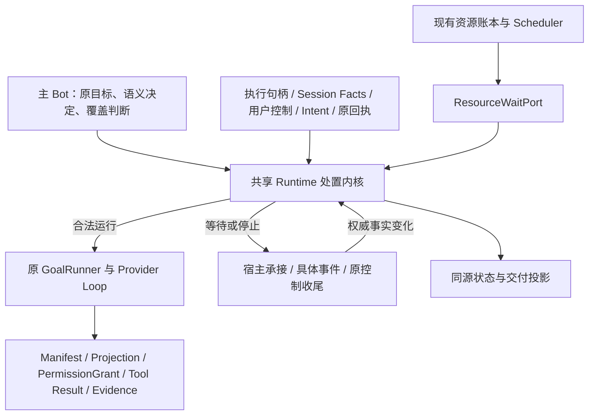

# ADR 120：运行事实、统一处置与资源等待闭环

创建时间：2026-11-03
最后更新：2026-11-08（文末确认 ADR 124 的退役索引不对用户开放，且不改变本文的停止确认归属）
状态：Accepted（用户先讨论整体收敛方向，随后明确要求“先详细 ADR 再进行实施”；本文件先于代码实施，源码与验收状态分别记录）
级别：A（运行事实、等待与组合准入契约），B（父协调处置、恢复和装配），不新增本地能力或权限来源。

关联：[产品北极星](../../design/product/peer-product-alignment.md)、[工程治理](../architecture/20-architecture-governance.md)、ADR [85](85-project-agent-hosts-inputs-and-surfaces.md)、[94](94-reply-attempts-silent-wait-and-recovery.md)、[95](95-progress-driven-execution-policy.md)、[102](102-unified-task-lifecycle-projection.md)、[110](110-follow-up-responsibility-and-current-list.md)、[112](112-runtime-module-and-loading-boundaries.md)、[116](116-session-control-and-resource-settlement.md)、[117](117-intent-driven-coordination-and-goal-closure.md)、[119](119-user-stop-cognition-admission-and-settlement.md)、[链路审计](../experience/peer-task-chain-reliability-audit.md)。实施范围与顺序见[实施卡](../../playbook/v0.1.0/runtime-decision-convergence.md)。

## 1. 问题与决定

0.0.18 的单任务自治和原能力链继续作为执行基底。主 Bot 增加目标理解、跨阶段调度与跟进；共享 Runtime 拥有准入、等待、停止与机械收尾。用户反馈 RC 连续无法完成完整任务，本决策以原执行闭环的可靠性为约束，不用增加另一个任务管理器解决集成错误。

冻结核对源码为 Peer-Agent `4a58e2846875f85de69915764a127096721c5b0d`（RC35 peeled commit），知识基线 `f952a447fc46a325f7c5b79267f35df21e5643b1`。已确认：

1. 原 Intent 协议允许 resource 等待，但 intent-lifecycle 对该合法分支返回 resource_adapter_unavailable，资源控制与语义等待未接通。
2. 生产 executionOwnership 是 live/ended/unknown，根关闭读取 `.active`；正确的 Protocol 类型没有覆盖 JS 消费端。
3. 父工作在正常收尾、回复恢复和冷恢复中分别再推导 runnable；bot 跟进责任和旧回复 sources 能取得执行含义，现场停止后出现重复认知调用。
4. 上述路径已有大量局部机制；需要减少策略出口，并以真实生产者/消费者证明接通，不能只删除拒绝或改一条字段访问。

决策：建立受严格类型检查的运行事实/处置内核，绑定现有权威事实；用现有 Scheduler/资源账本提供完整 ResourceWaitPort；正常收尾、回复恢复、修复接回和等待重查使用同一处置规则。类型校验、装配验证、事件重查和生产契约用例共同防止再次出现同类错接。

## 2. 目标架构与边界

根 Intent 与子 GoalPlan 是不同责任，分别关闭；资源 claim、停止控制、权限和 Evidence 仍由原 Module 持有。一次处置快照是只读视图，不是数据库、Task 表、执行许可或新的权限事实。模型仍负责语义，不负责资源轮询、停止确认、操作身份生成或回执补送。

保持唯一能力链：Capability Provider → Manifest → Runtime Projection → Tool Call → PermissionGrant → Evidence。资源重查和生命周期恢复只使用原已登记的受控状态端口，不得以收尾名义自行执行 Shell/文件/MCP。

本批实现本 ADR 的事实、资源等待、父协调处置及生产接线。ADR119 的完整 WorkControlOperation/跨角色认知代次与批量控制摘要是独立控制扩展；本批不谎称已完成该提案。共享处置必须尊重现有 stopScope/pendingControl/用户停止事实，不能为了等待修复解除它们。本文不是整体替换 GoalRunner、所有 Provider Loop 或权限系统的授权。

## 3. 真值归属

| 问题 | 唯一来源 | 消费规则 |
| --- | --- | --- |
| 当前执行是否活跃 | 原 execution token、受管句柄、sessionFactsFromPlan | 只认 ExecutionOwnership 三态；没有 token 不证明 ended |
| 是否仍委托及哪一版本 | 原 work/mandate/Intent/用户控制 | 观察或回复引用不能创造执行权 |
| 哪个资源阻挡当前执行 | 原设备资源账本、Scheduler inspect 与执行身份 | read 无副作用；当前 inspect 不能代替 reserve/dispatch 前重检 |
| 停止是否确认 | 原 Session Control/StopBarrierReceipt | cancelled 字符串不代替停稳回执 |
| 是否完成/签收 | GoalPlan 原核验与验收、Intent 覆盖/交付 | 根关闭不反向签收子任务或释放资源 |
| 谁应处理下一步 | 统一处置内核消费上述事实 | owner=bot 不等于调用模型；区分 model/host/user/none |

不得为兼容错误访问新增 executionOwnership.active 镜像，不得把 resource busy 改为 allowed，不得从历史助手承诺补造来源、停止或工具成功。

## 4. Runtime Session Facts 契约

在 Protocol 增加有类型的规范化事实接口及纯判断函数，字段来自现有 WorkSession，不改变原存储所有权：

| 字段 | 语义 |
| --- | --- |
| sessionId/status | 稳定身份与既有生命周期输出；未知/错误形状保守处理 |
| executionOwnership | live / ended / unknown；缺失旧字段按 unknown，错误对象形状不能冒充 ended |
| followUp owner/reason | 原唯一生命周期投影；当前责任与处理类型分离 |
| needsUser / completionReviewRequired | 原真实人工请求/结果门；普通技术核验不能变成人工门 |
| origin/work/parent/control refs | 原关联与停止事实；不从 sources 推导持有权 |
| handling | model / host / user / none，只读计算，不独立持久化 |

规范化入口接受 unknown，验证身份、字段类型与枚举，返回明确的有效/缺失/无效事实；新正常生产者必须完整，旧缺字段保持保守兼容。无效执行类型、事实不足及未确认停止归 host，不交给模型反复查询。

关键纯消费者放入 `.ts` Module，沿现有 strict tsconfig 参与正常 typecheck/build；不能仅新增声明文件遮盖未检查的 JS 函数体。正常构建重写 `.ts` 导入沿现有工具链。对 touched `.mjs` 用明确输入边界适配，逐步迁入该内核，不把本批扩成全仓 JS→TS 迁移。

根关闭使用同一规范化事实：非接受/取消终态、live、未确认停止、无效事实、真实请求和未决完成门任一成立均有待处理义务。用户已合法撤回而仅历史 unknown 沿 ADR110/116 收口，保留原保护，不无限追溯。不能用一条错误 `.active` 或单个 status 得出结束结论。

## 5. 统一父协调处置 Interface

深化现有 continuation/intent/reply policy，新增纯且严格类型检查的 `decideRuntimeDisposition`，而非新的执行器。输入是当前 work 控制、一次 continuation 结论、规范化子事实、语义处置、真实等待、失败恢复、交付和未观察事件；输出含 state/end、handling、waitFor 和 repairSessionIds。输出是调度决定，不是 PermissionGrant。

优先级固定：

1. 现有工作范围暂停/取消、历史恢复隔离及未完成控制先约束相关准入；其它任何结论不得覆盖成 runnable。
2. 本次显式停止回复保留 `end=user_stopped` 并关闭父回复的自动准入；没有活跃子任务时为 paused，仍有子任务运行时沿既有 waiting_children 表达，均不恢复该父回复链。显式回复重试保留原入口；工作范围暂停仍须经工作 resume。

   回复停止的确认点是 Runner 对当前 workId/attemptId 的协调日志写入。先封闭该回复的准入，再通知在途请求中止。保留原 checkpoint、工具结算和子任务身份。收尾可更新停止后的等待投影。冷启动与旧事件不得绕过该停止事实。若进程在发布回复停止卡之前退出，由新租约持有者从同一 work 的停止事实与 checkpoint 重建原停止卡，身份仍为原 attempt，不补造未落盘的文本或 Evidence。明确重试才在原 work 上重新准入，并由同一轮消费已积累的相关事件。未知派发仍沿现有回执检查阻塞。

   Work Control Module 负责整项暂停、取消和恢复。同一 work 的控制调用按进入顺序结算，后到的停止不能先确认、再被较早的恢复异步回写覆盖。未结算的整项控制不能被另一条恢复命令替换。所有恢复目标结算前保留 work 范围的屏障。全部结算后同时恢复普通回复范围和当前 end，lastControl 保留操作历史。旧 work 范围记录若仍带 user_stopped，即使留有 resume 回执也保守停住，因为无法判断后续是否又停止过回复。恢复该历史状态须先经现有整项暂停路径确认停稳，再由用户明确整项恢复，仍须通过原子任务控制和派发事实检查。
3. 真实调用失败、未知派发、显式预算按原错误/恢复政策保留，停止优先，不为汇报额外调用模型。
4. 宿主已准入的具体 silentWait 保留目标与等待身份；等待不是无进展，不递增或清零原指纹/次数。与在途 PR268 保持此语义，交叉文件由最终集成明确核对。
5. 交付补偿、停止确认、资源等待和其它确定性宿主待办归 host；重复事实不使模型重新运行。
6. 有效 Intent 的 continue/wait/return/withdraw 沿原 Kernel/核验/关闭回执解释；处理真实未观察事件不能突破用户控制。
7. 没有上述强约束时，才从有处理权的子事实判断语义修复、用户等待、子执行等待或已交还。

正常 finish、reply onRecovered、repair custody 与等待重查消费这一 Interface。各消费者可以保存自己负责的 checkpoint/交付/事件回执，但不能再各写一段“bot 仍负责就 runnable”。停止、核验、验收和资源保护不因统一处置而合成一个 running/done 字段。

处置快照不能跨 await 当作仍有效；异步结果回写前重新读 work/control/goal/来源版本，沿原 writer/CAS 提交。不得按旧快照覆盖期间发生的取消/暂停或新目标。实际执行仍过原 lease、预算、版本、资源和权限准入。

## 6. 引用与处理权

任务 sources/报告阅读只建立观察关系。模型修复权来自原 work/mandate 绑定、可核对原 anchor 或 Kernel 明确的责任转移。新取消回复引用无 workId 的旧任务，不自动加入新 work 的 repairSessionIds。

已持久归属的旧记录保留，必要时加法适配；缺少完整来源时由原 Session Control 或 host 恢复待办承接，不制造新可执行任务。查询不写入新 ownership，不依据最近任务或标题猜绑定。修复和回复恢复必须共用这一关联函数。

## 7. ResourceWaitPort Interface 与装配

Scheduler 提供有范围的只读资源等待事实，使用其已注入的 currentPlan、lease、原 resource inspect/snapshot；Supervisor 绑定 work/parent/已准入 session 范围，主 Bot 不能随意指定另一项任务的 claim。

| 端口 | 契约 |
| --- | --- |
| read(scope) | 返回本 work 合法 session 中实际被资源阻挡的有界事实列表；包括目标身份、wait.id/revision、阻碍类别与安全摘要 |
| inspect(scope, wait) | waiting / ready / stale / unavailable；同时重检目标关联、执行代次、当前 blocker，不以旧 inspect 放行 |
| 资源变化承接 | 复用 Scheduler/Host 的原资源变化与 tick 对账，重新检查具体等待；不建立周期模型调用或新队列数据库 |

scope 至少含 workspaceId、parentConversationId、workId、由宿主 mandate 提供的 sessionIds。wait.id 绑定目标 session 与执行身份，revision 由宿主对相关 blocker/claim revision/目标绑定计算；不能用全设备资源 revision 的变化制造无关进展。对相同目标仍被新 blocker 挡住时继续 host 等待，不因任意 revision 改变就调用模型。

id 不暴露凭据或原工具正文；模型只回填 query 返回的引用。资源等待消失且原目标身份仍合法才是 ready；目标换代/越范围为 stale，源不可读/资源 DB 故障为 unavailable。后二者保守保持具体系统阻碍，不能当作资源空闲。

生产 Desktop/TUI 的 Supervisor 和 Runner 必须拿到同一个资源等待端口。启用 Intent 资源等待的装配缺少端口即明确失败，不保留“声明合法，运行时一律 unavailable”的占位分支。无物理资源的轻量宿主/测试显式使用空资源适配器，不能靠默认猜成无资源限制。公开嵌入入口的兼容过渡需显式标明支持范围，缺端口不得承接已持久化 resource 等待。

本批对公开 `createProjectAgentHost` 保留旧调用签名：未提供 `readResourceClaims` 的嵌入宿主沿空资源适配器运行，仅支持非物理资源场景；空适配器对任何资源等待都返回 stale，绝不 ready。提供了资源 claim 端口而遗漏 `resourceWaits` 时装配立即失败。Intent/Supervisor 的资源端口仍为必需；两正式宿主显式传入同一实例。该兼容路径不表示物理资源保护缺省放行。

## 8. 资源等待的完整时序

1. Scheduler inspect 确认某个合法执行受资源阻挡。任务原队列立即保留等待，启动本身不依赖模型正确编排 wait。
2. Intent query/DecisionFrame 投影同一端口的等待引用与可用性，源事实通过原 L7 事实准入，不增加 System Context Source 或系统指令层。
3. 模型如决定让父协调等待该资源，只能提交返回的 wait.id/revision。Runtime 从同一端口复核后沿原 assessment 日志持久化 `waitFor(kind=resource)`；禁止仅凭模型自报写入任意资源等待。
4. 父 work 为 host waiting，释放协调计算机会。重复 tick/资源事件只重新读取与比较，不调用模型、不刷新进度指纹。
5. 资源释放、句柄结束、受管停止或宿主冷恢复触发原资源/队列对账；读取所有已登记相关 wait，未变继续等待，仍阻挡保持等待，故障保守阻塞。
6. 所有具体资源等待 ready，且未被用户停止/换代/真实人工门约束时，原 work 被重新准入一次，沿原 checkpoint/Intent 处置继续；真正目标会话启动仍经过 reserve/activate/dispatch 前重检。

等待中的 owner 仍可取消/暂停；未知效果/ResourceHold 不因 wait ready 被清除。共享依赖与其他 workspace 的冲突保持原设备级判断，不能按 workId 分离而绕过真实目录竞争。只对模型闭环缺口增加端口，不改变原资源保护与公平调度。

## 9. 持久化、版本与恢复

不增加存储路径、数据库、锁表或新的权限记录。沿原 work/Intent 的 waitFor 和原资源 ledger 持久化；handling 与规范化事实不另存真源。ResourceWait 属于现有 Intent schema 已声明的 kind，正常实现不新增事件 discriminant；因此本批保留联合格式9，不能借此宣称已实施 ADR119 预留的新格式/控制操作。

如果实施实际需要增加旧 reader 无法安全理解的持久字段/事件，必须先修订本节并提升能力门槛，再写首条新记录；不能以“可选字段”跳过兼容。旧版本对 resource wait 没有完整恢复能力，降级前应沿原控制停稳；不宣称所有版本能无损自动续跑。

冷恢复先还原原租约/控制/资源保护，再重建端口并检查等待，最后开放原 Runner。暂时源不可用不删 wait、不清 unknown、不直接进入模型；来源恢复后可确定性再查。查询和等待重查不得改原 Intent assessment 的来源/签名/语义 revision 来伪造模型决定。

并发规则：同一次决定使用同一同步事实快照；任何 await 后条件回写；停止优先；旧执行结果只进原历史；资源 ready 后仍需当前真实准入；原 GoalRunner/PermissionGrant/Evidence 不变。

## 10. 已有代码的删除与迁移清单

| 原代码 | 处理 |
| --- | --- |
| intent-lifecycle 的 resource_adapter_unavailable 占位分支 | 删除，以实际 ResourceWaitPort 校验与有类型等待状态替代 |
| 根关闭的 executionOwnership?.active | 删除，改为统一的生产事实/未决义务判断，不新增 active 镜像 |
| repairOwnership 把所有非 live bot 责任作模型修复 | 使用规范化 handling；host 收尾保留具体待办但不进入模型修复列表 |
| ownedSessions/reply recovery 从 sources 吸入旧会话 | 共同使用经过来源核对的归属函数，引用保持观察关系 |
| finish、onRecovered、repair custody 各自状态优先级 | 迁入统一处置函数，原 Module 保存本身的事实/回执 |
| 资源等待缺少 query/host/runner 接线 | 同一端口从 Scheduler→Supervisor→Intent/Runner，并在 Desktop/TUI 正式装配 |

保留原 public API 的合理兼容，新增 required port 的入口要同步所有生产装配及明确的测试/轻量适配；不能只让某个 Desktop 调用点成功。生成式 prompt/storage worker 如 canonical 源实际改动才按原生成器同步，不手工编辑嵌入副本。核心 Module 要增加 Locality/Leverage，避免将原判断平均搬到多个新 wrapper。

## 11. 备选方案与取舍

不采用只删 resource 拒绝、只把 `.active` 换成字符串、全局关掉资源保护、无条件隐藏停止任务、增加一个代理监督原代理，或整体重写原任务引擎。这些方案分别遗漏装配、消费契约、等待出口、用户控制或原执行可靠性。

选用类型化事实/统一处置与有源等待，代价是要同时接好两宿主、恢复和测试适配；收益是同类错误在编译/装配/生产契约场景暴露。类型不能证明目标语义或外部结果正确，模型质量、权限、Evidence、核验与最终真实任务验收继续各自成立。

## 12. 实施包与授权

RC-01：Protocol 运行事实与严格类型处置内核；RC-02：资源等待端口、query/校验及真实宿主装配；RC-03：正常/交付/恢复处置统一与来源归属；RC-04：生产者到消费者契约用例、冷恢复/等待/停止/关闭组合、文档收据。按上述顺序串行实施，范围见实施卡。

用户当前授权涵盖先写详细 ADR、随后完成这些包；不需每包重复请示。用户没有在本任务明确要求早测，日常 Validation Scope 仍按当前有效 AGENTS：编写必要用例并内容/diff 审阅，测试/build/type/架构/IPC/产品回归留发布或后续明确授权。其它在途治理 PR 的描述不自动替代已生效的用户指令；若当前工作树 AGENTS 的有效规则变化，先核对来源与优先级并在收据注明。

新分支从开发线4a58e284建独立工作树，保留原工作区及运行实例。知识先提交并推送，再实施代码；所有本地提交同轮推送。提出 draft PR 供审阅，不自行合并或发布，不安装/重启、不修改真实用户数据或重新启动已取消目标。在途 PR268 的 silentWait 与停止/接管修复按最终整合核对，不覆盖其分支、不宣称继承它的 CI 结论。

## 13. 必须编写的验收场景

| 编号 | 场景 | 预期 |
| --- | --- | --- |
| RF01 | 从真实 sessionFacts/projectWorkSession 得到 live，再进入根关闭 | 不得关闭；不是假 active 对象 |
| RF02 | 缺字段/对象形状/无效枚举与旧历史 | unknown/无效事实保守处理，不能冒充 ended；合法旧终态按原回执解释 |
| RF03 | Protocol 准入的 resource wait，经真实 Scheduler/资源账本校验 | 得到合法 waiting；无占位 unavailable；跨 work/伪版本拒绝 |
| RF04 | 真实目录占用→父等待→匹配停止回执释放→原任务重准入 | 一次准入，无原工具重放；不把 ready 当权限 |
| RF05 | 重复 tick/无关资源变化/仍有新 blocker | 模型请求不增加、进度不漂移；仍等待 |
| RF06 | 资源源不可读、目标换代、租约失效 | held/具体阻碍，不当作 ready，不丢原等待 |
| RF07 | 停止/暂停和最后资源释放、子结果并发 | 控制优先，旧等待/回复恢复不复活相关工作；无关新任务正常 |
| RF08 | 正常 finish、reply recovery、冷恢复的同一事实 | 状态/handling/等待/修复列表一致 |
| RF09 | stop_unconfirmed、host 收尾及引用旧无 workId session | 不进入模型修复；不因引用取得处理权；责任和历史保留 |
| RF10 | 明确 silentWait 在活跃 Intent 中、重启后重复 | 等待继续，原进度计数既不递增也不清零 |
| RF11 | 真正技术修复、用户问题、原目标 continue/return | 合法自治保留，真实人工门不吞；核验/签收/覆盖条件不放宽 |
| RF12 | 正式装配遗漏 ResourceWaitPort | 启用该功能时确定失败；空资源宿主必须显式适配 |
| RF13 | 原完整单任务、调查→实施及下一同目录任务 | 实际工具/产物/Evidence/核验/交还/根关闭都有证据 |

发布前对最终组合候选执行完整工程门禁与产品 Capture/逐图审阅/Verify，并单独记录真实模型、正式安装版、升级数据、辅助技术和独立审阅范围。当前只写用例不得称上述场景已通过；静态类型和局部 fixture 不代替用户任务完成。

## 14. 当前收据

2026-11-03：设计提交 `1cd4c5f` 先行提交并推送；随后完成本批源码实施，代码候选为 [Peer-Agent `9c20faea20609ef6542cccec4b89682e2bf4e6ce`](https://github.com/ly-ccx/Peer-Agent/commit/9c20faea20609ef6542cccec4b89682e2bf4e6ce)，分支 `codex/runtime-decision-convergence`，基于开发线 `4a58e284`，已推送。实施授权来自本轮用户“先详细 ADR 再进行实施”。未合并、发布、安装或重启。

| 已实施边界 | 具体落点与删除路径 |
| --- | --- |
| 类型化运行事实 | Protocol `runtime-session-facts.ts` 规范化三态、有效性、处理类型与未决义务；公开 `projectWorkSession` 补传生产执行所有权。根关闭/撤回改用统一判断，缺失已绑定会话同样保守；删除 `.active` 消费，不添加布尔镜像 |
| 统一父处置 | 严格类型 `runtime-disposition.ts` 固定优先级；finish、reply recovery、repair custody 与资源恢复共用。未确认停止、事实无效/缺失归 host，不等于模型修复；既有控制与回复停止优先 |
| 原资源端口闭环 | `resource-wait.ts` 从原 Scheduler/账本 read/inspect，核对 work/parent/session、mandate 执行绑定、执行代次及相关 blocker revision。query 和 turn DecisionFrame 共用有界事实投影，assessment 复核原引用；删除占位拒绝 |
| 资源变化与冷恢复 | `resource-wait-recovery.mjs` 只对已准入等待重查；仍忙或换 blocker 不递增进度，stale/unavailable 保留引用并阻塞，由当前事实投影说明原因；就绪转交既有 `report_available` 事件，不新增事件种类或数据库 |
| 一次唤醒与连续性 | 资源事件 ID 有界且确定，含目标会话以满足原 source 准入；先 transfer 后写 work，崩溃重查去重。消费后不再次作唤醒源；新认知步骤不接旧 Provider 尾部。完成配对的工具历史不要求重放才能恢复 |
| 来源与停止保护 | 阅读引用不能取得 custody；只认已存绑定、原锚点或有范围的持久事件托管。回复补送/失效、恢复选择、派发前 prepare 和原重试准入尊重 pendingControl/工作停止；回复重试不能替代工作范围 resume |
| 两宿主接线 | Supervisor 建立同一端口供 Intent 与 Runner；Desktop、TUI 正式构造均传入该端口。无资源测试显式空适配，公开旧嵌入兼容范围见 §7 |

新增 21 条用例源码，分布于 Protocol 运行事实、统一处置、真实资源等待、Intent 生产者/消费者组合和有界 DecisionFrame；同步原 fixture 与已绑定来源用例。包括真实 execution token → `sessionFactsFromPlan` → `projectWorkSession` → 根关闭，真实 Scheduler/SQLite 资源账本 → 等待引用 → Protocol 校验/Intent 准入 → 停稳回执 → 冷 Runner 重查 → 一次事件 → 下一语义决定，以及伪版本/越范围/换代/失租/账本故障/新 blocker/停止优先/silentWait/三处消费的一致性。这里描述的是已写用例的构造，不是运行结果。

内容与 diff 为实施者自审，非独立评审；执行了 `git diff --check`，没有测试、构建、typecheck、架构/IPC 检查、截图/交互回归、真实模型或正式安装版验证。遵守当前有效 AGENTS 的日常验证范围，没有以在途 PR269 的规则提案推定授权。自动 CI 若运行，属于远端另行结果，本收据未等待或援引其通过。

本批不改变存储格式9、权限、Evidence、原 GoalRunner 或 Provider Loop 的能力执行职责。ADR119 的 WorkControlOperation/全角色认知代次/批量控制摘要仍为 Proposed，尚未实施。RF13 的完整真实任务、正式安装版及升级数据验收尚待发布门禁；不据此宣布用户现场已修复或任务成功率已恢复。PR268 与本批在 repair/runner/reply/recovery 路径有交叉，silentWait 保留指纹与次数的语义已纳入本批；合并时须在最终组合候选核对其余 takeover/恢复行为与全部门禁，不能套用任一分支先前的检查结论。

### 14.1 RC36 发布准备中的修正与验证

用户随后要求发布新 RC，完整发布验证因此获得授权。最初候选 `9c20faea` 的 [CI41573929898](https://github.com/ly-ccx/Peer-Agent/actions/runs/41573929898) 双平台失败，确认为本补丁回归及新 fixture 构造错误，不标为偶发：旧持久事件 custody 被过度排除；停止回复的既有 waiting_children 表示未保留；无资源等待的恢复扫描过早读取 roster；资源 fixture 只有持久 running 字符串，未建立真实执行 token，且未实际释放无关 claim 来推进资源事件 revision。

修正 `79ff4c1f` 保留原有行为断言，补回有范围的持久事件托管、保持停止回复对父认知的约束并兼容活跃子任务、延迟到实际资源等待才读取 roster；资源 fixture 经真实 token 和停止回执构造。核验派发 fixture 明确提供当前 accepted/ended 会话事实，同时新增“派发已对账但当前会话事实缺失不得关闭”检查。新增用例累计22条；未知事实仍保守，不为通过检查降成已完成。

整合提交 `cd73dd04ad318a9335f0969e47e5a97dc714632b` 接入 PR268 的 takeover/已有交叉状态恢复，冲突消除后301项定向检查通过；原等待保护保留在 `repairProgressDecision`，统一处置仍为状态出口。前序1769项 Runtime 探索性运行虽然通过，但执行期间发生源码整合，明确不计最终候选验收。最终 RC36 组合源码须在全部 PR 合并后重跑全部门禁，见 [RC36 收据](../../playbook/v0.1.0/rc36-candidate.md)。

前序候选补查（兼容方案已由 §14.2 替换）通过真实 Work Coordination Store → `controlProjectWork resume` → Runner `prepare` 复现旧 end 标记阻挡明确工作恢复：修正前断言 `runtimeWorkHeld(current) === false` 实际为 true。Work Control 完成后写入当次控制的 end；兼容旧记录须有原 lastControl.action=resume 回执，缺回执或仍为 cancel/pause 时继续停止，不能按 waiting_children 字符串推定恢复。正、反两条已有状态路径和新写入均保留检查，230项受影响检查及 runtime-node typecheck 通过；将以新提交重新运行发布 CI，不沿用旧 head 的通过结论。新增用例累计23条。

### 14.2 发布暂停期间的停止与恢复验收

2026-11-05，在 RC36 本地隔离候选复现三段断链。回复停止确认早于持久化，收尾前重启会续跑。完成整项恢复后旧范围继续屏蔽宿主等待和结果收尾。两个并发的整项控制争用同一 pendingControl，早先恢复可在后到暂停确认后继续执行。补强持久停止后另复现一个展示窗口，重启无原停止卡，用户缺少继续入口。

按本 ADR 第 5 节修正。控制收口在 Runner Coordination 和 Work Control，旧事件按原归属等待明确继续，原工具的已知结果保持绑定。恢复仍经原 Work/Session Control、checkpoint 与 Evidence 门禁。未确认停止和未知派发保持封闭。

验收针对 HEAD `f68ada2e450110643eea94ad9e09d5ab7e090cce` 加本地差异 `e0cb2bc094fcad5612736749e060768d69b83f68e3d3e35fb6fd90ccb5384dec`。Runtime 1811 项和桌面宿主 21 项通过，桌面构建、Runtime 类型检查、架构与 IPC 检查通过。两个收尾时序验证了停止期零原 work 派发、原 checkpoint 下两个实际文件各读一次且交付一条合计 42 的回复。实际 Session Supervisor 与 GoalRunner 保持原计划和证据并完成剩余叶子。隔离源码 Electron 实测切回对话保持停止，明确继续在同一 work 提交回复。扩展流式回归通过，停止与恢复截图由实施者核对。

本轮为脚本认知和实际本地工具的 macOS 源码验收。在线模型、签名安装版、真实 RC35 数据升级、跨平台和完整发布门禁待验。RC36 处于发布暂停。

### 14.3 组合候选验收

全部代码 PR266—274 合并后冻结 `5093407395d28d7cf650f43bb4eff00493e60c9a`。完整工程门禁通过，Node 9189 通过、5 跳过，Bun 849 通过。255 张 macOS 源码产品截图由实施者逐图审查，Capture/Review/Verify 同一源码指纹通过，范围和自动 CI 后续结果见 [RC36 收据](../../playbook/v0.1.0/rc36-candidate.md)。§14.2 的“发布暂停”是当时状态，用户后续已恢复发布授权。真实在线模型、正式安装版与完整辅助技术仍各自待专项验证。

PR275 在首次未发布标签的 Windows ASAR 校验失败后修正跨平台路径，并修正 Linux SDK 策略测试的目录监听生命周期。重新冻结最终候选 `793c9a5223e7ba12d3f83f2d99c3e8a0bc2b7618`，全量工程门禁通过，Node 9,195 通过、5 跳过，Bun 849 通过。新的 255 张截图自审与 Verify 绑定 sourceFingerprint `806e94fb03fca8fd33b852f97e86a251c4cc48ad92074d466a3dfc14764a41c5`，2026-11-05T09:44:53Z 通过。旧候选验收不作为新源码的替代。自动 CI 和发布状态以 [RC36 收据](../../playbook/v0.1.0/rc36-candidate.md) 为准。

最终标签已从 `793c9a52` 发布，Release42008952591 与 Pages42008952590 成功，14 项下载资产、三平台更新清单、四个 npm 包与五个 Pages 入口线上核对通过。完整发布回执和各项覆盖限制见 [RC36 收据](../../playbook/v0.1.0/rc36-candidate.md)。

## 2026-11-06 补充：持久化故障、恢复操作与执行效果

状态：用户认可并授权实施；源码验收记录见 [F1–F8](../../playbook/v0.1.0/persisted-turn-recovery.md)，不等于发布或个人原任务恢复。

现场 resume transition 为 completed、executionAdmission=queued、executionEffect=pending，GoalPlan/runner 却再次 failed/0 tools；等待被 session_not_advancing 拒绝后主 Bot 仍继续轮询。沿 ADR95/96/110/116/117 收口，区别协调完成、排队、实际开始和执行结果，不重定义 phase=completed，也不据助手文字宣称恢复。

### 本次 A 级事实投影收紧

宿主仅从运行时 `runner.lastError` 的精确机器前缀 `conversation_persistence_failed` 规范化既有 blockedReason。唯一 Lifecycle 出口在 failed/waiting_agent 状态保留 Bot 当前责任，FollowUpReason 增加 `local_persistence_failed`。Runtime Session Facts 将该原因归 host，其余技术阻塞保留模型修复；统一 Runtime Disposition 在语义续跑前收为 blocked_system/fatal、blockedCode=conversation_persistence_failed。原诊断全文留在 runner/历史。人类门、活体执行、未决停止、明确暂停/撤回和承接优先级保持，不能用任意包含词或助手文字冒充该事实。

这是既有 Protocol 投影的明确收紧，取代本文旧“失败一律按语义修复”的适用范围；不新增持久字段或格式，不改变权限、Evidence 或能力执行链。UI 原技术阻塞计数和行状态识别新原因，沿既有恢复入口表达。

### 原 Session Takeover 中的安全恢复

恢复继续走 Session Control / Supervisor / Scheduler / GoalRunner，逐次核对 lease、原 work/session、goalRevision/executionEpoch、停止/人工门及未知效果。只有停稳且无未知效果，并且 runner 与失败叶子原因均为上述本地故障时，才把对应叶子准备为 pending。原完成叶子、非本地失败、failureReason/result/Evidence/运行历史和累计计数均保留，不全量 reset。

准备前在原 runTrace 记录 operationId/taskIds/previousError。安全准备后的本次新 attempt 选择 execute，不能沿用旧失败 intent=block；准备仍不等于执行。若准备中崩溃，同 operation 依原审计识别已准备的 pending 叶子，保留 execute，不重复审计或重置。实际再次失败照实归 host 阻塞，同 operation 重放不再次启动。

本轮只在隔离 fixture 和冻结副本验证，不修改个人任务、不安装或重启应用；不采用 Proposed ADR119/113 的扩展。真实模型、安装版与原任务的恢复仍待独立验收。

## 后续（2026-11-07，ADR 124 已接受；实现尚未交付）

[ADR 124](124-legacy-stop-obligation-controlled-resolution.md) 已接受并授权实施。主 Bot 可以只读核实遗留停止证据，并在用户授权后停止跟进展示。核实结果里的缺口不是停稳回执，resolve 也不写停稳回执。模型调用核实不等于本文所说的停止确认。未知所有权和未确认停止仍交给宿主，不交给模型循环。2026-11-07 记录时，已发布运行时还没有这些工具。其后的未合并草稿见 ADR 124 第 9.2 节。

## 后续（2026-11-08，ADR 124 可见性修订）

退役跟进仍不写停稳回执，也不把核实当成停止确认。确认后该条离开用户的跟进和任务列表，处置写入内部索引。Desktop、TUI 和工作面板不展示「待核实」。未合并的代码草稿不是已发布运行时，这次可见性修订也尚未落入该草稿。
