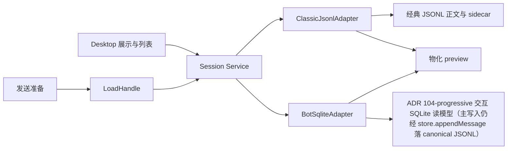

# ADR 121：Desktop 会话窗口契约

创建时间：2026-11-05
最后更新：2026-11-15（跨 ADR 对齐：准确区分 `BotSqliteAdapter` 消费 [ADR 104-progressive](104-progressive-interaction-and-coordination-storage.md) 交互 SQLite 读模型与 `store.appendMessage` JSONL 持久真源）
状态：Accepted（契约已定。Peer-Agent 在已发布的 `0.1.0-rc.36`、开发线 `PeerAgent/dev/0.1.0` 之上按 P0 → P1 → P2 落地。各阶段验收另记，本文不宣称实现已经通过。）
级别：A（Desktop 与会话存储之间的窗口读取、追加返回、列表预览与修订订阅契约），B（open block、延迟高亮与贴底的渲染路径）。不新增 Capability、PermissionGrant、Evidence 或 System Context 层，不改数据根。把经典正文全量迁入独立 SQLite，或取消 Bot 交互 SQLite 读模型，超出本文，须先修订 ADR 74 与 [ADR 104-progressive](104-progressive-interaction-and-coordination-storage.md)。

关联：[产品北极星](../../design/product/peer-product-alignment.md)、[架构治理](../architecture/20-architecture-governance.md)、[交互契约 §4](../specifications/peer-human-agent-interaction-contract.md)、[动效系统 §5–§6](../specifications/motion-system.md)、ADR [22](22-stream-reattach-on-reload.md)、[57](57-canonical-conversation-history-projector.md)、[74](74-deployment-surfaces-and-local-storage.md)、[86](86-batched-persisted-conversation-reads.md)、[98](98-large-history-execution-responsiveness.md)、[104-progressive](104-progressive-interaction-and-coordination-storage.md)。路线图入口见[产品路线图 §2](../../design/product/peer-product-roadmap.md)。

## 1. 问题

Desktop 会话路径仍把整份同步 JSONL 读写和整面 React 热更新绑在一起。打开、列表、追加和发送准备都会碰到完整消息数组；流式阶段又按 token 刷新已沉降的表面。大历史下，这条路径的成本随未见历史增长。ADR 98 已记录父会话与子会话的全文解析会堵在主线程；ADR 104-progressive 已把模型侧交互读取前移到有界页。Desktop 产品路径还没有同一条窗口契约。

现场要分开的四件事：

1. 冷路径每次读取都物化整份消息，追加的返回值也带回整份消息。发送准备把 load、project、fingerprint 拆成多次独立的全文遍历。
2. 热路径按帧对整棵已沉降树做协调，同步做高亮，并用每帧 hit-test 判断是否贴底。
3. 列表预览仍可能扫描整份 JSONL。经典 JSONL 与 Bot SQLite 各走各的读取形状，调用方必须知道正文落在哪一种存储里。
4. 能力、权限、Evidence 与执行位置已经被 ADR 74 和治理主链锁住。性能契约不能借机改这些边界。

## 2. 决策

Desktop 产品路径改为会话窗口契约，分三阶段演进。

| 阶段 | 路径 | 决定 |
|---|---|---|
| P0 | 冷路径 | 产品读取只返回 meta 与窗口切片。`append` 只返回 meta 与 preview。一次发送准备只持有一个 LoadHandle，在该句柄内把 load、project、fingerprint 各做一次 |
| P1 | 热路径 | 流式增量进入当前回合的 openSlot。高亮延后到块关闭或明确的空闲/用户请求。跟随最新时按 `turnId` 与 Δheight 贴底，钉住状态来自既有阅读意图，不来自每帧 hit-test |
| P2 | 存储接缝 | 经典 JSONL 适配器与 Bot 交互 SQLite 读模型适配器实现同一个 Session Service：`listMeta`、`getWindow`、`append`、`subscribeRevision`。列表只读物化 preview。为列表预览扫描整份 JSONL 的路径退出产品调用 |

执行与 Evidence 留在用户侧节点。Gateway 与云端继续只做会话路由、注册与授权（ADR 74）。Renderer 仍只表达窗口与 openSlot，不读文件，不执行能力。



## 3. 契约

Session Service 是 Desktop、主进程与两个存储适配器之间的唯一产品接缝。下面是概念 Interface。字段名落地时可以放进既有 protocol 模块；语义以本节为准。

```ts
interface SessionService {
  listMeta(query: ListMetaQuery): Promise<MetaPage>
  getWindow(query: WindowQuery): Promise<SessionWindow>
  append(input: AppendInput): Promise<AppendResult>
  subscribeRevision(scope: RevisionScope, onRevision: (event: RevisionEvent) => void): Unsubscribe
}

interface SessionWindow {
  meta: SessionMeta
  window: StoredMessageSlice
  cursor: SessionCursor
  hasMore: boolean
}

interface AppendResult {
  meta: SessionMeta
  preview: SessionPreview
}

interface SessionMeta {
  conversationId: string
  contentRevision: string
  title: string
  preview: SessionPreview
  availability: 'ready' | 'rebuilding' | 'version_changed' | 'damaged'
}
```

`StoredMessageSlice` 沿用现有持久化消息在 UI 中的可见投影，只包含本次游标请求的有界切片。切片携带稳定消息身份。调用方修改返回值不得污染下一次读取。

`SessionPreview` 是物化的列表与打开槽摘要，至少包含 `conversationId`、有界 `title`、有界可见 `excerpt`、`updatedAt` 与 `contentRevision`。计数字段只能源自追加时的增量维护。preview 是派生展示，不是 Evidence、执行成功或签收凭据。

`SessionCursor` 按 canonical 追加顺序和消息身份生成。时间戳不代替顺序。跳到引用锚点时直接定位该游标，不从最新页逐页扫到目标。此规则与 ADR 104-progressive 的交互页游标一致；两种页的载荷仍然分开，见 §5。

`availability` 是结构化结果。`damaged` 返回明确错误，空窗口不算成功。`version_changed` 表示读取期间正文已变，调用方丢弃该次结果后再读。`rebuilding` 表示 preview 或窗口索引尚未就绪，列表保持该状态，产品路径不改走全文扫描。

窗口条数和字节数必须有上界，上界与未见历史的总量解耦。具体数字沿用 Desktop 现有分页与 ADR 104-progressive 已有的响应预算，不在本文另定第二套限额。单条超预算时返回正文分片和附件引用，原文保留在存储中。

### 3.1 getWindow

`getWindow` 的产品返回值就是 `{ meta, window, cursor, hasMore }`。

- `window` 只含请求游标一侧的有界消息。
- `hasMore` 表示该方向还有未返回的历史。
- `meta.contentRevision` 标识这扇窗口所依据的正文版本。
- 流式中尚未落盘的正文放在 openSlot，不塞进 `window` 冒充已沉降消息。
- 产品调用的返回值里没有完整消息数组。

### 3.2 append

`append` 在 canonical 提交成功后返回 `{ meta, preview }`。

- 返回值没有消息数组，也没有整份历史。
- preview 在同一次成功提交里更新，供 `listMeta` 直接读取。
- 写失败不更新 preview，不发出修订事件，不向 UI 报成功。
- 幂等、锁、`contentRevision`、sidecar 排除、provisional tail、标题与计数仍走原路径。ADR 98 对空消息和写失败不通知的要求继续有效。
- 每个流式 delta 不是一次 `append`。回合沉降时提交一次；提交前的增量只进入 openSlot。

### 3.3 LoadHandle

一次发送准备创建一个 LoadHandle。该句柄是发送侧的冷路径，不是渲染窗口。

句柄内部按顺序执行且各执行一次：

1. **load**：读取本次投影所需的当前正文。范围服从 ADR 104-progressive 的交互上下文与既有压缩边界，不把 UI 窗口误当成模型上下文，也不为 UI 再读一遍。
2. **project**：调用 ADR 57 的共享 Canonical Conversation History Projector，得到这一次的 provider history。
3. **fingerprint**：为这次 load 与 project 的结果生成指纹，并绑上当时的 `contentRevision`。

指纹算法保持现有实现。本文只固定三件事：同一次发送里三步都发生在同一个句柄上；任一步失败则整次准备失败；`contentRevision` 在句柄飞行期间变化时，句柄作废，不得用旧投影发送。Renderer 不接收这次投影的完整历史。投影结果留在用户侧节点，供既有 Provider 请求使用。

### 3.4 openSlot 与热路径

openSlot 是当前 `turnId` 的展示槽，承接已经存在的流式增量（ADR 22 的重连缓冲、连续回复投影中的公开段落）。它在渲染树里最多有一个活动槽。

| 规则 | 契约 |
|---|---|
| 更新范围 | token 增量只写入该 `turnId` 的 openSlot。已沉降消息保持对象身份 |
| 高亮 | openSlot 打开期间使用未高亮或轻量文本。高亮延后到槽关闭、用户展开该块，或进入明确空闲之后。高亮不改变消息身份 |
| 贴底 | 阅读意图沿用[交互契约 §4.1](../specifications/peer-human-agent-interaction-contract.md)：跟随最新、上滚保留锚点、明确回到最新、引用跳转优先。跟随中的高度变化以 `turnId` 记录 Δheight，同一帧合并后调整滚动位置 |
| hit-test | 是否钉住来自既有手势与意图，不来自每一帧对「是否靠近底部」的几何探测 |
| 几何修正 | 图片晚加载、代码展开、虚拟列表重测只修正 Δheight，不改写用户意图 |
| 减少动效 | 沿用动效系统：取消位移与顺滑滚动，保留静态终态。减少动效不改变钉住语义 |
| 落盘 | 槽关闭时由一次 `append` 结算。正式消息身份与 openSlot 的 `turnId` 可关联；沉降后的窗口读取看到已提交消息 |

openSlot、preview 和高亮状态都不是 PermissionGrant、Tool Result 或 Evidence。动效结束只结束表现。

贴底实现复用 `threadScrollPolicy.ts` 与 `streamingScrollScheduler.ts`。本文把「先定位再绘制、不逐 token 强制同步测量」写成 Δheight 规则，不另立滚动状态机，也不改动效 token。

### 3.5 listMeta 与 subscribeRevision

`listMeta` 返回 `MetaPage`：有界的 `SessionMeta` 列表，以及页自己的 cursor 与 `hasMore`。每一项的展示文本来自物化 preview。列表路径不读取消息正文，不把 JSONL 读成一个字符串，也不为了摘要反序列化 `agent_turn.rounds`。

`subscribeRevision` 的事件只带范围、`contentRevision` 和原因（`append`、`replace`、`sidecar`、`external`）。事件里没有消息正文。订阅方在修订变化后重新调用 `getWindow` 或 `listMeta`。同一会话的突发修订可以合并成一次再读；合并不得吞掉最终失败，也不得把旧窗口留在新 revision 上冒充当前事实。

跨进程写入沿用 ADR 98：以文件身份、大小与纳秒级 mtime/ctime，或 SQLite 的持久 revision 校验。不能只靠时间 TTL。持续冲突返回 `version_changed`，稳定损坏返回 `damaged`。

### 3.6 full:true 只用于诊断

迁移期间可以保留一个显式诊断入口：`getWindow` 或等价诊断方法收到 `full: true` 时，允许顺序读取完整正文，返回值带 `diagnostic: true`。

- 缺省就是产品窗口。调用方不传 `full` 时，行为与 `full: false` 相同。
- `listMeta`、LoadHandle、Desktop 分页和热路径渲染都没有 `full` 参数，也不能把 `full: true` 传进 `getWindow`。
- preview 缺失时产品结果是 `rebuilding`，由后台按当前版本补齐物化字段。诊断扫描不能成为这次补齐的同步回退。
- 取证、选定 attempt 的恢复检查点，继续走 ADR 104-progressive 已有的显式恢复读取，不借 `full: true` 变成第二条产品 API。
- 诊断返回的完整消息仍然不是新的授权或 Evidence。

## 4. 经典 JSONL 与 Bot 交互读模型分工

两个适配器实现同一 Session Service。调用方按 `conversationId` 寻址，不按存储种类分支去拼列表或窗口。

| | ClassicJsonlAdapter | BotSqliteAdapter |
|---|---|---|
| 正文与读模型 | 现有 canonical JSONL 与 sidecar（ADR 86） | 读取 [ADR 104-progressive](104-progressive-interaction-and-coordination-storage.md) 定义的 Bot 交互 SQLite 读模型与索引视图；规范消息持久化追加（`store.appendMessage`）与完整正文真源仍落在 canonical JSONL |
| 窗口 | 按游标读取切片。产品打开不把文件转成一个字符串 | 通过 `readInteractionPage` / SQLite 读模型按同一游标形状查询窗口 |
| 追加 | JSONL 提交成功后再更新 preview。返回 meta 与 preview | 由宿主经 `store.appendMessage` 提交 canonical JSONL 并同步更新 SQLite 读模型 / preview 与 revision |
| 列表 | 只读物化 preview。禁止为列表解析 JSONL 正文 | 只读同形 preview 字段 |
| 修订 | `contentRevision` 与 sidecar 版本变化进入 `subscribeRevision` | 持久化 revision 映射为同一个事件形状 |
| 诊断 | `full: true` 可顺序扫描该会话文件 | `full: true` 可读取 canonical 正文全记录 |

物化 preview 是可重建派生数据。经典侧可以是旁路索引或与会话索引放在一起的列；Bot 侧可以随 [ADR 104-progressive](104-progressive-interaction-and-coordination-storage.md) 交互 SQLite 读模型维护。两边的 preview 字段同形。索引损坏时标记 `rebuilding` 或 `damaged`，不把损坏索引当成空会话，也不在列表请求里同步扫完整 JSONL。

ADR 74 的混合存储与 [ADR 104-progressive](104-progressive-interaction-and-coordination-storage.md) 的读模型分工继续有效：canonical JSONL 保存规范消息追加事实，SQLite 承担需要筛选/分窗的结构化交互读模型与 preview（并非另建一套脱离 JSONL 的孤立正文真源）。Evidence、截图等大对象仍是文件系统上的 `artifact_ref`。密钥不进业务库。

## 5. 与既有决策的关系

| 决策 | 本文如何承接 |
|---|---|
| ADR 74 | 执行与 Evidence 留在用户侧节点。存储按种类混合。Session Service 是读取接缝，不是新的执行面，也不是迁库许可 |
| ADR 57 | LoadHandle 的 project 步骤只调用共享 projector。Desktop Renderer、Main 与 TUI 不各自再写一份历史重组 |
| ADR 22 | 活跃流的身份、累积缓冲和 reattach 仍由 main 侧负责。openSlot 是这些增量的渲染槽，不在 renderer 再造一份可恢复真源 |
| ADR 86 | `getPersistedConversationHistories` 仍可服务已经持有有界 ID、并且确需持久化历史的非 UI 任务。Desktop 列表、窗口、发送准备不使用它充当 preview 或产品窗口 |
| ADR 98 | `returnMessages: false` 是 Desktop append 走向「只返回元数据」的前一步。共享 Conversation Store 的旧方法，在尚未迁移的调用方上仍可按 ADR 98 默认返回完整会话。Desktop 产品路径改走 Session Service，不再调用那个默认。查询范围、严格失效、权限与真实性能门槛继续有效。P3 的视口虚拟化继续有效；本文只追加贴底与热更新范围 |
| ADR 104-progressive | `readInteractionPage` / `readInteractionContext` 仍是模型与恢复使用的交互视图。`getWindow` 是 Desktop 展示窗口，可以包含用户在该页看见的卡片。两种载荷不能互换：展示窗口不进入模型，交互上下文也不直接当成整面 UI 状态 |

主链保持一条：Capability Provider → Manifest → Runtime Projection → Tool Call → PermissionGrant → Evidence。窗口读取、preview、openSlot 与 fingerprint 都不旁路这条链，也不新开工具通道。

## 6. 非目标

- 不在本知识仓修改 Peer-Agent 实现。
- 不改变 Capability、PermissionGrant、Evidence、System Context 装配顺序或数据根目录。
- 不把 Gateway、云端或远程入口做成执行或 Evidence 真源。
- 不规定经典 JSONL 正文进入 SQLite，也不规定 Bot SQLite 正文改回 JSONL。
- 不把 openSlot、preview、高亮或贴底动画写成执行成功、用户签收或 Evidence。
- 不替换 ADR 57 的 projector、ADR 104-progressive 的模型交互窗、ADR 22 的流式重连。
- 不新造滚动状态机、配色或动效体系。虚拟列表的库选型沿用 ADR 98 已落地的视口方案。
- 不要求 TUI 与 CLI 在 P0/P1 同步改完渲染。它们在接入 Session Service 之前可以继续使用旧读取；旧读取不能重新成为 Desktop 列表和发送准备的实现。
- 不新增模型工具，不把列表摘要升级为系统提示。

## 7. 迁移与兼容

1. P0 先换 Desktop 的打开、追加与发送准备。旧的全文返回留在共享 Store 的未迁移调用方和显式诊断入口。
2. P1 在 P0 的窗口身份之上改热路径。openSlot 与 Δheight 不改变已落盘消息的格式。
3. P2 让两个适配器通过同一组契约测试。preview 缺行时后台按当前 `contentRevision` 重建；列表在此期间返回 `rebuilding`。
4. 历史 JSONL 只追加，不因本契约重写。已有 sidecar、终态替换和流式排除规则保持不变。
5. 旧客户端如果忽略新增的 preview 字段，仍能读取原消息切片中的既有字段。产品 Desktop 必须消费 meta、window、cursor、hasMore，以及 append 的 meta 与 preview。
6. `full: true` 在 P2 之后仍然只存在于诊断入口。产品代码不再获得一个默默退回全文的开关。
7. 任一阶段都可以单独回退渲染或调用方，不删除历史、不自动重跑未知执行、不清理用户数据。

## 8. 验收门

下列门是对应阶段可以宣称完成的条件。知识文档合并不代表这些门已经跑过。实现记录须写明代码修订、夹具规模、失败项与尚未覆盖的宿主。

### 8.1 P0 冷路径

- 产品打开调用 `getWindow`，返回值只含 meta、window、cursor、hasMore。`window` 长度不超过请求上限，载荷不随未见历史条数增长。
- 产品 `append` 返回 meta 与 preview，返回值中没有消息数组。测试能证明这次返回没有为了组装返回值重读整份正文。
- 一次发送只创建一个 LoadHandle。load、project、fingerprint 各计一次。句柄飞行中 revision 变化时，该次发送作废。
- Renderer 在发送准备之后拿不到完整投影历史。
- 与本路径相交的权限、能力与 Evidence 行为保持原语义：读取和 preview 不写授权、不写 Evidence。
- 大历史夹具沿 ADR 98 / ADR 104-progressive 已出现的量级（多兆字节父会话，或同等密度）。Desktop 打开与发送准备的成本随窗口和一次 LoadHandle 变化，不随整文件转成一个字符串。

### 8.2 P1 热路径

- 流式 delta 只更新对应 `turnId` 的 openSlot。已沉降消息保持对象身份，不因每个 token 重新协调整面历史。
- 高亮不在每个 delta 上运行。槽关闭、用户展开或明确空闲之后才高亮，且消息身份不变。
- 用户处于跟随最新时，滚动位置由该 `turnId` 的 Δheight 在同一帧合并后更新。实现中没有逐帧 hit-test。
- 用户已上滚或定位历史时，新的 Δheight 不改变其阅读锚点；回到最新和引用跳转仍按交互契约 §4.1。
- 减少动效时保留静态终态与钉住语义。贴底动画不能充当到达底部的判断。
- 取消、失败、重载重连沿用 ADR 22 与连续回复投影：未落盘文本仍从 main 侧缓冲恢复；恢复后的槽仍绑定原 `turnId`，不把未提交文本写成成功 Evidence。

### 8.3 P2 接缝

- `listMeta`、`getWindow`、`append`、`subscribeRevision` 只有一套语义。ClassicJsonlAdapter 与 BotSqliteAdapter 通过同一组契约测试。
- 经典语料上的 `listMeta` 在全文解析被故障注入为失败时仍返回物化 preview。Bot 列表使用同形 preview，不另做一套列表 DTO。
- `subscribeRevision` 的事件不含消息正文。订阅方通过再读窗口或 meta 看到新 revision。
- Desktop 列表、分页、LoadHandle 与热路径的调用图里不存在 `full: true`。诊断入口的 `full: true` 有单独测试，并带 `diagnostic: true`。
- 缺 preview 时列表得到 `rebuilding`，补齐发生在后台，且补齐过程校验当前 revision。
- 执行仍发生在用户侧节点。本阶段的存储接缝不新增远程执行、云端正文真源或第二条权限链。

P0、P1、P2 可以分批合入。只通过 P0 时，不得宣称热路径或双适配器收敛已经完成。渲染指标通过而追加、权限或恢复语义退化时，该阶段不算通过。

## 9. 后果

产品读取的成本与可见窗口、一次发送准备和物化 preview 对齐。经典与 Bot 的 UI 可以共享分页、订阅和列表投影。追加返回值不再诱导调用方持有整份历史。

代价是迁移期内两套读取并存：Session Service 服务 Desktop 产品路径，旧 Store 方法服务尚未迁移的调用方与诊断。preview 是必须维护的派生数据，提交路径要保证它和 `contentRevision` 一起成功或一起失败。`full: true` 如果被产品代码重新引用，会把本文的冷路径退回到全文扫描；验收门把它当成失败，而不是兼容成功。

明确不采用：

| 选项 | 原因 |
|---|---|
| 继续让 Desktop append 默认返回完整消息 | 返回值本身把全文读取留在热路径上 |
| 用每帧 hit-test 维持贴底 | 与动效系统「不逐 token 强制同步测量」冲突，并把阅读意图重新绑到几何探测 |
| 列表缺 preview 时同步扫描 JSONL | 把被禁止的全文扫描留成隐式回退 |
| 为了统一接口把经典正文一次迁入 SQLite | 违反 ADR 74 的按种类存储，且迁移窗口不可控 |
| 让展示窗口兼任模型上下文 | 与 ADR 104-progressive 的交互视图和 ADR 57 的唯一 projector 重叠，并可能把内部过程送进模型 |
