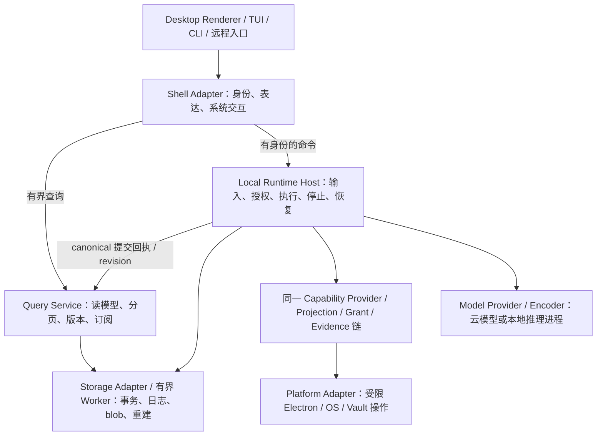

# ADR 128：本地运行时隔离与有界查询契约

创建时间：2026-11-11
最后更新：2026-11-11
状态：Proposed。用户已授权重新审查整体架构，并允许推翻不合理边界和重构；本篇是据此形成的具体方案，尚未取得逐条接受，也未改变产品运行行为。可行性实验通过不等于实现或发布验收。
级别：A（进程、运行时通信、权威写者与读模型边界），实施包含 B 级宿主/查询/存储迁移。能力范围、权限政策、Evidence 含义和 System Context 顺序保持现行契约。

依据：[系统总体设计](../architecture/local-agent-system-blueprint.md)、[现场与架构审查](../experience/desktop-runtime-responsiveness-architecture-audit.md)、[产品北极星](../../design/product/peer-product-alignment.md)、[工程治理](../architecture/20-architecture-governance.md)。实施：[分阶段实施包](../../playbook/runtime-isolation-implementation.md)。

2026-11-11 补充：首次提案主要展开执行位置与查询隔离，逻辑 Module/依赖仍不够完整。按用户追问新增总体设计，明确产品责任、内部 Module、事实归属、依赖禁令、端到端时序和实施就绪条件。本篇仍为 Proposed，没有扩大为已接受或已实现。

2026-11-11 详细设计修订：用户明确要求先补齐逐模块接口、数据、依赖、队列和异常恢复，再自上而下审查后重构。[详细设计v1](../specifications/runtime-isolation/README.md)已固定15个M模块、11个已有Feature owner、21种View、14条队列、411项现有IPC路由和完整提交/平台/恢复合同。本修订新增设备内command-delivery耐久接收/对账日志、独立计算许可、异步Repository提交及内部Platform invocation context；这些是A 级提案的明确新边界，不伪称只有执行位置变化。命令日志不拥有任务/Grant/Evidence成功真值。`conversations:add-usage`拟退出Renderer计量签发权，`client-tool:execute`的已认证Gateway投递迁入Host；重启pendingTask改为claim后保留、匹配原InputReceipt后CAS清除，旧unknown不重发；其它原scope/角色约束及模型/工具政策保持。每项目受保护writer floor预留13（基线最大12），切换/旧writer/回滚合同见05。

## 1. 决定要解决的问题

Peer 需要在多年历史、多个项目、并行 Agent、本地模型、多入口和昂贵恢复下，保持输入、阅读、控制与执行事实可靠。逐个缩短热点不能给这一目标建立稳定边界。

目前 Renderer、Module、Store 的代码组织已有分层，但 Electron main 同时拥有桌面系统 API、IPC、运行时编排和大量同步数据工作；列表等展示查询又调用完整执行/验收查询。一个新功能能够在没有违反导入分层的情况下重新制造长停顿。

本提案把“谁能读取什么、在哪执行、如何排队、结果属于哪个版本、失败后谁恢复”纳入 Interface。进程隔离保护响应性，有界查询控制总成本，两者共同成立。

## 2. 现行 ADR pass 与替代范围

首先读取 `00-adr-map.md`；同号按完整文件名核对。相关决定及处理如下：

| 文件 | 本提案保留 | 拟修订的局部边界 |
|---|---|---|
| `85-project-agent-hosts-inputs-and-surfaces.md` | 本地宿主、持久输入、TurnSink、多入口、真实窗口身份 | Desktop 持有宿主职责，不再意味着执行引擎与 Electron main 共用事件循环；决策12单帧头像data URL改为03的有界chunk组装，保留≤1MiB与原权限 |
| `86-batched-persisted-conversation-reads.md` | 旧完整批读兼容、严格版本与错误 | 完整读取不得作为产品查询的主线程回退 |
| `96-task-execution-responsiveness.md` | 终态提交屏障、权限与 Evidence、恢复和原性能门槛 | 部分 worker 优化升级为系统范围的进程/工作预算；不撤回已有实现 |
| `98-large-history-execution-responsiveness.md` | 严格版本、Query Scope、缓存隔离、取消及真实负载验收 | 生产展示查询的同步 Interface 分阶段改为异步有界查询；不保留 main 的全量回退 |
| `102-unified-task-lifecycle-projection.md` | 唯一生命周期/行动权投影 | 展示服务消费结果，不能重建另一份状态机 |
| `104-progressive-interaction-and-coordination-storage.md` | 五种视图、canonical 增量记录、可重建索引、旧 writer fence | 查询和重建明确放在独立服务/worker；现有同步兼容方法退出产品路径 |
| `112-runtime-module-and-loading-boundaries.md` | 共享 packages、加载 seam、唯一 owner/start/dispose | 将进程和队列也纳入资源所有权，增加可执行导入/成本约束 |
| `113-checkpoint-content-addressed-storage-and-retention.md` | 其已单独授权的恢复入口 | 全篇仍为 Proposed；本提案不暗中批准 CAS/GC 或删除历史 |
| `116-session-control-and-resource-settlement.md`、`120-runtime-facts-disposition-and-resource-wait.md` | 权威事实、停止屏障、unknown、交接、资源等待 | 搬迁执行位置，不重写其控制算法或以显示状态释放资源 |
| `121-desktop-session-windowing-contract.md` | Session Service、窗口、preview、openSlot、LoadHandle | 底层执行位置接到查询服务；展示字节预算不变 |
| `126-execution-resource-claim-closure-and-unknown-retention.md` | 受控 claim 闭包、RetainedUnknown；原页头状态及后续分开理解 | 不凭它的标题认定全部提案已接受 |
| `127-unknown-outcome-reconciliation-and-delegated-resolution.md` | 已接受的 ask/bot_verified、对账/证据与范围 | 迁移时完整保留；不把查询优化变成自动放行 |

本篇被接受时，才替代上述点名的执行位置与同步产品查询条款，其他约束继续有效。`74-deployment-surfaces-and-local-storage.md` 的 Proposed 状态保留；本轮不把 canonical 数据迁入云或改正文存储格式。新增进程中的通信类型进入 Protocol，不能成为未登记的执行旁路。

## 3. 目标拓扑与责任

本节是部署图，不代替逻辑模块设计。Runtime Host 内部的协调、调度、控制、资源、Agent Turn、Context、能力、授权和核验职责，以及 Query 与权威事实的依赖方向，统一见[总体设计 §3–§7](../architecture/local-agent-system-blueprint.md)。Host 仅拥有装配与生命周期，不能成为这些领域算法的新总管理器。



| 运行单元 | Interface 与唯一职责 | 不得承担 |
|---|---|---|
| Desktop Renderer | 有界窗口与流式槽、输入草稿、焦点和阅读意图；调用 typed API | 本地 I/O、执行、租约、权限真值 |
| Desktop Shell（Electron main） | 窗口/托盘/快捷键、受限系统与凭据 Adapter、窗口/frame/origin 验证、消息转发与进程生命周期 | 历史解析、索引扫描、模型循环、签收重算、同步数据库等待 |
| Local Runtime Host（独立本地进程） | 当前 writer/lease、持久命令、Session Control、调度、Provider/工具链、事实提交顺序 | 因展示需要构建全项目报告，阻塞控制循环做无界解析 |
| Query Service（独立本地进程） | 按 scope 读取可重建读模型，分页、版本、availability、订阅；只返回消费方所需事实 | 批准、自动启动、修复 canonical 业务状态、创建核验通过 |
| Storage / projection workers | 在原 Store 边界内做 CPU/磁盘工作；有界并发、逐聚合有序写、校验并提交 | 模型规划、工具准入、任意新执行通道 |
| Provider Adapter / 平台 Broker | 既有能力链内的具体执行与结构化结果；平台专属调用通过受限代理 | 向 Renderer 开通通用 fs/shell/secret 调用 |

这是同一个本地引擎的职责拆分，不新建第二个任务系统。GoalPlan、Coordination、资源账本、PermissionGrant、Tool Result、Evidence 的真源及 Protocol reducer 不改变。进程边界不是自动获得的 OS 权限沙箱；具体进程权限和 broker 校验须另行验证。

Desktop 使用 Electron `utilityProcess` Adapter；TUI/CLI 使用可移植进程 Adapter，共享业务入口与协议，不能依赖 Electron 已安装。首个版本由应用组合层启动和管理子进程，窗口关闭仍按既有后台策略工作；不在本 ADR 中承诺父进程崩溃后 utility 子进程必然存活。独立 OS 常驻服务/跨应用更新管理是后续部署 Adapter，不是本次强制安装项。多宿主继续以现有租约、writer fence 和交接回执决定唯一执行者，PID 存活或 UI 连接不授予执行权。

## 4. 查询契约：边界先于缓存

产品视图只消费命名读模型：BotList/Badge、PendingGrant、TaskSummary、SessionReport、InteractionWindow、TracePage、EvidenceRef。查询声明 scope、field set、limit、byteBudget、cursor、取消信号和目标版本。禁止通用 `getEverything` 或由 Renderer 提供文件路径/SQL。

```ts
type QueryRequest = {
  requestId: string;
  view: ViewKind;
  scope: VerifiedQueryScope;
  cursor?: string;
  limit: number;
  byteBudget: number;
  budgetMs: number;
  afterRevision?: RevisionVector;
};
type QueryResult<T> = {
  requestId: string;
  availability: 'ready' | 'rebuilding' | 'version_changed' | 'damaged' | 'unavailable';
  source: RevisionVector;
  items: readonly T[];
  nextCursor?: string;
  hasMore: boolean;
};
```

以上是概念契约，实施时必须放进 Protocol 并完成 schema/catalog 校验。Verified scope 由宿主根据已注册调用方构造；Renderer 的 requestId、workspaceId 或 role 字段本身不代表授权。

连接握手检查 protocol/schema 版本、data-root 身份、host generation 和受管进程来源；不兼容返回明确错误，不回退到未校验的旧 payload。`budgetMs` 包括排队时间，由调用方的本地单调时钟维护总期限，转发时扣除已经消耗的预算；不能在每一跳重置超时。取消是绑定连接/generation/requestId 的独立协议操作，不能靠任意字符串取消另一客户端的请求。

### 4.1 成本与完整性

1. 列表/角标不构建完整报告，不读取 tool output/checkpoint，不重跑验收。PendingGrant 为空时不为了不存在的标题/按钮投影全部 session。
2. Evidence 按已验证的 planId、conversationId 或 evidenceRef 查询；索引在其所属 Module 中维护，不能每个消费者取得全库再筛选。返回引用不把派生行变成新的 Evidence。
3. Query Service 初始响应上限沿用会话窗口的 256 KiB；其他小视图采用更小的显式预算。单条超限用原引用/分片继续读取，不静默截断事实或丢历史。
4. 候选筛选、排序、limit 在内容 hydrate 前完成；结果有 20 条，不代表允许先构造 20,000 条。跨源联接通过有索引的键完成，禁止隐藏 N×全库扫描。
5. 稳态成本按返回页、相关索引与变更增量计，不随无关历史线性增加。首次重建与历史调查单列成本，离开交互/控制循环。
6. 重建排队或索引不可用时返回明确 availability；不得切回 main 做全文计算。错误不变成成功空列表。

### 4.2 一致性

读模型只有展示权。每个结果携带 canonical source revision；多源结果使用 revision vector，不虚构跨现有多个 Store 的全局原子事务。视图需要的状态元组由已有生命周期 Module 在同一组事实版本下计算；不能把不同版本字段拼成可操作状态。

索引事件只提示“应赶上哪个版本”，不构成提交事实。读模型 checkpoint 必须不晚于耐久 canonical commit；崩溃后从已验证 checkpoint 增量重放。缺口、损坏、同长度替换、回退、外部 writer 与旧格式都需要严格失效路径。后台重建只写派生目录，不能自动修复 canonical。

用户执行决定时提交看到的版本，Runtime 在命令准入/提交时重新检查当前事实与权限。陈旧卡片不能 authorize；版本冲突返回可恢复的刷新结果，不自动改写参数。查询取消只取消读取，不等于停止任务。

## 5. 命令、执行和平台能力

命令沿现有 Application Service/Session Control 进入 Runtime，拥有 operationId、requestDigest、调用方身份、scope、预期版本和必要 authorityRef。队列接收、耐久接收、执行开始、执行结束与已验证/签收分开返回；任何 timeout 或断线都不自动转换成失败、成功或重放许可。

同 operationId 同 digest 返回已有回执；不同 digest 拒绝。接收前队列满返回未接收，接收后崩溃按耐久回执对账。未知副作用保留 unknown；沿 ADR116/126/127 停稳、闭包、对账与恢复，不能靠重启服务释放 claim。

执行 recorder 的 bootId、pid、pidStart、hostId 与句柄必须绑定真实执行进程/代次，不能继续用窗口或父 broker 的 PID 代替。父进程退出不证明独立工具/子进程已死；资源释放仍需原停稳或受控闭包证明。跨进程的 live 观察在断线后只能失去新鲜度，不能被持久化成“仍活跃”或自动变成 ended。

授权仍由现有本地主体与 PermissionGrant 决定。UI 只提交决定；Runtime 在写入和执行时检查当前主体、scope、版本和有效期。查询进程、菜单点击、动画或模型正文不能签发 Grant。

Electron 专属的 Browser、对话框、剪贴板、截图/OS 权限及 Vault 经 Platform Adapter 回调 main。调用必须来自受管 Runtime 的已验证操作，绑定执行身份、projection/capability、允许参数、资源范围、有效期与取消归属；签发和校验机制在 Protocol/主进程 owner 内实现，不把可自行构造的 renderer 对象当 ticket。Adapter 返回既有结构化结果/Evidence，仍属于同一能力链。凭据只沿既有 Provider/credential seam 获取，不传 Renderer、不持久化到消息/日志；新增进程不拥有通用 secret 导出 API。

System Context 仍由现有 Sources/assembler 组装，Provider Encoder 仍负责请求 lowering。进程通信内容是协议/事实，不因跨进程被提升为 system 指令。未来本地模型、ASR、图像/OCR 或嵌入索引接独立受管 Adapter/worker，不能进入 main 或绕过能力准入。

## 6. 调度、背压与生命周期

进程隔离后仍要保护 Runtime 的取消/授权/租约循环；不能把原 main 的大循环整体复制到另一个同样无界的控制线程。

- 控制、执行、查询、索引重建分别计量并设有界队列；控制接收与已准入的停止屏障不排在历史查询后面。优先级不能抢占一段已经开始的同步 JS，故长计算必须由 worker 或可中断批次承担。
- 每个 aggregate 的写入保持原顺序和 CAS，跨 aggregate 不建立全应用全局互斥。资源预留的全局约束仍归原资源账本事务。
- 存储 worker 不依据过期内存快照覆盖文件。真正 commit 在原写锁/事务内重检版本、writer fence 和 ownership；耐久提交后才发布 revision、终态与 Runtime release。
- 查询按 view/scope 共享在途工作，合并等待刷新标记；限制每个客户端的订阅、分页与在途字节。后台窗口暂停昂贵刷新，恢复时补最新版本。
- 合并仅用于展示刷新/失效提示；不得丢弃用户输入、Tool Result、批准、取消、Evidence 或耐久执行事件。订阅有序号/cursor，断线可发现 gap 并补读，不能依赖“应该收到了广播”。
- rebuild/CPU pool 在同一数据根跨宿主共享配额（不新增跨独立根daemon，也不声称整机全根硬上限），不能每个 Bot 建 worker；保留已接受的并发限制并测量峰值内存。队列期限包括等待时间。纯读取超时可以重试，业务命令先查 operation receipt。
- 所有连接、订阅、worker、重建和平台回调都有 owner/start/drain/dispose。服务退出使连接进入 unavailable，旧 generation 的迟到结果不能推进新回合。

## 7. 失败与已有状态恢复

| 场景 | 必须的处理 |
|---|---|
| Renderer 关闭/崩溃 | Runtime 依原策略继续；展示重连补读版本，不重新执行输入 |
| Query Service 崩溃、损坏索引、超时 | 视图 unavailable/rebuilding，保留草稿/阅读锚点；有界重启/重建，不运行命令 |
| Runtime 崩溃/父进程退出 | 原执行身份、未结工具、Grant、claim 和回执保留；重建先关闭新准入，按现有 writer/lease 及停稳协议对账 |
| 提交中崩溃、存储满、worker 退出 | 保留旧 canonical/sidecar 和准备回执；不先发布 done、不清 unknown；成功提交按版本重新发现 |
| 命令断线/超时/回复丢失 | 查 operationId 的耐久状态，不无条件重发工具/模型 |
| 服务换代或迟到平台结果 | 校验 host generation、lease、operation/execution identity；只归原历史，不释放新 claim |
| 迁移中断/旧 writer | 原数据不抹除；兼容读取与 writer fence 启用，阶段回执可重入；缺依赖明确阻塞 |
| 当前已卡住或部分完成的工作 | 在隔离副本验证冷恢复、后续任务准入；未知效果不猜；恢复 blocker 指向支持的对账/控制操作 |

对老 Task Overview 的“读取补写自检通过”不做迁移仿造：展示查询移除写入；机械状态恢复转入显式 Runtime recovery。缺少实际核验的计划保留未验证事实，由既有核验责任处理，不为让列表好看而补 passed。

## 8. 迁移与删除标准

采用入口逐个迁移。每一阶段都有唯一 active writer；不能同时让旧 main 和新 Runtime 执行同一项目。查询可以在隔离数据上 shadow 比较同一 revision，命令与工具不得双跑。

先建立真实查询/IPC 基线和禁止事项，再引入选择性证据/任务读模型与查询服务；之后搬迁 Runtime 及平台 Adapter。旧同步 API 仅为明确的兼容/取证入口保留，迁完的产品路径不允许 fallback。最后删除旧 main 装配、读取中的业务修复、视图独立全量轮询和反向宿主依赖。

既有业务canonical格式本轮不迁移。明确新增的command-delivery.sqlite只拥有新命令接收/路由/对账，compute_permits只拥有临时计算许可；注册、schema、锁/提交及恢复见详细设计05。没有新增全局Task/权限/Evidence真源，也没有假设跨Store原子事务。除此以外再改变格式、权威数据或事务边界，必须先修订ADR。回滚不能让旧writer写高版本项目或清缓存冒充恢复。

## 9. 可执行验收

1. 静态导入与真实调用计数共同守门：main 的产品 handler 不直接消费历史/证据全表；只读查询不能写 canonical、更新 lease、推进任务或产生 passed。Query Service 能写自己的派生索引，但没有业务写入端口。
2. 同等页面结果，增加无关历史不增加全库读取/归一化次数；分页/字节/在途/队列上界可观察。至少空授权、全 Bot 角标、当前任务、报告、长历史、Trace/引用、搜索逐项覆盖。
3. 生产 Module 与真正进程桥接验证协议版本、超限、来源身份、超时、取消、崩溃、迟到、重连、重复 operation、版本冲突及正常提交；不能只测 mock bridge。
4. 同机器无负载基线与负载对照；连续 ≥10 分钟覆盖 15/30 秒周期、任务执行、大历史提交与取消。保留输入 p95 <100ms、p99 <200ms、max <500ms、滚动 p95 <100ms、rAF p95 <32ms 的既有门槛；任何 >50ms main 工作段都须命名和归因，任何 >500ms 主循环/输入峰值均失败，不用平均数或新分位数冲掉。
5. main/Runtime 控制循环单个正常工作片的设计预算为 8ms，超过预算须拆批或移出；这是实施约束，最终仍以原生交互与异常恢复测量为准。记录所有样本、负载、候选、探针及 profiler 开销；噪声不事后删除。
6. 至少原 1,100 计划、约 185MB coordination、46MB 会话负载和本次证据索引规模；另做 10 倍无关历史、200 Bot 启动/重建的复杂度与内存测试。synthetic 可公开，用户历史副本只做本地读取，不作为真实模型上下文上传。
7. Query 重建负载下，授权/取消请求仍及时接收，停止完成仍以真实屏障为准；控制可用性不能靠提前宣告停稳。已有 partial/unknown 工作恢复后，后续任务按资源与授权正常准入。
8. 最终功能路径保持同一模型/工具/授权/Evidence 链；真实模型大历史任务、原生输入/滚动、macOS/Windows/Linux 与签名包分别记录。全产品回归和所有开放 PR 合并仍为发布门禁，本提案不声称它们已完成。

## 10. 取舍

不选仅加 debounce/TTL：它不能约束单次最坏工作量或隔离新的调用方。仍可在既定查询接口内合并展示工作。

不选把所有业务一口气搬入一个 worker：同一长任务仍会阻塞取消/租约/执行控制，也没有收窄查询。独立 Query Service 与有界 Storage worker 让隔离边界可验证；代价是协议、生命周期、内存与恢复复杂度，必须按阶段验证。

不选先换 Electron、Rust 或统一重写数据库：当前证据指向工作分配和数据接口；语言/框架变化不能自动消除全量查询和读写混合。现有 shared runtime、reducer、Provider 和持久化协议有可保留价值。

不选每 Bot 一个进程：大量 idle 资源与恢复风暴会转成新的瓶颈。进程按职责隔离，项目/aggregate 的公平和顺序由有界调度管理。

## 11. 实施前结论与证据

同一生产查询在 main 与 utility process 的有限对照显示 IPC max 从约 210ms 降到约 0.3ms，查询本身仍约 190ms。它支持隔离方向，不证明完整目标架构完成。根因剩余差值、全部页面、写入桥接、资源恢复、平台与真实模型仍待实施验收。

官方接口依据：[Electron Process Model](https://www.electronjs.org/docs/latest/tutorial/process-model)、[utilityProcess](https://www.electronjs.org/docs/latest/api/utility-process)、[Node.js Event Loop 与 Worker Pool](https://nodejs.org/en/learn/asynchronous-work/dont-block-the-event-loop)。这些资料支持执行位置与调度机制；上述 Peer 的具体拓扑和预算是本提案的设计选择。
