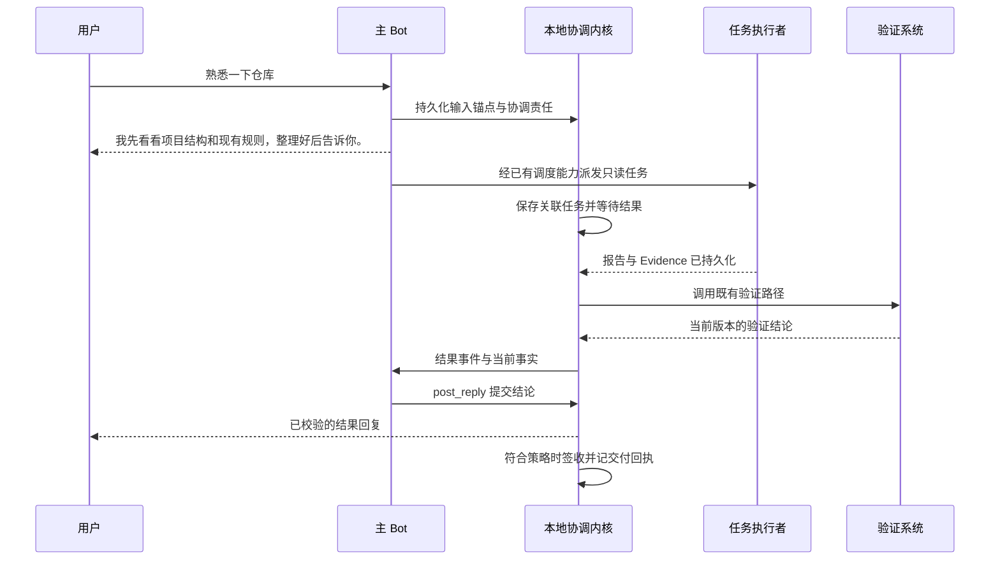

# 88 项目代理连续执行与结果交付方案

> 2026-11-01 实施衔接：[ADR 117](117-intent-driven-coordination-and-goal-closure.md) 已获授权，在隔离交付分支实现逐输入处置、目标覆盖和下一步承接。新契约 work 区分回合/阶段交付与根目标关闭；事件 handled 仍只表示持久责任已承接。来源、预算、检查点与 unknown 恢复边界保留；旧 mandate 不批量迁移或重开。接口与格式门槛见 ADR 117 §14，自测及未覆盖范围见[实施回执](../../playbook/v0.1.0/intent-driven-coordination-self-test.md)。本文 Accepted 契约与历史验收保持各自含义，分支实现不表示已安装或发布。

> 2026-10-18：系统默认累计工作上限及核验累计次数/总截止由 [ADR95](95-progress-driven-execution-policy.md) 取代；显式用户预算、用量记账、单次调用超时和安全恢复边界保持有效。

创建时间：2026-10-07
最后更新：2026-11-15（补充 §7.2 / §11.2 / §21.2 跨 ADR 部分取代与演进指针；2026-11-01 关联 ADR 117 实施边界；§22 中断核验契约保留）

状态：Accepted。2026-10-07 仓库所有者明确批准本方案并授权实施。以下契约按 R88-01 至 R88-08 逐项落地；批准不代表实现或验收已完成，也不改变已有 ADR 的 Accepted 状态。

级别：A。涉及成功标准的验证权限、回合结束契约、协调状态持久化、事件消费及结果交付。实现包含 B 级 Runtime 与 Context 调整、C 级表达调整。

关联：[产品理念](../../design/product/peer-product-alignment.md)、[ADR 80](80-project-agent-delegation-model.md)、[委托运行时](../architecture/project-agent-delegation-runtime.md)、[执行手册](../../playbook/project-agent-implementation-handbook.md)、[产品回归](../../playbook/product-regression.md)。

## 1 目标与实施范围

用户把目标交给命名机器人。机器人接住目标、安排执行、处理返回结果，在主对话说明结论；遇到权限、缺信息或真正需要用户判断的事项时，提出一个具体请求。技术过程和证据按需在侧栏查看。

本次解决主 Bot 的工作责任被单次回合上限截断、完成事件被失败回合挡住、普通检查被误设为人工验收，以及执行和核验状态不一致的问题。保留项目代理只读与调度、受治理的能力链、验证下限、结果签收策略和 Git 交付边界。

交付必须满足：

1. 用户发起的工作有持久的输入锚点、关联任务和待交付结果。
2. 一次模型回合结束或调度让出，不会丢掉仍需完成的工作。
3. 等待子任务时停止无意义查询，子任务的结果和异常能够唤醒主 Bot。
4. 启动、继续、核验、汇报与签收都可从真实记录恢复，不重复执行已发生的操作。
5. 普通质量检查由执行系统和模型承担；人工决定有明确来源和具体对象。
6. 真正预算耗尽、用户暂停或取消、权限拒绝时，自动执行按对应边界停止。
7. 对话、卡片、列表、watchdog 与模型读取相同的执行事实。
8. 本地宿主未运行或电脑离线时不承诺后台继续；下次宿主启动恢复。窗口关闭能否继续，以宿主实际生命周期为准。

## 2 已定位的问题与代码落点

诊断样本是 2026-10-07 的“熟悉仓库”请求。诊断时的记录显示：12:19:53 派发只读任务；12:21:45 叶子已有报告；12:21:52 主 Bot 使用过期 running 状态汇报，被 `status_claim_mismatch` 拒绝；12:21:58 主 Bot 触发工具次数上限；12:23:26 子任务被人工 DoD 门阻塞。该时点不能声称独立核验已经通过。

| 已确认的缺口 | 实际影响 | 当前代码锚点 |
| --- | --- | --- |
| 用户回合 10 轮 20 次工具，wake 回合 6 轮 12 次工具；内层上限报错，剩余次数不足时整批拒绝 | 一轮未收尾被呈现为整个请求失败 | `project-agent/agent-turn-plan.mjs`、`runner.mjs`、`runtime-sdk/src/pipeline.ts`、Desktop `chat-runtime/agent-loop-kernel.mjs` |
| `failedJob.budgetExhausted` 或 `explicitRetryOnly` 拦住 `kick` | 新完成事件可能继续积压，直到重试或新用户输入 | `project-agent/runner.mjs` |
| 字符串成功标准和未知 kind 默认归为 `manual` | 报告内容、分支检查等普通标准可能进入人工确认门 | `goal-plan-store.mjs` 的 `normalizeSuccessCriterion` |
| `verifying` 元数据可盖过需要用户的状态，watchdog 另算状态 | 任务实际受阻，界面仍可能显示核验中 | Protocol `delegation.ts`、`project-agent/watchdog.mjs`、`session-supervisor.mjs` |
| 用旧状态或重复读取报告继续推理 | 长时间重复“我再核对”，没有新的交付 | `reply-composer.mjs`、`session-report.mjs`、Context 与回合调度 |
| 启动发布和重启扫描存在不同事件身份路径 | 已存在任务可能被当成新的启动事实 | `event-mapper.mjs`、`project-inbox.mjs`、宿主恢复装配 |

这些缺口会相互放大：普通标准被设为人工门 → 子任务阻塞 → 主 Bot 反复核对 → 回合上限 → 主 Bot 停住 → 后续事件无法交还。不能只放宽次数或修改错误文案。

代码锚点相对于 Peer-Agent 仓库根。诊断基线 HEAD 为 `8a888f8c6d6c5d963e6388b6889f0e089164a200`；当前工作区含后续未提交修复，实施前按最新源码重新定位，不把 HEAD 当作这些修复的完整快照。

已有的报告与任务说明分离、核验失败退出 verifying、真实耗时、回复连续性、真实人工确认卡和 Provider reasoning 回传修复应保留。新方案整合这些路径，避免重建第二套完成和权限机制。

## 3 产品参照及采用范围

| 官方已说明的行为 | Peer 采用的原则 |
| --- | --- |
| dot 可安排并行后台 Agent，Agent 向 dot 回报，主对话继续 | 主对话与后台执行分离，主 Bot 负责结果交还 |
| Grok Bot 的派发重试去重、子任务完成通知、用户消息优先和工作后回复 | 幂等派发、可靠结果事件、用户输入优先、交付责任持续存在 |
| 双方在动作执行前检查权限，具体请求可以在对话中处理 | 动作批准和结果质量核验分别建模 |
| dot 提醒运行结束不自动证明目标实现 | Worker 报告须经过实际验证与策略签收 |
| Codex Goals 保存目标，安全边界续跑，抑制无工具调用的自动空转，真实预算耗尽时停止 | 持久目标、事件驱动续跑、无进展保护、真实预算边界 |

来源：[dot 任务与记忆](https://learn.chatgpt.com/docs/dots/tasks-and-memory)、[dot 控制](https://learn.chatgpt.com/docs/dots/controls)、[Grok Bot 更新记录](https://x.ai/changelog/bot)、[Grok Bot 对话](https://docs.x.ai/grok-bot/chat-and-collaboration)、[Grok Bot 审批](https://docs.x.ai/grok-bot/approvals-security-and-privacy)、[Codex Goals](https://developers.openai.com/cookbook/examples/codex/using_goals_in_codex)。

这些来源说明产品行为，不能证明 Grok Bot 或 dot 的内部存储和调度算法。Codex Goals 的技术说明不等于 dot 使用同一实现。dot 暂停当前主任务与停止子任务分开，Grok 的更新记录说明明确停止会传播给被委托的工作；Peer 必须自行定义停止范围。

dot 派发的 Work 和 Codex 工作计入各自用量；Grok 也有用量和消费限制。不存在“参照产品无限执行”的依据。[dot 用量](https://learn.chatgpt.com/docs/dots)、[Grok 故障说明](https://docs.x.ai/grok-bot/troubleshooting)

## 4 模块职责与执行边界

| Module | Interface 与职责 | Implementation 落点 |
| --- | --- | --- |
| 项目代理 | 理解目标、拆解工作、选择已有调度能力、组织回复 | 现有 `ProjectAgentRunner`、Context Sources、Delegation Provider |
| 任务执行 | 在已准入 GoalPlan 和授权范围内推进，返回 Tool Result 与 Evidence | 现有 Goal Runner、执行宿主与 Providers |
| 成功标准验证 | 判断每项标准是否成立，绑定对象版本和证据 | 扩展现有验证闸门、CriterionResult 与 Verifier |
| 协调内核 | 保存待交付责任，依据用户输入、事件和 checkpoint 决定下一步 | 新建共享纯 reducer 与持久化 Adapter，Runner 只装配 |
| 会话事实投影 | 从 GoalPlan、真实核验记录、待处理请求生成统一快照 | 收敛现有 Supervisor 与 watchdog 的事实构建 Seam |
| 回复交付 | 校验事实、幂等落回复、按策略签收、记录交付回执 | 扩展现有 ReplyComposer 和 `onReplied` 路径 |
| 表达层 | 消费 typed projection，展示气泡、具体请求和侧栏 | Desktop、TUI、远程入口的现有适配器 |

协调记录只管理“哪些输入已接住、还在等什么、哪些结果尚未交付”。Conversation、GoalPlan、PermissionGrant、Evidence 和 `resultAcceptance` 继续各自持有原来的真值；不新增 Project 表、Task 表或另一份任务执行状态。

所有模型发起的本地动作继续经过 Capability Provider → Manifest → Runtime Projection → Tool Call → PermissionGrant → Evidence。协调调度使用已有宿主执行入口，不直接执行文件、Shell、MCP 或浏览器操作。

## 5 用户目标的完整流程

### 5.1 普通任务



轻量问答直接回应，不强制开任务。需要后台执行时，开头只接住一次；等待期间不重复查询和播报。返回结果不足时，主 Bot 安排针对缺项的补查；通过后在主对话交付结论。

### 5.2 用户中途插话

用户输入先持久入队，优先于普通 wake 和自动续跑。正在执行的工具在安全边界收尾，已发生的结果保留；主 Bot 按当前引用范围决定直接回答、补充现有任务、暂停取代、并行或停止。输入处置只能来自成功的结构化操作。

用户问“现在怎么样”时读取当前快照并回答，不重开目标。用户明确改目标时记录目标修订与锚点；旧报告不得用于新版本签收。

### 5.3 结果需要修正

验证失败但可在原授权内修复时，将失败标准、相关 Evidence 和具体修复要求交回原任务。常规修复由系统推进，明显的路径变化或影响结果的失败才向用户说明。

同一原因持续无进展或能力不可用时，说明已完成部分、具体阻碍和可采取的下一步。没有实际问题、选择或操作对象时，不渲染“需要你处理”。

### 5.4 真正需要用户参与

| 请求 | 主对话必须说明 | 用户动作后的结果 |
| --- | --- | --- |
| 权限 | 做什么、作用范围、为什么需要授权 | 解决同一个 PermissionReview 请求，任务从等待点继续 |
| 缺信息 | 缺哪个信息及其对结果的影响 | 回答写入原任务并恢复消费 |
| 计划批准 | 执行目标、改动范围、需批准的原因 | 真实决定持久化后执行准入 |
| 人工判断 | 具体待判断结果、选项与后果 | 写入绑定版本的人工决定后重算闸门 |
| 预算耗尽 | 哪个预算用完、已完成什么 | 用户明确扩充或恢复后继续已有工作 |

请求在主对话可直接完成。侧栏提供上下文；不要求用户先进入任务卡片维持流程。普通聊天选项不会自动转成 PermissionGrant 或人工签字。

## 6 协调状态与协议对象

### 6.1 状态分开持有

执行阶段、验证结论、结果签收、回复交付分别存在。Worker 写出了报告，只能证明报告存在；运行时验证通过之后才可能签收；回复持久化之后才证明向主对话交付。

新增 `ProjectWorkReceipt` 是协调对象。一个输入可关联多个子任务，后续补充输入可关联同一责任记录。标识为宿主生成的 `workId`，绑定 `workspaceId`、项目代理 Conversation、原始输入及关联 Session；用户目标正文沿用原输入和 GoalPlan，不复制成可独立编辑的目标真源。

拟议字段：

```ts
interface ProjectWorkReceipt {
  schemaVersion: 1;
  workId: string;
  workspaceId: string;
  parentConversationId: string;
  anchorInputIds: string[];
  sessionIds: string[];
  state: CoordinationState;
  revision: number;
  checkpointRef?: string;
  waitFor?: { kind: 'session' | 'approval' | 'question' | 'retry_timer'; id: string }[];
  consumedEventIds: string[]; // 有界快照，完整回执留在追加账本
  pendingResultRefs: string[];
  lastDeliveredFactKey?: string;
  budgetRef?: string;
  stopScope?: 'reply' | 'work';
  updatedAt: string;
}
```

这些是拟议 Protocol 字段，不允许模型直接写持久化对象。绑定和状态由宿主回读成功 Tool Result、输入、事件和存储事实后计算。

### 6.2 协调状态

| 状态 | 成立条件 | 下一步 |
| --- | --- | --- |
| `runnable` | 有可执行步骤或待交付的新结果 | 安全边界执行一个调度片段 |
| `waiting_children` | 关联任务还在执行，没有父侧步骤 | 释放模型与调度槽位，等待相关事件 |
| `waiting_user` | 存在具体未解决请求 | 等同一请求的真实决定 |
| `retry_wait` | 可恢复失败，已预约重试 | 到时恢复；新输入仍可处理 |
| `paused` | 用户明确暂停这件事 | 保存事实，直到明确恢复 |
| `budget_limited` | 用户或系统真实硬预算用完 | 停止新工作，交付当前进展和下一步 |
| `blocked_system` | 不可恢复失败或同因无进展达到阈值 | 提供具体恢复动作，保留已有结果 |
| `delivered` | 所需回复已持久化，所需签收已完成 | 安静；追问或纠正按既有生命周期处理 |
| `cancelled` | 用户明确取消该工作责任 | 停止该范围的续跑，保留历史与产物 |

`post_reply` 成功仅结束当前模型回合。若子任务未结束，协调状态仍为 `waiting_children`；不会因为已经说“我去看看”而进入 `delivered`。

### 6.3 回合结束契约

现有通用 error 必须补充结构化终止原因：`reply_committed`、`awaiting_children`、`yielded`、`awaiting_user`、`budget_limited`、`provider_retryable`、`no_progress`、`user_stopped`、`fatal`。

Executor 返回实际工具调用、Tool Result 引用、Evidence 引用、Provider usage、checkpoint 及原因。Loop Kernel、Runner 和 UI 使用该原因；不从错误字符串猜测是否应续跑。

## 7 成功标准与验收权限

### 7.1 三类标准

| 标准 | 验证方式 | 例子 |
| --- | --- | --- |
| 可机械检查 | 现有 command、test、file 等检查，执行仍受任务权限约束 | 文件存在、测试通过、分支和引用一致 |
| 语义质量 | 新增 `model_review`，由受控 Verifier 读取已准入结果和证据，返回结构化判断 | 报告覆盖四项、结论有依据、解释清楚 |
| 人工判断 | `manual`，绑定真实用户要求或已配置项目策略 | 用户明确要求“给我看后再确认”，审美选择、业务取舍 |

`model_review` 不能由 Worker 自报 passed。宿主核验对象、报告版本、标准版本和 Evidence 绑定后写 CriterionResult；无效报告、缺证据或对象变化保持未通过。模型可以建议增加检查，不能降低运行时验证下限。

验证顺序为：机械检查与实际叶子证据 → 对相应报告执行语义检查 → 按改动类型执行剩余验证下限 → 汇总未解决人工判断 → 计算结论与签收策略。manual 待处理不阻止收集其他检查结果，避免人工门先挡住全部自动核验。`model_review` 结果由专用宿主记录入口写入；Worker 的任务更新工具只能提供候选内容，不能把这类 CriterionResult 改成 passed。

### 7.2 人工标准的来源

> **[部分演化提示（2026-11-15）]**：人工标准权威源与禁止静默降级原则继续保留；逐输入处置、DecisionFrame 与门禁/等待态的细化契约以 [ADR 117](117-intent-driven-coordination-and-goal-closure.md) 与 [ADR 120](120-runtime-facts-disposition-and-resource-wait.md) 为准。

标准新增宿主所有的 authority，包含 `origin`、来源引用、标准版本、验证者类型及要求人工决定的原因。模型提交的 proposed criteria 不包含可生效的 authority。

- 新 Delegation 输入使用结构化标准。代理生成的自然语言质量要求默认进入语义检查；新路径不将未知 kind 或字符串静默降成 manual。
- 已有人工标准只接受原有可信来源。单独引用一条用户消息，不足以证明用户要求人工验收。
- 新的人工作用域来自用户在 typed review 操作中明确设置，或已有可信项目配置。只有普通文本且意图有歧义时，主 Bot 提出针对该标准的明确问题；模型自行推断不产生签字权限。
- 模型发现业务取舍可以向用户提问。这是决策请求，不能伪装成已授权的人工完成门。
- 真正 manual 标准继续只能由宿主记录人工决定。Worker 的 `passed: true`、主 Bot 的“用户同意了”、普通问答的选项，都不能替代它。

### 7.3 四个门分开运行

1. 计划准入：当前计划是否允许开始。
2. 能力授权：这次操作有没有 PermissionGrant。
3. 结果验证：当前结果是否满足成功标准和验证下限。
4. 结果签收：按现有 AcceptanceDecision 由策略或用户签收。

人工偏好不明时不猜测授权；普通验证可继续收集证据，人工门只阻止其对应的最终结论或签收。全部通过且策略允许的结果在主对话汇报后代签。人工例外在主对话的真实卡片里完成，不生成“我去卡片亲手收下”的普通选项。

### 7.4 已有字符串标准

不全局改写历史 `manual`，不把旧确认记录补成 policy。新路径严格执行结构化输入；旧计划没有可信 origin 时保留未知状态。

迁移先生成审计建议。能从原目标、标准、人工决定和实际证据证明是模型生成质量检查的，按指定计划执行有版本的标准修订；有用户人工意图、拒绝记录或来源不明的，不自动降级。修订保留原标准与原因，旧验证指纹失效，按新标准重新核验。

## 8 调度切片与真实预算

### 8.1 两种额度

| 类型 | 目的 | 耗尽后的处理 |
| --- | --- | --- |
| 调度切片 | 限制一次占用，给用户输入、其他任务和结果事件让出机会 | 持久化 checkpoint，返回 `yielded`，满足条件时续跑 |
| 真实硬预算 | 用户指定 token 或费用限制、系统任务总额、Provider 额度 | 停止新执行，进入 `budget_limited`，说明进展 |

当前 10/20 和 6/12 可先保留为调度默认值，改掉其“整件事失败”的含义。数值后续按实际时延和用量调优；不靠扩大数字完成根因修复。

一次模型响应返回的有限工具批次，不因切片剩余次数不足而整批报错。先保证已接收批次的调用都有标准结果，在安全边界让出；允许超过软切片的部分受独立批次大小限制。真正硬预算、权限或取消触发时，未执行调用返回明确未执行结果，已执行结果保留；不越过硬预算启动新副作用。

### 8.2 续跑条件

协调记录为 `runnable`，本地宿主持有租约，真实预算可用，没有明确停止，没有未处理高优先级输入，且前一批工具已收尾时，才能预约续跑。由事件或可解释的待执行步骤触发，不创建紧密 while 循环。

`waiting_children` 不预约周期性模型查询。watchdog 的定时检查读取本地事实，只在真实停滞或截止风险出现时产生事件。

用户输入优先，其次具体用户请求与结果返回，再次可恢复的异常和到期续跑。普通 started/progress 只更新快照；无需交付的新事实不单独唤醒模型。同一工作短时间内的事件合并，不覆盖不同结果版本。

### 8.3 无进展保护

继续复用同因重试阈值 3 的边界，计数跨回合和重启保存。第一次重复选择更有针对性的检查；连续三次同因且无实质变化，停止自动重复并提出具体阻碍。新用户修改目标、相关报告或证据变化才重置相应计数。

指纹绑定工作责任、目标版本、待满足标准、相关对象内容摘要、阻碍原因和动作目标；排除随机 UUID、时钟、事件序号和重复读取生成的新引用。重复创建同目标任务、换一个任务编号、重写同一计划不能重置保护。

没有工具调用且没有新的结果、交付或待执行步骤的自动回合，不再次自动续跑。等待 Worker 不计为无进展失败；长耗时工具用自己的超时和进度事件管理。

### 8.4 用量归属

主 Bot、Worker、Explorer、Verifier、恢复重试的实际 usage 关联同一个工作责任，并沿既有 Usage Ledger 汇总。硬预算累计跨切片不清零。未知 usage 或价格标 unknown，不按零计；Provider 硬拒绝停止重复请求。

并行请求在现有预算 Seam 预约可计量额度，实际 usage 返回后核销；不能让几个子任务同时读取同一份剩余额度后各自用完。已经在途的请求可能产生最终用量，取消不撤销已消费额度。硬预算达到后不再创建新的执行请求；无法精确预估的 Provider 用量不能承诺零超额。

预算或 Provider 不可用导致无法继续生成结论时，宿主从现有事实生成明确的未完成通知和恢复动作，保存尚未交付的报告引用。该通知不替代结果结论，也不触发签收；不能为了通知偷偷再调用一次超预算模型。

模型降级与切换仍遵守现有角色模型和用户设置，不能为续跑临时绕过模型范围。费用预算不可精确计量时明确其限制，采用可计量的 token 或请求边界，不能承诺精确消费上限。

## 9 事件消费与回复交付

### 9.1 事件身份和阶段

生命周期事件以 `workspaceId + sessionId + kind + semanticRevision` 生成稳定身份。启动事件绑定启动代次，报告事件绑定报告内容版本，验证事件绑定验证对象版本，人工请求绑定原请求 ID。重启扫描复用身份，不用扫描时间生成新 started。

Worker 报告产生时新增 `report_available`；它只说明内容可读。既有 `result_ready` 保持经过当前验证闸门的语义。通过新的 Protocol 事件与 typed payload 明确报告阶段、验证阶段和未满足标准，不能为了唤醒主 Bot 把未验证报告标成可签收结果。

事件变化先持久入现有 Inbox，再进入协调账本。主 Bot 只处理对应工作的事实；历史任务仅在当前目标需要或用户明确询问时读取。

### 9.2 接收与处理分开确认

目前 Inbox 的批次游标与模型回合成功耦合。改为两级回执：

1. **接收回执**：事件已幂等写入协调账本，可以推进 Inbox 的连续游标。
2. **处理回执**：事件引起的等待、核验、修复、问题或回复已持久化。

模型失败不会删除待处理责任。批次部分接收时，仅推进已完整移交的连续前缀；后续高优先级事件可先处理，但不得用它的 seq 跳过尚未接收事件。账本压缩仅覆盖已交付或已取消记录；仍在等待和恢复的事件不能过期丢弃。

`failedJob` 收敛为一次 attempt 的诊断状态。它可以阻止同一次无效重试，不能阻止结果持久入队、其他工作或新用户输入。用户停止、真实硬预算和 Provider 熔断仍分别约束执行；即使不能再调用模型，也应保存新结果供恢复。

### 9.3 回复与签收的可恢复提交

跨 Conversation 与 GoalPlan 不假定存在原子事务。沿现有 `post_reply` 和 `onReplied` 做可恢复提交：

1. 宿主读取当前报告、标准、验证结论与请求，校验 `statusClaims` 和对象版本。
2. 写入 `reply_prepared` 记录，包含稳定 messageId、工作责任、来源、事实版本、拟议签收模式。
3. 幂等追加同一 messageId 的正式回复到父 Conversation。
4. 回读回复存在且结论仍适用于当前对象后，按既有 AcceptanceDecision 提交 policy 签收；人工模式生成或复用同一个真实请求。
5. 写交付回执。只在需要的签收也完成时，将工作责任置为 `delivered`。

崩溃恢复从未完成步骤继续。回复已存在但签收失败时，仅补签收，不再次执行任务或重复发回复。写前后对象改变时禁止用旧结论签收；追加纠正记录和必要说明，保留历史。

`status_claim_mismatch` 保留。拒绝结果携带最新有限快照及版本引用，主 Bot 修正当前结论；相同事实反复拒绝计入无进展保护。不能把校验关闭来减少报错。

### 9.4 去重规则

同一工作、同一结果版本、同一报告目的使用稳定事实键。去重覆盖 dispatch、result、verification、reply 和 acceptance。新的用户追问仍应回答；不按文字相似度抹掉有效新消息。

普通重试复用同一个 dispatchKey；明确新开或派生任务使用新的用户锚点和责任记录。已执行外部操作但结果未知时，保留 `outcome_unknown` 并先核对实际结果；Provider 不支持幂等和核对时不得自动重放。不能承诺任意外部系统严格 exactly once。

## 10 Checkpoint 与恢复

### 10.1 保存什么

每个安全边界保存有界 checkpoint：工作与输入绑定、当前 attempt 和 Provider、已提交调用 ID、真实 Tool Result 与 Evidence 引用、报告及标准版本、待处理事件、当前等待对象、下一步、预算累计及无进展指纹。

摘要只提供检索方向，不替代 Tool Result、Evidence 或授权事实。检查点不把模型口头的“已完成”转成状态。展示用 `publicUpdates` 与恢复事实分开，旧公开段落不能作为执行证据。

恢复上下文经既有 `project-roster-source` 等 Context Source 的 `L7_CONTINUITY` 事实层准入，按当前责任投影未交付结果、等待对象、检索引用与预算状态。静态协调规则进入既有 `project-agent-source` 的角色规则；回合结束原因经 typed reminder 表达。报告、用户输入、checkpoint 建议和工具结果不提升成 system 指令；checkpoint 的“下一步”也不自带执行授权。层序与 debug snapshot 保留，不在 Runner 或 Provider Loop 临时拼系统字符串。

Provider Encoder 负责恢复下一次请求所需的合法结构。工具调用和结果配对必须完整；需要回传的原生 thinking/reasoning 块沿受保护的 Provider 历史路径保存和重放，不由摘要补造，也不进入公开气泡、日志预览或项目记忆。无法合法恢复该 Provider 请求时，从已确认工具事实重新构建新回合，禁止重放未知副作用。

### 10.2 存储位置

拟议新增文件全部位于已登记的 device 级 `projectRuntime` 下：

```text
<dataHome>/project-runtime/<workspaceId>/coordination.jsonl
<dataHome>/project-runtime/<workspaceId>/coordination-snapshot.json
<dataHome>/project-runtime/<workspaceId>/checkpoints/<checkpointId>.json
```

`coordination.jsonl` 追加保存责任变更、事件接收与处理回执、dispatch 绑定、回复提交阶段和恢复审计。snapshot 是可重建索引，不另立真源；checkpoint 保存引用与恢复元数据。路径登记到 `data-store.mjs`，写入使用原子替换或可识别的追加记录，损坏末行可以报告并恢复，不能静默吞掉关键未交付状态。

沿现有 HostLease 保证单宿主写入，所有写操作携带宿主 epoch，过期宿主不能提交回复、签收或新的执行。设备协调状态不作为可跨设备直接运行的便携数据。

### 10.3 重启时的顺序

获得宿主租约 → 回放协调记录与未完成提交 → 对照真实 GoalPlan、报告、待处理请求和 Conversation → 修复投影 → 接收积压 Inbox → 按优先级恢复可运行工作。

暂停、取消、人工请求、预算耗尽保持原边界。重启不创建新任务，不伪造启动事件或历史人工决定。后台运行已失联时先判断真实宿主状态，不能同时再启动一份。

### 10.4 必须覆盖的崩溃窗口

| 崩溃位置 | 恢复行为 |
| --- | --- |
| 已记录输入，尚未派发 | 继续同一责任记录 |
| 已创建子任务，父侧尚未保存绑定 | 从 dispatchKey 找回子任务，补绑定 |
| Tool Call 已执行但回复未落盘 | 从工具结果与 Evidence 恢复，不重做操作 |
| 外部动作执行结果未知 | 先核对，无法核对则具体交接 |
| 报告已写，事件尚未发布 | 从真实报告重建同一报告事件 |
| 事件已接收，Inbox 游标未推进 | 重复接收幂等，再推进连续游标 |
| 回复已追加，签收尚未完成 | 回读版本并补签收，不重发回复 |
| 已签收，交付回执未写 | 从签收与回复事实补回执 |
| 核验标记已设置，Verifier 异常 | 核验 attempt 转失败或未知，清除过期 verifying |

## 11 统一状态投影与停止范围

### 11.1 同一份会话事实

共享 `SessionFactSnapshot` 构建函数集中读取执行阶段、当前有效的核验 attempt、报告版本、具体阻碍、待处理请求、签收和停止记录。Supervisor、watchdog、事件 Mapper、ReplyComposer、列表与详情均消费它。

它是事实投影，不新增持久任务状态。最少包含 session/plan/version、execution、verification、acceptance、needsUser、lastProgress、reportRef 和阻碍原因。Protocol 的 `projectWorkSession` 根据该快照生成产品状态。

优先级：取消或已被取代的真实边界 → 已签收 → 当前阻止推进的具体人工请求 → 当前仍有效且未结束的核验 attempt → 执行阶段及报告。不得由旧布尔 verifying 盖过真实已终结核验或当前人工阻碍。

Worker 报告已写且等待核验时显示“正在核对结果”；只有核验 attempt 活跃才显示核验进行中。主 Bot 与 Worker 都空闲且没有可运行责任时，停止“正在回复”或“正在执行”的动画。

### 11.2 停止命令

> **[部分取代提示（2026-11-15）]**：本表保留“输入框停止仅停当前回复 vs Pause/Cancel 绑定工作、不允许把已签收改为 cancelled”基础原则；后续关于停止与未知结果、会话停稳门禁、遗留停止义务受控解除及 `unknown` 收口的完整状态机已由 [ADR 110](110-follow-up-responsibility-and-current-list.md)、[ADR 116](116-session-control-and-resource-settlement.md)、[ADR 124](124-legacy-stop-obligation-controlled-resolution.md)、[ADR 126](126-execution-resource-claim-closure-and-unknown-retention.md) 与 [ADR 127](127-unknown-outcome-reconciliation-and-delegated-resolution.md) 细化/局部取代。

| 操作 | 范围与效果 |
| --- | --- |
| 输入框停止按钮 | 停止当前回复 attempt 与它的自动续跑；已派发任务继续。新的后台结果作为新事件仍可处理，按钮标签与说明明确这一范围 |
| 暂停这件事 | 暂停当前绑定工作责任及可暂停的关联执行；保留报告和事件，明确恢复后继续 |
| 取消这件事 | 取消该范围尚可取消的任务及临时子 Agent，关闭待交付责任，保留产物和历史 |
| 继续 | 恢复指定工作，重新校验预算、权限、对象版本与租约 |

所有命令绑定工作或输入引用。用户明确指向某件事时不再次索要同一授权；范围不明且多件事并行时，提出范围问题。不能停止无关任务，不能把已签收任务改成 cancelled；纠正已签收结果沿已有派生任务机制处理。

不支持原地暂停的能力使用其现有取消与恢复契约。在途原子操作可能完成，实际结果必须记录，不能把停止等同于撤销。

## 12 主对话与侧栏交互

### 12.1 默认表达

| 时点 | 用户看到 |
| --- | --- |
| 接住目标 | “我先看看项目结构和现有规则，整理好后告诉你。” |
| 正常等待 | 输入框上方一个轻量“正在了解项目”的真实任务摘要，无重复状态气泡 |
| 有实质发现 | “项目里已经有一套任务调度，我发现结果交还这里需要重点检查。” |
| 完成 | “看完了。项目主要分成三部分……目前有一个需要注意的问题……” |
| 遇到真实问题 | “报告已经写好，但目前拿不到这项检查所需的文件。需要你提供文件，或让我跳过这一项。” |

以上是表达示例，不是固定模板。简短回复优先说明用户关心的结果；技术解释请求可以详细回答。失败和未验证部分在正文说清，不藏进详情。

### 12.2 气泡与连续表达

完整公开段落按真实到达顺序呈现，不把单词或每行切成消息，不添加人工延迟。沿用 `publicUpdates` 与已校验 `post_reply`，保持历史交接时的段落 ID，避免重播和重复末段。

自动 wake 的内部推理与普通工具正文保持隐藏。确有新发现需告知时使用经过宿主校验的公开回复；执行流程不会为了制造聊天感要求每轮播报。

### 12.3 详情和必需动作

消息末尾小字“查看详情”打开当前回复的右侧栏。默认展示实际做了什么、验证覆盖和可读的证据名称；内部 ID、参数、HTTP JSON、Provider 机制继续折叠到技术详情。不可读 Evidence 说明原因和可用的替代记录，不只展示 `NOT_FOUND`。

权限、具体问题和人工结果判断直接留在主对话。动作点击后进入提交中，重复点击幂等；宿主确认后更新两处卡片及机器人角标。失败说明具体原因并保留同一个请求。

副标题、错误说明和提示使用较小字号与轻字重。消息、等待摘要和输入框共用内容列；窄窗或开侧栏后不横向溢出。引用沿用户偏好不加前导装饰竖线。所有图标用 SVG，键盘焦点不能做成突兀的持续高光。

## 13 现有受阻任务的修复流程

此节是实施后的恢复操作规范，本轮设计不修改真实任务。

1. 先导出指定计划、标准、叶子结果、报告、核验记录、人工决定、Inbox、父回复和引用清单；保留原版本与内容指纹。
2. 核对当前状态，不把诊断时状态当成恢复时真值。已经签收或取消的任务不重复处理。
3. 逐项审计 c4 分支与提交检查、c5 四项报告检查的来源。确认它们来自模型质量要求且没有用户人工意图后，生成并记录标准修订；不能插入虚构 manualConfirmation。
4. c4 通过授权的文件读取检查 `.git` 指向、HEAD、refs 与 packed-refs 等实际内容；worktree 和无法解析的引用保持未知。遵守原来的只读边界，不因检查需要默认改用 Shell。c5 用绑定报告与证据的语义检查。
5. 重新读取现有报告并执行当前下限要求的核验。报告、分支或标准发生变化时使旧结论失效；不先签收再补证据。
6. 修复有效核验状态，幂等接收积压结果事件，恢复原有待交付责任；不新开一个“熟悉仓库”任务。
7. 验证通过且策略允许时，主 Bot 汇报现有结果，然后 policy 签收；需要人工判断时，在主对话提出唯一具体请求。
8. 记录恢复前后 diff 与实际 Evidence，验证重启后不再次派发、核验或重复交付。记忆写入单独遵循现有记忆规则与用户选择。

旧版本真实的人类拒绝、暂停、取消和“不写记忆”选择必须保留。只修复可以证明错误的分类与协调状态。

## 14 分阶段实施卡

每张卡一个范围、一个评审单元，按执行手册交付。下表为拟议拆卡，ADR Accepted 后才能实施 A 级卡；每次开工需核对最新源码、依赖与未提交改动归属。当前其他工作区改动不作为本方案可顺手修改的范围。

| 卡片 | 级别及依赖 | 目标和允许改动 | 退出条件 |
| --- | --- | --- | --- |
| R88-01 标准验证权限 | A，ADR 88 | `protocol/src/goal.ts`、`delegation.ts` 与导出和测试；`goal-plan-store.mjs`；新 `project-agent/criterion-authority.mjs`；既有 Delegation 标准准入及测试 | 新普通质量标准不落 manual；可信人工门不能被模型或普通问答绕过；旧计划不静默降级 |
| R88-02 统一会话事实 | A，R88-01 | 新共享 `project-agent/session-facts.mjs` 与测试；`session-supervisor.mjs`、`watchdog.mjs`、`session-verification.mjs`、Protocol 投影与测试 | 同一快照在 Bot、列表、watchdog、卡片及回复校验状态一致；终结核验不遗留 verifying |
| R88-03 协调持久化 | A，R88-01 | 新 `project-agent/work-coordination.mjs`、`work-coordination-store.mjs` 与测试；Protocol 协调类型；`data-store.mjs`；已有租约 Adapter 和装配 | 责任记录、dispatch 绑定、checkpoint 可回放；损坏及过期宿主不能丢事实或重复执行 |
| R88-04 事件交还与回复提交 | A，R88-02、03 | `project-inbox.mjs`、`event-mapper.mjs`、`reply-composer.mjs`、`reply-composer-port.mjs`、Runner 交付装配与测试；新 `reply-delivery.mjs` 与测试 | 新结果不受旧 failedJob 永久阻塞；接收游标无跨越；回复与签收崩溃窗口幂等恢复 |
| R88-05 安全续跑 | A，R88-03、04 | `agent-turn-plan.mjs`、`runner.mjs`；新 `continuation-policy.mjs` 与测试；Runtime SDK pipeline 结束契约；Desktop Loop Kernel、Executor、Provider loops 及 Encoder 适配测试 | 超过软切片能继续；硬预算准确停止；批次结果完整；原生消息格式合法；同因无进展会停 |
| R88-06 语义核验与老任务恢复 | A，R88-01、02、04、05 | 新 `criterion-review.mjs` 与测试；Goal Runner 的验证闸门 Seam、Store 版本修订、现有 Verifier；新只读审计及限定修复 Adapter | 标准、报告、Evidence 版本绑定；只恢复可证明错误的指定任务；无虚构批准或确认 |
| R88-07 对话及停止交互 | A/B/C，R88-04、05、06 | 既有 Context Sources 和资源；Desktop `project-agent` state、conversation、drawer、styles；typed IPC、preload、i18n；TUI 适配；相关窗口检查 | 主对话完成请求；详情进侧栏；阶段和停止范围真实；段落与布局连续；经典入口不受影响 |
| R88-08 集成与发布验收 | B/C，前述各卡 | `runtime-node` 集成测试、Desktop 生产 IPC 与 Electron 场景、现有产品回归脚本；隔离迁移和安装包验收记录 | 第 15 节场景通过；真实模型与安装包覆盖如实记录；没有 unresolved blocking finding |

表内各包路径以 Peer-Agent 根为起点，`project-agent` 运行时目录为 `packages/runtime-node/src/project-agent`。新增 seam 优先把被触及逻辑移出大 Runner；`main.mjs` 净增不超过零，`llm-chat-service` 不新增顶层参数。不得新增依赖、顶层 package 或改版本、发版物来完成本卡。

协议公共文件、GoalPlan Store、Runner 和 i18n 是热点，相关卡串行落地。其他可独立评审的测试与 Adapter 只有在文件不冲突时才并行；这不是对执行模型自动派发任务的授权。

## 15 回归矩阵与完成标准

### 15.1 确定性执行场景

| 编号 | 注入情形 | 必须观察到的事实 |
| --- | --- | --- |
| T01 | 熟悉仓库的普通报告标准 | 无人工 DoD 门，实际检查完成后结论可交付 |
| T02 | 真正 manual、用户拒绝或要求过目 | 门保持，普通回答和模型 passed 不放行 |
| T03 | 字符串及未知 criterion kind | 新路径结构化拒绝或归到合法语义标准；旧来源未知不自动修改 |
| T04 | Worker 未结束，连续 started/progress | 父 Bot 等待，不持续调用模型查询 |
| T05 | Worker 完成，不发送任何新用户输入 | 主 Bot 被结果唤醒，读取报告并交付一次 |
| T06 | 父 attempt 已耗尽切片，随后 child 完成 | 结果进入协调处理，旧 failedJob 不阻挡 |
| T07 | 需要超过 20 次工具的有进展请求 | 跨切片继续，实际结果和用量不丢失 |
| T08 | 单批工具超过软切片剩余额度 | 有限批次安全收尾，调用与结果配对完整，随后让出 |
| T09 | 真正 token、费用或 Provider 预算耗尽 | 不再开始新执行，明确未完成，已有结果保留 |
| T10 | 三次同因且同事实 | 自动重复停止；换 UUID、重启或重复读不清计数 |
| T11 | 验证对象新增有效事实 | 对应保护计数合理重置，继续针对缺项检查 |
| T12 | 重复启动请求和重启扫描 | 同 dispatchKey 仅一个子任务，无重复 started |
| T13 | 用户插话与结果同时到达 | 用户输入优先；完成事件保留，之后仍交付 |
| T14 | Inbox 部分接收、乱序高优先事件 | 不跨越缺口推进游标，不丢低优先结果 |
| T15 | 第 10 节全部崩溃窗口 | 无重复副作用、重复回复或虚构签收 |
| T16 | 过期状态汇报及对象改变 | 宿主拒绝旧声明、提供最新事实；不能错误签收 |
| T17 | Verifier 失败、超时、异常、持久化失败 | 退出活动核验，明确修复或未知，不永久 verifying |
| T18 | 权限或具体回答在主对话处理 | 同请求被解决，原任务从等待点恢复，两处卡片同步 |
| T19 | 停止回复、暂停工作、取消、恢复 | 严格遵守指定范围和既有终态边界 |
| T20 | 外部执行结果未知 | 核对或交接，不能盲目重试 |
| T21 | 多项任务和租约切换 | 未失败工作继续；过期宿主无写入权 |
| T22 | 原生 thinking、工具历史跨片段恢复 | 合法 Encoder 输出；公开界面无隐藏 reasoning |
| T23 | policy 签收落盘失败后重启 | 仅补合法签收，不重开任务、不重发结论 |
| T24 | 旧受阻任务、既有人为拒绝与不写记忆 | 有审计的限定恢复；人工选择和历史均保留 |

必须通过生产模块和实际持久化链，不能仅用手写“完成”消息测试 UI。Provider 合同夹具覆盖调用和结果配对、reasoning replay、拒绝与异常；受控模型不能证明实际模型不会长时间重复。

### 15.2 产品与真实模型场景

必查截图包括正常等待、完整结论、具体问题、权限、真实预算耗尽、恢复失败、主对话处理人工例外、回复详情和证据不可读。覆盖深浅色、宽窄窗、侧栏打开后收窄、键盘与 reduced-motion；用户提供过的长报错与长说明作为数据形状进入夹具。

真实模型至少验证：熟悉项目、查一个运行时问题、工作中插话、一次可恢复中断、一次核验打回后修正。记录实际模型、耗时、用量、状态、Evidence、公开段落、重复查询和结果送达；不能用受控 Executor 的“自然文案”替代真实模型表达验收。

安装候选验证冷启动、执行期间关窗、重启恢复、版本升级与隔离降级演练。明确源码实例、安装构建、平台和无障碍覆盖；没有覆盖的范围逐项列出。

```sh
pnpm build
pnpm typecheck
pnpm architecture:check
pnpm --filter @peer-agent/desktop ipc:check
pnpm qa:product:capture --output <temporary-directory-outside-repo>
# AI 检查每张必查截图，填写同一包的 review.json
pnpm qa:product:verify --output <same-temporary-directory>
```

另跑各卡定向测试和受影响包完整测试；TUI 变更执行 TUI 测试。全量测试只按既有门禁执行，偶发计时失败隔离重跑确认，不能新增 skip 或放宽断言。

AI 审查按现有 product-regression 执行。实施者自审写 `independent=false`；独立审查需要实际未参与实现的审查者。没有部署定时或无人值守模型审查服务，不把这套流程描述成已存在的后台 AI 测试服务。

### 15.3 可量化的退出条件

- 同 dispatchKey 的重复与恢复场景中，创建子任务次数为 1。
- 同结果版本的恢复场景中，结果回复和签收次数各为 1；新用户追问另计。
- 仅 started/progress 且无异常的等待窗口，自动模型查询次数为 0。
- 相关新结果到达空闲宿主后，2 秒合并窗口结束即可进入可运行队列；不把模型返回速度承诺为 2 秒。
- 硬预算耗尽或已暂停、取消之后，新副作用调用次数为 0；在途调用的真实收尾单独记录。
- 状态投影、人工请求解决和所有崩溃窗口的确定性断言通过。
- 真实模型场景完成后，原请求都有明确结果或具体阻碍；不出现持续重复“我再核对”的未收尾输出。
- 所有必查图片经过 AI 实际查看，Verify 通过，无未解决阻断发现。

## 16 上线与回退

先在隔离数据与受控 Executor 验证 R88-01 至 06，再验证真实 Provider 和模型；最后进入正式 UI 包、安装候选与限定的旧任务恢复。诊断、schemaVersion、标准来源和回执都可导出。

新协调机制使用可回退的内部版本开关，仅作用于支持该版本的新工作。旧任务恢复逐项指定，不启动全库自动降级 manual 的迁移。已有 JSONL 只追加，GoalPlan 修订保留历史；checkpoint 和 ledger 压缩前保留可恢复备份。

功能回退先停止新续跑与新格式写入，保留报告、事件、回执和用户选择。未关闭的协调责任标注需由支持版本恢复，不让旧调度器和新调度器同时接管。

旧构建对 `model_review` 和新恢复记录的行为必须实测；在确认读写兼容前，不允许把“关闭功能开关”当作可以用旧构建安全改写真实数据的证明。降级测试用隔离数据复制，必要时从升级前备份恢复兼容副本，同时保留新产生记录供后续导入。

结果签收不授权合入、远端推送、部署或发布。旧任务恢复不得改真实用户数据来制造通过结果。每张实施卡交付真实命令结果和覆盖边界；若提交代码或知识，按仓库规则同轮推送对应跟踪分支。

## 17 决策摘要

拟采用以下组合：持久交付责任 + 同一份会话事实 + 结构化标准验证权限 + 安全边界续跑 + 可靠事件移交 + 可恢复回复提交。

主 Bot 接住目标后，在现有权限和预算内持续推进；普通报告由系统核验后在主对话交付；真正的人工判断直接在主对话处理。一次 attempt 失败、报告写出、验证通过、结果签收和回复送达分别有记录，恢复时从尚未完成的环节继续。

需评审的契约变化为：新增协调账本及状态、回合结构化结束原因、报告可读事件、`model_review` 与宿主标准 authority、两级事件回执、可恢复回复提交，以及明确的停止范围。接受这些契约后按 R88-01 至 R88-08 落地；完成判定以第 15 节的执行事实和产品回归为准。

## 18 实施中真实模型发现（2026-10-07）

真实安装候选发现 worker 将已完成步骤与 `model_review` 自评一起传给 `goal_update_task`。步骤证据写入成功，但自评被拒绝，整体返回失败；模型因此把步骤改回 running，导致核验通过后仍无法收下。Provider 必须分别回执步骤登记与标准核验：合法步骤证据照常提交；model_review 自评不得进入 CriterionResult，明确返回 host_verification_pending 和忽略的标准 ID。宿主 verifier 仍独占语义核验，完成步骤不等于通过标准。现有 Goal Runner Context Source 同时说明这一顺序；不得以 prompt 代替 store 权限校验。

安装候选复核又发现 completed 计划的 runner.failed 没有进入旧的 executing/blocked 恢复谓词。复核完成入口可额外接纳只读、phase=running、叶子与所有标准已满足、没有活跃 Runner、报告哈希一致且新宿主核验通过的 completed/failed 快照；旧失败 attempt 继续保留。写任务、暂停/取消、人工门、证据缺失和材料改变仍不能进入。

真实模型还复现 report_available 与子任务 verifier 竞争。报告写出只代表可读材料，活跃 Runner 或 verifier 退出前不交给主 Bot 发起第二次核验。Watch Facts 在稳定执行边界才发 report_available；completed worker + running Runner 仍投影 running，真正的通过和签收各自依赖宿主记录。这不把报告当成通过，也不移除报告版本事件。

进一步定位到 Store 的旧终态校正：最后一个叶子完成后，persist 把仍在推进的委托 Runner 强制改为 idle。委托计划的 completed 只代表叶子材料完成，不能抢占 Runner 的核验结束事实；委托 Runner 由实际执行入口收尾，非委托旧入口保持既有校正规则。当前进程的核验所有权按 attempt 集合记录，重叠核验分别退出，不让一轮结束清除另一轮事实。熟悉项目的自动记忆写入也必须经过既有 memory gate，关闭记忆时不能绕过该开关。

后续真实模型复现了另一处切片错误：child 已提出问题，但 parent 尚在整理具体问题时发生软让出。协调器用 child.waiting_user 覆盖 parent.runnable，Runner 又把所有非 runnable 的让出统一解释为 no_progress。子任务等待用户的事实必须保留，但它不能提前结束尚未投递的父回复；软切片继续至公开回复提交后，才把责任转为等待用户。无进展停机只由实际 no_progress 判定产生，不得由等待、让出等正常状态推断。熟悉项目的限定目标同时说明：已核实的事实和未知项都属于阅读报告，发现缺陷不要求用户先批准新修复任务；只有完成本次读取本身所必需且无法自行查明的决定才提问。

隔离降级演练证实 RC.6 读取新版 model_review 会改回 manual，旧 Store 写入会丢失标准来源和工作绑定。旧版本不得直接改写新版数据；回退使用升级前兼容备份，并另外保留新版计划、协调账本及回执。关闭新版开关本身不构成安全降级。

同因无进展比较还需排除只读调用的排列与重复次数：相同调用输入与结果的事实集合相同，不因换顺序、重复读取或重复的 roster 条目重新计算进展。保留各结果内部有意义的数组顺序；材料内容或真实状态变化仍产生新指纹。此规则在宿主的 continuation-policy 生效，不能只靠模型减少轮询。

## 19 实施交付与验收记录（2026-10-07）

用户在接受完整方案后明确授权实施。R88-01 至 R88-07 已落到代码与宿主执行链；R88-08 已完成本机确定性验收、产品截图审查、真实模型抽样和 macOS 打包候选验证。此记录描述本机交付，不替代正式签名发布与其他平台的安装验收。持久摘要见 [ADR88 实施证据](../../playbook/v0.1.0/evidence/adr88-execution-20261007.json)。原始测试输出与截图保存在本次工作区之外的临时验收包，摘要记录其哈希；临时文件被清理后不能以摘要替代重新执行。

### 19.1 落地范围

| 卡片 | 已实现的契约与宿主行为 | 验证 |
| --- | --- | --- |
| R88-01 | 标准 authority、model_review、可信人工门、带来源的旧标准修订；Worker 完成步骤与自评分别回执 | Protocol、Store、Delegation 与 authority 定向测试 |
| R88-02 | 统一 session-facts、活动核验 attempt 集合、真实终态与 verifying 清理 | 重叠核验、异常收尾、投影与监督测试 |
| R88-03 | 本地协调账本、租约 epoch、日志回放、不可变 checkpoint、工作与子任务绑定 | 重启、损坏尾部、过期宿主、重复 dispatch 测试 |
| R88-04 | Inbox 先持久移交再确认、输入优先、独立事件回执、回复与签收分阶段提交 | 丢失批次恢复、结果唤醒、交付各崩溃窗口测试 |
| R88-05 | 安全工具批次收尾、原生消息 checkpoint、软切片续跑、共享硬预算、事实集合无进展保护 | 跨切片、reasoning/tool replay、未知副作用、重排与重复查询保护测试 |
| R88-06 | 新材料版本、宿主语义核验与 Evidence 索引、受限的旧任务审计恢复 | 核验失败后重查、版本改变、旧人工意图保留测试及真实任务恢复 |
| R88-07 | Context Source 自然交付约束、主对话段落、右侧详情、统一内容列；typed IPC 和治理后的 control_work | Desktop/TUI 测试、IPC 门禁、实际交互与截图审查 |
| R88-08 | 全量门禁、隔离 Electron 场景、候选包、真实模型及降级兼容性演练 | 下列已覆盖范围与未覆盖范围分别记录 |

所有执行继续经过 Capability Provider → Manifest → Runtime Projection → Tool Call → PermissionGrant → Evidence。Renderer 只表达与提交交互；结果签收不能授权新的远端发布动作。新增深度集中在 project-agent 协调、事实、核验与交付 Module，新增上下文通过现有 Context Source，Provider 历史保留通过 Encoder seam。

### 19.2 最终源码与确定性门禁

源码基准 HEAD 为 `8a888f8c6d6c5d963e6388b6889f0e089164a200`，工作区存在未提交改动，因此 HEAD 单独不能代表交付源码。最终产品包指纹为 `a0369a1fce8be2d38e98f486ccdd17e75de1f3bde60a8600f3edbdae6b0d55c6`，本机候选编号 36；候选编号仅用于本次验收记录，不是产品版本。

最终源码的 `pnpm build`、`pnpm typecheck`、`pnpm architecture:check`、Desktop `ipc:check`、`pnpm test` 均成功退出。新增连续性集成测试单独执行 14 项通过、0 失败、0 取消。IPC 目录核对为 331 channels、329 preload operations、288 main registrations。打包检查确认 7 项 main-process workspace imports 与 2 项主题 Dock 图标。

产品 Capture run 为 `d49d65be-c590-47ef-b67a-9e133d087141`。AI 实际查看全部 63 张必查截图，为每张写入具体观察，Verify 于 `2026-10-07T10:27:38.579Z` 返回 passed，无未解决阻断发现。审查者为实施者自审，`independent=false`。深浅色、宽窄窗口、侧栏、键盘焦点与返回、Escape、reduced-motion 及现有对比度检查均纳入；截图中的受控认知和人工确认夹具不能冒充真实模型质量或普通任务的人工验收流程。

### 19.3 真实模型覆盖与版本区分

以下四场景使用 macOS 打包候选 35、真实 `grok-4.6` 和生产 Project Host、Tool Call、post_reply 链；没有用受控 Executor 生成结果。

| 场景 | 耗时 | 实际结果 |
| --- | --- | --- |
| 熟悉项目 | 116.978 秒 | 保持原有子任务，宿主通过后主对话交付一条结论 |
| 排查运行时问题 | 76.034 秒 | 一条接住请求的回复、一条最终结论，保持原有子任务 |
| 执行中插话 | 84.456 秒 | 接住请求、回答插话、交付结论各一条，插话不丢失原工作 |
| 子任务执行中中断并重启 | 78.707 秒 | 恢复原 session/plan，最终结论交付一次，无重复子任务 |

这四场景均终结为 accepted、无 renderer page error。主 Bot 对每个场景只在结果返回后查询一次 get_session；插话场景的中途回复没有额外模型查询子任务。公开回复数量包含接住请求与用户插话，不能把它们当成重复结果交付。

DeepSeek 同一候选的四场景只有后两项通过：插话 95.731 秒、中断重启 129.730 秒。熟悉项目返回服务端 HTTP 403（要求有效 OpenCode Go 订阅）；运行时排查在 60.054 秒验收窗口内未交付，保留为失败，不能因后续请求通过而将这两项改成成功。另有候选 31 的真实“核验失败后重新核查”场景在 46.825 秒完成：保留旧 failed verifier，追加新的 passed 核验并交付一次，原有子任务没有重跑。该原始报告 scope 字段误写 candidate27，实际启动脚本的 executablePath 为 candidate31；保留原证据并在摘要标明差异。

最终候选 36 在候选 35 基础上修正同事实查询的重排、去重指纹；这项最后变化经过 14 项连续性测试、全量门禁、新的 63 张 Capture/Verify 与真实数据冷启动，未将候选 35 的四项模型抽样声称为候选 36 全部重跑。模型 turn usage 字段不可用，不能给出实测 token 或账单费用。共享请求/工具硬上限与可用时的可信 token/cost 上限由确定性测试验证，真实账单仍属覆盖缺口。

### 19.4 指定旧任务恢复

第 13 节的“设计阶段不修改真实任务”限制在本次用户授权实施后按限定恢复规范执行。对原有卡住任务先备份，核对 canonical dispatch 来源，仅修订被证明属于模型质量要求的 c4/c5，不插入人工确认。审计修订本身保持 accepted=false 并要求重新核验；随后候选 34 经真实宿主核验与语义检查均 passed，在 `2026-10-07T10:03:53.973Z` 合法签收并交付一条新结果。

候选 36 冷启动与之后空闲回读确认同一 plan/session 的签收时间保留，结果交付 ID 未增加；人工历史与项目记忆保持不变。先前“不写记忆”的选择属于后来取消的上一轮任务，不能冒充新一轮熟悉结果的记忆回答。当前新结果的可选记忆问题与普通任务结果验收分别处理，不将该问题重新投影为旧任务执行受阻。

### 19.5 回退与剩余覆盖

隔离降级使用 immutable `v0.1.0-rc.6`（`f0b9b14eb7cc410e8f2ce9ec51e8f755b269093a`）Store 与同版本依赖，证实旧 Store 读取 model_review 会降为 manual，旧写入会丢 authority 与工作绑定。演练本身通过，新数据保留可读；结论是直接降级不安全。回退只能按第 16 节使用升级前兼容备份，另外保留新账本与产物，不能只关闭开关后让旧版本改写真数据。未执行旧安装客户端的 GUI 降级验收。

本次安装构建覆盖 macOS arm64 的本地打包候选和冷启动/执行中重启，采用 ad-hoc 签名；未替换 Applications 安装，未做正式证书签名、公证或发布。未覆盖 Windows/Linux 安装、完整屏幕阅读器、长期运行以及跨供应商 verifier 独立性。没有部署定时或无人值守 AI 审查服务；产品图片的 AI 审查在本次工作中实际完成。上述真实 Provider 失败和缺失覆盖仍保留，正式 RC 发布不得把本机验收摘要当作已完成这些门禁。

## 20 请求失败后的完整恢复方案（2026-10-10）

状态：Accepted。用户在确认根因及修复方向后明确要求“落成完整的方案，然后实施落地”。本节扩展恢复契约；实现与验收另记录，不以批准代替完成。

### 20.1 已确认的事实

RC10 的一个用户回合完成 19 次只读工具调用，第 7 个模型请求在等待响应头时失败，诊断为 `connect timeout after 20000ms (ConnectTimeoutError)`。完整原生工具消息已写入 native checkpoint，但工作停在没有预约的 `retry_wait`。内存 `failedJob` 在熔断器 closed 时挡住 kick 和新输入；手动重试使用新鲜 job 而未装入原生 checkpoint，重启可能把原输入重新入队。实际物理网络重试没有完整遥测，不能把 7 个请求说成 7 次重试，也不能从该错误定位具体 DNS、TLS、代理或上游故障。

### 20.2 请求层的唯一重试所有者

受管模型请求在 canonical provider request seam 内执行最多 4 次真实派发，退避沿用 500/1500/3000ms。每次实际派发前检查取消与工作预算并扣请求计数；真实 usage 按返回事实结算，缺失保持 unknown。逻辑 round 不因 HTTP 重试增加。压缩请求也使用同一预算入口。

受管请求关闭 transport、Responses wrapper 与外层整轮 recovery 的重复重试。经典路径没有工作预算时仍经过同一请求政策；非模型 transport 的原有接口保持兼容。当前请求已出现正文、推理或工具意图时禁止静默重放；先前请求已确认的工具结果不阻止下一请求恢复。

保留 ADR30/83 已有的明确域名/security-gateway 阻断路由政策：无公开输出、无已执行工具、无受保护 native checkpoint 时，403 加明确路由阻断诊断可尝试既有授权候选；默认同模型，角色显式候选池沿原授权范围。普通认证 403、网络失败、429/5xx 不因此开放外层整轮重试；同 Provider 的重试仍只归 canonical request 所有。每个候选的实际派发均受原工作预算。不能把恢复历史换到另一 Provider/model。

当前请求存在 partial output、`replaySafe=false` 时，工作层也不自动预约相同请求，防止换一个恢复层绕过安全门。保留公开进展和工具结果，用户明确“继续尝试”后才从已确认检查点继续；普通按钮仍不能重复未知副作用。

响应头等待与流式中断分别分类。现有 20 秒 time-to-headers 和 120 秒 stream idle 默认值保持有界；不靠无界放宽超时掩盖恢复缺口。抛出的异常和返回的 HTTP/stream failure 进入同一宿主分类。取消、认证/权限、参数或格式、预算、证书配置、结果不明不能按普通网络错误自动重试；429、5xx 和可恢复网络失败可以按政策恢复。Provider/model 原生历史的身份兼容仍由 Encoder/Loop 强制。

### 20.3 工作恢复的持久身份

`ProjectWorkReceipt.schemaVersion=1` 增加可选 `recovery`：typed failureKind、retryable、autoAttempts、failedTurnId、retryAt、reservationId 和恢复周期的截止时间。旧记录可读；缺预约的旧 `retry_wait` 不在启动时盲目重放。明确手动恢复可根据已保存的工作与工具账目补预约或直接继续。

同 work 自动恢复最多再试两次，延迟 2 秒、5 秒，自动恢复预约的启动窗口最长 5 分钟；开始后的请求和工具仍受各自超时、工作预算及取消约束。手动恢复可开启新有界周期，但绝不清除工作预算、unknown usage、pendingTools 或 uncertainDispatches。`retryAt` 是时间真源，`waitFor.retry_timer.id` 绑定同一 reservationId。start 原子消费匹配预约；状态、revision、租约或预约变化后旧 timer 失效。暂停、取消、预算耗尽或失去租约时不执行。额度耗尽后，只有宿主实际提高限制且原有计数及 unknown 账目仍满足新限制，才允许手动继续。

自动、手动和重启共用 `turnId → workId → 最新 durable job/native checkpoint` 的恢复入口。旧 turn 不能恢复另一件工作。所有 completed Tool Call/Result 对和受保护的 provider history 保留，继续下一请求；摘要只作辅助。恢复已有交付提交时只补交付/签收，不再请求模型。没有可验证的原生检查点且曾执行工具时，明确交接，不默默重放整件事。主检查点和 native 文件必须实际读取验证；缺失或损坏时撤销预约，以可选 typed `recovery.blockedCode=RECOVERY_CHECKPOINT_UNAVAILABLE` 表达阻碍，并保留旧检查点与结果账目。恢复读取失败不能写入空 rounds，使下一次手动恢复误判为从未执行工具。

### 20.4 调度与新输入

新用户输入优先于到期自动恢复和普通 wake，独立建立新责任，不继承旧 checkpoint。旧网络失败不能挡住入队或模型调度；现有新目标对旧责任的暂停规则扩展到 retry_wait，阻止旧恢复突然插入新目标。不是用户输入的结果事件保留原责任并按既有优先级处理。

宿主 pending input 回放排除已由 coordination anchorInputIds 持有的输入，不将失败原输入再当新工作。工作恢复不使用裸 enqueue 原文本的逃生路径。重复按钮、timer 与 sync 竞争时，同 work 只有一个 active attempt；拒绝码如 EXECUTION_OUTCOME_UNKNOWN、STALE_TURN 保留到表达层。

同样，协调账本已由 work 的 pendingEventIds/consumedEventIds 持有的旧事件不能再组成新的 wake job。失败、预约等待、暂停或预算受限时，原事件只通过该 work 的检查点恢复入口继续；启动或普通 kick 不能以“事件未 handled”为理由绕过预约、用户意图和原生历史。新的独立事件仍可唤醒，新用户输入仍优先。产品夹具必须保留旧事件未 handled 的真实失败窗口，不能提前标记 handled 来掩盖这条边界。

### 20.5 工具和权限边界

工具派发先记录 pendingTools，Tool Result 应用并原生 checkpoint 持久化成功才清除。检查点写盘失败时同 attempt 也不得发下次模型请求或新工具；finish 将不确定派发保留为 uncertainDispatches。任何恢复都不清此账目以换取可运行。

Runtime SDK 的 `model.checkpoint(state, executions, context)` 是 Tool Result 应用后的关键提交 Seam，失败进入结构化 failed 终态，不能被展示层 lifecycle observer 的容错吞掉；终止工具同样先提交 checkpoint 再返回 stopped。桌面各 Provider Adapter 与 TUI 在此保存原生格式，展示投影继续使用非关键 observer。写盘成功只清除具有明确配对结果的 pendingTools；结构化 `execution_outcome_unknown` 或 `cancelled_outcome_unknown` 的工具结果仍保留不确定账目，不能将错误记录当成副作用已确认。

检查点不授予权限。恢复后的新动作继续经过 Projection、PermissionGrant 和 Evidence；撤回或过期授权按原路径拒绝。已发生但结果不明的写操作不能自动或普通手动重放，必须先核对实际结果；无法核对时具体交接。

### 20.6 用户表达

主对话保留已公开的进展。正在实际重试时表达“连接暂时中断，我会接着刚才的进度继续”；预约耗尽后表达“连接还没有恢复，已有进展已保留。你可以继续尝试，也可以先发新消息”。按钮称“继续尝试”，不暗示原消息重新发送。认证、预算、未知执行结果各有对应说明；技术错误留在回复详情。不存在实际预约时不显示仍在恢复。

历史无 turnId 的回复只在同一用户输入边界内兼容关联最近过程；新的 user_input 清空 legacy fallback。明确 turnId 的恢复回复仍按真实身份关联，不因排序变化丢掉过程。标准恢复夹具暴露了旧关联跨新用户输入的缺口，此项 C 级修复避免将旧工作工具记录挂到后续无关回复，不改写历史存储。

### 20.7 实施卡 R88-09

级别 A（protocol/持久恢复契约），实现含 B runtime、C 表达。分支 `codex/reply-recovery`，基线 RC10 开发线。允许改动：protocol failure/work-coordination 及导出/测试；runtime-node project-agent 的恢复政策、runner、coordination、work-budget、runtime-host 及测试；Runtime SDK pipeline contract/checkpoint 和测试；Desktop request coordinator、transport、Responses adapter、Loop/pipeline/compactor 的装配和测试；TUI Turn Executor 的关键 checkpoint 装配与测试；现有 response-retry、CardView/投影、i18n、标准产品回归夹具及测试。新模块需集中政策和恢复身份，保持既有能力链、存储根和 IPC 通道，不增加依赖或改发版物。

必须验证：19 个结果后断线继续而不重做；4 次物理派发有界并实际扣预算；当前请求 partial 不重放；新输入独立执行；手动/timer 竞争幂等；重启保留预约且原输入不重入队；旧预约/暂停/取消/租约/预算阻断；checkpoint 失败和未知写结果不重放；权限仍校验；原生 provider/model 不兼容拒绝；已提交回复只补交付。UI Capture/逐张 AI 审查/Verify 后交付，明确自审、真实 Provider 和安装版本覆盖限制。

### 20.8 R88-09 实施与验收记录

代码交付为 [PR #138](https://github.com/ly-ccx/Peer-Agent/pull/138)，最终源码 `28ddb755f3069ca68f2ccd8d7250f0c868347894`。实现覆盖第 20 节的请求、工作、调度、检查点和表达契约；没有改动 RC 版本、安装应用、用户真实工作账本或历史消息。架构影响为 A 级可选持久恢复字段及关键 checkpoint seam，包含 B 级宿主调度与请求装配、C 级表达；Capability Provider → Manifest → Runtime Projection → Tool Call → PermissionGrant → Evidence 链和存储根保持现有边界。

独立代码审查发现并复核修正了未知工具结果误清派发、损坏或缺失检查点的历史保留、手动继续与新输入竞争。产品集成又复现了旧 wake 事件绕过恢复预约的窗口，修正后经同一独立审查者复核。旧事件仍保留未 handled，使用工作归属排除新的 wake 派发；新独立事件继续可执行。产品夹具另修正了屏幕外重复打开详情、旧无持久工作种子和缺原生结果的直接认知夹具，未通过放宽生产门禁或提前 handled 事件让验收通过。

本机 `pnpm build`、最终 `pnpm typecheck`、`pnpm architecture:check` 与产品审查 gate 6/6 通过。此前完整 `pnpm test` 为 8189 passed、5 项现有跳过、0 fail/cancel；最终调度变化再运行 Runtime 全包 1154/1154，独立恢复与持久夹具集成 25/25 通过。Desktop 后续全包曾有一项通知风暴测试跨越真实时钟窗口而失败；按仓库要求隔离重跑该文件 14/14 通过，保留原失败日志，不将它抹成全包首次成功。

两个完整流式交互变体（带后台工作及默认模式）均通过：partial 失败没有自动整轮重放；显式继续装入原生 ToolCall/Result，已完成 read_file 只派发一次，回复只交付一次；持久 wake 从原事件批次继续，原预算 12 增至 13 而非清零。独立于 UI 截图包的权限组合集成重建 runner/store 并实际读盘恢复，再发出新的 local.file.read，覆盖有效授权、once、full_local 撤回至 ask_before_local 后拒绝新请求，以及真实 one-time book 的过期拒绝。调用仍经过生产 Projection、Runtime SDK、Desktop permission gate 和新 grant/Evidence；未投影能力在 Projection 返回拒绝 Evidence，不进入 PermissionGrant 或 provider。权限 gate/book 留在注入宿主内存中，未覆盖完整应用进程重启或真实模型权限弹窗。

标准 Capture v5 的独立逐图审查保留两处未通过：任务展开动画尚未结束时拍到半行文字，以及默认 surface screenshot 临时清掉真实鼠标的 hover 状态而漏拍详情入口。定向红绿实验确认两者是采集问题；最终只修正回归脚本，分别等待实际有限动画结束并断言文字被父层完整容纳、使用实际视图截图并断言捕获前后 hovered/opacity/几何/滚动位置保持及原生 DPR 下完整视口尺寸。未修改生产 CSS、强制显示按钮或减弱验收断言。v5 没有作为通过包交付。

最终标准 Capture v6 的 runId 为 `0d177b39-8ea7-47bd-aa47-93b3862018de`，源码指纹 `df41481800b5b9895d7ee755d2f407bdabfffaffe02a4d1f57001fc2c6d0facf`。隔离 Electron 的 main、selection、shared 三段通过，page/authorization errors 为 0，三个 owned process 正常退出。六类恢复状态覆盖深浅主题共 12 张；机器证据核对公开进展保留、实际预约、旧状态退出、unknown 和 missing checkpoint 不重放。未参与实现的 AI 审查者重新逐张查看全部 127 张截图，127/127 pass，两处 v5 blocker 在新像素中确认解决，reviewer.independent=true。正式 Verify 在 `2026-10-10T06:07:59.263Z` 通过，绑定相同 runId、源码指纹和截图哈希。最终源码双平台完整 CI [38029282618](https://github.com/ly-ccx/Peer-Agent/actions/runs/38029282618) 的 macOS/Linux 构建、类型、架构、全套测试及 Electron smoke 均通过。

覆盖限制：认知、原生 provider history 和工具内容为受控夹具；请求网络使用 loopback/fake fetch。没有真实 Provider、真实网络恢复、已安装应用、完整屏幕阅读器或长期运行验收。Quick Chat 的透明 PNG 不足以确认原生透明背景对比度；侧栏旧失败摘要表达是本轮未修改的相邻限制。不会把受控交互、独立代码审查或机器断言称为真实模型质量验收或定时无人值守 AI 审查。

## 21. RC12 委托核验长期挂起的收口（2026-10-11）

级别 B：修正现有只读核验的等待、取消及请求传递；沿用已批准的执行连续性和图片授权边界。对应修复分支为 `codex/verifier-lifecycle`。

### 21.1 已确认的事实与诊断限制

用户在普通问答中同意查看回归图片后，主 Bot 的真实图片读取仍返回 `image_outside_read_scope`。普通问答没有变成 PermissionGrant。随后主 Bot 调用 `verify_session`，该调用超过 32 分钟未返回。诊断快照显示活动回合 1/4、排队 0、待批准 0；不能将其归因于调度槽位耗尽或一个尚未点击的权限弹窗。

源码中核验 await 缺少整体截止时间，`finish` 只在内部调用返回后清理 `verifying`。只读执行器取消虽通知 Chat Service，但仍等待底层 Promise，非协作适配器可阻止调度租约释放。主 Bot 的 `focus` 已传到 runVerifier 调用参数，但语义执行器没有消费，具体复核请求因此没有进入核验者消息。

当前内层核验使用任务创建时冻结的模型选择，不等于主 Bot 输入框的模型。内层是 ephemeral 流，现场日志不足以确定它正在等待 Provider、工具还是多轮推理；不得把缺少整体截止时间进一步解释成已证明的网络或模型故障。

该调用随后自行以 `verifier_failed` 结束，宿主时间戳显示耗时 42 分 36 秒。对应 ephemeral 流的请求用量记录为 Deepseek Flash、49 次 Provider 请求、758346 输入 token、252565 输出 token。没有内层逐工具持久记录，因此不能把 49 次 Provider 请求都说成网络重试或精确的逻辑轮数。源码确认此核验沿用通用无界 Agent Loop，没有专用核验轮数/工具预算；委托核验画像为 `role=work_session, agentKind=verifier`，生命周期策略必须识别该画像，不能只匹配 `role=verifier`。

### 21.2 实施范围与不变量

> **[对齐提示（2026-11-15）]**：本节冻结的只读核验五分钟整体截止时间及单轮 `12` 逻辑轮 / `128` 只读工具调用上界继续有效，并与 [ADR 93](93-verification-continuity-and-repair-ownership.md)、[ADR 95](95-progress-driven-execution-policy.md) 及 [ADR 103](103-verification-settlement-and-progress.md) 的连续核验与停滞门禁共同生效。

1. 共享 Runtime 的只读核验生命周期 Module 管理默认五分钟的整体截止时间、父级取消及清理。一次格式修复沿用同一个截止时间，不能重新获得五分钟。截止时间是宿主配置，不由模型 Tool Call 扩大。
2. 语义和视觉核验都在此生命周期内执行。取消或超时向实际内层流传播，并在只读执行器中终止等待、释放回合租约；即使底层适配器未返回，也不能卡住父调用。底层 Promise 的迟到成功或失败被消费，不能成为当前核验报告或修改成功标准。
3. `verify_session` 分别返回核验超时、取消、权限拒绝；Provider 保留既有 finally 清理路径，不伪造 passed、签收或用户决定。已有 Evidence 和失败结论保持原状。
4. `focus` 作为当前核验请求进入既有 user 消息，与索引快照、工作报告分开标注。它不授予访问范围、不改变成功标准；报告和工具内容仍为不可信事实材料，不能提升为系统指令。
5. 本卡不自动将自然语言问答转成文件或图像授权。越界图片仍须宿主真实授权准入；超时不能作为绕过授权或替填视觉审查的理由。
6. 每次核验执行使用宿主专用上界：12 个逻辑模型轮次、128 次只读工具、每批 16 个调用；若已有预算更低则取更低值，原 guard 保留。模型请求重试仍由既有请求层管理和计量，不能借此清零实际用量。既有格式修复最多一次，第二次执行仍使用相同上界且沿用整体五分钟截止时间；并非整个核验只有 12 次物理请求。
7. 真实工具结果出现权限拒绝时立即结束本次核验并取消内层流，而非允许模型在无像素条件下反复读取。普通 worker 和主 Bot 的连续执行政策不改变。Desktop/TUI 共用核验画像识别和预算；只读核验取消收口不扩展到未知副作用的执行者。

允许改动：runtime-node 的 verifier 生命周期、verifier report/message/goal host、session verification 及导出和聚焦测试；Desktop/TUI 的只读 verifier 执行等待、预算及测试。无新 IPC、存储、依赖或发版物，不修改日常任务数据或安装应用。

### 21.3 验证要求

复现不返回的语义/视觉核验；整体超时覆盖格式重试；父级取消及时返回；底层忽略取消仍释放调度槽位；迟到 passed 不写验证真值；权限拒绝不触发格式恢复；focus 实际进入核验请求且不变成授权。运行受影响包测试、类型和架构检查。明确受控适配器、实施者自审与安装版尚未更新的覆盖限制。

### 21.4 实施与本机验证记录

代码交付为 [PR #151](https://github.com/ly-ccx/Peer-Agent/pull/151)，源码 `6d3210ca`；本节知识变更为 [PR #35](https://github.com/ly-ccx/Peer-Knowledge/pull/35)。本机验证不代替 CI、安装版或真实 Provider 验收。

共享生命周期已接入语义和视觉核验，Desktop/TUI 对冻结委托核验画像应用执行预算。实时 `Tool Result` 中的权限拒绝取消核验；既有事件集合中的拒绝即使伴随通用 stream failure 也保留权限分类。`verify_session` 的结构化失败继续通过原 Provider finally 清理临时 `verifying`，不会替签或写入成功结论。

定向测试覆盖底层不返回、格式修复共用截止时间、父取消、并发上限为 1 时父回合恢复、视觉适配器忽略取消、真实委托画像、实时拒绝、迟到成功不写验证真值、focus 传递和 TUI 非协作 Provider。先加入 focus 断言并确认旧实现失败，再修复后通过。

本机最终 Runtime 全包 1219/1219 通过，Desktop 主测试 5496 passed、5 项现有跳过及 i18n 1/1 通过，TUI 759/759 通过；共享模块构建、全仓类型检查、架构/UI 约定检查及 diff 检查通过。最初 Runtime/Desktop 各有一个由依赖 `dist` 未重建导致的失败，重建 Protocol 后完整重跑通过；原日志保留。新增 JS 模块的导出声明曾缺少完整参数类型，补充显式 Interface 后全仓类型检查通过，不放宽调用方类型。

此轮由实施者自审，没有独立 AI 审查。验收使用受控适配器和生产宿主/Provider 装配；没有用修复源码请求真实 Provider，也没有覆盖安装版升级、长期运行或完整无障碍验收。没有 UI 样式/布局修改，因此未新增标准产品截图包。现场真实 RC12 的长核验自行失败退出，并非被本次源码修复终止；安装应用和真实用户任务数据保持原样。自然语言同意尚未成为图片权限入口可用的授权，这个集成缺口仍未在本卡实现。

后续用户明确要求补齐并全局审计权限继承，升级为 A 级 [ADR 92](92-scoped-permission-inheritance.md)。该决策在实现前记录，单独补齐正式资源授权、主 Bot/核验者继承、重启与撤回边界；本节对 RC12 现场和前次生命周期修复的记录保持为历史事实。

## 22. 中断核验的执行结果核对与恢复（2026-10-16）

状态：Accepted。用户授权完整调研并修复 `execution_outcome_unknown`。级别 A：追加宿主恢复回执及事实准入契约，包含 B 级 Runtime 修复。实施卡 R88-10，代码分支 `codex/execution-outcome-recovery`；保持现有 Provider、PermissionGrant、Evidence、存储根和 IPC。

### 22.1 现场与执行链

现场账本显示：10 月 10 日的一次 `verify_session` 在途约 63 分钟后被抢占，原生检查点没有该调用的可信终态，`finish` 将调用留下为 `uncertainDispatches`。10 月 15 日同一子任务恢复运行，新的结果事件关联旧 work，主 Bot 在下一模型请求之前约 0.28 秒被旧标记拦截。旧记录保留是正确的重复副作用保护；缺口是只有阻断、没有基于宿主事实的核对入口。当前主线已具备 §21 的核验超时和取消收口，也已有未知结果不可普通重试的表达，不能以旧分支推断这些代码不存在。

另外，SDK 在 Tool Result 应用后、关键 checkpoint 前检查 abort。正常取消与已知工具回执在这个窗口相遇时，已有结果可能未提交就被丢弃，进而被记为未知。中断并不意味着所有已返回结果未知；真正未知的调用也不能因保存了一条错误文本就被清除。

### 22.2 决策与 Module

1. **结果提交**：已派发批次收尾、应用 Tool Result 后先提交关键原生 checkpoint，再响应 abort；不启动下一工具/模型请求。SDK 的 checkpoint 异常继续失败，不被 observer 吞掉。所有 Provider 与 TUI 共用此 seam；原有 unknown 结果仍留账。
2. **核验核对 Module**：共享 Runtime 新增 `verification-dispatch-recovery`，小 Interface 接收协调 Store、真实历史、活跃 attempt 集和宿主核验查询端口。它只核对已经结束的 `verify_session` 调用，不执行工具、不重新派发核验、不生成 passed 或 Evidence。
3. **绑定**：新 dispatch 记录最小核验目标（sessionId）；宿主验证目标属于同 workspace、同 parent conversation、同 work 关联 session。必须已退出原父 attempt，且宿主确认该计划没有活跃核验，才可记录 `verification_interrupted`。活跃、跨范围、未知能力、身份缺失或无法核对时保持未知。
4. **历史兼容**：旧 dispatch 无目标时，仅接受协调追加账本中原 attempt / toolCallId 对应的准确 turn，再读取该结构化 `agent_turn.rounds.toolCalls` 中唯一可匹配的中断核验目标（新历史已有可信 workId 时可直接绑定），且该 work 只有一个待核清核验调用。模糊、多个候选、普通 assistant 正文或模型自报不能作为恢复凭据。没有可信历史时保持阻断。
5. **持久与租约**：核对前后都校验 owner；回写前重读最新 work，保留并发新增调用、预算、待处理事件与用户停止。将该调用从未知集合移动到有界的宿主核对记录；追加账本保留全部旧记录，不删除旧调用，不将“中断核验”标为“成功核验”。写盘失败或租约更换则不恢复。
6. **工作继续**：启动、具体子任务事件、原工作显式继续入口先进行幂等核对。核清系统阻断后可恢复原受保护 checkpoint；用户 paused/cancelled、工作级停止、预算耗尽与新目标优先级仍生效。新独立输入不继承旧责任。通用文件写入、Shell、外部发送及未知副作用不能通过此模块放行或普通重放。
7. **上下文事实**：主 Bot 通过既有 L7 project-roster Context Source 读取有界的宿主核对记录，内容只表明原核验已中断、结论未确认及关联 session。它不是 Tool Result、PermissionGrant、Evidence、签收或新的系统指令。后续重新核验须以新调用重新经过原权限与当前版本检查。
8. **表达**：沿用主线未知执行结果提示，未知副作用不提供无效重试。可核对的旧核验由宿主处理；核对失败返回明确原错误码。保留原始诊断及历史，不用改报错文案或清空预算掩盖问题。

Desktop/TUI 仅装配 SessionVerification 查询端口；查询只读取当前计划和进程内核验所有权，不改计划、核验结论、标准和签收；陈旧 verifying 标记仍由既有 SessionFactSnapshot 按进程所有权处理。Renderer 不获得恢复真值写权限。无新能力、IPC、依赖或持久化根目录。

### 22.3 必须验证与交付

先加入红灯：已知工具结果与 abort 同时到达仍关键提交；旧中断 verify 在新 session 事件后可核对并继续原 work；不能重复派发旧 verify。覆盖目标/历史歧义、活跃核验、跨项目/会话、真实未知写操作、混合调用、缺失/损坏检查点、写盘失败、租约变化、重复核对、并发新调用、暂停/取消/预算、重启和现有重试竞争。

验证所有 Provider 共用 SDK 提交 seam，宿主核对只产生 interrupted 事实；后续权限与当前报告版本检查保留。跑受影响包测试、构建、类型与架构门禁。若修改用户界面，执行标准 Capture、实际逐图审查与 Verify；未修改界面时用生产宿主集成覆盖表达状态。实施者自审如实声明，真实模型、安装版和真实用户账本恢复单独说明，不能用源码测试代替已安装修复。本卡不直接改写真实用户数据或安装应用。

### 22.4 实施与本机验收

代码为 [PR #160](https://github.com/ly-ccx/Peer-Agent/pull/160)，提交 `e11298bc6a6534fb6ab45ebaa4e52afd102f467f`；本决策为 [Knowledge PR #40](https://github.com/ly-ccx/Peer-Knowledge/pull/40)，先于代码提交。复用协调账本追加最小目标和有界核对记录；原未知记录的历史没有删除。宿主纯查询不改 GoalPlan、核验结论或签收，原生 checkpoint 仍必须有效。

SDK 的已知结果取消窗口先复现缺少 durable 提交，修复后按 applied → durable → cancelled 收口，且没有下一次模型请求。旧核验自动/显式继续的红灯修正后通过。追加并发回归又复现活跃 Worker 的正常 pending 错挡父恢复，修正后父 Bot 可继续、子 Worker 的在途调用保持原样。未知写入、活跃核验和不具备绑定的历史继续阻断。

最终定向组合 88/88 通过；其中恢复新用例 20/20。覆盖结构化唯一旧记录、无 workId 的宿主账本绑定、孤儿与活跃 attempt、只读 liveness、跨 workspace/parent、模糊/正文伪造、异步无证明端口、读取异常、写盘失败、租约更换、核对期间新增未知写、缺失 checkpoint、暂停、并发按钮与重启幂等。SDK 与 Context Source 测试确认关键结果提交与有界 L7 事实准入。

完整 `pnpm build`、`pnpm typecheck`、`pnpm architecture:check`、`pnpm test` 已通过。并发和启动发现边界修正后重新构建 Runtime，并重跑 Runtime 全包 1246/1246 及上述 88 项组合，全部通过。没有新增 skip；Desktop 全包保留 5 项既有 skip。

现场记录另作离线隔离回放：从真实只读账本找到原 attempt/toolCallId 对应、没有 workId 的准确历史 turn；使用隔离计划副本及内存协调写入调用生产核对 Module 和 SessionVerification 查询。未知计数 1→0，预算与核验结论未变，无工具重放。报告 SHA-256 为 `a0b53f2cff0f1a357e4e494fb5e4eb920ea64621a9d58cf19bf6bf9f805ae7d8`。它证明旧格式可匹配和核清，不代表真实运行宿主已恢复；用户账本和安装应用保持原样。

此轮实施者自审，没有独立审查。没有 Renderer、样式、布局或交互入口变更，沿用主线未知结果提示及禁止无效重试；本机未新建标准视觉截图包。覆盖生产本地 SDK、Store、核验端口、共享宿主装配与受控认知，不覆盖云模型语义质量、安装版升级、完整读屏或长期运行。最终两平台 CI 结果见 §22.7。


### 22.5 启动发现及 CI 窗口采样补充

补充提交 `f9b226ad` 让宿主调用 hasContinuation 时也能发现可核清的旧核验；不要求先收到新消息。新输入仍先于独立旧工作执行，两者 workId 和原生上下文分开，不自动取消独立目标。先复现启动探测返回 false，再修正；失败写盘向调用方报告异常且保留未知状态。新增两项回归纳入最终 88 项和 Runtime 1246 项。

首轮 [CI 38768898903](https://github.com/ly-ccx/Peer-Agent/actions/runs/38768898903) 的两平台构建、类型、架构和全量测试通过，Linux 完整窗口回归通过；macOS 在无关的更新弹窗动画检查失败。帧记录显示真实 320ms CSS 动画已创建并到达目标，但 RAF 采样从第 127ms 跳到第 390ms，漏掉了中间宽度，失败发生在恢复场景之前。

测试提交 `7d8fbd87` 保留中间宽度、方向、落点、自然结束卸载、焦点、进度条、快速完成和 reduced motion 检查。中间态额外使用原生 CSSAnimation 的实际中点计算 DOM 几何，同步恢复 currentTime/startTime 后继续自然播放；时间断言依据原生动画时钟。窄窗口夹具注入 360ms renderer 卡顿，旧采样稳定复现同一失败，新采样通过。没有改生产动画、CSS 或 Runtime 恢复代码，没有降低宽度、方向或终点阈值。该检查证明实际 CSS 几何及退出生命周期，不作为高刷新率流畅性测量。

该轮源码 Electron 的聚焦更新窗口复验通过：宽深、窄浅、reduced motion、快速完成、错误恢复及四次点击各派发一次。实施者实际查看 4 张前后截图：两种主题的更新窗口文字和按钮完整，关闭后左下角显示 42% 进度及水平进度条，窄窗口未横向溢出。没有以这 4 张截图冒充完整标准视觉包或独立审查。该轮源码为 `7d8fbd877136bafd1619c305cc7f1f31b3f484db`，新 [CI 38771460714](https://github.com/ly-ccx/Peer-Agent/actions/runs/38771460714) 的结果见 §22.6。

### 22.6 窄窗口检查与最终交付

[CI 38771460714](https://github.com/ly-ccx/Peer-Agent/actions/runs/38771460714) 中两平台构建、类型、架构及全量测试通过，更新动画检查也在两平台通过；Linux 完整窗口通过。macOS 随后在流式对话缩窄至 760px 的宽度断言失败，尚未进入取消与历史交互检查。失败截图没有显示持续横向溢出，但不能仅凭截图判断断言时刻的布局。

源码检查发现，此场景先打开推入式详情，再缩窄窗口；`setViewportSize` 返回时，React 的 resize 监听不保证已经把 414px 推入式抽屉替换为覆盖式抽屉。提交 `67ffcf0789d83d717d2fbc26fea6eddfbf08304d` 只调整检查顺序：等待原 dock 卸载且覆盖式 panel 可见，然后执行原有 `scrollWidth <= clientWidth` 断言，没有重试或放宽宽度条件，也没有修改生产布局。

本机生产 Electron 的流式与委托工作聚焦复验通过，包括两主题窄窗布局、分段输出、切换 Bot、工具实参/结果、历史读取、停止、保存的原生历史继续和手动 wake 重试。实际查看两张窄窗截图：详情完整，关联任务保持展开，暗浅主题可读。此处仍是受控认知、实施者自审，不是安装版或完整产品视觉包验收。该轮双平台 CI 为 [38774617173](https://github.com/ly-ccx/Peer-Agent/actions/runs/38774617173)，Linux 失败如下，macOS 在后续提交触发时取消。

该轮 Linux 的构建、类型、架构和全量测试通过，窗口检查在新增的 360ms 人工卡顿场景中未通过落点断言。记录显示 CSS 时钟尚在约 67ms，真实弹窗退出兜底已将其卸载；因此不能将此失败说成漏采终点，也不能声称人工卡顿下动画生命周期通过。人工压力注入改为 `--updater-frame-gap` 显式选项，保留该复现入口；常规 CI 不再注入卡顿，原落点、方向及自然生命周期断言仍保留。没有为此次恢复修复扩大生产动画改动范围，也没有以普通窗口测试结果覆盖这个压力场景的限制。

提交 `15466862a6e1e278c1badd1e3ef96e82f5a002ef` 完成该显式选项。本机生产 Electron 的常规更新聚焦检查通过，三种窗口/主题/动效组合、快速完成与错误恢复通过，页面异常为零；双平台最终 CI 结果如下。

### 22.7 最终 CI 与交付状态

[CI 38775787607](https://github.com/ly-ccx/Peer-Agent/actions/runs/38775787607) 的 macOS、Linux 两个平台全部通过，包括构建、类型、架构、完整测试及完整 Electron 窗口交互。代码头为 `15466862a6e1e278c1badd1e3ef96e82f5a002ef`，CI 实际检查 PR 合并预检提交 `e27a2ef147c58479cfcc6b0301dbd3d39c51f61b`，其两个父提交分别为目标主线 `69b6a2c9d4397b02d86f830fa87d3b68eef9c9fd` 和代码头；这是预检，PR 尚未合并。

两份窗口报告均为 `ok=true`、`sourceDirty=false`，13 项流式/恢复交互与 3 组更新窗口检查通过，`pageErrors` 与 `mainAuthorizationErrors` 均为空。自动场景含无障碍断言，不等于完整读屏或独立产品审查。

修复代码与 ADR 已分别推送到 Code PR #160、Knowledge PR #40；既有权限专项 PR #159 仍单独开放，本卡不隐式合并、发 RC 或替换安装应用。真实用户账本只读调研与隔离回放，尚未对真实任务执行在线恢复。云模型语义、安装版升级、完整读屏和人工卡顿压力场景的限制保持上文说明，不以双平台常规 CI 通过替代这些覆盖。
