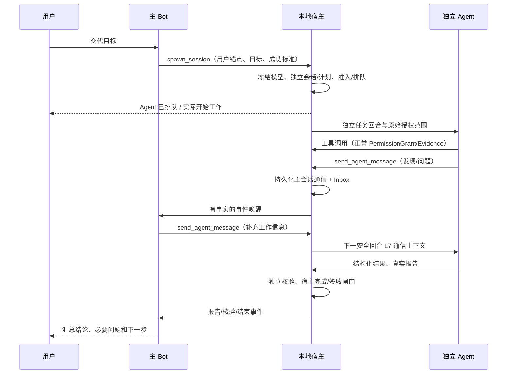

# ADR 89：独立 Agent 接手、双向通信与真实工作动态

日期：2026-10-10  
创建时间：2026-10-10

最后更新：2026-10-10（补充 ADR 91 自主协调设计引用）

状态：Accepted（用户明确要求先完善 ADR、再实施；本决策在实现之前记录）  
变更级别：A（通信契约、能力准入与上下文来源），B（执行及事件装配），C（消息间距与工作动态）  
依赖：ADR 80、83、85、88；产品北极星 `design/product/peer-product-alignment.md`  
实现卡：`playbook/v0.1.0/agent-delegation.md`

后续设计：[ADR 91](91-project-bot-autonomous-coordination.md) 增加主 Bot 自主调度、目标修订、取消重派、资源释放与版本化接手；设计 Accepted，实施未开始。本文已有通信、身份、权限与真实状态契约保留，不把 ADR 91 的计划计入本 ADR 已完成的验收证据。

## 1. 用户目标与已核实的问题

用户与主 Bot 自然对话。主 Bot 可把清晰的工作派给有名字的独立 Agent；Agent 实际接手执行，能给主 Bot 回信，主 Bot 能给它补充工作信息；主 Bot 汇总结果。界面可以看到谁接手、谁回信、谁结束，具体工具和技术信息仍按需查看。参照用户提供的 Codex 截图中的交互，不推断 Codex 未公开的内部架构。

代码已有真实执行基础：`spawn_session` 创建独立 Conversation 与 GoalPlan，SessionSupervisor 管准入和队列，GoalRunner 使用独立上下文与冻结模型执行；Explorer/Verifier 也有独立回合。缺口不是缺少一个彩色标签。

已核实的缺口：

1. `message_session` 用 `role=user` 写入子会话，等待输入时可能消耗用户问题。它适合转达明确的人类回答，不适合模型自主通信。
2. 任务可以提交报告、通过 Inbox 唤醒主 Bot，但没有明确的子 Agent 回信工具与发送者身份约束。
3. 事件、任务状态、模型报告的意义不同。仅从工具名或 assistant 文字推导“某 Agent 已完成”会制造事实。
4. 恢复提示所在的 `bot-system` 容器没有显式纵向间距；卡片段落的 margin 又被归零。叙述与恢复气泡可以直接相贴。间距应由容器负责，不能靠段落默认 margin。

## 2. 决策与保留的边界

采用已有 WorkSession 作为具名独立 Agent 的工作身份，补充独立通信 Module。保留主 Bot → 工作会话 → 临时 Explorer/Verifier 的固定层级，不增加机器人间群聊、递归派工或第二套任务表。

- 一个工作 Agent 绑定一个 `sessionId`、一个 `planId`、一个独立 `conversationId`、一个真实执行与恢复记录。
- 名称来自已持久化任务标题。颜色由 sessionId 稳定映射，仅表示身份，不表示成功、权限或核验结论。
- 主 Bot 可创建多个工作 Agent；并行数、排队、优先级、依赖、worktree 隔离沿用现有调度器。
- 子 Agent 不能创建另一个工作 Agent；临时审查回合不冒充任务执行者发送消息。
- 自主通信不扩大用户目标，不解除只读，不批准计划、工具权限或验收。
- 任务报告完成与独立核验完成分开显示；只有宿主事实允许显示“已完成”。

## 3. 对象与接口

### 3.1 AgentMessage

Protocol 定义加法式结构：

| 字段 | 责任 |
| --- | --- |
| messageId | 宿主根据调用身份生成的稳定 ID；重放不重复写入 |
| workspaceId | 宿主读取工作区身份 |
| sessionId | 通信所属工作 Agent；不接受跨项目自由寻址 |
| direction | `parent_to_child` 或 `child_to_parent` |
| senderConversationId / recipientConversationId | 宿主解析，不由模型指定 |
| purpose | `update`、`question`、`answer`；是工作信息，不是批准动作 |
| replyTo | 父 Agent 回答工作问题时指向原 question 的 messageId；不关联人类问题 |
| text | 有界正文，作为事实上下文与未验证模型内容 |
| at | 宿主持久化时间 |

通信结果只保证 `queued`：已经持久化到收件方会话，下一次安全回合可以读取。它不宣称模型已理解、任务已恢复或问题已回答。工作信息不能伪装成 `user_input`，也不能进入 L1/L6 指令层。

### 3.2 模型工具

新增 `send_agent_message`，位于已有 `local.delegation` Provider：

```json
{"sessionId":"工作会话 ID（主 Bot 必填）","text":"工作信息","purpose":"update|question|answer"}
```

工作 Agent 的 sessionId 从可信 turnProfile 推导；如果传入其他身份，拒绝。主 Bot 只能寻址当前项目下、父会话确实是自身的直接子 Agent。经典聊天、临时 Explorer/Verifier 与未知身份不投影/不执行该能力。

`message_session` 保留兼容，但被明确限制为转达本轮真实人类输入：宿主核对当前 user_input 的文本及锚点；模型自己组织的新工作信息必须走新工具。无真实回答时不能消耗 waiting_user。

### 3.3 身份、权限与 Evidence

所有通信仍走 Provider → Manifest → Runtime Projection → Tool Call → PermissionGrant → Evidence。Manifest 声明可用模式；执行时再次根据可信 turnProfile、Conversation 与 GoalPlan 的父子关系核验。仅模型参数中的 role/sessionId 不构成身份。

读写工作通信是本地编排元数据操作，允许只读任务使用；不开放项目文件写入、Shell、浏览器或模型渠道修改。Evidence 只证明通信被接纳/拒绝与排队，不证明正文结论正确。

## 4. 持久化、交付和恢复

复用既有 Conversation 消息存储与 ProjectInbox，不新建 agent 表、数据库或机器相关路径：

1. 宿主串行检查目标会话和当前租约。
2. 以稳定 messageId 向收件方 Conversation 追加 `kind=agent_message` 的结构化记录（不使用 user role）。
3. 子→主方向以 `agent-message:<messageId>` 写入 Inbox，正文由已落盘记录提供。
4. 父→子方向无需停止当前工具；下一次 GoalRunner 回合从同一子会话读取通信事实。
5. 回合构建时只把有界消息导入显式 L7 Context Source，普通 provider 历史投影排除内部消息。
6. 出现写入后、发事件前的崩溃，重放同一调用会修复缺失事件而不重复消息；启动恢复根据未进 Inbox 的子→主消息补齐事件。Inbox 按事件 ID 去重。

通信记录按会话既有生命周期保留。读取按时间/追加顺序有界，超出上下文窗口仍可在任务会话查看。循环交流是实际工作回合的一部分，使用 ADR 88 已有工作预算和调度预算；不得添加无界自动 ping-pong。

## 5. 完整执行流程



主 Bot 在用户回合简短说明意图，派发后可以结束当前公开回复；后台任务继续。事件唤醒仅在有新事实时运行，不每隔几秒重复“我再看看”。Agent 提问是给主 Bot 的工作信息；只有真实缺失人类决策时，主 Bot 再向用户提出具体问题。

## 6. 等待、取消和故障语义

工作 Agent 的 `question` 是专门的协调等待：宿主记录 `agentWaitMessageId`，结束当前模型切片，进入 `waiting_agent`（等待主 Bot 答复），不生成用户问题。主 Bot 用 `answer` 加 `replyTo` 指向该消息；收件方消息先落盘，宿主再持久化 `agentResumePending`，等当前执行安全收尾后恢复同一计划。恢复前再次核对租约、终态、暂停与真实用户问题；有任何人类批准/回答待处理就不继续。执行入口为父 Agent 答复返回明确的 `resumeAdmission`（`admitted` / `deferred` / `human_wait` / `closed`）。只有 `admitted` 才清理待恢复标记；宿主尚未就绪或租约不可用时保留原问题与答复，待原计划重新具备执行条件后补偿。普通状态快照不能充当执行器已接手的证据。清理时只消费本次答复的恢复标记；如果执行器接手期间已有新的工作问题或答复，保留新标记，不由上一轮的收尾覆盖。回复标记在启动成功后清理；如果同一安全边界已有真实人类等待，保留回答事实并清理内部协调标记，不调用 resume，也不消耗人类问题，避免旧回信在将来重复唤醒；重启补偿从持久标记恢复，不丢回答也不重开任务。等待信息和回答均为工作范围内的协调，不构成人类权限。

| 情况 | 处理 |
| --- | --- |
| 正在执行 | 通信排队，下一安全回合读取；不打断正在发生的外部副作用 |
| 等待主 Bot 答复 | 只有匹配 question 的父 Agent answer 可以恢复；自动 poll 不空转 |
| 等待人类输入/权限/计划批准 | 通信不恢复任务，不消耗问题，不生成批准 |
| 排队/准备工作区 | 可以排队工作信息；真正开始仍由调度器决定 |
| 暂停、取代、取消、失败或已结束 | 拒绝新的工作指令，提供明确结构化原因；不暗中重开任务 |
| 提供方断线 | 沿用 ADR 88 检查点恢复；消息 ID 和来源保持不变 |
| 工具结果未知 | 保留未知结果边界，不把通信当成重新执行授权 |
| 丢失父会话、身份冲突、跨项目 | 拒绝并返回 Evidence，不写入任何收件箱 |
| 事件重复或进程重启 | 同 messageId/eventId 去重，补齐持久交付，不重复派工 |

取消 Agent 使用既有结构化取消能力；停止主 Bot 当前回复与取消独立任务是两个真实动作。UI 不依靠文字推断或取消任务。

## 7. 界面表达

1. 同一 Bot 连续气泡纵向间距 8px，由 `bot-system`、`bot-reply`、`bot-cards` 和 narration 容器统一控制；不同发言组沿用现有间距。
2. 主对话新增轻量工作动态行：稳定 SVG 标记、Agent 名称、真实状态。没有竖线、伪团队面板或整段原始工具参数。
3. “已派发/排队”“开始工作”“发来进展/问题/答复”“结果已返回”“核验通过”“已结束/取消/受阻”来自宿主事件，不能把 queued 显示为 started。
4. 点击工作动态沿用现有任务详情/独立任务会话入口，可看到该 Agent 的目标、执行、报告和来源；主 Bot 始终是默认对话入口。
5. 结果返回不自动宣称已签收。技术内容继续置于侧栏；不添加默认展开的调试字串。
6. 保持深浅主题、窄窗口、稳定滚动、键盘焦点与 reduced motion；新动态不制造白色高光或字符图标。

## 8. Module / Seam 与实现范围

- `agent-communication`：根据可信调用身份解析父子关系、持久排队、去重、交付修复；接口小，权限和交付逻辑集中。
- `agent-activity`：将宿主生命周期事实投影为 Conversation 动态；不解释模型文字，不替代 GoalPlan 状态。
- Protocol：通信和动态的加法契约。
- Context Source：L7 工作通信事实；L1 已有角色来源补充用工具沟通的规则。
- Provider 与 Manifest：既有委托能力接入新工具；可替换 Provider adapter 不绕 Runtime Projection。
- SessionSupervisor/宿主：少量端口装配，复用既有 GoalRunner、租约与 Inbox。
- Renderer：独立小组件渲染已投影动态，现有任务入口导航。

Desktop 与 TUI 共享工具契约和通信 Module。Desktop 具备新动态表达；TUI 保持合法投影及结构化消息回传，不要求复制图形外观。经典聊天执行范围不改变。

## 9. 兼容与迁移

所有字段/消息 kind 为加法，旧 Conversation 与 GoalPlan 不批量改写。已有 user relay 保留原始事实；新通信不再沿用该写法。旧版本忽略新内部消息和未认识的动态；工作与权限真值仍在既有计划/会话。

新实现基于已推送的回复恢复 PR #138，隔离工作区中建立独立分支与堆叠 PR，避免覆盖原工作区的在制修改。本用户指令授权继续这条已实施基础，不为了未合并依赖而停工。合入开发线时按依赖顺序操作，不自动合并或发布 RC。

## 10. 验收矩阵与发布门槛

- 独立会话、冻结模型、真实执行器、报告/核验与主 Bot 汇总已有链路必须保持。
- 双向消息、同调用重复、写入后事件失败、重启补偿、失效父会话、跨工作区、伪造 session、临时审查角色、终态拒绝。
- 消息不成为 user_input/system 指令，不消费 waiting_user，不批准计划/权限，不扩大只读。
- Provider 返回结构化 PermissionGrant 和 Evidence；Desktop/TUI Manifest 可见性与执行二次门禁一致。
- L7 来源的边界、截断、普通历史排除、临时审查不读取通信正文。
- 生命周期开始/报告/核验/取消的 UI 状态来自事实，重复事件不重复动态。
- 恢复提示与进展气泡测量实际间距；动态行深浅主题、宽窄窗口、点击进入任务与键盘可达。
- 受影响包测试、build、typecheck、architecture:check；全量产品截图包逐张 AI 审查、review.json 与 verify。
- 实现者自审标记 independent=false；不能声称真实模型、安装版、长时间后台或全面无障碍已被隔离窗口测试覆盖。

## 11. 回滚与限制

回滚只撤新工具投影和动态表达，不删除旧消息、Agent 报告、权限记录或 Evidence。历史通信保留为内部事实。若新上下文来源不可用，工具必须保持结构化失败/排队可查询，不伪装成直接发消息。

首版不做跨 Bot 群聊、任意 Agent 寻址、递归派发、独立可编辑人设、自动扩大权限或运行无限消息循环。这些是独立架构决策，不能随本次 UI 调整隐含加入。

## 12. 落地与验收证据（2026-10-10）

实现代码：[Peer-Agent #139](https://github.com/ly-ccx/Peer-Agent/pull/139)，提交 `fd8160ed3fc51b28a3dbb7b3e709fe42fd4060f6`，PR base 为回复恢复依赖 `codex/reply-recovery`（#138）。实施前 ADR 与卡已提交推送；本次代码没有合并或发布 RC。

已落地：持久工作消息与角色准入、父子双向交付、真实主 Bot 事件唤醒、同计划协调等待/恢复、具名宿主事实动态、连续气泡 8px 间距。Desktop 与 TUI 复用通信 Module；不新增数据库或执行路径。`question` 和 `answer` 不消费真正的人类等待或权限确认。

| 验收项 | 证据与结果 |
| --- | --- |
| 真实独立执行与双向工作通信 | 实际 ConversationStore、Inbox、GoalRunner 和 Portable Project Host 集成测试通过；主 Bot 从工作事件唤醒，答复继续同一计划 |
| 身份与权限边界 | 父子身份、项目、租约、角色、终态拒绝；Provider 的 PermissionGrant / Evidence；经典和临时审查角色投影排除，通过 |
| 上下文边界 | L7 有界、JSON 引用且未验证的工作事实；普通历史排除内部消息；临时审查不读取正文，通过 |
| 交付和恢复竞态 | 12 项通信测试包含重复调用、写入后崩溃/重启补偿、宿主未就绪后补偿、人类等待在安全边界到达、新问题/答复在恢复接手中到达不被旧收尾覆盖，通过 |
| 界面 | 连续进展与恢复气泡实际间距 8px；1280 深色和 760 浅色具名 SVG、稳定身份、任务详情与等待主 Bot/用户区分，通过 |
| 工程门禁 | `pnpm build`、`pnpm typecheck`、`pnpm architecture:check`、`pnpm test` 全部通过；UI 圆角/SVG 和版本升级矩阵通过 |
| 产品门禁 | `qa:product:capture`、131 张必查截图逐张查看、绑定源码/截图 SHA 的 `review.json`、`qa:product:verify` 全部通过 |

产品包 runId：`0f19ee48-945f-496c-9e2c-b45eb5ae24b5`；sourceFingerprint：`ddb1862ac7049383e2cb3b68e7067838879a7b51fc1e4e14b96ac942ba67190f`。包在工作机器临时目录保留，不提交机器路径或截图到仓库。审查为实现者自审，`independent=false`。

覆盖限制：受控认知/隔离动态事实、源码 Electron；未做真实模型质量/网络时序、安装 RC、长时间后台或全面屏幕阅读器验收。Agent 执行与通信的真实性另由实际执行器/宿主集成测试证明，截图不单独充当执行证据。Quick Chat 透明 PNG 不能证明原生合成背景对比度；相邻基线侧栏旧失败预览仍有 response 片段，未声称本次修复。


2026-10-28：后续双向监督与连续工作设计见[ADR 111](111-project-agent-duplex-supervision-and-continuity.md)。本批源码、自测范围与限制见[实施回执](../../playbook/v0.1.0/code-structure-refactoring.md)；不将本次新增能力计入历史版本。
