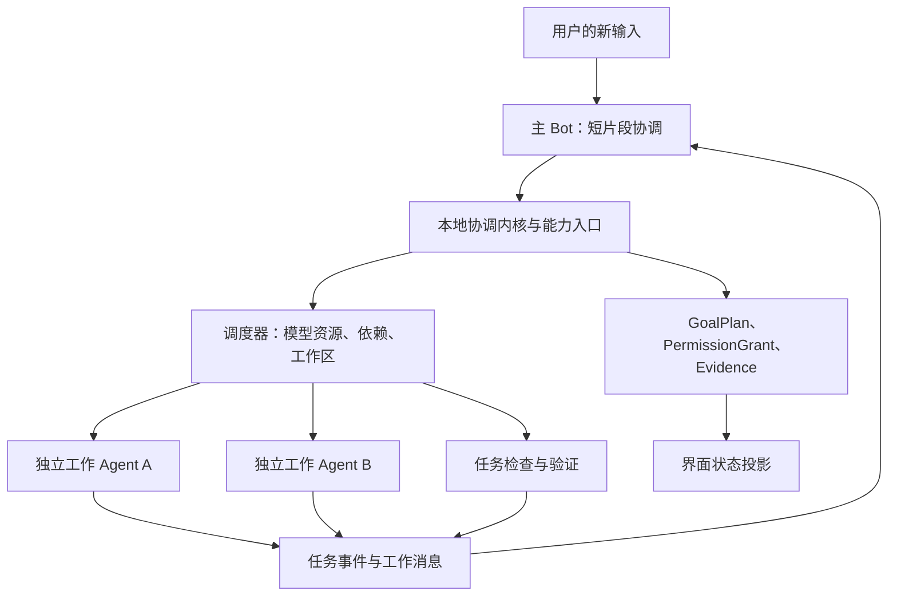

# ADR 91：主 Bot 自主协调、并行调度与取消重派

> 2026-11-01 实施衔接：[ADR 117](117-intent-driven-coordination-and-goal-closure.md) 在隔离交付分支深化同一 Coordination Kernel：新契约子任务 accepted 只证明阶段结果，根责任按当前目标覆盖、宿主只读核验、实际交付/签收和无未决义务关闭。主 Bot 负责跨任务目标判断，工作 Agent 自主选择范围内方法；mandate、goalRevision、executionEpoch、真实人工门及唯一能力链保留。四包实现与版本边界见 ADR 117 §14 和[实施回执](../../playbook/v0.1.0/intent-driven-coordination-self-test.md)，不改写本文 RC12 历史证据或声称已发布。

创建时间：2026-10-10
最后更新：2026-11-05（第 15 节身份解析、派发责任与独立 PR 候选）

状态：第 1–14 节为 Accepted / Implemented in RC12；第 15 节为独立 PR 实现候选（最终验证见 15.13，未发布）（用户认可技术设计方向，并明确授予主 Bot 自主判断、取消错误任务和重新安排执行的协调权）。R91-01 至 R91-05 已按依赖合入开发线并发布 `v0.1.0-rc.12`；正式签名包8个真实模型协调场景与本轮发布验收通过。实际覆盖与限制见[RC12交接](../../playbook/v0.1.0/rc12-candidate.md)，不代表总体Ready/GA或用户日常安装已升级。

级别：A（协调授权、取消/接手契约、能力与上下文准入），B（回合调度、任务事件与恢复），C（真实工作状态表达）。

关联：[产品北极星](../../design/product/peer-product-alignment.md)、[治理基线](../architecture/20-architecture-governance.md)、[ADR 80](80-project-agent-delegation-model.md)、[ADR 82](82-project-objectives-and-watches.md)、[ADR 85](85-project-agent-hosts-inputs-and-surfaces.md)、[ADR 88](88-project-agent-execution-continuity.md)、[ADR 89](89-independent-agent-delegation-and-communication.md)。实施卡：[主 Bot 自主协调](../../playbook/v0.1.0/autonomous-coordination.md)。

## 1. 用户要求与决策

主 Bot 是用户在项目中的持续协调者。用户交代目标后，主 Bot 自主选择推进方式，拆分工作、并行派发、查询进展、回答工作 Agent 的问题、验证结果、恢复执行和安排接手。用户可以在其他任务执行时继续提出要求。

用户进一步明确：新要求补充或纠正先前目标时，主 Bot 有权判断旧执行是否仍然正确；必要时自行取消正在运行的错误任务、重新安排正确任务。用户无需再次使用“取消”这个关键词或进入任务卡完成内部协调操作。

本决策将自主判断落成可执行契约：

1. 模型负责理解目标和选择处置；本地宿主负责处置的授权、顺序、执行与事实记录。
2. 新输入可以补充、调整、替换或取消已有工作，也可以创建独立并行工作。上一条消息的时间邻近关系不自动确定任务范围。
3. 正确任务可以在原进度上调整；已确认方向错误的执行必须停止。替代任务沿用有效工作，不能盲目从零重跑。
4. 同一原目标内的事件可以触发继续、补充检查、恢复、取消错误分支和换人接手，不要求用户反复交代同一目标。
5. 主 Bot 的协调权不取代本地 PermissionGrant、验证结论或实际执行记录。文件、网页、图片、工具输出和 Agent 消息没有用户授权效力。

## 2. RC11 源码核实的限制

核实代码基线：Peer-Agent `v0.1.0-rc.11`，提交 `438d1a6f52853ff55031fb351cb14625de554514`。以下是实现限制，不能单凭用户截图断言某条任务的现场阻塞原因。

| 限制 | 代码锚点（相对于 Peer-Agent 根） | 影响 |
| --- | --- | --- |
| 单项目串行 pump 等当前用户 job 结束；新输入仅中止 wake；待处理用户输入会合批 | `packages/runtime-node/src/project-agent/runner.mjs`，`takeNextJob`、`runRounds`、`enqueueUserInputs` | 长用户回合影响新要求的及时处理与分流 |
| 主 Bot 与工作回合共用模型执行名额；高优先级只排序排队者 | `apps/desktop/electron/main/agent-host/agent-turn-executor.mjs`；`project-agent/execution-scheduler.mjs` | 工作执行占满资源时，协调者也可能排队 |
| 准入占用按 delegation phase 与终态计算，未充分区别协调等待和实际资源使用 | `project-agent/execution-scheduler.mjs`，`occupying`、`inspect`；`session-supervisor.mjs` | 等待中的逻辑任务可能继续阻挡同类任务准入；不等于一定仍占模型回合 |
| 普通事件唤醒不能由历史用户消息授权新任务；目标唤醒另有宿主闸门 | `project-agent/delegation-provider.mjs`；`prompts/delegation/spawn_session.md` | 原目标范围内的自主补充和纠偏需要持久协调授权 |
| `supersedes` 的现有语义以暂停并保留旧任务为主 | `project-agent/session-supervisor.mjs`；ADR 80 | 尚未区分可恢复暂停与错误流程取消重派 |

已有 SessionSupervisor 会用 `awaitIdle:false` 启动独立 GoalRunner；底层已支持多会话并发、worktree 与 ADR 89 双向通信。本次复用这些机制，不能把当前产品限制描述为完全没有并行执行器。

## 3. 架构与职责

主 Bot 仍是项目唯一默认对话对象，保持读取与协调的能力模式；实际项目写入、Shell、浏览器/MCP 副作用由具备相应授权的工作执行者完成。任务保持独立 Conversation、GoalPlan、上下文与真实执行记录。

固定层级保持主 Bot → 工作会话 → 临时 Explorer/Verifier。扩大主 Bot 的协调权不隐含开放工作 Agent 递归派工、跨 Bot 任意寻址或无限群聊。

## 4. 自主协调的授权契约

在 ADR 88 既有协调 work 上增加持久的 `CoordinationMandate`；它不是第二份任务真值，也不是工具权限批准。字段职责如下，已实现的 Protocol schema 见 `packages/protocol/src/delegation-coordination.ts`：

| 字段 | 责任 |
| --- | --- |
| mandateId / workId | 宿主生成；关联已有协调工作 |
| workspaceId / parentConversationId | 可信项目与主 Bot 身份 |
| rootInputIds / revisionInputIds | 原目标和修改目标的真实 canonical 用户输入 |
| goalRevision | 宿主单调递增的目标版本；模型不能自行签发版本 |
| allowedActions | 在目标范围内的派发、补充、查询、验证、恢复、取消、替换、接手等协调动作 |
| taskBindings / materialRefs | 绑定的真实任务、依赖和已准入材料；引用有来源与范围 |
| permissionScopeRef / policyRevision | 现有权限和项目政策的引用；执行时重检，不冻结成永久通行证 |
| budgetRef / lifecycle | ADR 88 既有工作预算引用以及 active、paused、cancelled、fulfilled 等协调生命周期 |

模型可自主选择任务拆分、处置、执行者、先后关系，以及配置与角色路由政策允许的模型。已开始的执行保留冻结配置；换执行者或模型通过新的执行 attempt 绑定，不在回合中悄悄改写。

普通事件唤醒可通过有效 mandate 在原目标范围内推进相关工作；扩展现有 `spawn_session` 等能力的准入与执行二次检查。历史消息本身仍不能授权任意新目标。ADR 82 长期目标、探测和通知的独立政策不被本契约自动替换。

宿主检查身份、目标版本、任务父子关系、材料范围、动作类别、取消状态、政策与 PermissionGrant。模型对语义关系的判断作为有来源的决策记录保存，不能声称宿主 schema 校验能够证明模型理解正确。

新用户要求即是相关目标调整的依据，不为正常补充、纠偏、取消、重派再追加一个人工确认流程。确实缺少目标信息、要求有实质歧义，或本地已有政策要求决定时，主 Bot 提出一个具体请求；无关任务继续推进。

## 5. 输入路由与目标修订

每条输入保留独立 inputId 和处置回执。模型提交结构化 `CoordinationDecision`，包含 inputIds、受影响 task/work、expectedRevision、动作、理由及原始来源；宿主校验并落盘。可以一次理解多条相关输入，但不得丢掉每条输入的身份、范围和处理结果。

| 关系 | 默认处置 | 处理要点 |
| --- | --- | --- |
| 信息补充，原成功标准仍成立 | augment | 给原 Agent 排队补充信息，下一安全点读取 |
| 方法或范围调整，已有执行可以继续 | revise | 持久目标修订并要求执行者确认新版本；修改验证绑定 |
| 明确改变目标，旧执行已不适用 | replace | 取消错误执行，创建关联的替代任务 |
| 用户指出实现对象或执行方向错误 | replace 或 revise | 主 Bot 自主判断能否安全沿用当前执行；继续错误操作的分支必须停止 |
| 用户要求停止且无替代目标 | cancel | 停止指定任务及其专属执行后代，保留真实记录 |
| 独立新工作 | parallel | 独立任务；原任务不受影响 |
| 只询问进展或回答已有问题 | query / answer | 不重建任务、不把问题答案当成新能力授权 |

引用/回复对象是可信范围线索，原始 input/task 绑定由宿主校验；不能仅依据“上一条消息”取消另一件工作。范围拿不准时先做无争议的查询、补充与并行工作；不能伪造明确的人类取消事实。

收到新版本后，宿主及时登记旧版本的执行约束。纯信息补充可在安全点生效；改变正确性的修订必须阻止旧版本启动下一次不再有效的操作，直到执行者接纳新版本或进入替换流程。

## 6. 取消与重派是可恢复的协调操作

复用既有协调 action/outbox 记录新增 `TaskTransition`，至少包含 operationId、mandateId、sourceInputIds、decisionSource、expectedGoalRevision、oldSessionId、replacementSessionId、reason、executionEpoch 和处理 phase。模型不能任意指定他人 epoch 或伪造停止回执。

主 Bot 自主纠偏的取消记录 initiator=project_agent 与对应用户目标/事件来源；decisionSource 区分用户直接要求、Bot 目标纠偏和执行修复。主 Bot 有权自行决定取消，不需要用户给出明确取消用词，但不能把自己的协调决定冒充用户点击过取消按钮。

phase 表示替换操作的进度，例如 recorded → stopping → ready → started → completed；awaiting_outcome 和 blocked 表达未知副作用或真实闸门。它不覆盖 GoalPlan 自己的执行状态。

### 6.1 时序

1. 校验本次新要求与目标范围，以稳定 operationId 持久化替换意图、取消原因和替代任务规格。
2. 废止旧执行者开始新操作的资格，向现有 GoalRunner/工具执行器传播结构化取消；不得等待新任务成功启动才停止已确认错误的流程。
3. 对运行中工具执行正常取消或等其安全收尾。结果未知时记录实际调用及 Evidence 关联，进入 awaiting_outcome；不能将“请求停止”显示成“已取消”。
4. 汇集旧检查点、有效产物、未完成工作、已失效结论与执行结果。项目文件修改不因为取消自动全部回滚。
5. 建好绑定新目标版本的替代会话、准入配置和交接材料。相同目录的新写执行须等旧副作用已确认、写资源可以安全交接。
6. 调度器接纳后启动替代执行；排队、隔离失败或权限等待显示真实原因，不能暗中恢复错误方向。
7. 按宿主记录生成处置回执与公开说明。旧会话以 cancelled 并带 replacement 原因/关联保留；暂停用于用户暂缓等明确可恢复场景。

取消计划和创建替代计划跨越多个持久操作，采用可重放的协调过程；不能宣称跨提供方或外部系统具备原子事务。重启扫描依据落盘意图补偿缺失步骤，不重复取消/创建，也不把用户原要求重新派发一遍。

替换尚未完成又收到同目标的新修订时，以宿主提交成功的最新 goalRevision 为准。尚未启动的旧替代规格失效；启动前重新检查版本。已开始的旧替代执行进入相同停止/交接流程。保留每条输入的处置回执，不能出现多个替代者同时认为自己拥有当前目标。

### 6.2 执行版本与迟到结果

每次接手绑定新的 executionEpoch；本地执行入口在工具开始、检查点/报告提交和结果签收前核对当前目标版本、执行身份及状态。旧执行者的迟到结果保留为当时发生的历史事实，不推进新目标的完成或接受状态。

已经开始的外部副作用无法靠版本校验撤销。先查询/对账实际结果，再决定补偿；不可查询时明确保留 unknown。禁止以恢复或重派为理由直接重放未知写入。

已经完成或已签收任务不被改写为“从未完成”或强改 cancelled。新要求创建关联的纠正工作，旧结果对新版本的适用性另行标记；结果就绪时发生纠偏，需要撤销旧结果对当前目标的自动交付资格，而不删除原报告和 Evidence。

### 6.3 取消范围

- 取消当前任务连同其专属临时执行者及排队操作；只停止主 Bot 当前回复仍是独立动作。
- 共享依赖不随一个使用者取消；标记其产物适用范围。依赖错误结果的任务暂停相关步骤，由主 Bot 决定重算、调整依赖或取消，不自动杀掉无关任务。
- 不因取消删除真实用户数据、工作目录、报告或 Evidence。worktree 清理遵循已有保留与回收规则。
- 用户取消 root 目标后，相关 mandate 关闭；迟到事件不得自动恢复或再派发该目标。

## 7. 短协调回合与资源调度

主 Bot 的项目 actor 保持单写者、有序状态提交；回合改为可以保存进度的短执行片段。新输入在安全点优先处理，工作事件按相关性与公平性进入队列；长用户回合也能让出，不只允许抢占 wake。

安全点检查必须进入内层模型/工具循环，不能只改外层 runner 的轮数。已落盘 Tool Result/Evidence 后保存检查点和剩余预算；新输入到达不触发整轮从头重做。提供方请求可按 adapter 能力停止/让出；无法中断的请求如实等待，不承诺绝对响应时延。

| 资源 | 决策 |
| --- | --- |
| 全局模型名额 | 区分 coordination 与 work；初版在总上限内预留 1 个协调名额，例如总 4 时 1 协调 + 3 工作；多个项目公平分享协调名额 |
| 上限为 1 的渠道 | 安全点交替执行；等待主 Bot 答复的工作先释放模型资源，明确表达排队，不能假称物理并行 |
| 工作准入 | waiting_agent/waiting_user 等逻辑存活状态不等于正在消耗计算；拆开准入占用与执行租约 |
| 工作区修改 | 同目录写入互斥；宿主核实的 worktree 写入可独立执行；等待不必释放仍有风险的写资源 |
| 临时审查与验证 | 进入同一预算和资源管理，避免协调回合嵌套占槽造成等待环 |
| 渠道限制 | Provider 并发、速率和成本约束继续独立生效；预留协调不超发请求 |

初版不借出协调名额，减少不可抢占请求造成的饥饿。后续借用须有真实可撤回的执行片段与公平性证据。只读准入数沿现有配置/政策，不以放宽固定数量代替等待状态修复。

## 8. 事件、通信与接手

沿用 ADR 89 的具名独立 Agent、双向 AgentMessage、ProjectInbox 和 waiting_agent。工作 Agent 提问后退出当前执行片段；主 Bot 可以自行查询、回答、安排检查或替换失败执行者。有真实人类等待时，Agent 答复不批准权限、不消耗人类问题。

报告就绪、验证结论、提问、依赖满足、执行中断、用户输入和资源可用变化触发协调。关联的任务版本改变后，协调者重新取得事实快照；同一事件去重，但新版本或新问题不能被旧处理回执吞掉。

换人接手优先保留原 WorkSession/GoalPlan 与目标，新增执行 attempt/epoch。只有目标改变或任务身份确实需要替换时才创建新会话。交接包包含目标版本、检查点、产物和 Evidence 引用、未决问题、失败原因、执行工作区与权限引用；不能把完整项目历史和无关附件全部复制给执行者。

协调片段让出时只保存已观察的事件与检查点，不签收其处理完成。新的事件批次不能复用仍在 runnable/retry_wait 中的协调 work 并覆盖其检查点；使用独立的稳定事件批次 work，原片段仍由原 work 恢复。对目标的处置权继续从原 mandate 与未处理事件取得，工作 Agent 的累计预算、目标修订与执行 epoch 不变。只有片段完成处置或回复送达后，才提交对应处理回执。

事件交付采用至少一次与稳定 ID 去重；本地协调动作幂等，外部副作用未知时走对账。watchdog 只检查实际过期执行、缺失交付和异常租约，不周期调用模型重复查询没有变化的任务。

## 9. 验证、签收与预算

通信验收由宿主从既有 Conversation 中投影当前工作与直属父 Bot 的结构化 AgentMessage 回执，核对 workspace、session、双方会话身份、方向、replyTo 和时间。Verifier 引用包含实际 messageId 的宿主送达证据验证消息及问答关联；该回执不证明消息内宣称的文件操作，也不授予权限。消息文本作为有界事实材料进入既有 verifier mission 的用户上下文，不成为系统指令。执行验收仍使用原 Tool Result / Evidence，不新增证据存储。

投影后的通信回执须在调用 Verifier 前登记到既有 EvidenceIndex，绑定当前 GoalPlan 与子会话，并保留原 messageId、通信 capability 和真实送达时间。宿主派生稳定的 agent-delivery 引用，以计划与 messageId 为身份；不能与工作 Agent 在任务结果中引用的裸 messageId 共用索引身份，避免任务结果登记覆盖送达事实的 provenance。未通过上述身份及关联检查的回执不得登记；派生引用已属于其他计划、会话或 capability 时不得重绑定。登记只证明宿主记录的送达事实，不把消息正文中的执行声明提升为执行证据。核验持久化仍执行原证据索引与目标版本检查，不因通信引用而放宽签收条件。重启后从相同 Conversation 回执重新投影，按稳定派生引用幂等登记。

主 Bot 可在原成功标准范围内追加检查、修复失败项和安排复核。目标修订后，宿主将验证绑定到对应目标、执行与产物版本；旧版本通过不能直接关闭新版本。

完成仍由真实任务报告、不可下调的验证下限和结果政策决定。符合自动签收政策就由系统收下，不能让主 Bot自行创造“你去卡片亲手验收”步骤。既有真实人工标准、工具权限及交付政策继续生效。

沿 ADR 88 区分执行片段结束与真实工作预算耗尽。让出片段保存累计费用和进度，继续不能刷新预算。重试/替换有持久的无进展和失败统计：同目标版本、同失败事实反复重派不算新进展；明确用户修订有新来源，但不重置此前实际用量。到达真实预算或不可恢复阻塞时说明具体原因，保留任务现场。

## 10. 持久真值与 Module 接口

不新建 Project/Task 表或第二套完成状态。沿现有协调 work、Conversation、GoalPlan、执行租约、权限与 Evidence 记录进行加法扩展；若实施确需新增持久文件，必须先登记数据存储 scope 与恢复/迁移规则。

| Module / Seam | Interface 与不变量 | 实现方向 |
| --- | --- | --- |
| Input Routing | 每条输入的身份、绑定、处置与目标版本 | 现有输入队列、Protocol 与协调 reducer |
| Coordination Kernel | 接受版本化决定，保存待办、transition 与事件游标；不拥有完成真值 | 扩展 ADR 88 内核与持久 Adapter |
| Execution Scheduler | 协调/工作名额、依赖、工作区资源、公平性与取消 | 现有 scheduler 深化资源接口 |
| Session Lifecycle | 修订、停止、恢复、接手与版本检查；一个执行拥有者 | 从 Supervisor/GoalRunner 提取深 Module，原宿主只装配 |
| Delegation Provider | mandate、调用身份、项目范围与执行二次检查 | 既有 Provider/Manifest/Projection；小接口接入协调内核 |
| Context Admission | 角色规则与有界相关事实分别进入注册 Source | L1 静态协调规则；L7 当前授权引用、任务快照和工作消息 |
| Product Projection | 原目标、替代关系、实际 Agent 状态、真实待处理请求 | 共享状态投影；Renderer 仅表达与发送 typed command |

所有动作继续经过 Capability Provider → Manifest → Runtime Projection → Tool Call → PermissionGrant → Evidence。不能在 renderer、prompt 或主 Bot 自建脚本中直接取消进程、写文件或批准权限。Desktop/TUI 共享运行时契约；不向 god module 继续堆业务。

## 11. 界面表达

派发完成后主 Bot 可以结束当前公开回复，后台 Agent 继续工作。Bot 正在思考与项目有任务正在执行分开表达。工作区可显示“2 项正在推进，1 项需要你决定”，不把所有后台工作包装成一条无期限的“正在回复”。

用户修订时简短说明正在调整的对象和处理方式；确认停止后才能说已停止。可以表达“我会停下气泡圆角的修改，改为检查引用卡片，已有检查会保留”，其状态由真实事件更新。

原任务的取消原因、替代关系和有效产物在详情可查；无关任务不跳动、消失或被重建。消息间距、Bot 颜色、圆角、SVG 图标、气泡右侧 hover 详情、右侧技术信息与 reduced motion 沿既有设计规则。

## 12. 兼容与决策覆盖

1. 本 ADR 对新版本协调工作生效；旧记录不补造授权、目标修订或取消事实，旧任务先从已有真实用户锚点和范围恢复。
2. 部分取代 ADR 80 的长用户回合不可让出、模型名额无协调保障，以及“所有取代均暂停且可直接恢复”的实现政策。普通明确暂停仍可恢复；已确认错误流程取消后不会自动复活。
3. 扩展 ADR 80/88 的普通 wake 准入：由有效 mandate 允许原目标内的相关动作；无 mandate 的历史消息限制仍保留。
4. ADR 89 的通信身份、waiting_user 保护、事实上下文与固定层级保留；本 ADR 增加工作资源释放和接手版本契约。
5. 已完成/已签收历史保持原事实。经典聊天能力与用户数据不迁移；不改写历史会话 jsonl。

回滚时停止接纳新的自主协调动作，保留 transition、旧产物、Evidence 和任务关联。已登记的取消继续安全收尾；未开始的替代任务停止自动启动。不能因为功能回滚让已确认错误的旧任务自动恢复。

transition 记录 schema 与最低执行器版本，新宿主接手前核对支持能力。受控降级前必须停止执行宿主并安全收尾进行中 transition；存在未知副作用时拒绝自动降级。既有旧版不能凭空理解新增 epoch，不能承诺“忽略新增字段即可安全执行”。用户自行运行不支持该契约的历史版本属于未保证的混合执行场景，发布说明必须明确；升级测试与受控降级测试分别记录。

## 13. 验收矩阵

| 验收故事 | 必须证明的事实 |
| --- | --- |
| A 执行时用户提出独立 B/C | A 继续；新输入得到独立处置；具备资源时实际执行区间重叠，不能只展示 started 标签 |
| 用户将“气泡圆角”纠正为“引用卡片圆角” | 无第二次取消确认；旧错误流程不能启动新操作；新任务获得新目标和有效交接 |
| 补充说明且原目标正确 | 原计划继续，补充在安全点消费；不无谓取消重跑 |
| Agent A 等主 Bot 回答且其他工作占槽 | 协调有执行机会；A 释放计算等待，B/C 持续；无槽位等待环 |
| A 等真实人类决定 | B/C 可继续；工作通信不批准 A 的权限 |
| 用户取消 A 或 root 目标 | 精确停止范围；B 不受影响；迟到事件不复活取消目标 |
| 工具运行中取消、超时后结果未知 | 请求停止与停止完成分开；真实结果核对；不重放未知写入 |
| 替换中各持久步骤崩溃、重复事件、双宿主竞态 | 稳定 operationId；单执行拥有者；恢复原 transition；不重复新建任务 |
| 替换尚未启动又收到下一条同目标纠正 | 旧替代规格失效；最新版本只有一个执行拥有者；每条输入有回执 |
| 接手后旧 Agent 回报/试图写入 | 开始新操作与状态提交被版本闸门拒绝；已发生结果保留为历史 |
| 已完成结果收到纠正 | 原完成事实保留；纠正工作关联新版本；旧验收不能关闭新目标 |
| 并行同目录修改与 worktree 隔离 | 写资源互斥；独立目录实际隔离；结果验收与合回政策区分 |
| 恶意文件、网页或 Agent 消息要求取消其他任务 | 不生成用户修订，不扩大 mandate、材料范围或 PermissionGrant |
| 升级、受控降级与功能回滚 | 数据不丢；已取消错误任务不复活；未收尾或未知副作用拒绝受控降级；不把旧宿主的未知字段忽略称为执行兼容 |

定向 reducer、协议、权限、取消、调度、恢复与 Context 测试加上实际 GoalRunner/Provider 集成。修改 UI 后执行完整产品 capture、逐张 AI 审查、review.json 和 verify，明确 independent 状态。

最终产品验收要求真实模型与安装版执行上述并行、插话、纠偏、通信和重启场景；记录模型、渠道限额、实际执行时间、来源版本、任务/事件 ID 与 Evidence。源码模拟截图或脚本化认知不能单独证明自主调度质量、真实网络时序或物理并行。

## 14. 实施顺序与当前状态

R91-01 协调契约、输入路由与目标修订 → R91-02 短片段与协调资源保障 → R91-03 安全取消、替换与接手 → R91-04 mandate 事件推进与通信补偿 → R91-05 真实投影及安装版并行验收。

2026-10-10 用户明确授权按此设计实施；随后授权发布新RC并验收。R91-01 至 R91-05 已按依赖合入，发布准备PR149合入 `cc9f9a1b9ec718c92c63eb324756bfb08b57eeaa`，不可变tag `v0.1.0-rc.12` 指向该提交。2026-10-11正式签名包以原装凭据助手、真实GPT-6.1 Sol通过8个严格协调场景：并行、同目标补充、取消重派、兄弟不中断、重启、关联问答、结果核验与主Bot自主收下。143张产品截图自审、30项升级/恢复、两平台CI及正式资产、npm、更新发现/旧版下载均通过；完整记录见[RC12交接](../../playbook/v0.1.0/rc12-candidate.md)。实现者自审不是独立审查，发布成功不表示用户日常安装已升级；Windows/Linux交互安装、复杂外部写入、七天日用与GA仍按记录保留限制。

2026-10-28：后续双向监督与连续工作设计见[ADR 111](111-project-agent-duplex-supervision-and-continuity.md)。本批源码、自测范围与限制见[实施回执](../../playbook/v0.1.0/code-structure-refactoring.md)；不将本次新增能力计入历史版本。

## 15. 2026-11-05：用户锚点身份与协调失败后的责任连续性

创建时间：2026-11-05。状态：**Implemented source candidate；2026-11-05 用户授权实施及提交 PR。共享工作树历史结果见 15.11；独立开发线候选及最终结果见 15.12–15.13，未发布。** 以下现场分析与修复验证分别记录，未验证项不计通过。本节补充第 4、7、8、10、12 节，不改变此前已接受部分的状态，也不把旧版实现细节升级为架构要求。

级别：A（工具身份与作用域准入契约），B（协调恢复、事件及交付责任）。继承 [ADR 94](94-reply-attempts-silent-wait-and-recovery.md)、[ADR 99](99-authoritative-reply-receipts-and-model-recovery.md)、[ADR 111](111-project-agent-duplex-supervision-and-continuity.md)。遵守产品北极星、工程治理和人机交互契约。初稿阶段仅改知识仓文档；用户审阅后授权实施。源码候选及结果见 15.10–15.13。两个仓库的既有修改保留，个人任务、运行实例和安装包未改。

### 15.1 目标、范围与非目标

现场用户上传文档侧栏截图并说“把这个去掉吧”。主 Bot 已定位中文导航的 `self-host-quickstart` 条目，准备委派删除导航项并验证。其任务规格还包含保留正文、不改其他语言、不提交、不推送等约束；它们是现场模型形成的规格，不能仅因写入规格就视为用户逐项明确批准。

修复目标：既有委托发生技术参数错误后，仍保留下一步的负责方，在原有效范围内纠正并继续；真实权限、范围歧义、停止意图与未知副作用仍沿相应契约处理。用户不负责解释内部 ID，说明性回复不代替文件修改和验证。

范围：主 Bot 委派与回复使用的 canonical 用户消息锚点、失败诊断、既有工作恢复与去重；Desktop/TUI 共用 runtime-node。非目标：提升图像识别、修改现场导航、建设通用自动重试平台、全量迁移历史、重做任务生命周期或全面改版 UI。实施若发现需扩大范围，先更新本节。

### 15.2 基线身份与证据边界

初稿阶段读取已有真实记录，**没有重新运行原任务，也没有建立安装版可执行复现**。以下身份绑定现场分析；后续源码隔离验证见 15.11，不能反推事发进程已被重放。

| 来源 | 身份与用途 | 限制 |
| --- | --- | --- |
| 现场会话 | `${DATA_HOME}/conversations/e1d80744-422e-4d2c-946b-8d6286f06e36.jsonl`，记录 242–246；inputId=`fbe6b46e-f8a3-42e2-8a54-3eb592bb6956`；messageId=`input-fbe6b46e-f8a3-42e2-8a54-3eb592bb6956` | 记录号只是定位，绑定下面的摘要；原文及图片不复制进知识仓 |
| 工作与检查点 | workspace=`213a4368-f809-493f-887d-4a069bb0df6d`；work=`work-d679f67f41ca593de1e1236fac15a68d8108ac3af726598d47106ea70aa73a92`；其 `project-runtime/<workspaceId>/checkpoints/6cddf818a9020b4b71fea2fb33aaf34aefae081c1c22d23912538de2f7baed7e.json` | 只读 job/outcome；失败时检查点不代表当前执行许可 |
| 检查时本机安装包 | 包内版本 `0.1.0-rc.36`；app.asar SHA-256=`0905dd02f7b7336b1450bb0f6945c75a797bce036cd04c48627bd54cd4fa5ce3` | 包内代码与记录能解释错误；缺事发进程构建回执，不能仅凭当前磁盘包证明当时进程必为同一二进制 |
| 当前代码仓 | HEAD=`7a725fbd2899b4acc03b7e597216ad41045f3299`，另有大量既有未提交修改 | 与安装包协调协议不同；HEAD 不是未提交工作树完整指纹，也不是已验证候选 |

单条 JSONL 原记录文本的 SHA-256（不含换行），只绑定事实分析，不是执行成功 Evidence：

| 记录 | SHA-256 |
| --- | --- |
| 242：评估与派发 | `a466e1ad58b78f8818f25f3c2576373c4522cb1ea5007e03d021e3641b13ae78` |
| 243：查询与重派 | `69510026b52fd44d18ef8d40ecdaed7396cbb286dec25dcc20a99fdbcbf31d1c` |
| 244：直接派发及回复失败 | `53aca14cdc8df87fc65dca0a4050921daf63cd0cdf112a49758617df7bff38df` |
| 245：回复成功与重复调用 | `aec8c48171964cd293da154933b0a1f8952eac6d99fb30a1b6a1eda4d99b12b7` |
| 246：最终错误卡 | `b79010a4cceb19a6a6c71e0f213da1448190db6f129e7e53633338672f50f6f4` |

### 15.3 已证实的实际调用链

日期为 2026-11-05，时间为北京时间（UTC+8）。这里是回合/卡片记录时间，不冒称每个工具的精确开始时间。

| 时间 / 记录 | 调用与真实结果 | 可以得出的结论 |
| --- | --- | --- |
| 20:34:56 / 242 | `coordinate_work(action=assess)` 成功，保存 continue、workRevision=1、goalRevision=0；随后 parallel 的 task.anchorMessageIds 使用裸 inputId，返回 material_out_of_scope | 曾有结构化处置，不能称整项工作“从未评估”；派发被拒 |
| 20:35:15 / 243 | query 后仍用同一裸 ID 调用 parallel，再次 material_out_of_scope | 未修正出错字段，没有成功派发回执 |
| 20:35:45 / 244 | spawn_session.anchorMessageIds 和 post_reply.replyTo 均传裸 inputId，均为 anchor_not_found；后者返回带 input- 前缀的真实可用 ID | 混用了 inputId/messageId；错误本身不证明需要新的用户授权 |
| 20:36:22 / 245 | 改正 post_reply.replyTo 后成功；追加修复轮再次发送相同回复，结果成功且 replayed=true | 回复工具已接受，重复调用没有创建新回复；该轮没有修正任务派发或更新处置 |
| 20:36:22 / 246 | 同 turn `turn-b20155eb-6547-4724-af6d-9e7b1c3d51c1` 产生 work_disposition_required | 回复接受与旧版工作收尾是两种事实 |

已追踪的 Module 与状态转移（源码路径相对 Peer-Agent 的 `packages/`；安装包对应 runtime-node/dist）：

1. `runtime-node/src/project-agent/input-queue.mjs` 管理输入及消息映射；`agent-turn-plan.mjs` 经已有 `system-context/src/sources/project-roster-source.mjs` 提供 inputAnchors.messageId。失败检查点里有正确的 input-… 锚点，不能断言“宿主没有提供正确 ID”。
2. `coordination-lifecycle.mjs` 从当前 canonical 用户消息及 mandate 的根/修订输入导出允许锚点。安装包此路径（第 125 行附近）将任务中的非成员锚点报为 material_out_of_scope；裸 inputId 与消息 ID 不相等。`coordination-kernel.mjs` 另有同名材料错误，不能仅凭错误名认定此案为图片/文件未授权。
3. `delegation-provider.mjs`、`reply-composer.mjs` 各自校验消息身份，分别拒绝直接派发与回复。改对回复参数不会自动修复此前被拒的派发。
4. 安装包 runner.mjs 发现 missingDisposition 时只给一轮修复，之后仍缺则失败。runner-coordination.mjs 的 dispositionMissing 接受“本 attempt 的处置”或“宿主证明可沿用的原生续接处置”，不是每次无条件重新 assess。
5. 最终检查点 decisionFrame 仍含前轮处置引用 `9f2f16a9514b46a38ad46f6c14b44941f6c6284864ee626252bbbbcdb078e73c`、一项 remaining requirement、sessions=[]、operations=[]、unknownEffects=[]；job 无 resumedIntentDecisionRef，context 有 dispositionRequired=true。决定在上下文里可见，不等于对最终 attempt 已被接纳。

**直接因果：派发失败源于锚点身份不匹配；最终错误卡源于旧版未接纳最终 attempt 的处置，追加轮又仅重发回复。** 本案未证实网络故障、真实权限拒绝或图像无法读取。

所查三个派发尝试都被拒，没有该项成功建任务或写文件的回执。这不能证明文件没有被其他工作、其他程序或后续操作改变。

### 15.4 尚未证实的更深原因与版本差异

- 沿用绑定为何没有延续到最终 job：安装包 resume 对模型选择、有效原生检查点、yield 状态、目标版本等均有条件。已确认最终缺失，尚未逐段重放确定首次不满足的条件；不能直接归咎模型切换、检查点损坏或某行漏赋值。
- 失败帧虽提供正确 inputAnchors，但 availableActions 中 parallel=false、原因 current_user_or_mandate_required，controls 含 stopScope=reply。需对照对应时刻的准入事实核验，不能跳过这个独立阻塞，也不能声称“加前缀就能完成任务”。
- 模型为何收到修复上下文后仍重发回复，未通过实际 Provider 请求逐段归因；仅修改 prompt 的效果未验证。可靠性不能依赖模型永不犯错。
- 初稿所查共享工作树已无 action=assess/dispositionMissing 收尾路径和上述 availableActions/current_user_or_mandate_required 诊断形状，但 stopScope 字段及其控制语义仍在。不能把截图旧协议当作当前源码设计，也不能把删除错误码当作原工作恢复。旧协议读兼容到当前责任投影的映射待验证。

本次变更对第二道准入门的决策已经限定：身份解析成功后，若当前用户或有效 mandate 的动作校验仍拒绝，**保持拒绝，继续保留并投影主 Bot 对该未完成工作的跟进待办**，不删除守卫、不自动补造 mandate、不靠换入口派发。待办不表示已获执行权，也不授权持续重试；真实人工决定或权限等待仍保留原行动权。放宽此门必须先另行修订本节，不能为通过 A5 而顺带实施。

此前“补齐本轮处置”的建议据此收窄：先按目标候选实际契约核对责任，再恢复缺失步骤；**不重新引入强制 assess 仪式**。

### 15.5 决策一：统一身份解析，保留独立动作准入

沿 Input Routing / Delegation Provider seam 集中用户锚点解析，服务 coordinate_work、spawn_session、post_reply，提高 Locality，避免三个入口维护不同纠错规则。不是为三个函数各包一层浅转发。

Interface 输入为可信 workspace/conversation、宿主传入的这一段会话记录、待解析值；输出仅为真实消息身份、传入值及解析来源，或明确拒绝。查找域不能自动扩展到其他历史页、项目、附件或全局索引。动作允许集由宿主独立构建并在解析后校验，模型不能提交自己的 allowlist；解析函数不返回授权结论。

当前谓词并不相同：coordination-lifecycle 用 user-priority.mjs 的 isCanonicalUserInput，先检查 role=user，再对 kind=user_input 返回真；这个分支不要求 id=input-${inputId}。kind 缺失的兼容分支才检查输入 ID 格式与映射。delegation-provider/reply-composer 的 isUserInput 则对 kind=user_input 直接返回真，否则在 kind 缺失时按 role 判断。输入队列写出的规范格式不能代替记录校验，不能从函数名或前缀推断身份。本节所称 canonical 用户记录沿用既有 isCanonicalUserInput，不另加字符串格式规则，也不把较宽的回复谓词直接当成派发允许集。

1. 在该会话片段内优先精确匹配 messageId；命中后返回该记录身份，用户判定仍由动作入口执行。未命中时，才按 inputId 等于传入值查找通过既有 isCanonicalUserInput 的记录，恰好一条才解析成功，零条或多条均拒绝。精确 ID 自身有重复冲突也拒绝。不得补前缀、按字符串相似性、最近消息或正文匹配推断；不能为找到一个能放行的候选而跳过精确身份。
2. 解析后分别校验当前用户、mandate、引用范围、材料、版本、权限。成员检查使用解析出的 message.id，不再以原始字符串另做第二道成员门；动作准入守卫保留。派发允许集继续依现有规范用户谓词及动作约束生成，仅具回复引用资格的历史消息不因解析成功进入派发允许集；有效 mandate 的根/修订输入仍按原规则独立核验。普通 wake 不从历史裸 ID 取得派发权。精确匹配不把非用户消息、其他会话/项目消息提升为可执行意图。
3. assessment.sourceInputIds 等表示输入身份的字段仍用 inputId，不全局替换所有 ID。工具 schema/说明明确两个字段的用途；现有正确调用保持兼容。
4. 原 Tool Call 参数原样保留；Tool Result 同时记录传入值、解析出的消息 ID 与解析来源，不把“模型传入 inputId”改记成“模型提交了 messageId”。**Evidence 身份、Evidence 索引键、agent-delivery 派生送达引用、任务结果引用和 goalRevision 均不经过此别名解析，也不因解析发生重绑定或版本变更。** 第 9 节要求的送达派生引用与任务结果裸 messageId 保持分开索引；已有 Evidence 可证明这次解析/调用的实际结果，不能借诊断重写它的身份。需要新增 Tool Result 诊断字段时先在 Protocol 声明和验证，失败历史保持原样。
5. 区分身份不存在、非用户、歧义、锚点不在动作范围、真实材料越界。具体错误码在实施前与现有 Protocol 对齐，本节不声称新码已存在。诊断候选保持现有有界形状：最多最近 5 条的 messageId 与最多 120 字正文；按当前入口可见且可引用的范围筛选，不加入附件、图片或其他项目锚点。回复候选只是可引用消息，不是新任务授权候选；派发诊断只能给出其动作允许集内的候选。

prompt 可辅助解释，但 enforcement 位于本地；规则与事实沿已有工具注册/Context Source 进入，Provider encoder 只负责请求形状，不新增系统上下文旁路。

### 15.6 决策二：保留工作的下一步责任，分别处理回复与执行

输入接收、派发准入、实际执行、回复送达、工作待办/阻塞、验证与签收保持独立事实。post_reply.ok 不能产生其余事实。

| 情形 | 应有处置与恢复 | 不允许的推导 |
| --- | --- | --- |
| 派发前参数被拒，查明没有接纳 | 模型按诊断修正，经同一能力链再尝试，保留原 work/输入及失败记录 | 宿主看到错误字符串直接启动写任务，或让用户解释内部 ID |
| 身份已解析，但当前用户/mandate 仍拒绝动作 | 保持拒绝与主 Bot 跟进待办，保留具体 blocker；按现有政策等新事实或合法决定 | 拆除第二道门、自动补造授权，或为了 A5 成功绕过守卫 |
| 回复已接受，工作未完成 | 依交付账和责任投影继续待办，避免重复公开回复 | 发过回复就清空义务；反复重发回复冒充进展 |
| 合法、同版本原生续接 | 宿主核验 work、来源、goalRevision、attempt/epoch 与停止意图后沿用有效事实 | 仅凭“上下文里看得见旧决定”放行 |
| 旧版失败、当前无强制 assess | 读旧事实，映射真实任务/待办/阻塞；缺失事实保守保留并给核对路径 | 重建废弃 assess，补造完成，或只隐藏错误卡 |
| 权限/人工决定、暂停或取消 | 沿原入口和范围处理；停止回复与停止工作分别核对 | 技术恢复代批权限；把停止回复当作恢复工作的许可 |
| dispatch/效果未知、旧执行可能活跃 | 先 reconcile Tool Result、Evidence、GoalPlan、transition 与 lease | 超时或没回复就重派；把未知改成未执行 |

无新事实时沿现有预算、退避及无进展规则有界收口，不无限追加修复轮。同 work 可以有多个合法子任务，去重按同一派发操作与其绑定，不能规定“一个 work 永远只许一个任务”。

已有卡住数据先在隔离副本恢复：关联原输入、派发记录、交付账、checkpoint 与当前停止/权限/版本事实。已有接纳则续接原任务/transition；证明派发被拒且目标仍有效才允许纠正派发；未知效果保留具体 blocker 和支持的对账路径。重启、重复读取和晚到回执不重复执行，也不吞后续新输入；无关目标仍能准入。

本节不授权在个人数据试恢复，不授权安装/重启/发布或改变原任务范围。优先复用已有账本和索引；如需新存储或 schema，先补登记、崩溃恢复与旧宿主兼容决策。

### 15.7 预期落点、兼容风险与取舍

| Module / 锚点（相对 Peer-Agent 的 packages/） | 职责 | 边界 |
| --- | --- | --- |
| runtime-node/src/project-agent/input-queue.mjs、agent-turn-plan.mjs 与共享解析 seam | canonical 身份及有界映射 | 不改历史 ID，不新增用户输入 |
| coordination-lifecycle.mjs、delegation-provider.mjs、reply-composer.mjs | 统一解析，各自校验动作范围与准确诊断 | 不扩大权限，不跨入口逃避准入 |
| runner.mjs、runner-coordination.mjs 及已有恢复/交付 Module | 持久责任、版本、幂等恢复、旧失败兼容 | 深 Module 承担规则，不往 runner 堆分支 |
| protocol/src/delegation*.ts、system-context/src/sources/project-roster-source.mjs 与工具说明资产 | 类型、结构化诊断、有界事实 | 不新增 System Context 注入路径 |

表内未写目录的 mjs 均属 runtime-node/src/project-agent/。这是冻结的 seam 范围，实际 28 个源码/测试/生成资产文件的任务增量见 15.11 回执；实施前已重查 worktree 并保存快照，不能覆盖并行未提交改动。无新增权限、MCP 或 renderer 执行入口。兼容解析应保留原/解析身份用于审计，不能把 inputId 当作新权力。移除旧检查后必须以真实责任事实补上工作连续性，不能只验证没有红字。

已接受取舍：“唯一真实映射的兼容解析 + 独立动作准入”；旧 assess 只作历史语义读取。若改选严格 messageId + 可纠正错误，需先修订本节，并保持以下恢复与范围隔离验收。

已知旧漂移另记：第 6 节用文字区分用户直接要求、Bot 目标纠偏和执行修复三类 decisionSource，而当前 protocol/src/delegation-coordination.ts 只有 user_revision / execution_repair；coordination-kernel.mjs 也按这两种值写入。本节不新增第三枚举、不改旧节或运行时语义；后续单独对齐，不能以此阻塞或扩大本次身份解析范围。

### 15.8 可验证验收标准（冻结口径，实测与限制见 15.11）

脱敏夹具保留同 inputId/messageId 映射、带图输入、跨片段让出、既有处置、派发前拒绝和回复已接受关系，不缩成字符串拼接单测。使用生产 Provider/协调/存储 seam；认知先用可控执行器，文件和应用数据均在临时隔离目录。权限相关调用仍经完整能力链。

A5 前置条件：夹具在身份处理之外，当前用户或有效 mandate 的派发准入本来就允许该动作，现有 PermissionGrant/能力与版本前提也满足；测试不得拆除、mock 成无条件成功或放宽这些守卫。另以 A4 验证身份解析正确但动作门拒绝的路径。A5 的其他语言、正文及条目顺序不变是**隔离夹具的安全断言**，不作为现场用户逐项批准的证据，也不扩大原请求范围。

| 编号 / 场景 | 操作 | 预期结果 | 验证方式与证据 |
| --- | --- | --- | --- |
| A1 原始基线 | 冻结调用形状及旧守卫语义，回放裸 ID、错误派发、成功回复、缺沿用绑定 | 准确产生各拒绝和最终检查原因；模拟守卫须标为替代复现 | 只读摘要+受控基线测试，不重跑日常安装 |
| A2 唯一映射与审计身份 | 分别以 messageId、对应 inputId、非前缀格式但符合现有规范谓词的记录经过三入口；加入精确 ID 与别名同名场景 | 先精确身份，否则只作唯一 canonical 映射；成员检查用解析后 ID；Tool Call 保持传入值，Tool Result 记录来源，Evidence/送达索引/goalRevision 原样 | 三入口集成及分离的 Evidence/送达引用断言；不能用 alias 改写源引用 |
| A3 非法身份 | 未知/非用户/歧义/跨会话及项目 ID | 拒绝，零任务/写入，无跨项目诊断泄漏 | Provider/Scope 集成，存储和执行计数 |
| A4 身份有效但无权 | 解析有效 ID 后，设置当前用户/mandate 拒绝；另测历史输入、无 mandate 的 wake、引用范围外任务、未准入材料 | 守卫仍拒绝、零派发；主 Bot 跟进待办及 blocker 保留，权限/人工行动权不变，正确 ID 不新增权力 | 真实协调/材料/权限守卫与责任投影断言；不能只断言返回错误 |
| A5 准入原本允许的完整目标 | 在上述前置条件成立的带图请求夹具中派发，由工作执行 seam 修改并读回 | 同一逻辑派发一次；目标项去除、JSON 正常；其他语言、正文及顺序不变仅为夹具安全断言，有验证证据 | 真实 GoalRunner/Provider/准入集成，文件 diff/解析/Evidence；证明守卫存在且前提满足 |
| A6 参数纠正 | 首次拒绝，返回允许锚点，受控模型修正 | 原有效范围内无需重复用户确认；独立准入阻塞仍准确保留 | 跨回合集成，调用数、原输入、预算、诊断 |
| A7 回复成功但未完成 | 接受回复后留待办，再纠错或让出 | 不重复公开回复、不清空责任、不误报完成；新事实可继续触发 | Runner+交付账+责任投影，canonical 回复数 |
| A8 旧绑定/版本 | 合法续接、缺失引用、修订目标、迟到旧回执 | 有来源且当前的事实才可沿用；不恢复强制 assess | 旧事实兼容夹具+当前恢复 seam，逐项准入 |
| A9 卡住数据/重启 | 从副本恢复“拒绝且已回复”和“已接纳未回执”，反复重启 | 前者保留待办再安全派发；后者对账原操作；不重复任务、费用、回复 | 持久 store 重建，dispatch/GoalPlan 数量、历史保留 |
| A10 异常出口 | 注入停止回复、暂停/取消任务、权限拒绝、人工待答、未知写效果 | 语义分别保留，无非法授权/复活；未知先对账，恢复路径具体 | 权限/恢复/取消矩阵和真实控制 seam，零非法执行 |
| A11 无进展/新输入 | 模型反复传错，并提交另一新目标 | 预算/停滞规则有界收口，原责任不丢；无关输入仍能准入 | 受控时序，预算、计数、输入回执 |
| A12 宿主/表达 | Desktop/TUI 消费相同共享结果与待办/阻塞事实 | 行为一致；送达不冒充完成，技术错误不制造新授权要求 | adapter 定向验证；若改 UI 补隔离交互/截图自审 |

实施后逐项记录候选 commit/工作树指纹、命令、结果、Evidence、失败尝试与待验证项。日常做范围内测试及契约/type/架构检查；完整产品回归是最终发布门禁。脚本化认知不能证明真实模型稳定用对参数；源码通过不表示安装包已升级；副本恢复不表示原个人任务已恢复。真实模型、平台、安装版及无障碍覆盖分别报告，不让用户安装重试补首轮有效验证。

### 15.9 初稿只读阶段的实测与未验证清单（历史记录）

| 项目 | 结果 |
| --- | --- |
| 现场核对 | 已只读核对记录 242–246、最终 checkpoint、检查时安装包版本/摘要和源码 HEAD，身份见 15.2 |
| 直接故障 | 已确认锚点不匹配、回复成功且第二次为 replay、最终旧守卫错误；不是行为复现或修复验证 |
| 深层归因 | 沿用引用首次丢失条件、availableActions=false 的精确原因、Provider 实际纠错效果仍待核验 |
| 行为验收 | A1–A12 全部未运行；本轮无实现通过、任务恢复或安装版验收声明 |
| 文档审查 | 初稿已通过内容/diff、3 个引用和 9 小节/A1–A12 结构检查；2026-11-05 评审补充明确两种谓词、片段内身份解析、保留第二道门、Evidence 身份隔离、候选上限及 A5 前置条件。修订后内容/diff、git diff --check、3 个引用、12 项验收及 11 项评审约束检查通过；快照比对确认仅改文首状态和第 15 节，既有内容保留；纯文档不跑代码测试 |
| 用户数据及运行实例 | 未改个人记录、任务或安装包；不提交/推送、不重启；本节保持 Proposed 供评审 |

### 15.10 实施冻结（2026-11-05）

用户已授权按上述评审修订实施。分支沿用现有 PeerAgent/tui-desktop-goal-contract-shared；不提交其他任务的未提交改动，不安装或重启应用。实施前已在仓库外保存拟触及文件快照，用于确认增量与保留原改动。

- 新增共享 user-anchor Module：messageId 精确匹配优先，否则仅在宿主会话片段内按既有 canonical 谓词作唯一 inputId 映射；三入口沿用各自准入。错误使用现有 anchor_not_found/anchor_not_user_input，加上 anchor_ambiguous/anchor_out_of_scope，真实 material_out_of_scope 保留。Protocol 声明 anchorResolutions（field、suppliedId、messageId、source）及有界候选类型。Tool Call、Evidence/送达索引及 goalRevision 不变。
- 在既有 ProjectWorkReceipt 增加可选 delegationFollowUp：仅保存未解决派发的来源引用、操作身份、错误与恢复分类，不成为权限或完成真值；沿现有 work 账持久化，不新增存储路径。已成功的同一逻辑派发可以解除对应待办，其他任务成功不能清除它。
- 正常收尾有未解决的参数错误时保留工作责任，沿既有无进展计数有界纠正；用户/mandate/材料等守卫拒绝则保存 blocked_system 与具体 blocker，不自动重试放宽。人工门、停止意图、预算、未知效果优先，不能被技术待办覆盖。
- 旧 work_disposition_required 只读兼容：从其受保护检查点及同 work 历史结构化回执核对可恢复事实。不能证明合法重放时继续阻塞；已完成 Tool Result 配对且无未知效果时可重新认知，保留原执行/回复事实，不重放已执行写入。未知 legacy 意图不重建成新权限，不补回 assess。
- 定向测试先记录旧行为失败，再覆盖 A1–A12；使用临时数据与可控认知、真实 Provider/协调/持久化 seam，并补真实工作执行夹具。依赖构建、相关包测试/typecheck、架构检查及当前 candidate CI 查询按实际改动执行。真实云模型/安装包与完整产品回归不冒称本轮覆盖。

实施细化：派发结果未知时，待办保存实际 Tool Result 的 operationId，仍拒绝手动和自动重放。只有既有协调日志证明同 work、当前 goalRevision、完成的 transition 和实际 session execution binding 后，才改为“已对账、待汇报”；来源会话必须经原回复校验被正式引用，才能清除此待办。无操作引用或凭据不足时保留阻塞，不从文字或新建任务猜测已恢复。

具体实现与每项实测结果见 15.11；本节保留实施前冻结与过程中修订的记录。

实施验证补充：全包并行 I/O 下，既有 recovery-continuity 插话夹具的 150ms Promise.race 会在真实 pump 尚未完成时提前核对顺序。单独复验通过，但不把聚合失败计为通过。本轮保留 5 秒总截止、原结果与精确续跑顺序断言，改为先立即断言入队已同步发出 AbortSignal，再等待真实 foreground 回执；未及时抢占会更早失败，不以延长等待窗替代原不变量。相关失败日志保留，修改后重新运行定向与全包检查。

实施验证发现并修正：提前取得的 decision snapshot 跨越了既有 continuation coalescing 的持久写入，导致新事件被旧快照再次视为未归属，重复调用模型。保留 failed campaign；恢复为先合并、后取得决策快照，任何后续写入仍失效缓存；有 delegationFollowUp 的工作不参与纯观察合并，避免其义务被旁支吞掉。不得通过调整原重复回复断言规避。

### 15.11 共享工作树历史候选与逐项实测（2026-11-05）

实现已落在共享 runtime-node 和既有 Protocol / L7 Source seam，Desktop/TUI 消费同一结果。没有新权限入口、执行旁路、存储目录或强制 assess。Renderer、个人任务、运行实例及安装包未修改。仓库原有大量未提交工作保持原状，本轮未提交或推送；不能将 HEAD 单独当作本次候选。

统一[验收回执](../../playbook/v0.1.0/evidence/user-anchor-20261105/validation.json)记录命令、结果、日志摘要、逐文件前后摘要及每项限制；[源码清单](../../playbook/v0.1.0/evidence/user-anchor-20261105/source-manifest.json)绑定包含既有未提交修改的 2,707 个源码/配置/资产文件。候选 HEAD 为 `7a725fbd2899b4acc03b7e597216ad41045f3299`，清单 SHA-256 为 `2e777f40b5f4a6f40864153565167193a57f53e3c74b7650576afd4c5ee0227e`（计算规则见清单）。[任务增量](../../playbook/v0.1.0/evidence/user-anchor-20261105/task-delta.patch.gz)为保留补丁上下文空白以 gzip 原样归档，仅包含本轮 28 个文件的变化，不是完整候选 checkout；应用到其他工作树前需先核对前置源码身份。

实现要点：

- `user-anchor.mjs` 仅解析三个评审字段，优先精确消息身份，否则唯一 canonical inputId 映射；拒绝歧义且无字符串补前缀。Provider、协调、回复分别执行既有动作/材料/版本准入。原 Tool Call 不改，Tool Result 带 suppliedId / messageId / source，Evidence、送达和目标版本引用不走别名解析。
- `delegation-follow-up.mjs` 只读真实结构化回执，待办沿既有 work 账持久化。纠正成功只解除相同 canonical 任务规格的待办，不能让其他成功任务或回复清空它。不同规格、未知身份不靠语义猜测合并。已接纳但结果未知的操作须按原 operation / work / goalRevision / executionEpoch 对账；证明已派发后只欠汇报，不能重派。
- 收尾、重启、崩溃前回执保存、原回复去重和有界无进展处理共同保持责任。权限/人工等待、根工作停止、未知效果优先。已有 L7 Source 只投影有界待办事实，不授予新权力；待办工作不参与纯观察合并。旧错误检查点只做受保护读取，不补造旧决定。

| 检查 | 实测结果 | 意义与限制 |
| --- | --- | --- |
| 依赖与 runtime-node 构建 | `pnpm --filter @peer-agent/runtime-node... build` 通过 | 包含依赖构建和工具说明资产生成；不是安装包构建 |
| 定向 Module/宿主检查 | 160/160 通过 | 身份、派发/回复、持久恢复、去重、抢占、能力/协调、Desktop/TUI adapter 与 L7 Source；与下列全包用例有重叠，不相加宣称独立覆盖 |
| System Context 全包 | 42/42 通过 | 既有 Source 准入及有界事实 |
| Protocol / runtime-node / system-context 类型 | 定向 typecheck 通过 | 不替代全仓、Bun 或安装包类型/构建 |
| 架构检查 | `pnpm architecture:check` 通过 | 没有新增执行/上下文旁路 |
| runtime-node 全包 | **1,495 项：1,482 通过、13 失败** | 全包门禁未通过；失败逐一在修改前源码替换基线中复现，详见下文；不能称全绿或发布可接受 |
| 修改前对照 | 185 个原测试文件、1,474 项：1,460 通过、14 失败 | 使用原 URL 的 pre-change Module 快照替换；不是 clean HEAD 或安装版重放。除以下 13 项外，原 150ms 测试竞态也失败，已按 15.10 保留不变量修正 |
| 反例基线 | 身份集成旧实现 6 项中 5 失败；早期跟进责任用例 5 项中 4 失败 | 固定失败证据先于实现；不把旧 disposition 收尾守卫的分析称为可执行复现 |
| 自动 CI | 当前未提交候选无 CI 结果 | 查询到的远端 run `39937746546` 属于更早的 `b33995611299d70562577b54369c4bf2c898bc29`，Build macOS/Linux 因 git-provider 类型检查失败；不能借用它证明本候选通过 |

A1–A12 按原口径逐项登记。这里的“范围内通过”只针对实际执行的生产 seam 和隔离夹具，不代表未运行的平台/旧版本/模型验证通过。

| 项目 | 结果与证据 | 尚未验证 / 边界 |
| --- | --- | --- |
| A1 | **部分**：现场原记录/包摘要只读核对；新身份与责任反例在修改前失败 | 没有重放 rc36 强制 disposition 守卫及原进程；沿用引用首次缺失的原因仍未知 |
| A2 | **范围内通过**：三字段、精确优先、非前缀 canonical 身份、别名幂等、原 Call 与解析来源、源 inputId / Evidence/送达引用断言 | 未做全量历史 Evidence 索引迁移，本次也不迁移 |
| A3 | **范围内通过**：未知、重复、非用户、外部身份拒绝；无派发；候选只含最多 5 条 ID 与 120 字正文 | 不扩大会话片段查找域 |
| A4 | **范围内通过**：真实 current-user / wake / 历史 / scope 守卫继续拒绝；协调与能力准入检查通过；拒绝后待办和 blocker 留存、无自动放宽 | 部分责任测试注入结构化拒绝结果验证收尾，不冒称端到端真实模型授权决定 |
| A5 | **范围内通过**：真实 Supervisor → GoalPlan → GoalRunner → RuntimeProjection → 文件 Provider / PermissionGrant / Evidence；一个子任务、一次写入和读回，JSON/语言/正文/顺序夹具断言成立 | 可控认知；图片为带 dummy bytes 的附件元数据，不证明视觉识别。独立父级核验/签收仍待办；未操作现场文件 |
| A6 | **范围内通过**：真实 Runner 经 Provider 纠正历史参数失败；唯一 canonical 映射与重复派发去重；其他任务不能清除待办 | 只对确切相同规格自动解除，未知身份/改变规格不猜测关联 |
| A7 | **范围内通过**：回复成功后派发责任仍在；纠正跨回合只产生一条 canonical 公开回复 | 说明文字不是任务完成 |
| A8 | **部分**：旧错误字段形状的检查点/历史保持原样；当前工作、动作、修订和执行绑定核验；拒绝旧 revision / epoch / work | 当前格式 store 中的代表性旧字段夹具，不是完整 rc36 日志升级或缺失绑定归因 |
| A9 | **范围内通过**：真实磁盘 store 重建、交付前崩溃、已接纳操作的持久 transition/binding 对账；只正式送达后解除汇报待办，不重派 | 未恢复用户原卡住任务，未证明个人旧数据升级成功 |
| A10 | **部分**：停止/取消保留、晚回执不能复活、未知效果拒绝手动及自动重放；范围内原人工/权限恢复用例通过 | 未跑真实系统权限框、完整取消竞态包或安装版崩溃恢复 |
| A11 | **范围内通过**：重述不算进展、有界无进展收口；新输入准入；待办不被观察合并吞掉 | 未用真实云模型压力测试 |
| A12 | **部分**：实际 Desktop shim / TUI TypeScript adapter 与现有 L7 Source 一致；保留诊断来源与普通 wake 拒绝 | TUI adapter 由 Node 原生 TS 执行，环境无 Bun；无 UI 截图、辅助技术、真实模型或安装版验收 |

全包剩余 13 项修改前失败涉及：agent-communication/mode-policy 的 continuity 能力白名单断言；agent-supervision 的冲突异常与队列排序；bot-lifecycle 的 Git 文案；continuity.integration 的两项报告/检查点；coordination-lifecycle 及 session-supervisor 的三项 `coordination_recovery_pending`；session-supervisor 的 Git inventory 字段；work-coordination-store 的未来 schema 错误形状；shared-goal-runtime 的兼容导出路径断言。完整名称、位置和已脱敏失败文本见[失败明细](../../playbook/v0.1.0/evidence/user-anchor-20261105/runtime-failures.txt)与统一回执。它们保留为明确工程阻塞，不在本轮顺带改写其他未提交任务；尤其旧格式协调恢复仍有失败，不能把 A8 的字段夹具通过泛化成全部旧任务可恢复。

保留前三次失败 campaign 的摘要及原始临时日志：全包依次失败 17、15、14 项。已修复本轮引入的 snapshot 读次数和合并时序回归，原断言保持；150ms 夹具竞态按 15.10 改为更直接的同步中止断言。最终候选重新构建并重新验证。早期真实执行夹具配置/断言失败也未计作通过；回执记录修正内容，不能静默替换失败历史。

本轮由实施者自审，**非独立评审**。已做任务快照增量、内容/diff、引用与源码身份一致性审阅；未跑完整发布包、产品截图/键盘/IME/读屏回归，未调用真实云模型或验证安装版。已有任务的恢复实现与隔离夹具通过，不等于个人数据恢复或已发布接受。全包 13 项失败、真实旧版升级及安装接受仍待解决/验证，本节只能作为范围内验证的源码候选交付。

### 15.12 PR 候选移植冻结（2026-11-05）

用户要求提交 PR。重新 fetch 后，实际目标为 Peer-Agent 的 PeerAgent/dev/0.1.0@793c9a5223e7ba12d3f83f2d99c3e8a0bc2b7618；知识目标为 Peer-Knowledge main@2add540。此前 15.11 验证的是大量既有未提交修改的共享工作树，不能将那份结果直接标为 PR 验收。新建隔离分支 codex/user-anchor-follow-up / codex/user-anchor-follow-up-adr，只移植本任务增量，原工作区不变。

目标开发线已有 runtime-disposition、runner-reply-lifecycle、delegation-dispatch-recovery 和 intent/处置守卫，与 15.4 描述的旧共享工作树不同。保持目标线已有评估/版本/停止/权限语义，不删除或旁路它们，也不移入共享工作树对这些既有机制的其他修改。无新增强制评估：本补丁不引入任何新 assess 仪式。身份和责任规则分别移植到目标 Provider 与共享 runtime disposition/reply-lifecycle seam，待办事实仍沿原 work 账与 L7 Source。

知识仓沿目标现有 ADR 111 引用（共享工作树中的 ADR 106 已在远端重编号）；保留目标 ADR 1–14 节及历史更新。两个产品矩阵只追加本任务补记。15.11 及其指纹/日志作为历史候选记录保留；移植后重新构建、运行相关定向/异常恢复测试、类型和架构检查，并记录 PR 候选身份与 CI 状态。若原 13 项失败在目标线已修复，以新候选实际结果为准，不沿用失败豁免。

验收增加：PR diff 只含本任务增量；已有 runtime disposition 的停止、人工、未知副作用与旧处置准入优先级不回退；真实目标线上的身份映射与持久责任测试通过。完整安装/个人任务恢复/真实模型仍按 A1–A12 的限制登记，不因 PR 存在就算通过。

### 15.13 独立 PR 候选回执（2026-11-05）

本节优先于 15.11 的共享工作树结果。源码分支 codex/user-anchor-follow-up 从实际开发线 793c9a5223e7ba12d3f83f2d99c3e8a0bc2b7618 建立，只含本任务 31 个文件；没有移入其他未提交改动。原工作区及其 HEAD/文件保持原样，未安装、重启产品或修改个人任务。

移植保留开发线既有 intent/处置准入、Runtime Disposition、停止控制、历史持有和未知效果恢复。新增责任优先级在同一 runtime-disposition Module 内实现，普通收尾与正式回复恢复共同消费；回复恢复遇到未解派发时不能提前完成目标语义核验。身份解析、Evidence 隔离和候选上限沿评审口径。原已认领输入不会因重入被当成新请求，已新增 Runner 重复输入断言。

新夹具显式创建并 prepare 当前 format-2 store，使用目标宿主的 Empty Resource Wait Port；没有改生产迁移/准入守卫来迁就旧夹具。L3 角色隔离由“与无待办上下文的完整角色正文相同”验证，避免与开发线已有错误说明词冲突。新增 finish / reply-recovery 一致性及人工/停止优先级断言。目标线本来已修复 150ms 竞态，PR 只强化同步 AbortSignal 检查，仍等待真实 foreground 回执并保留原截止及顺序断言。

最终代码候选为 `010a4603cf72f970fe4ac18bdf1a4e769173fc4e`，任务源清单 SHA-256=`6a0bc08ef8e4ec9028ad901a7f50edf3c3c96d4a99350fe1fa53a2b6f384fb90`，分支已推送。完整命令、31 个文件摘要、反例、失败尝试与 A1–A12 边界见[独立 PR 验收回执](../../playbook/v0.1.0/evidence/user-anchor-20261105/pr-validation.json)。初次移植定向有 4 失败：两项旧 format-1 store 前提、一项已认领输入被当新输入的旧夹具、一项与目标线角色说明词冲突的断言；修正夹具后 30 项全通过。扩大定向 239 项通过。首轮全包 1,990 项有 2 个文件未加载：isolated install 使用 --ignore-scripts，未下载 Electron 测试依赖；补齐依赖后 15 项原失败文件测试全部通过，再运行全包，不把失败隐藏或作为产品缺陷豁免。首轮提前构建因依赖安装未完缺 tsc 的失败日志也保留。

覆盖边界沿 A1–A12 逐项继承：A1 原过程重放、A8 完整 rc36 旧日志升级、A10 安装版真实系统异常、A12 界面/辅助技术仍部分覆盖；图片为附件元数据与 dummy bytes，可控认知不代表真实视觉/云模型验证。源码 Module 与隔离数据恢复通过不代表原卡住任务已被恢复。仅创建 PR，不自动合并、发布或升级运行实例。

| PR 候选检查 | 最终结果 |
| --- | --- |
| 构建 | runtime-node 及依赖构建通过 |
| 扩大定向 | 239/239 通过，包含目标线 intent、历史认领、协调恢复、统一 Runtime Disposition、真实文件执行与宿主 |
| runtime-node 全包 | **2,003/2,003 通过，零失败/取消/跳过**；旧共享工作树的 13 项失败不能作为新候选豁免，也未在本候选出现 |
| System Context 全包 | 51/51 通过，角色正文与基线完全一致，责任只进入 L7 |
| 类型与架构 | Protocol / runtime-node / system-context typecheck 及 architecture:check 通过 |
| 目标线缺陷反例 | 对目标 base 两个实际身份入口加载修改前源码，2/2 按预期失败；分别拒绝裸 ID，脱敏记录见回执邻近文件 |
| 源码/diff/文档 | 任务指纹在检查前后相同；仅本任务文件；既有 ADR 1–14 节保留，引用/本机路径与内容审阅通过 |
| CI / 产品接受 | 本地检查不能代替 CI；PR 创建后另查真实状态。未跑安装版、真实模型、视觉/辅助技术或完整发布回归 |

## 2026-11-23 Rust Core 有界恢复实施契约

Rust 主 Bot 沿原有委托 Provider 和租约接入自愈。沿用 ADR 88 §21、ADR 93、ADR 103、ADR 110 和 ADR 111 的核验、跟进和中断规则。初始实施范围为共享 Rust Core。

- 唤醒轮可用 `spawn_session(supersedes)` 重试原 Bot 名下可安全重放的失败任务。宿主从原委托继承真实用户输入、目的、验收标准、依赖及执行范围。每条替换链最多自主重试两次，单一前驱只允许一个替代者。已执行写入或外部动作而结果未知时先对账。需要更改原规格时走已有协调授权。隔离工作树创建失败时停止派发。
- 唤醒轮可回答发给父 Bot 的技术问题，并在原会话上恢复有明确宿主来源、可安全续接的技术中断。自动续跑每会话最多两次。用户暂停、待答、审批、预算耗尽和未决副作用继续走各自的流程。旧数据缺失可靠中断来源或停止事实时保留其归属和诊断。原生 Worker 通过仅向委托运行期投影的只读 `request_parent_input` 提交技术问题，宿主在工具回执提交、执行停稳后登记待答身份并唤醒父 Bot。该能力不产生人类输入或授权。
- `verify_session` 对已完成尚未签收的工作走相同的宿主只读核验器，保留历史 run 回执，每会话含初次最多三次。配置的核验器角色优先，缺省用当前 Bot 模型。焦点只作为核验问题输入。持久化的在途回执和提交检查防止并发或迟到结果覆盖状态。
- 带委派会话绑定的审批由持有工作区租约的宿主恢复。桌面普通聊天审批的启动扫描跳过这类请求。换租约时，计划审批仅在原工作仍处于待批、项目、会话、计划、执行代际和请求摘要逐一匹配时继续有效。受旧恢复流程误置为失效的同一待批计划由新宿主签发替代请求，保留旧回执。未绑定到当前待批计划的旧审批继续失效或过期，既有用户决定保持有效。
- 新增可选字段留在现有 GoalPlan 元数据，不增加存储根、工具批准或 Evidence 来源。普通核验通过后继续通过结构化汇报和现有策略签收。

阈值为本轮实现默认值。

### 完成验收

- 用同一份新版 `peer-native` 在隔离的 `dev:lab` 连接真实配置模型，分别走通常规自动交付、后台安全重派、Worker 同会话技术问答或续跑、原会话独立重验。常规交付需以引用宿主证据的真实回复完成自动签收。核对已签收和已替代任务是否退出跟进列表，历史结果能否查阅。
- 用宿主回归核对权限与并发边界。重复唤醒只能创建一个替代者，重派不能扩权或降低隔离，未知外部结果须先对账。分别触发用户暂停、人工待答、未决审批、预算耗尽及重试、续跑、核验次数上限，核对拒绝回执。验证取消、超时和租约变更后的迟到核验结果不会发布或覆盖当前裁决。
- 用桌面界面核对运行、待答、核验、失败及签收的宿主投影。遇到真实人工门时，界面须说清等待哪项决定、由谁处理。重启后核对计数、证据与既有用户决定，重复事件不能复活已关闭任务。待批请求跨租约后仍可处理，拒绝须阻止 Worker 启动并让任务退出跟进列表。
- 验收回执记录二进制指纹、会话及任务 ID、状态变化、证据引用与最终回复。交付记录注明真实模型联验与受控回归各自覆盖的场景。
