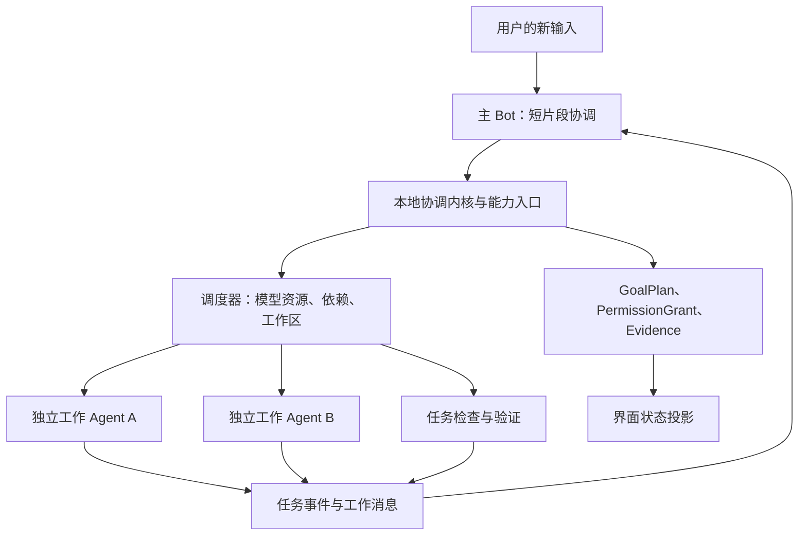

# ADR 91：主 Bot 自主协调、并行调度与取消重派

创建时间：2026-10-10
最后更新：2026-10-10

状态：Accepted（用户认可技术设计方向，并明确授予主 Bot 自主判断、取消错误任务和重新安排执行的协调权）。仅设计获认可，运行时实现及验收尚未完成。

级别：A（协调授权、取消/接手契约、能力与上下文准入），B（回合调度、任务事件与恢复），C（真实工作状态表达）。

关联：[产品北极星](../../design/product/peer-product-alignment.md)、[治理基线](../architecture/20-architecture-governance.md)、[ADR 80](80-project-agent-delegation-model.md)、[ADR 82](82-project-objectives-and-watches.md)、[ADR 85](85-project-agent-hosts-inputs-and-surfaces.md)、[ADR 88](88-project-agent-execution-continuity.md)、[ADR 89](89-independent-agent-delegation-and-communication.md)。实施卡：[主 Bot 自主协调](../../playbook/v0.1.0/autonomous-coordination.md)。

## 1. 用户要求与决策

主 Bot 是用户在项目中的持续协调者。用户交代目标后，主 Bot 自主选择推进方式，拆分工作、并行派发、查询进展、回答工作 Agent 的问题、验证结果、恢复执行和安排接手。用户可以在其他任务执行时继续提出要求。

用户进一步明确：新要求补充或纠正先前目标时，主 Bot 有权判断旧执行是否仍然正确；必要时自行取消正在运行的错误任务、重新安排正确任务。用户无需再次使用“取消”这个关键词或进入任务卡完成内部协调操作。

本决策将自主判断落成可执行契约：

1. 模型负责理解目标和选择处置；本地宿主负责处置的授权、顺序、执行与事实记录。
2. 新输入可以补充、调整、替换或取消已有工作，也可以创建独立并行工作。上一条消息的时间邻近关系不自动确定任务范围。
3. 正确任务可以在原进度上调整；已确认方向错误的执行必须停止。替代任务沿用有效工作，不能盲目从零重跑。
4. 同一原目标内的事件可以触发继续、补充检查、恢复、取消错误分支和换人接手，不要求用户反复交代同一目标。
5. 主 Bot 的协调权不取代本地 PermissionGrant、验证结论或实际执行记录。文件、网页、图片、工具输出和 Agent 消息没有用户授权效力。

## 2. RC11 源码核实的限制

核实代码基线：Peer-Agent `v0.1.0-rc.11`，提交 `438d1a6f52853ff55031fb351cb14625de554514`。以下是实现限制，不能单凭用户截图断言某条任务的现场阻塞原因。

| 限制 | 代码锚点（相对于 Peer-Agent 根） | 影响 |
| --- | --- | --- |
| 单项目串行 pump 等当前用户 job 结束；新输入仅中止 wake；待处理用户输入会合批 | `packages/runtime-node/src/project-agent/runner.mjs`，`takeNextJob`、`runRounds`、`enqueueUserInputs` | 长用户回合影响新要求的及时处理与分流 |
| 主 Bot 与工作回合共用模型执行名额；高优先级只排序排队者 | `apps/desktop/electron/main/agent-host/agent-turn-executor.mjs`；`project-agent/execution-scheduler.mjs` | 工作执行占满资源时，协调者也可能排队 |
| 准入占用按 delegation phase 与终态计算，未充分区别协调等待和实际资源使用 | `project-agent/execution-scheduler.mjs`，`occupying`、`inspect`；`session-supervisor.mjs` | 等待中的逻辑任务可能继续阻挡同类任务准入；不等于一定仍占模型回合 |
| 普通事件唤醒不能由历史用户消息授权新任务；目标唤醒另有宿主闸门 | `project-agent/delegation-provider.mjs`；`prompts/delegation/spawn_session.md` | 原目标范围内的自主补充和纠偏需要持久协调授权 |
| `supersedes` 的现有语义以暂停并保留旧任务为主 | `project-agent/session-supervisor.mjs`；ADR 80 | 尚未区分可恢复暂停与错误流程取消重派 |

已有 SessionSupervisor 会用 `awaitIdle:false` 启动独立 GoalRunner；底层已支持多会话并发、worktree 与 ADR 89 双向通信。本次复用这些机制，不能把当前产品限制描述为完全没有并行执行器。

## 3. 架构与职责

主 Bot 仍是项目唯一默认对话对象，保持读取与协调的能力模式；实际项目写入、Shell、浏览器/MCP 副作用由具备相应授权的工作执行者完成。任务保持独立 Conversation、GoalPlan、上下文与真实执行记录。

固定层级保持主 Bot → 工作会话 → 临时 Explorer/Verifier。扩大主 Bot 的协调权不隐含开放工作 Agent 递归派工、跨 Bot 任意寻址或无限群聊。

## 4. 自主协调的授权契约

在 ADR 88 既有协调 work 上增加持久的 `CoordinationMandate`；它不是第二份任务真值，也不是工具权限批准。拟议 Protocol 字段如下，最终 schema 在实施前按现有对象复用情况收敛：

| 字段 | 责任 |
| --- | --- |
| mandateId / workId | 宿主生成；关联已有协调工作 |
| workspaceId / parentConversationId | 可信项目与主 Bot 身份 |
| rootInputIds / revisionInputIds | 原目标和修改目标的真实 canonical 用户输入 |
| goalRevision | 宿主单调递增的目标版本；模型不能自行签发版本 |
| allowedActions | 在目标范围内的派发、补充、查询、验证、恢复、取消、替换、接手等协调动作 |
| taskBindings / materialRefs | 绑定的真实任务、依赖和已准入材料；引用有来源与范围 |
| permissionScopeRef / policyRevision | 现有权限和项目政策的引用；执行时重检，不冻结成永久通行证 |
| budgetRef / lifecycle | ADR 88 既有工作预算引用以及 active、paused、cancelled、fulfilled 等协调生命周期 |

模型可自主选择任务拆分、处置、执行者、先后关系，以及配置与角色路由政策允许的模型。已开始的执行保留冻结配置；换执行者或模型通过新的执行 attempt 绑定，不在回合中悄悄改写。

普通事件唤醒可通过有效 mandate 在原目标范围内推进相关工作；扩展现有 `spawn_session` 等能力的准入与执行二次检查。历史消息本身仍不能授权任意新目标。ADR 82 长期目标、探测和通知的独立政策不被本契约自动替换。

宿主检查身份、目标版本、任务父子关系、材料范围、动作类别、取消状态、政策与 PermissionGrant。模型对语义关系的判断作为有来源的决策记录保存，不能声称宿主 schema 校验能够证明模型理解正确。

新用户要求即是相关目标调整的依据，不为正常补充、纠偏、取消、重派再追加一个人工确认流程。确实缺少目标信息、要求有实质歧义，或本地已有政策要求决定时，主 Bot 提出一个具体请求；无关任务继续推进。

## 5. 输入路由与目标修订

每条输入保留独立 inputId 和处置回执。模型提交结构化 `CoordinationDecision`，包含 inputIds、受影响 task/work、expectedRevision、动作、理由及原始来源；宿主校验并落盘。可以一次理解多条相关输入，但不得丢掉每条输入的身份、范围和处理结果。

| 关系 | 默认处置 | 处理要点 |
| --- | --- | --- |
| 信息补充，原成功标准仍成立 | augment | 给原 Agent 排队补充信息，下一安全点读取 |
| 方法或范围调整，已有执行可以继续 | revise | 持久目标修订并要求执行者确认新版本；修改验证绑定 |
| 明确改变目标，旧执行已不适用 | replace | 取消错误执行，创建关联的替代任务 |
| 用户指出实现对象或执行方向错误 | replace 或 revise | 主 Bot 自主判断能否安全沿用当前执行；继续错误操作的分支必须停止 |
| 用户要求停止且无替代目标 | cancel | 停止指定任务及其专属执行后代，保留真实记录 |
| 独立新工作 | parallel | 独立任务；原任务不受影响 |
| 只询问进展或回答已有问题 | query / answer | 不重建任务、不把问题答案当成新能力授权 |

引用/回复对象是可信范围线索，原始 input/task 绑定由宿主校验；不能仅依据“上一条消息”取消另一件工作。范围拿不准时先做无争议的查询、补充与并行工作；不能伪造明确的人类取消事实。

收到新版本后，宿主及时登记旧版本的执行约束。纯信息补充可在安全点生效；改变正确性的修订必须阻止旧版本启动下一次不再有效的操作，直到执行者接纳新版本或进入替换流程。

## 6. 取消与重派是可恢复的协调操作

复用既有协调 action/outbox 记录新增 `TaskTransition`，至少包含 operationId、mandateId、sourceInputIds、decisionSource、expectedGoalRevision、oldSessionId、replacementSessionId、reason、executionEpoch 和处理 phase。模型不能任意指定他人 epoch 或伪造停止回执。

主 Bot 自主纠偏的取消记录 initiator=project_agent 与对应用户目标/事件来源；decisionSource 区分用户直接要求、Bot 目标纠偏和执行修复。主 Bot 有权自行决定取消，不需要用户给出明确取消用词，但不能把自己的协调决定冒充用户点击过取消按钮。

phase 表示替换操作的进度，例如 recorded → stopping → ready → started → completed；awaiting_outcome 和 blocked 表达未知副作用或真实闸门。它不覆盖 GoalPlan 自己的执行状态。

### 6.1 时序

1. 校验本次新要求与目标范围，以稳定 operationId 持久化替换意图、取消原因和替代任务规格。
2. 废止旧执行者开始新操作的资格，向现有 GoalRunner/工具执行器传播结构化取消；不得等待新任务成功启动才停止已确认错误的流程。
3. 对运行中工具执行正常取消或等其安全收尾。结果未知时记录实际调用及 Evidence 关联，进入 awaiting_outcome；不能将“请求停止”显示成“已取消”。
4. 汇集旧检查点、有效产物、未完成工作、已失效结论与执行结果。项目文件修改不因为取消自动全部回滚。
5. 建好绑定新目标版本的替代会话、准入配置和交接材料。相同目录的新写执行须等旧副作用已确认、写资源可以安全交接。
6. 调度器接纳后启动替代执行；排队、隔离失败或权限等待显示真实原因，不能暗中恢复错误方向。
7. 按宿主记录生成处置回执与公开说明。旧会话以 cancelled 并带 replacement 原因/关联保留；暂停用于用户暂缓等明确可恢复场景。

取消计划和创建替代计划跨越多个持久操作，采用可重放的协调过程；不能宣称跨提供方或外部系统具备原子事务。重启扫描依据落盘意图补偿缺失步骤，不重复取消/创建，也不把用户原要求重新派发一遍。

替换尚未完成又收到同目标的新修订时，以宿主提交成功的最新 goalRevision 为准。尚未启动的旧替代规格失效；启动前重新检查版本。已开始的旧替代执行进入相同停止/交接流程。保留每条输入的处置回执，不能出现多个替代者同时认为自己拥有当前目标。

### 6.2 执行版本与迟到结果

每次接手绑定新的 executionEpoch；本地执行入口在工具开始、检查点/报告提交和结果签收前核对当前目标版本、执行身份及状态。旧执行者的迟到结果保留为当时发生的历史事实，不推进新目标的完成或接受状态。

已经开始的外部副作用无法靠版本校验撤销。先查询/对账实际结果，再决定补偿；不可查询时明确保留 unknown。禁止以恢复或重派为理由直接重放未知写入。

已经完成或已签收任务不被改写为“从未完成”或强改 cancelled。新要求创建关联的纠正工作，旧结果对新版本的适用性另行标记；结果就绪时发生纠偏，需要撤销旧结果对当前目标的自动交付资格，而不删除原报告和 Evidence。

### 6.3 取消范围

- 取消当前任务连同其专属临时执行者及排队操作；只停止主 Bot 当前回复仍是独立动作。
- 共享依赖不随一个使用者取消；标记其产物适用范围。依赖错误结果的任务暂停相关步骤，由主 Bot 决定重算、调整依赖或取消，不自动杀掉无关任务。
- 不因取消删除真实用户数据、工作目录、报告或 Evidence。worktree 清理遵循已有保留与回收规则。
- 用户取消 root 目标后，相关 mandate 关闭；迟到事件不得自动恢复或再派发该目标。

## 7. 短协调回合与资源调度

主 Bot 的项目 actor 保持单写者、有序状态提交；回合改为可以保存进度的短执行片段。新输入在安全点优先处理，工作事件按相关性与公平性进入队列；长用户回合也能让出，不只允许抢占 wake。

安全点检查必须进入内层模型/工具循环，不能只改外层 runner 的轮数。已落盘 Tool Result/Evidence 后保存检查点和剩余预算；新输入到达不触发整轮从头重做。提供方请求可按 adapter 能力停止/让出；无法中断的请求如实等待，不承诺绝对响应时延。

| 资源 | 决策 |
| --- | --- |
| 全局模型名额 | 区分 coordination 与 work；初版在总上限内预留 1 个协调名额，例如总 4 时 1 协调 + 3 工作；多个项目公平分享协调名额 |
| 上限为 1 的渠道 | 安全点交替执行；等待主 Bot 答复的工作先释放模型资源，明确表达排队，不能假称物理并行 |
| 工作准入 | waiting_agent/waiting_user 等逻辑存活状态不等于正在消耗计算；拆开准入占用与执行租约 |
| 工作区修改 | 同目录写入互斥；宿主核实的 worktree 写入可独立执行；等待不必释放仍有风险的写资源 |
| 临时审查与验证 | 进入同一预算和资源管理，避免协调回合嵌套占槽造成等待环 |
| 渠道限制 | Provider 并发、速率和成本约束继续独立生效；预留协调不超发请求 |

初版不借出协调名额，减少不可抢占请求造成的饥饿。后续借用须有真实可撤回的执行片段与公平性证据。只读准入数沿现有配置/政策，不以放宽固定数量代替等待状态修复。

## 8. 事件、通信与接手

沿用 ADR 89 的具名独立 Agent、双向 AgentMessage、ProjectInbox 和 waiting_agent。工作 Agent 提问后退出当前执行片段；主 Bot 可以自行查询、回答、安排检查或替换失败执行者。有真实人类等待时，Agent 答复不批准权限、不消耗人类问题。

报告就绪、验证结论、提问、依赖满足、执行中断、用户输入和资源可用变化触发协调。关联的任务版本改变后，协调者重新取得事实快照；同一事件去重，但新版本或新问题不能被旧处理回执吞掉。

换人接手优先保留原 WorkSession/GoalPlan 与目标，新增执行 attempt/epoch。只有目标改变或任务身份确实需要替换时才创建新会话。交接包包含目标版本、检查点、产物和 Evidence 引用、未决问题、失败原因、执行工作区与权限引用；不能把完整项目历史和无关附件全部复制给执行者。

事件交付采用至少一次与稳定 ID 去重；本地协调动作幂等，外部副作用未知时走对账。watchdog 只检查实际过期执行、缺失交付和异常租约，不周期调用模型重复查询没有变化的任务。

## 9. 验证、签收与预算

主 Bot 可在原成功标准范围内追加检查、修复失败项和安排复核。目标修订后，宿主将验证绑定到对应目标、执行与产物版本；旧版本通过不能直接关闭新版本。

完成仍由真实任务报告、不可下调的验证下限和结果政策决定。符合自动签收政策就由系统收下，不能让主 Bot自行创造“你去卡片亲手验收”步骤。既有真实人工标准、工具权限及交付政策继续生效。

沿 ADR 88 区分执行片段结束与真实工作预算耗尽。让出片段保存累计费用和进度，继续不能刷新预算。重试/替换有持久的无进展和失败统计：同目标版本、同失败事实反复重派不算新进展；明确用户修订有新来源，但不重置此前实际用量。到达真实预算或不可恢复阻塞时说明具体原因，保留任务现场。

## 10. 持久真值与 Module 接口

不新建 Project/Task 表或第二套完成状态。沿现有协调 work、Conversation、GoalPlan、执行租约、权限与 Evidence 记录进行加法扩展；若实施确需新增持久文件，必须先登记数据存储 scope 与恢复/迁移规则。

| Module / Seam | Interface 与不变量 | 实现方向 |
| --- | --- | --- |
| Input Routing | 每条输入的身份、绑定、处置与目标版本 | 现有输入队列、Protocol 与协调 reducer |
| Coordination Kernel | 接受版本化决定，保存待办、transition 与事件游标；不拥有完成真值 | 扩展 ADR 88 内核与持久 Adapter |
| Execution Scheduler | 协调/工作名额、依赖、工作区资源、公平性与取消 | 现有 scheduler 深化资源接口 |
| Session Lifecycle | 修订、停止、恢复、接手与版本检查；一个执行拥有者 | 从 Supervisor/GoalRunner 提取深 Module，原宿主只装配 |
| Delegation Provider | mandate、调用身份、项目范围与执行二次检查 | 既有 Provider/Manifest/Projection；小接口接入协调内核 |
| Context Admission | 角色规则与有界相关事实分别进入注册 Source | L1 静态协调规则；L7 当前授权引用、任务快照和工作消息 |
| Product Projection | 原目标、替代关系、实际 Agent 状态、真实待处理请求 | 共享状态投影；Renderer 仅表达与发送 typed command |

所有动作继续经过 Capability Provider → Manifest → Runtime Projection → Tool Call → PermissionGrant → Evidence。不能在 renderer、prompt 或主 Bot 自建脚本中直接取消进程、写文件或批准权限。Desktop/TUI 共享运行时契约；不向 god module 继续堆业务。

## 11. 界面表达

派发完成后主 Bot 可以结束当前公开回复，后台 Agent 继续工作。Bot 正在思考与项目有任务正在执行分开表达。工作区可显示“2 项正在推进，1 项需要你决定”，不把所有后台工作包装成一条无期限的“正在回复”。

用户修订时简短说明正在调整的对象和处理方式；确认停止后才能说已停止。可以表达“我会停下气泡圆角的修改，改为检查引用卡片，已有检查会保留”，其状态由真实事件更新。

原任务的取消原因、替代关系和有效产物在详情可查；无关任务不跳动、消失或被重建。消息间距、Bot 颜色、圆角、SVG 图标、气泡右侧 hover 详情、右侧技术信息与 reduced motion 沿既有设计规则。

## 12. 兼容与决策覆盖

1. 本 ADR 对新版本协调工作生效；旧记录不补造授权、目标修订或取消事实，旧任务先从已有真实用户锚点和范围恢复。
2. 部分取代 ADR 80 的长用户回合不可让出、模型名额无协调保障，以及“所有取代均暂停且可直接恢复”的实现政策。普通明确暂停仍可恢复；已确认错误流程取消后不会自动复活。
3. 扩展 ADR 80/88 的普通 wake 准入：由有效 mandate 允许原目标内的相关动作；无 mandate 的历史消息限制仍保留。
4. ADR 89 的通信身份、waiting_user 保护、事实上下文与固定层级保留；本 ADR 增加工作资源释放和接手版本契约。
5. 已完成/已签收历史保持原事实。经典聊天能力与用户数据不迁移；不改写历史会话 jsonl。

回滚时停止接纳新的自主协调动作，保留 transition、旧产物、Evidence 和任务关联。已登记的取消继续安全收尾；未开始的替代任务停止自动启动。不能因为功能回滚让已确认错误的旧任务自动恢复。

transition 记录 schema 与最低执行器版本，新宿主接手前核对支持能力。受控降级前必须停止执行宿主并安全收尾进行中 transition；存在未知副作用时拒绝自动降级。既有旧版不能凭空理解新增 epoch，不能承诺“忽略新增字段即可安全执行”。用户自行运行不支持该契约的历史版本属于未保证的混合执行场景，发布说明必须明确；升级测试与受控降级测试分别记录。

## 13. 验收矩阵

| 验收故事 | 必须证明的事实 |
| --- | --- |
| A 执行时用户提出独立 B/C | A 继续；新输入得到独立处置；具备资源时实际执行区间重叠，不能只展示 started 标签 |
| 用户将“气泡圆角”纠正为“引用卡片圆角” | 无第二次取消确认；旧错误流程不能启动新操作；新任务获得新目标和有效交接 |
| 补充说明且原目标正确 | 原计划继续，补充在安全点消费；不无谓取消重跑 |
| Agent A 等主 Bot 回答且其他工作占槽 | 协调有执行机会；A 释放计算等待，B/C 持续；无槽位等待环 |
| A 等真实人类决定 | B/C 可继续；工作通信不批准 A 的权限 |
| 用户取消 A 或 root 目标 | 精确停止范围；B 不受影响；迟到事件不复活取消目标 |
| 工具运行中取消、超时后结果未知 | 请求停止与停止完成分开；真实结果核对；不重放未知写入 |
| 替换中各持久步骤崩溃、重复事件、双宿主竞态 | 稳定 operationId；单执行拥有者；恢复原 transition；不重复新建任务 |
| 替换尚未启动又收到下一条同目标纠正 | 旧替代规格失效；最新版本只有一个执行拥有者；每条输入有回执 |
| 接手后旧 Agent 回报/试图写入 | 开始新操作与状态提交被版本闸门拒绝；已发生结果保留为历史 |
| 已完成结果收到纠正 | 原完成事实保留；纠正工作关联新版本；旧验收不能关闭新目标 |
| 并行同目录修改与 worktree 隔离 | 写资源互斥；独立目录实际隔离；结果验收与合回政策区分 |
| 恶意文件、网页或 Agent 消息要求取消其他任务 | 不生成用户修订，不扩大 mandate、材料范围或 PermissionGrant |
| 升级、受控降级与功能回滚 | 数据不丢；已取消错误任务不复活；未收尾或未知副作用拒绝受控降级；不把旧宿主的未知字段忽略称为执行兼容 |

定向 reducer、协议、权限、取消、调度、恢复与 Context 测试加上实际 GoalRunner/Provider 集成。修改 UI 后执行完整产品 capture、逐张 AI 审查、review.json 和 verify，明确 independent 状态。

最终产品验收要求真实模型与安装版执行上述并行、插话、纠偏、通信和重启场景；记录模型、渠道限额、实际执行时间、来源版本、任务/事件 ID 与 Evidence。源码模拟截图或脚本化认知不能单独证明自主调度质量、真实网络时序或物理并行。

## 14. 实施顺序与当前状态

R91-01 协调契约、输入路由与目标修订 → R91-02 短片段与协调资源保障 → R91-03 安全取消、替换与接手 → R91-04 mandate 事件推进与通信补偿 → R91-05 真实投影及安装版并行验收。

设计记录和实施卡已完成；2026-10-10 用户明确授权按此设计实施，当前进入逐卡实施。运行时代码与验收结果按实施卡回写，尚无新的 RC 发布。本 ADR 的 Accepted 表示用户认可方向和主 Bot 自主协调权，不等于运行时已经交付。
