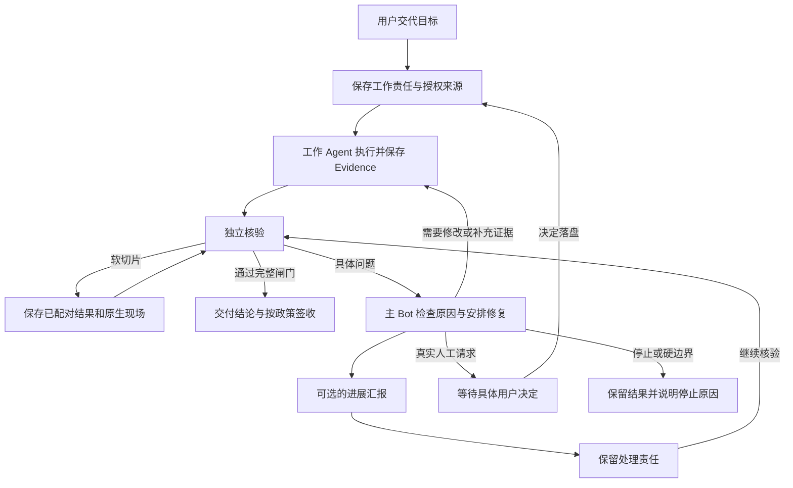
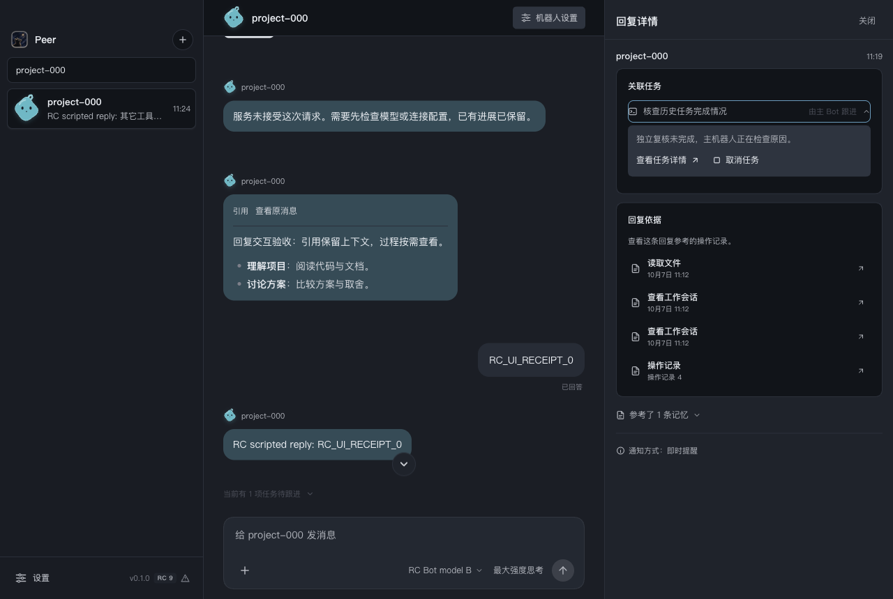
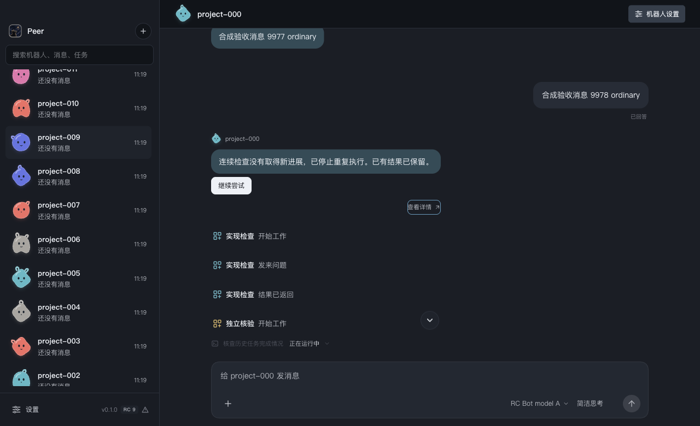
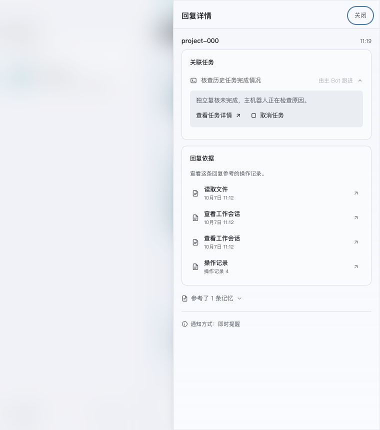
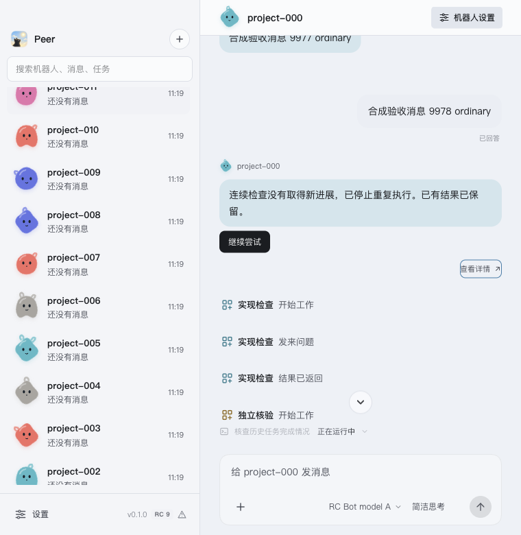

# ADR 93：复核续跑与未完成工作的处理责任

> 2026-10-18：系统默认累计工作上限及核验累计次数/总截止由 [ADR95](95-progress-driven-execution-policy.md) 取代；显式用户预算、用量记账、单次调用超时和安全恢复边界保持有效。

创建时间：2026-10-18  
最后更新：2026-10-18  
状态：Accepted（用户明确要求“出完整的修复 ADR 文档，然后着手根治这个问题”；本决策先于实现记录）  
级别：A（状态、续跑、错误及持久化契约），B（协调与核验运行时）  
依赖：ADR 80、83、85、88、89、91、92；产品方向沿用 `design/product/peer-product-alignment.md`。

## 1. 问题与现场证据

RC15 的实际任务已经完成代码与隔离产品回归，却在独立复核失败后停下。主 Bot 发出“独立复核仍失败，尚未验收”的汇报后，没有保存后续处理责任。此处没有未回答的人类问题，也没有未批准的人工标准。

已核实的故障链：

1. 两次核验运行均因桌面 Verifier 固定 12 轮的限制退出。该限制被当成执行失败，原生上下文没有用于接续。第三次异常被抹成 `verifier_failed`，不能反推第三次也由轮数导致。
2. `verify_session` 捕获异常时丢掉具体原因。另一次 focus 超过 500 字被拒绝；查询协调状态却要求先给出查询才知道的 goalRevision。
3. `deriveSessionFacts` 将所有 `runner.blocked` 映射为 `waiting_user`。Watchdog 再为每个 blocked 合成一条 question，即使没有真实问题。
4. 父协调器将一次成功汇报视为该批次处理完毕：子任务被误判为等待人，父责任进入 waiting_user，waitFor 为空，事件已处理且没有自动续跑责任。现场父预算仍有余额。
5. 旧任务无 ADR91 mandate，查询与修复不能依赖新任务才有的绑定；成功重查只允许关闭只读任务，对已经完成写入、仅剩复核的任务也不能收口。

以上来自本地持久事实及生产函数的内存重现，不通过修改用户数据修饰状态。具体会话正文和机器路径不进入架构文档。

## 2. 目标与不变量

- Bot 对已经授权且未完成的工作持续负责，包括检查失败原因、继续复核、修复和交付。普通进展汇报不能消除责任。
- “等待用户”必须由真实的人类请求支撑：计划批准、工具权限、待答问题或人工验收。技术阻塞由主 Bot 接手；无法自动恢复时明确标识系统阻塞。
- 软切片只让出执行权。硬预算、总截止时间、权限拒绝、取消、未知工具结果和无进展保护仍限制自动执行。
- 继续核验保留已配对 Tool Result、Evidence 和原生 Provider 上下文；不重做完成的写入，不将报告或聊天文本当权限、证据或人工签字。
- 通过仍需要当前版本的完整闸门。独立复核不是实现者自审，也不等于签收、安装、合并或发布。

## 3. 顶层 Module 与责任

| Module / Seam | Interface 与责任 | Implementation 落点 |
| --- | --- | --- |
| Session Facts | 输出执行状态、真实 needsUser 和技术阻碍；真实终态和人工请求优先 | Protocol 纯投影；Runtime 从计划、活跃核验和问题事实装配 |
| Continuation Obligations | 从当前关联 Session 推导未解决责任；控制汇报后的 runnable / waiting / blocked | 既有 ProjectWorkReceipt 与协调 checkpoint；不另建任务表 |
| Verification Continuation | 有限核验切片、累计额度、原生 checkpoint、版本绑定、格式重试、取消与超时 | 独立共享 Module；桌面 Executor 只适配既有 Provider Loop |
| Verification Failure | 保留 code、message、下一步，按类别决定能否继续 | Session verification 及 report decoder 共用失败归一化 |
| Verification Settlement | 不重放 Worker，重算全闸门后关闭纯复核阻塞 | 既有 GoalRunner completeRecheck Seam |
| Coordination Discovery | 查询真实当前版本，不要求模型先知道版本；修改仍 CAS | 既有 coordinate_work 的只读 query 分支 |

本地执行链仍为 Provider → Manifest → Runtime Projection → Tool Call → PermissionGrant → Evidence。UI 和 System Context 都不签发执行事实。

## 4. 状态与处理责任

1. cancelled / failed、已签收、取消或接手等待未知结果等权威终态沿用原优先级。
2. 有真实未解决的人类请求才是 waiting_user。`runner.waiting_user` 与宿主 `waitingOnUser` 继续表示真实请求；普通 blocked 不生成 question。
3. 活跃核验显示 verifying，即使之前的 runner 仍记录旧复核阻塞。持久 verifying 标志不证明活跃执行。
4. 技术 blocked 投影为既有 waiting_agent，表示主 Bot 应接手，不引入与任务存储竞争的新状态。实际 blockedReason 保留。
5. 父 Bot 汇报后，关联 waiting_agent 仍使工作 runnable；未答的子 Agent 工作问题也由父 Bot 处理。正在执行的子任务继续等待真实事件；真人请求进入 waiting_user。
6. 无进展、硬预算、明确停止、Provider 不能恢复或未知结果优先，不能被“仍有责任”覆盖成无限自动运行。

责任由当前 Session 的身份与版本推导，存入既有 receipt / checkpoint。事件 handled 表示责任已转交给持久协调工作，不能表示目标完成。父任务恢复时重新读取 Session；已取消、被取代、暂停、签收或版本变化的对象不因旧快照复活。技术等待不能吞掉其他任务和新用户输入。

旧 waiting_user receipt 仅在宿主当前事实证明所有相关等待均无真人请求、确有 waiting_agent 且已有有效 checkpoint 时转回 runnable。不改旧人工决定、目标正文、原始消息、完成历史或预算。无法解析的旧责任保持可诊断，不猜测其授权。

## 5. Verifier 的有限续跑

### 5.1 两级限制

12 轮改成核验软切片：Provider Loop 在一批工具结果配对后返回 yielded 与原生 checkpoint，不抛出“任务失败”。宿主在同一次独立核验责任内继续该上下文。每个核验责任另有有限累计请求 / 工具额度与原有最多 5 分钟总截止时间；格式修复也计入同一额度。有关联工作预算时仍经既有 WorkBudgetGuard 累计，不为重查、重启或切片重置真实 allowance。

默认核验责任最多 96 个模型轮次、512 次工具调用；这是最后的安全边界，不是每片重置的额度。用户或全局工作预算更小则先停止。不能声称请求数可以精确限定 Provider 费用；真实物理 dispatch 仍由原计量入口预约。

续跑元数据在 dispatch 前保存预约计数；存储或全局预算在后续准入拒绝时，预约可以保守计入已花额度，不能把未知计量当零。只支持旧 Adapter 结果计量的端口在片尾保守扣除；Desktop 的正式链路覆盖每次物理 dispatch。

### 5.2 恢复状态

已有 GoalPlan.runner 增加可选核验续跑元数据：源版本、模型身份、累计消耗、截止时间、原生 checkpoint 引用、格式重试阶段及 indexed tool result refs。原生内容放入已登记的 projectRuntime/checkpoints；元数据不是 Evidence，也不是新 Context Source。Provider Encoder 仍负责原生格式，恢复时经现有 providerCheckpoint Seam 读取，不能把内容提升成系统指令。

有本地工作区协调存储的委派核验可跨宿主恢复；没有该端口的普通 Goal 仍支持本次调用内的软切片，但不宣称跨进程恢复能力。恢复前重检宿主租约、计划源版本、模型、停止状态、截止时间和剩余额度。已关闭/取消或源变更的责任不能使用旧 checkpoint。保留已知调用结果，不从文字摘要重造调用；未结算 dispatch 沿 ADR92 后续恢复审计处理，不能直接重试。

每个计划同一时刻最多一个独立核验 continuation。持久化失败立即停止，不假装保存成功。checkpoint 缺失、损坏、身份不符返回明确错误，不静默从头运行。旧未保存原生现场的失败可以开始一次新的有界核验，但保留原失败历史与工作累计预算。

### 5.3 失败处理

| 结果 | 后续 |
| --- | --- |
| 软片结束 | 保存已配对现场并继续，不向用户报任务失败 |
| 合法失败报告 | 保存具体未通过项、证据和修复建议，主 Bot 决定修复；不冒充通过 |
| 格式不合法 | 一次有界格式修复；仍非法保留具体错误 |
| 取消 / 权限拒绝 / 超时 / 真实预算耗尽 | 立即结束这次自动执行，保留原因；不扩大授权、自动续期或另起任务逃避限制 |
| 工具结果未知 / checkpoint 不可用 | 系统阻塞，先核对执行事实，不重放副作用 |
| 重复观察且无新事实 | 既有无进展保护终止重复调度并交付明确阻碍 |

异常原始 message 有界保留；`verifier_failed` 是类别，不再替代全部诊断。返回当前阶段和可采取的下一步；路径、密钥和整段 Provider payload 不无差别暴露到主回复。

## 6. 安全收口、旧任务与工具发现

成功重查可关闭“所有叶子任务已完成，仅剩 verifier_failed / verification_gate_failed”的空闲委派任务，包括之前写过文件的任务。必须同时满足：目标与报告版本相同、当前 host independentVerifier 通过、完整 gate 通过、无活跃 Worker/Verifier、无停止或取代、无未满足的 UI 交付闸。原命令、人工标准、产品回归和交付证据不得绕过。仅修改 runner 收口状态，不重新执行 Worker，不自动 merge / install / release。

coordinate_work query 只读回当前主 Bot 所属 Session 的当前事实与可用 goalRevision。没有 mandate 时返回明确 legacy 状态与当前事实；不通过查询自动制造 mandate、扩大权限或启动执行。后续写动作继续要求真实来源锚点、现有协调准入和 expectedRevision。工具 schema 明示 focus 的 500 字上限，减少“调用时才发现”的反复。

## 7. 实施顺序

1. 以实际故障链建立确定性回归：技术 blocked 被误判、汇报后丢责任、12 轮失败、原因被吞、写任务重查不收口、查询需要预知版本。
2. 改 Protocol 事实投影及 Watchdog，保留真实人类请求。
3. 新建核验续跑 Module，适配既有 Executor 的 soft yield 和 providerCheckpoint；在既有存储与预算 Seam 持久化。
4. 补充父协调责任与旧 receipt 恢复，保留取消、预算、未知结果及无进展边界。
5. 修复诊断、只读发现和纯复核收口。
6. 聚焦测试、受影响包全测、build/typecheck/architecture；若用户可见投影或文案变化，执行产品 Capture → 全图实施者自审 → Verify。

## 8. 验收与限制

必须覆盖：跨 12 轮继续并返回合法带证据报告、格式修复累计计量、恢复不重复读/写、源版本与模型变化、重启/缺失 checkpoint、持久化失败、取消/超时/拒绝、累计预算、并发核验、真实人工请求不被清除、写任务验证收口、无副作用重放、父汇报后仍可继续、旧 receipt 恢复及查询零变更。

使用生产入口与可控模型复现调度；真实 Provider 网络与模型语义质量单独记录。产品截图的实施者自审必须标 independent=false，不冒称独立复核。本次不修改真实用户任务和授权，不替换安装版，不含合并与发布。交付记录补充实际通过项及未覆盖项，不能只依据本 ADR 计划称已完成。

## 9. 迁移与回滚

新增字段为加法式；旧读者忽略 continuation 字段，旧失败记录保留。新读者只从经过校验的宿主续跑元数据恢复，不给旧文本补造 checkpoint、批准或通过证据。回滚代码不会撤销已发生工具结果；暂停自动恢复后仍保留原日志供诊断。未解析/未结算的记录不得因为回滚而自动重派。

## 10. 取舍

没有选择直接增大每次 Verifier 轮数：它仍会在下一次上限处丢现场。没有选择让 prompt 说“你必须继续”承担执行保证：持久责任、调度与权限必须由宿主落实。没有选择复核失败就让用户重新发消息：这会把技术恢复工作转嫁给人。有限切片与累计限制增加了状态校验，但将调试集中在两个 Module，能够实际验证何时继续、何时停止以及谁负责。

## 11. 实施落点（2026-10-18）

代码：[Peer-Agent PR #163](https://github.com/ly-ccx/Peer-Agent/pull/163)。独立基于 RC15 开发线，不混入尚未合并的 PR162。

| 决策 | 实施与验证 |
| --- | --- |
| 真实处理责任 | Protocol / Runtime Session Facts 区分真人与技术阻塞；Watchdog 不为空技术阻塞合成问题，稳定 repairRevision 触发主 Bot 跟进事件 |
| 汇报后继续 | RepairOwnership Module 和 ProjectWorkReceipt.repairSessionIds 持有责任；父 Runner 已完整发出的进展回复之后继续新的推理步骤，读取当前事实，不重放旧工具 |
| 真正无进展时说明原因 | 进展话术不参与修复进展指纹；反复换说法仍被识别为同一阻碍。停下时保存明确的 agent_no_progress 回执，界面说明停止重复执行和已保留结果 |
| 核验软切片 | VerificationContinuation Module；Executor 合并原 WorkBudgetGuard 与续跑预约，不覆盖原 guard；既有 Provider Loop 的 yieldAtTurnLimit 和 providerCheckpoint 负责原生恢复 |
| 持久化与恢复 | GoalPlan.runner.verificationContinuation 与已登记的协调 checkpoint 存储；续跑端口检查来源、主体、模型、租约、原预算、未配对工具及截止时间；损坏元数据保留并拒绝，避免静默重置 allowance |
| 诊断与发现 | SessionVerification 保留具体 message、nextAction 和失败审计。coordinate_work query 不写协调日志、不签发 mandate，可先发现当前 goalRevision。focus 500 字上限进入模型可见 schema |
| 安全收口 | completeRecheck 用 settlement authority 重算完整 gate；所有叶子完成、目标与报告未变的写任务也可关闭纯验证阻塞。用户问题、人工标准、产品交付、停止及版本条件保留 |

生产链路集成测试实际通过 Verifier → Executor → Responses Loop → 只读文件 Provider 读取 13 个临时文件；12 轮让出后，第 14 个物理模型请求返回合法带证据结论。首片 Tool Result 保留在第二片请求中，13 个调用身份均唯一；核验累计与所属工作预算同为 14 请求、13 工具。传输响应由测试控制，文件读取、PermissionGrant / Evidence 和原生恢复使用实际执行链；不能称为真实云模型判断质量验收。

聚焦回归验证旧伪 waiting_user 恢复、父汇报后的继续执行、同一故障换话术仍停止、真正人工请求不被消耗、源版本变化、并发、取消、超时、拒绝、存储失败、缺失/损坏 checkpoint、格式重试累计扣除、旧失败历史保留及写任务无 Worker 重放收口。当前代码不修改真实用户数据，不为旧任务制造 mandate。

## 12. 实施验收记录

最终候选提交为 `7720e17428fe54b7e8b85178dff3a2ae8df13e2f`。完整机器记录和日志摘要见 [validation.json](../../playbook/v0.1.0/evidence/verification-continuity/validation.json)。

| 范围 | 实际结果 |
| --- | --- |
| Runtime Node 全包 | 1268 通过，0 失败，0 跳过 |
| Desktop 全包 | 5531 通过、5 个既有跳过；另 1 项 i18n 检查通过 |
| build / typecheck / architecture | 全部通过；架构检查包含 SVG 图标与圆角规则 |
| 产品闸门测试 | 6 项通过 |
| 生产入口集成 | 主 Bot 汇报后无需新用户消息便继续处理并交付；反复同义汇报在无进展保护下产生一条明确的停止回执 |
| Verifier 与真实工具 | 13 个临时文件、14 个物理模型请求、13 个唯一工具调用；跨 12 轮继续，无重复文件读取，累计工作预算保持一致 |
| 产品 Capture → Review → Verify | 158 张必需截图全部逐图实施者自审，最终 Verify 通过 |

本机最终包测试与 build/typecheck/architecture 对应 `3162b151`；随后 `29ab666b` 修正产品闸门对新无进展场景的预期重试状态；`57076c36` 与 `110bebd2` 修正受控夹具及原生快捷窗口的检查时序；`7720e174` 修复验收中重复发现的浮层动画提前卸载。此前截图包因缺少该预期而被闸门拒绝，没有改写旧包绑定来放行；修正后从最终提交重新生成全部截图并重新审阅。

最终产品包：runId `092e5c62-d349-4ef5-8666-9de054e2c44f`，sourceFingerprint `e1b30beba24716f60891fe228ce3fde2b86d9b4088a32729173af7081975bedb`。逐图观察、三个次要覆盖限制及哈希见 [review.json](../../playbook/v0.1.0/evidence/verification-continuity/review.json)，Verify 回执见 [result.json](../../playbook/v0.1.0/evidence/verification-continuity/result.json)。

新增状态的实际截图：

| 技术阻塞由主 Bot 跟进 | 无进展时明确停止原因 |
| --- | --- |
|  |  |
|  |  |

[最终 CI](https://github.com/ly-ccx/Peer-Agent/actions/runs/39092913859) 两平台通过：build、typecheck、architecture、全量 Test 和各自桌面烟测均通过。早期运行并非全绿：Linux 两次遇到更新弹窗在动画实际启动前便开始计算兜底期限，实际提前卸载；macOS 遇到合成图片授权在读取等待文案前到期、受控流式夹具在多窗口检查时超过其 30 秒等待。失败记录与取消的旧候选均保留在 validation.json，未冒称通过。

验收发现的附加 C 级修复集中在表达和夹具：Overlay 仍由既有基座表达，兜底先等 native animation.ready 再计算剩余时长，保留动画永不启动时的 2 秒退出上限；受控流式阶段的防死锁期限改为 120 秒、合成权限超时改为 10 秒；检查快捷原生窗口前显式 show/focus，不发送会重置被测状态的 shown 事件。正式 Provider/权限预算、超时及存储契约没有随夹具调整。相关 3 项夹具测试与最终桌面类型检查通过，最终产品包及 CI 覆盖实际桌面交互。

新候选均完整重新 Capture：保存失败提示或原生截图超时的候选没有放行；`110bebd2` 机器包虽通过，但在 Linux 动画缺陷修复后被取代，没有把其未完成的审阅冒称最终验收。`7720e174` 第一轮采集在短回复 hover 观察处超时，同源复跑完整通过，再审阅全部截图并 Verify；第一轮失败包未放行。

### 覆盖边界

这份产品审查的 `independent=false`：由实现者自审，不是另一位审查者或独立模型的结论。测试中的认知响应受控；文件读取、权限、Evidence、原生续跑和桌面主进程/Preload/Renderer 使用生产入口，但没有测试真实云模型的判断质量和网络时序。未替换安装版、未安装或发布 RC，也没有完整读屏器或长期使用验收。

截图审阅记录了三个次要限制：Quick Chat 浅色离屏透明图的黑底合成不能证明原生浅色对比度；预置旧失败会话的侧栏摘要仍含技术前缀。一张窄窗后台任务局部裁剪图抓到高度过渡，第二行局部截断，此图不作为稳定态纵向布局验收依据，其他完整任务截图中行文完整。本次新增的主 Bot 跟进和无进展主消息均使用明确中文。完整权限等待、允许后继续、拒绝、取消、停止、超时、完全授权多图，以及预算/未知结果的既有机器场景也通过，但不据此宣称所有真实模型行为已经穷尽。

2026-10-28：后续双向监督与连续工作设计见[ADR 111](111-project-agent-duplex-supervision-and-continuity.md)。本批源码、自测范围与限制见[实施回执](../../playbook/v0.1.0/code-structure-refactoring.md)；不将本次新增能力计入历史版本。
