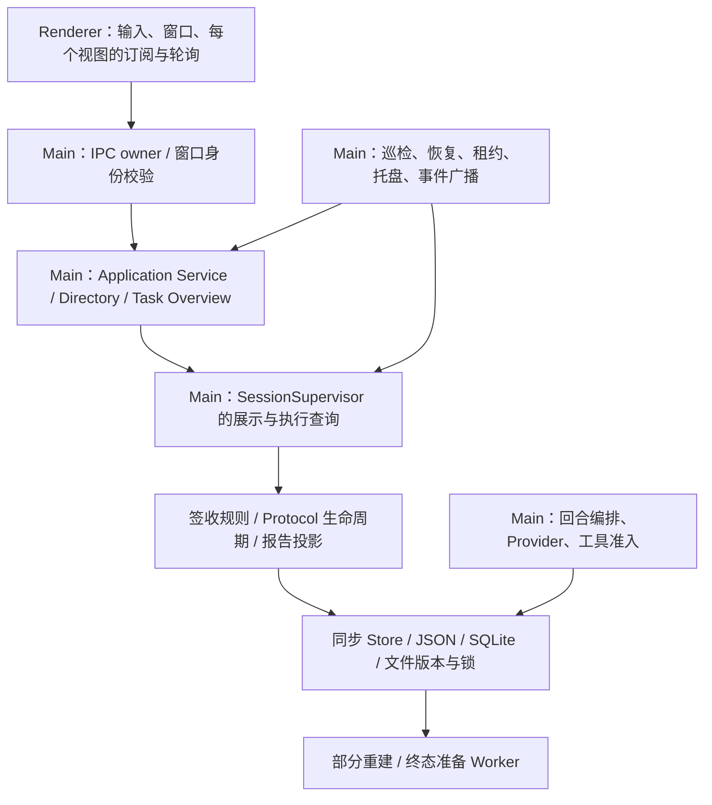

# Desktop 响应性与本地运行时架构审查

创建时间：2026-11-11
最后更新：2026-11-11
状态：审查完成；包含有限隔离实验，不是产品修复、发布验收或全部停顿的根因证明。

审查独立性：本轮由同一 Agent 取证、设计并自审，不称独立审查。

代码基线：Peer-Agent `b05b7afbf26b43444635f77710397c3a658d6a0f`，`release/v0.1.0-rc.41`，工作树无改动。现场为 macOS ARM64 安装版 `0.1.0-rc.41`。知识基线：Peer-Knowledge `7600b00`。初始打开的知识工作树停在 RC24；本次取回远端并在独立工作树审查当前决策，没有切换原工作树。

决策提案：[ADR 128](../decisions/128-local-runtime-isolation-and-bounded-query-contract.md)。实施顺序：[运行时隔离实施包](../../playbook/runtime-isolation-implementation.md)。机器收据：[隔离实验](../../playbook/evidence/runtime-isolation-feasibility-20261111.json)。

## 1. 能确认什么

用户描述的是跨操作、间歇发生的整体停顿。不能把找到一个慢函数等同于解释全部停顿，也不能把另一份负载上的测试通过等同于当前安装包流畅。

| 证据 | 实际观察 | 能支持的结论 | 不能支持的结论 |
|---|---|---|---|
| 安装进程 12 个 CPU 窗口 | main 峰值 38.3%；观察到的 renderer ≤0.2%、GPU 进程 ≤0.4%；整机 CPU 大部分空闲 | 存在主进程短时工作尖峰 | 没有验证所有页面、交互或 GPU 硬件利用率 |
| 本次启动以来的现有主循环日志 | 截止提取时 3,024 个窗口中 61 个 >100ms、34 个 >500ms，最大 3,949ms | 现场确实有长停顿 | 不能把 3,949ms 全部归因于某个查询 |
| 15 秒轮询与日志时间对齐 | 35 次空授权轮询中 33 次紧接 >100ms 主循环窗口，常见约 0.5 秒 | `list-obligation-grants` 是强关联调查入口 | 完成时间关联不是整段 0.5 秒的函数级耗时证明 |
| `refreshBadge` 慢定时器 | 同步回调 748–979ms；入口 `tray-controller.mjs` | 角标读取可长时间占用主线程 | 不证明角标是全部周期性停顿的唯一来源 |
| 同版本生产 Module 的隔离副本 | 空授权列表仍投影 23 个 session；每次调用完整证据索引 6 次，69,045 条 × 6 = 414,270 条；热查询 181–192ms | 已复现无结果查询中的历史计算放大 | 没有 live host binding，未完整复现现场 500ms |

安装包的 `main.mjs`、`tray-controller.mjs` 与审查源码哈希一致；runtime 的 bot-directory、session-supervisor、runtime-host 与本地构建 `dist` 哈希一致。源码与 dist 的格式差异不当作不同版本。没有重启、安装或修改个人任务；数据副本权限为 0700，未复制凭据/Provider 配置，未调用模型或工具，实验后删除副本。

原生 `sample` 的 V8 JIT 区段没有业务函数名，因此只用于确认线程状态，未将未知地址解释成业务根因。隔离 CPU profile 指向 `humanGateOf → acceptanceFacts → indexedRefs → readEvidenceIndex`；Inspector 启停本身的成本与业务段分列，不计入无 profiler 热查询结果。

## 2. 当前实际边界

`packages` 已分离大量领域 Module，但被装配回同一事件循环之后，文件分离没有提供调度和故障隔离。把函数声明为 async，也不会让它在第一个实际让出点之前的同步 JS、SQLite 和 JSON 工作离开主线程。

| Module / Interface | 当前实际调用与事实归属 | 问题 |
|---|---|---|
| Main composition / typed IPC | `apps/desktop/electron/main/main.mjs` 创建 Store、运行时、调度及窗口；IPC 调用本地服务 | UI broker 同时承担越来越多数据与业务工作 |
| Bot Directory | `project-agent-host.mjs` 注入 Supervisor、审批、问题卡及摘要读取；托盘也调用 `directory.list()` | 一个数字或列表预览可以进入完整事实构建 |
| Application Service | 空授权查询在筛选后仍调用 `sessionRows(workspaceId)` | 查询范围由下游完整 API 决定，没有在入口收窄 |
| SessionSupervisor | `list/get` 同时调用 `project`、`humanGateOf`、报告与版本计算；同一模块还负责 spawn、cancel、reconcile | 展示要了解命令侧的深事实，成本与权限规则耦合 |
| GoalPlan Evidence | `readEvidenceIndex` 缓存原始解析；每次返回仍对全索引归一化和派生，再由消费者筛选 | 有解析缓存仍有 O(全历史 × 调用数) CPU/分配成本 |
| Task Overview | `listTaskOverview → backfillCompletedPlanQualityReview` 可调用 `recordQualityReview` 和 `setRunnerState` | 读取会改变业务事实；展示、恢复与验证职责混合 |
| Storage / rebuild | Interaction、coordination 重建及终态准备部分使用 Worker；其他同步 SQLite、fsync、锁与序列化仍留在调用线程 | 把个别操作移出不等于守住主线程边界 |
| Watch / polling | 30 秒后台 sweep，加上视图的 15 秒兜底轮询、变更事件与托盘读取 | 各消费者各自防抖，缺少统一的成本与背压界面 |

Task Overview 的补写路径有现存自动化测试明确断言它发生。本次只确认代码与调用点，没有调用它处理个人计划，也没有依据 `completed` 认定那些历史计划实际通过核验。迁移时必须移除“页面读取制造自检通过”这一行为；缺少实际核验的旧记录须保留其缺口。

## 3. 为什么历次优化不能形成长期保证

ADR96 处理日志复用、头像与终态 worker；ADR98 继续收敛目录发现、历史投影、重复 clone 和托盘风暴；`104-progressive-interaction-and-coordination-storage.md` 引入增量协调存储、公开交互页和派生索引；ADR112 处理加载与 Module 职责；ADR121 固定会话窗口、preview 和 openSlot。它们都有明确价值，不能说此前所有修复无效。

遗漏在于这些决定主要约束某些数据/API 路径，没有建立系统范围的执行位置、查询复杂度、主线程工作上界和背压约束。新功能只要重新消费一个“完整事实”API，就能把历史规模带回 UI 主线程；同一底层缺口会表现成不同函数名。增加缓存还引入更多失效、克隆和内存复杂度，未必消除最坏停顿。

ADR98 保留了多轮峰值未通过记录，也记有 RC21 特定候选/负载的完整通过。后者是那次候选与场景的结果，不是后续所有 RC、历史规模或新功能的永久证明。本次不改写旧失败，也不把旧通过说成造假；需要补上可持续执行的架构门禁。

## 4. 进程边界的有限对照

在同一 Electron 实验宿主中，以同一隔离数据与现有 `SessionSupervisor.list`，两组各执行 16 次热查询；同一受限 preload 进行 120 次 renderer → main → renderer ping。只返回 session 数量，不把完整对象跨进程传输。后台 workload 与 IPC 采样都不执行业务命令。

| 指标 | 重查询在 main | 同一查询在 utility process |
|---|---:|---:|
| 单次查询 p50 | 187.86ms | 190.63ms |
| 单次查询 max | 217.59ms | 221.59ms |
| main 心跳最大间隙 | 219.68ms | 3.28ms |
| IPC 往返 p95 | 189.70ms | 0.30ms |
| IPC 往返 max | 209.60ms | 0.30ms |
| renderer 帧间隙 max | 10.40ms | 10.40ms |
| main CPU 时间 | 4,284ms | 133ms |

数据证明：在这个工作负载下，进程边界能保护 main 的 IPC 响应，同时查询总成本并未消失。没有测量 utility 进程 CPU 总量，不能据 main CPU 下降声称总能耗下降。两组持续时间不同，CPU 时间不是等时段利用率。

限制：这是本机、短时、热缓存、Playwright/Inspector 控制的结构可行性实验；ping 不是原生键盘输入。没有覆盖真实模型、全部 IPC、冷恢复、权限决策、执行命令、Windows/Linux、签名包或安装验收。第一轮启动超时，没有性能样本；修正实验入口的生命周期后才取得本表，失败单独保留。不得把这组结果称为应用修复完成。

## 5. 必须推翻与必须保留

推翻四个默认：重工作可以继续住在 Electron main；展示需要就能直接取得完整执行事实；读 API 可顺手修复业务状态；每个视图用自己的全量轮询兜底即可保证一致性。

保留产品北极星、统一能力链、Protocol 生命周期、现有用户授权/工具结果/Evidence、停止与 unknown 保护、单一 writer/fence、版本化 canonical 数据及既有工作恢复。新的进程不是第二个任务系统；读模型不是新的权威事实。是否改 Electron、语言或数据库，要由瓶颈与成本决定，目前证据不支持先做整栈重写。

## 6. 审查范围与未解决项

本次追踪了 Desktop 装配、IPC、主 Bot 查询、托盘、Supervisor、Evidence、巡检、会话索引与 worker、Desktop/TUI 共享宿主边界，以及相关 ADR。不是所有 Provider、MCP、Plugin、图像处理、Webview 和界面状态的逐行审计，也不是安全认证。

尚未取得 3.95 秒停顿的完整业务调用栈；现场约 500ms 与隔离约 190ms 的差值仍需给 IPC/查询/存储/诊断分别关联时钟、排队时间与业务段。已有慢日志使用同步追加和 console；它的成本也应单列测量，当前未证明它构成主因。不能用未知差值提前选择又一个小补丁。

下一交付是 ADR128 的分阶段实现：先建立可重现基线和查询预算，再迁移查询隔离、运行时隔离和系统 Adapter。整个产品的“已修复”只能由同规模、最终候选、连续交互与异常恢复共同证明。
