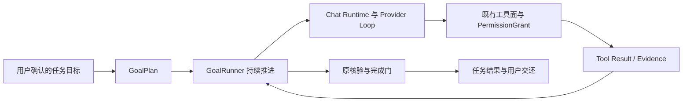
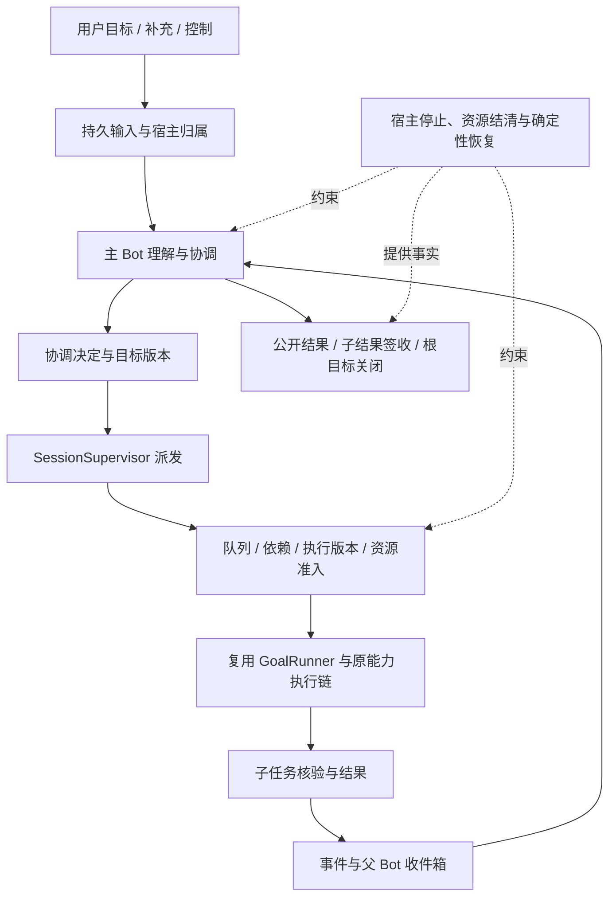

# 0.0.18 → RC35 任务链路可靠性审计与收敛计划

创建时间：2026-11-03
最后更新：2026-11-03
状态：只读源码与既有现场证据审计；收敛计划待实施，不是故障已修复或运行验收。

依据：[产品北极星](../../design/product/peer-product-alignment.md)、[架构治理](../architecture/20-architecture-governance.md)、ADR [80](../decisions/80-project-agent-delegation-model.md)、[85](../decisions/85-project-agent-hosts-inputs-and-surfaces.md)、[110](../decisions/110-follow-up-responsibility-and-current-list.md)、[112](../decisions/112-runtime-module-and-loading-boundaries.md)、[116](../decisions/116-session-control-and-resource-settlement.md)、[117](../decisions/117-intent-driven-coordination-and-goal-closure.md)、[119 提案](../decisions/119-user-stop-cognition-admission-and-settlement.md)。

## 1. 结论与判断边界

用户反馈：0.0.18 的任务链路使用顺畅，升级 RC 后连续遇到工程故障，尚未完整完成一个任务。该反馈是本次审计目标，不将其偷换为全体用户的失败率统计。

源码与现场支持的判断是：**任务执行器仍被复用，但其入口、恢复、资源、上报和关闭增加了交接条件；部分条件没有接齐，同一责任又被不同消费者解释成不同的执行行为。测试和发布记录不足以证明这些条件在真实模型、正式安装版与升级数据下组成了完整闭环。**

本次确认两个额外的静态接线缺口：资源等待在协议中合法、在运行时仍一律拒绝；活体所有权为字符串，根目标收尾却读取对象属性。它们与现场停止后续跑共同说明需要做契约整合，不能把所有故障归于模型能力或正常 RC 波动。

不据此认定全部新机制都应删除、旧版本从无缺陷、底层执行器完全没有回归，或每个新缺口都已在用户现场触发。没有执行模型请求、测试、构建、产品回归或变更生产状态；具体通过率、时延、费用和故障分布未知。

## 2. 固定核对对象与证据等级

| 对象 | 固定身份 | 用途 |
| --- | --- | --- |
| 稳定基线 | `v0.0.18`，peeled commit `a087988cc3a4382d780db62f7247d4b9d355636e`；注解标签对象 `9592a7461027bdd8b534d341b18806c3f5cb4607` | 追溯原 GoalRunner/能力/核验边界；不在真实数据上启动旧二进制 |
| 用户安装版本对应源码 | `v0.1.0-rc.35`，peeled commit `4a58e2846875f85de69915764a127096721c5b0d`；注解标签对象 `22ac216940f297a86189f0c473ae45bf5be3ca9f` | 本文源码行号以该冻结树为准，标签解析出的 commit 与发布记录候选一致 |
| 发布记录中的候选 | `4a58e2846875f85de69915764a127096721c5b0d` | RC35 回执所记冻结候选；只用于核对新增缺口在该候选也存在 |
| 知识基线 | `f952a447fc46a325f7c5b79267f35df21e5643b1` | Accepted ADR、RC34/35 发布及覆盖边界 |
| 当前代码工作树 | `5f78fb7992e122549b7f762a276e5dd6d86ba127` | 仅确认工作区状态；不拿其旧源码替代 RC35 |

本文源码链接绑定上述 peeled commit，区分注解标签对象与源码提交。实际安装产物身份另按原发布/安装回执核对，本轮未重新构建或宣称重建产物等于安装包。

证据分级：F=规范源码能直接确认的行为；I=既有真实现场记录确认；H=已有修复/发布记录中的历史事实；R=据以上推导的风险，尚未复现。单元测试源码只说明测试如何构造场景，不将静态阅读称为测试通过。

## 3. 两个版本的实际链路

### 3.1 0.0.18 已有任务自治

原版本已经有 GoalPlan、GoalRunner、多轮执行、Explorer、核验、证据门、暂停恢复、失败与无进展控制。新增 Bot 不能被描述为第一次赋予单任务自动推进能力。

原 pump 每轮读取同一计划、核对执行归属、调用 runGoalTurn、处理结果并进入核验/完成。参考 [0.0.18 pump](https://github.com/ly-ccx/Peer-Agent/blob/a087988cc3a4382d780db62f7247d4b9d355636e/packages/runtime-node/src/goal-runner.mjs#L1775)、[实际 runGoalTurn](https://github.com/ly-ccx/Peer-Agent/blob/a087988cc3a4382d780db62f7247d4b9d355636e/packages/runtime-node/src/goal-runner.mjs#L2096)。旧链路本身并非无状态或没有护栏；值得保留的是它的执行闭环与真实能力链。

### 3.2 RC 新增的是委托协调与多主体交接

父目标与子任务不是重复对象：前者表达用户原始委托，后者表达具体执行阶段。两者需要独立关闭，但不应各自另造权限或底层执行器。

新增交接的实际位置：Supervisor 创建/推广任务；goal-runner-host 将 delegated 计划接回 GoalRunner；Scheduler 检查 lease、当前 execution、running phase、依赖与资源；结果经父收件箱、reply delivery 和 intent disposition 返回。参考 [Supervisor 推广入口](https://github.com/ly-ccx/Peer-Agent/blob/4a58e2846875f85de69915764a127096721c5b0d/packages/runtime-node/src/project-agent/session-supervisor.mjs#L658)、[GoalRunner 接线](https://github.com/ly-ccx/Peer-Agent/blob/4a58e2846875f85de69915764a127096721c5b0d/packages/runtime-node/src/project-agent/goal-runner-host.mjs#L344)、[Scheduler 准入](https://github.com/ly-ccx/Peer-Agent/blob/4a58e2846875f85de69915764a127096721c5b0d/packages/runtime-node/src/project-agent/execution-scheduler.mjs#L273)。

因此，用户感知上的“只多一个自动调度层”，实际要求每个交接都保住旧链路的不变量。多个检查可以合理存在，但它们必须消费同一事实、给一致理由、具有合法解除出口；不能由各处分别猜测。

## 4. 逐段审计

| 段落 | 应有承接事实 | 核对结果 | 结论范围 |
| --- | --- | --- | --- |
| 输入 → Bot | canonical 输入、稳定身份、处理归属 | 持久输入/宿主机制已存在 | 本轮未发现它是所有失败的共同根因，不据此宣称全部输入路径正常 |
| Bot → 子任务 | 有效来源、目标版本、能力范围、一次派发 | Supervisor/协调 kernel 有相应机制；旧成功派发曾留下自占用保护 | H：已修复的历史路径，不冒称 RC35 仍未修复 |
| 队列 → GoalRunner | 当前执行绑定、可获得资源、明确等待与唤醒 | 资源等待上层协议与下层 adapter 不一致，见 F02 | F：可定位接线缺口 |
| GoalRunner → 工具 → Evidence | 原能力链、授权、执行、核验 | RC 仍沿原 sendMessage/goal 模式执行 | 原引擎可作为稳定化基底；没有用静态阅读证明其所有运行场景无回归 |
| 子结果 → 父处理 | 正确所属目标、结果版本、合法下一步 | sources 能吸入无 workId 的旧任务，停止责任能成为模型返修 | I/F：见 F01/F03 |
| 父处理 → 根关闭 | 当前覆盖判断、无未决义务、真实交付 | 活体条件读取错误；收尾 policy 在多处修正 | F/R：见 F04/F05 |
| 停止/重启 | 先封准入、宿主收尾、旧代次不复活 | 本次停止后仍启动五轮模型回合 | I：直接违反用户控制预期 |
| 发布 → 用户工作成功 | 正式安装版真实任务完整完成 | 有全量工程检查和产品自审，但相关恢复只到执行器入口/取消资源核对 | H：关键成功条件缺证据，见 F06 |

## 5. 具体发现

### F01 — 停止责任被转换为自动模型推进（P0；I/F）

`repairOwnership` 把 owner=bot 且 reason 非 live_execution 的对象全部纳入模型返修；`stateAfterReply` 再把返修列表映射为 runnable。这包括 stop_unconfirmed，而后者原本表示尚有宿主停止回执未确认。

[代码：repair-ownership 5—19](https://github.com/ly-ccx/Peer-Agent/blob/4a58e2846875f85de69915764a127096721c5b0d/packages/runtime-node/src/project-agent/repair-ownership.mjs#L5)。真实 2026-11-03 现场的 canonical 输入、父 work、取消回复和后续五轮调用已经记录在 [ADR119 §2](../decisions/119-user-stop-cognition-admission-and-settlement.md#2-问题证据与归因边界)。

这是责任与执行资格的错接。应保留可见的宿主责任并关闭自动认知，不应隐藏未确认停止、伪造已取消，或依赖 no_progress 最后停止。修复按 ADR119 的范围约束实施；不得仅改 prompt。

### F02 — 已声明的资源等待在运行时没有接上（P0；F，现场触发频率未知）

同一冻结源码内：

- `validWorkDisposition` 接受 wait.kind=resource，和 session/human_request/recovery 并列。
- `intent-lifecycle.dispositionError` 实现后三种校验后，对剩余分支直接返回 resource_adapter_unavailable，注释仍称 ADR116 未整合。
- 因合法 kind 已被 schema 限定，这一剩余分支正好使资源等待无法通过。发布候选 4a58e284 中该分支也仍存在。

[协议校验 26—36](https://github.com/ly-ccx/Peer-Agent/blob/4a58e2846875f85de69915764a127096721c5b0d/packages/runtime-node/src/project-agent/intent-coordination-kernel.mjs#L26)、[运行时拒绝 85—97](https://github.com/ly-ccx/Peer-Agent/blob/4a58e2846875f85de69915764a127096721c5b0d/packages/runtime-node/src/project-agent/intent-lifecycle.mjs#L85)。

不能只删除拒绝条件或把资源等待当作 session 等待。应将现有资源 blocker 的受核实身份/版本接入 Intent 等待适配端口，验证其确实阻挡当前目标，记录具体释放/变更唤醒条件；使用同一资源账本，不新增锁表。结果是可等待、可重新准入，而非让模型周期重试。

该缺口证明一条合法声明路径尚未交付，不证明用户此次停止后续跑由它引起。

### F03 — 汇报引用可以取得旧任务的处理关系（P0，与 F01 同包；I/F）

缺 workId 的旧 session 可以因 reportedSessionIds/sources 被关联到新的 work。回复恢复逻辑把这些 reported sources 合入 work.sessionIds，并按 related 的责任重新决定 runnable 和 repairSessionIds。

[ownedSessions 22—27](https://github.com/ly-ccx/Peer-Agent/blob/4a58e2846875f85de69915764a127096721c5b0d/packages/runtime-node/src/project-agent/repair-ownership.mjs#L22)、[回复恢复关联 42—53](https://github.com/ly-ccx/Peer-Agent/blob/4a58e2846875f85de69915764a127096721c5b0d/packages/runtime-node/src/project-agent/runner-reply-lifecycle.mjs#L42)。

用户要求取消全部时，回复合理地引用历史任务；这一观察关系不应把旧任务的技术/停止责任接成新取消 work 的模型执行义务。应以原执行绑定或经过校验的显式 custody 转移取得处理权。旧 session 可直接进入既有 Session Control 收尾，不能因没有 workId 而陷入 work_not_found/模型修复循环。

### F04 — 根关闭的活体检查消费了错误字段形状（P1；F，实际误关闭未复现）

生产事实生成器与 Protocol 将 ExecutionOwnership 定义为 live/ended/unknown 字符串；根关闭的 pending 判断却读取 `row.executionOwnership?.active`。

[Protocol 类型](https://github.com/ly-ccx/Peer-Agent/blob/4a58e2846875f85de69915764a127096721c5b0d/packages/protocol/src/task-overview.ts#L451)、[生产事实生成](https://github.com/ly-ccx/Peer-Agent/blob/4a58e2846875f85de69915764a127096721c5b0d/packages/runtime-node/src/project-agent/session-facts.mjs#L49)、[消费者 222—223](https://github.com/ly-ccx/Peer-Agent/blob/4a58e2846875f85de69915764a127096721c5b0d/packages/runtime-node/src/project-agent/intent-lifecycle.mjs#L222)。

该属性检查对合法字符串恒不能确认 live，属于明确的生产者/消费者契约错接。其他 session.status、请求、unknown 等检查仍可能阻止关闭，所以本轮只认定这一保护条件无效，不声称已证明整个根目标能提前 fulfilled。

`runtime-node/tsconfig.json` 同时设置 allowJs=true、checkJs=false，核心 `.mjs` 实现不因 Protocol 存在正确类型就自动获得函数体检查。[配置来源](https://github.com/ly-ccx/Peer-Agent/blob/4a58e2846875f85de69915764a127096721c5b0d/packages/runtime-node/tsconfig.json#L5)。因此“全仓 typecheck 通过”不能被解释为每个 JS 消费端都符合该契约；本轮没有重新运行检查，也不以此推定其它包同样关闭检查。

应消费原 Protocol 的真实枚举/统一事实，不另加 active 布尔镜像。补用例时必须从真实 sessionFacts/projectWorkSession 生产数据到根关闭，包含其他终态条件看似满足而仍有 live 的组合，不能只构造一份同名假对象。为触及的关键适配边界补可检查的输入类型，先限制在当前包，不扩成全仓 JS→TS 迁移。

### F05 — 父 work 的最终处置被多处 policy 连续修正（P1；F/R）

`runner-coordination.finish` 先取 continuationDecision，再依次考虑 child waiting、失败恢复、用户停止、stateAfterReply、预算、交付、reportedWait、未观察事件，最后可能再用 resolveIntent 覆盖。reply recovery 中另一次按 sources/semantic/stateAfterReply 保存 state；recovery selection 又能把 reportedWait 变化转回 runnable。

[finish 296—336](https://github.com/ly-ccx/Peer-Agent/blob/4a58e2846875f85de69915764a127096721c5b0d/packages/runtime-node/src/project-agent/runner-coordination.mjs#L296)、[回复恢复 33—53](https://github.com/ly-ccx/Peer-Agent/blob/4a58e2846875f85de69915764a127096721c5b0d/packages/runtime-node/src/project-agent/runner-reply-lifecycle.mjs#L33)、[恢复选择 130—163](https://github.com/ly-ccx/Peer-Agent/blob/4a58e2846875f85de69915764a127096721c5b0d/packages/runtime-node/src/project-agent/runner-coordination.mjs#L130)。

多条件本身不是缺陷，且切片、交付、用户等待本来需要不同规则。问题是最终优先级没有集中在同一个可复用的父协调处置接口，多个消费者再次解读“还有责任”和“可以执行”。F01 已证明其中一处组合产生了错误续跑；不能只统计赋值次数就宣称所有分支错误。

收敛方向是深化原协调 kernel/policy：以当前权威事实和控制作输入，统一输出 model/host/user/none 的处理方式、等待及拒绝原因；Runner、交付补偿、恢复只承接/保存，不自行再推一套许可。GoalPlan、根 Intent、控制和资源仍各持原事实，不合成一个新的 TaskManager。

### F06 — 已有工程门禁没有证明关键用户闭环（P0 产品交付条件；H）

[RC34 发布记录](../../playbook/v0.1.0/rc34-candidate.md)明确保留“发布成功但个人原任务仍排队”的限制；[RC35 记录](../../playbook/v0.1.0/rc35-candidate.md)明确原任务后来已被用户取消，恢复验证对旧快照只记录执行器入口、没有实际模型/工具执行，安装验证也没有新建真实任务。

这些记录坦诚区分了覆盖范围，不能据此说测试没有执行或结果造假。它们说明：工程/截图验收、恢复入口验收和用户真正需要的“安装版完成任务”是不同证据，后者在相关修复交付中仍有缺口。已取消任务当然不能为了测试重新启动；应另建受授权的隔离真实样本。

静态检查到的 `intent-lifecycle.test.mjs` fixture 使用内存 sessions Map、受控 spawn/verify 和 onReplied 将 result_ready 改为 accepted。这适于验证局部处置算法，但不能证明真实 Supervisor、Session Control、资源等待、模型输出和原验收组合可运行。[fixture 15—36](https://github.com/ly-ccx/Peer-Agent/blob/4a58e2846875f85de69915764a127096721c5b0d/packages/runtime-node/src/project-agent/intent-lifecycle.test.mjs#L15)。不能将这一文件概括成全仓测试都采用相同替身。

## 6. 原因的分层判断

| 判断 | 支撑与限制 |
| --- | --- |
| 上层协调的加入扩大了运行条件组合 | 可由实际调用链确认；不是按模块数量判断复杂度 |
| 合并后的接线审阅和组合覆盖有缺口 | F02/F04 的同版本契约错接直接支持；不证明某个人或某个 PR 是全部故障来源 |
| 多个局部修复未完全形成统一控制闭环 | F01/F03/F05 与 ADR116 历史冲突支持；应收敛解释权，而不是取消安全条件 |
| 模型承担了过多机械协议工作 | 本次取消中反复 query/assess 与 invalid_input 是现场事实；“全部复杂度都不应交模型”则不成立，目标理解/覆盖仍是模型职责 |
| 发布成功条件与实际使用目标不完全重合 | F06 支持；不推定没有其它真实模型验收，只确认此次相关闭环没有证据 |
| 新架构必须整体推倒重写 | 本次证据不支持。原执行器与能力链仍在，应先修接线和责任边界，再按证据决定范围 |

## 7. 目标架构：让新增层真正站在旧执行链之上

只深化现有三类职责，不新增第四套执行系统：

| 职责 | 保留 | 收回/删除的分散职责 |
| --- | --- | --- |
| 主 Bot/协调 kernel | 解释原目标、阶段选择、任务关系、有效后续与最终覆盖 | 不负责轮询停止、重复生成机械回执；sources 不自动取得处理权 |
| 原任务执行 Runtime | GoalPlan/GoalRunner、Provider/Encoder、工具投影、权限、Evidence、原核验与验收 | 不另写一个供 Bot 专用的 Worker 执行器；普通单任务不依赖未关联旧任务状态 |
| 宿主控制与资源 | 既有 Session Control、句柄、设备资源账本、确定性恢复/交付 | 不用模型文本判断停止、不从多个旧镜像各自猜占用、不为恢复重放原业务操作 |

产品投影读取这三类事实并解释下一步，不能成为调度事实源。恢复使用原控制/policy 的同一规则，不是第四个拥有重开目标权力的代理。

模型接口应尽量只提交它必须判断的语义：目标解释、下一步和依据。已知 work 身份、宿主操作身份、停止范围和回执由程序核实；版本必须仍受 CAS 约束。后续若减少模型复制协议字段，先确认是否改变 A 级契约，不以“让模型更容易”删掉来源/当前性校验。当前优先修断链，不进行全量工具接口重做。

## 8. 按闭环组织的实施顺序

以下为具体收敛计划，不是当前实施或测试授权。ADR119 仍是 Proposed；触及其新控制契约的包不得凭本报告自称 Accepted。已 Accepted 的资源/生命周期契约，可按其既有边界安排接线修复。工作包串行进入同一可识别候选，避免同时改接口后靠分支合并推定可用。

| 顺序/包 | 内容及边界 | 必须删除/收敛的旧判断 | 退出依据 |
| --- | --- | --- | --- |
| ST-00 基准与来源 | 固定 0.0.18、当前候选、对应模型/任务/运行数据形状；建立阶段事实清单 | 不用 UI 的已收到/正在运行代替真实模型/工具开始 | 能指出每项任务停在哪个交接以及依据，不需开启模型轮询 |
| ST-01 用户控制与旧引用收口 | F01/F03，沿 ADR119 统一父认知停止与宿主承接；先锁定真正范围 | owner=bot 即 repair；sources 即 custody；旧重试恢复旧代次 | 停止后不新增同范围派发，仍有清理可见；新独立工作不受旧取消影响 |
| ST-02 资源等待与生产契约 | F02/F04，接上原资源适配和正确活体类型；复用原 Scheduler/Control/Protocol | 资源合法但永久 adapter_unavailable；读取不存在的 active 字段 | 真实资源占用 → 等待 → 匹配释放事件 → 原任务一次准入；live 阻止不合法关闭 |
| ST-03 父协调处置集中 | F05，将完成/恢复/交付后的解释集中到已有 kernel/policy；不迁移原底层执行器 | 多消费者从相同状态重新制造 runnable；确定性收尾交模型 | 同一事实经普通收尾、交付恢复和冷恢复，得到相同处理方式与准入结论 |
| ST-04 模型协议与升级样本 | 将机械回执交宿主；按真实旧数据形状补组合用例，保留已有目标覆盖闸 | 取消要求硬套业务 covered/return；模型不断重复填账 | 一次取消控制可由宿主收尾；合法阶段自治继续；未知账本与原 Evidence 不变 |
| ST-R 真实任务与最终联合验收 | 在获准早测或发布时，完成下一节各类完整任务，再执行发布全部门禁 | 以执行器入口、已释放 claim、截图和测试数量代替任务完成 | 原目标有真实产物/证据/核验/交还；停止、下一任务和恢复也能闭环 |

ST-01 优先保护用户控制；ST-02 不能因为 ST-01 的大契约而无限推迟，可以独立进行内容审阅/编写其用例，但共享文件和最终候选要串行整合。ST-03 不以拆更多文件为目标；预期减少策略出口，不增加平行状态或账本。

本轮不扩大 UI 装修、输入辅助、模型目录、更多自动纠偏或更多后台角色。用户另外明确提出的工作仍按其授权范围处理；这里的稳定化顺序不擅自冻结其它任务或未提交修改。

## 9. 需要证明的最小用户闭环

受控生产集成与真实模型各有用途，互相不能替代。实际运行时机服从最新 Validation Scope；本轮只写出场景，没有运行。

| 样本 | 完整成功条件 |
| --- | --- |
| 单个只读任务 | 原目标 → 一次真实任务派发 → 实际读取/证据 → 核验 → 交还 → 根关闭；无无因模型续跑 |
| 单个有界修改任务 | 隔离项目中真实修改及适用验证 → 原验收 → 交付可审查产物；相同目录下一任务能够继续，不强制解锁 |
| 调查再实施 | 同一原目标下先交调查，再按已有授权实施；不因调查签收提前结束，也不因阶段结束从头重做 |
| 用户主动控制 | 生成中停止回复、工作暂停/恢复、撤回；作用范围正确、部分结果保留、迟到结果不复活；已撤回工作不作为测试重新启动 |
| 重启/升级数据 | 新数据及真实历史形状的隔离副本都能经原宿主恢复；不能靠清空目录、删除 unknown 或改计划 JSON 获得通过 |

“能跑”分别记真实输入接收、首次模型请求、首个实际工具、子任务核验、必要验收、结果送达及根关闭。收到消息、进入执行器、持有 lease、claim 已释放都只证明对应阶段。记录额外模型回合/重复工具、总用量和阻塞对象，不给未经测量的性能/费用承诺。

必须包含与完整正常任务组合的异常场景：资源先占用再释放、停止诊断超时后句柄真实结束、Provider 可重试错误、最后子结果与停止并发、消息送达失败、旧 session 无 workId、残留 unknown 与不冲突新工作。不能每个场景各自手工摆一个理想终态后就认定整链通过。

真实模型在明确允许的隔离目录内工作，工具调用继续受原授权和 Evidence 约束；不写真实用户任务状态、不重启已取消任务、不为了验收自动提交/合并/发布。新样本执行必须有对应授权，不能将本次只读审计当作运行许可。

## 10. 发布与审阅方式的调整

保留当前 build、测试、类型/架构/IPC、标准产品 Capture/逐图审阅/Verify、所有开放 PR 合并及最终候选身份门槛。需要调整的是交付证据的组织与成功条件，而不是取消检查。

- 与本批目标直接相关的完整用户闭环缺证据时，明确标为未验收，不能仅凭包发布成功交付“任务已可用”。正式采纳新增强制门槛需更新发布规程，不由本报告静默改写 Accepted 流程。
- 将跨模块“声明可用 → 真实消费 → 等待出口 → 最终收口”作为组合审阅重点。F02/F04 证明光看类型文件、模块测试或已合 PR 不够。
- 单元/局部集成保留快速定位价值；边界用例至少有真实生产者与消费者的组合，尤其 SessionFacts、资源回执、验收和根关闭。
- 报告分别列源码、受控模型、真实模型、正式安装版、升级数据和独立审阅的覆盖；不能把其中一类的通过传播成另一类通过。
- 真实任务若已取消，保留其事实并换受授权样本，不以解除用户取消换取“跑通”的记录。

## 11. 本轮交付与限制

完成冻结版本的源码链路比对、F01—F06 发现、目标职责与 ST-00—ST-R 收敛计划，以及完整任务样本定义。没有修改 Runtime 或 UI，没有执行测试/构建/类型/架构/IPC 或截图交互回归，没有调用真实模型、安装/重启应用或修改生产数据。文档仅做内容、来源与 diff 自审；非独立评审。

仍待实际证明：0.0.18 与当前候选在同类真实任务上的成功率差异；F02 的现场触发分布；F04 是否能与其它条件组合造成实际提前关闭；各层延迟/费用占比；最终修复的真实模型、安装版与升级验收。本报告不会用这些未知项掩盖已确认的停止续跑、资源等待错接和字段形状错误，也不把它们扩大成全仓架构失效。
