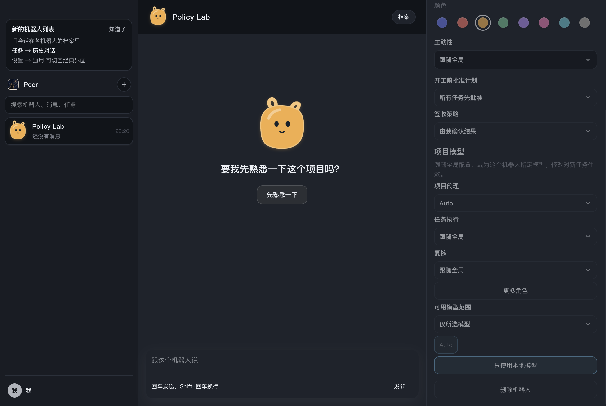

# Beta 1–3 桌面集成补修

日期：2026-09-30。来源：负责人要求复核前 3 个 Beta，并补齐发现的遗漏。

## 卡片

Beta 1–3 已接受能力的集成补修。范围包含生产装配、回复与任务事实、生命周期、卡片交互和机器人策略设置，不开启 Beta4 能力。

## 分支与提交

- 代码与知识分支：`PeerAgent/pa/beta123-integration-repair`。
- 代码目标分支：`PeerAgent/dev/0.1.0`；知识目标分支：`main`。
- 具体提交与 PR 见对应仓库的交接 PR。

## 改了什么

| 审查遗漏 | 补修与回归 |
|---|---|
| 正式宿主缺模型解析 | 项目代理和任务都使用现有 ModelRouter，传入项目策略并冻结任务选择 |
| 默认调度 Provider 未接监督者 | 安装调用时解析的监督者与持久化账本，实测 Projection → Grant → Evidence |
| 拒绝的 post_reply 仍可变成回复 | 只接受成功 Tool Result，使用宿主校验后的结构化消息 |
| 任务名册与唤醒事实没有进模型上下文 | 进入 turnProfile.context，经已注册的 project-roster Source 放入 L7 |
| 熟悉项目、空项目职责、README、verified 记忆没有生产调用 | 调度只读 research；保存 stated 职责；用户接受后创建 docs；核验通过且有来源才写 verified 记忆 |
| 错误终态变成空成功回复 | error / aborted / interrupted 与流错误进入失败；无有效用户回复生成可重试卡 |
| 回合与回复 id 重启冲突 | 回合 UUID；重启恢复原输入，不重复用户消息 |
| 确认结果、README、重试卡缺操作链 | 补 IPC、preload、应用服务、Renderer；检查归属、状态和重复点击 |
| 批准、签收、模型策略缺保存与界面 | 更新档案前整体校验；自定义下拉、模型范围和本地限制；列表保留完整档案，保存后立即刷新 |

额外发现并修复：任务完成不等于已签收；复核结束退出 verifying；小结保留任务、结论与 Evidence 引用；来源归属覆盖模型列表 50 条以外的任务；宿主退出释放安装端口。下拉的字符勾号替换为 SVG。

## 与卡片的偏差

这次由负责人直接授权补审查遗漏，跨越原来的多张卡，不按单卡文件范围拆开。新增独立的项目事实、策略校验、生命周期效果 Module，集中装配逻辑；`main.mjs` 净增 0 行，无新依赖、无新 sendMessage 参数。

## 验证

- `pnpm build`、`pnpm typecheck`、`pnpm architecture:check`、桌面 `ipc:check` 通过。
- 定向命令：`node --test apps/desktop/electron/main/project-agent/*.test.mjs apps/desktop/electron/main/agent-host/agent-turn-executor.test.mjs packages/runtime-node/src/project-agent/*.test.mjs`；228 通过，0 失败、0 取消、0 跳过。
- 全量 `pnpm test` 通过：6456 通过、0 失败、0 取消、5 个既有跳过。新增用例无跳过。测试使用隔离目录和脚本模型服务，未发出真实模型请求。
- 新增测试：`beta-integration.test.mjs`、`desktop-integration.test.mjs`；补取消桥接和小结引用持久化测试。
- 隔离 Electron 源码实例：实际点击计划批准、签收、固定模型、范围与本地限制，检查磁盘档案，并关闭、重开档案验证显示值；检查无原生 select、勾号为 SVG。

## 架构影响

沿用 Provider → Manifest → Projection → Tool Call → PermissionGrant → Evidence。Renderer 只经契约 IPC 交互，权限与执行留在本地宿主；L7 只接收事实，L6 只保留行为提醒。新策略字段属于既有 BotProfile，旧档案读取默认值，不批量重写。完整项目事实集合是宿主内部查询，模型 list_sessions 仍限 50 条。

## 文档偏差

前三个 Beta 的模块与标签已经发布，但生产装配并未形成完整可用链路。本文记录补修证据，不把已发布标签等同于真实场景验收通过。

## 未完成与后续

- Beta1 真实关窗运行、视觉复核与安装包冒烟尚未补证。
- Beta2 三个真实项目的模型全链路与熟悉项目记忆查撤端到端尚未补证。
- Beta3 真实插话/证据/送达/升级与连续日用 5 天尚未补证。
- 实际安装升级、降级矩阵尚未运行。本次源码 UI 冒烟不代替安装包验收。
- 开发线 CI 待 PR 执行。合入由负责人决定，本次不打新 tag、不改发布状态。
